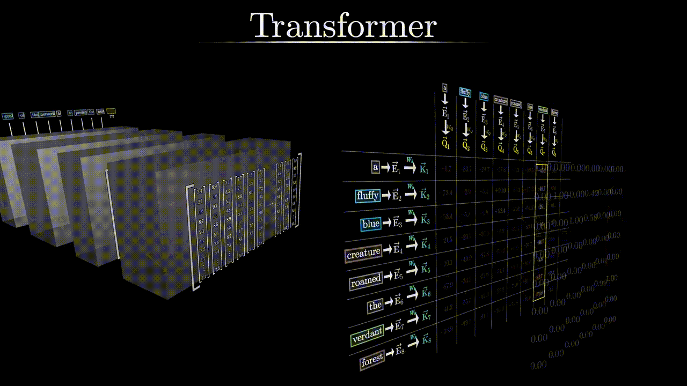
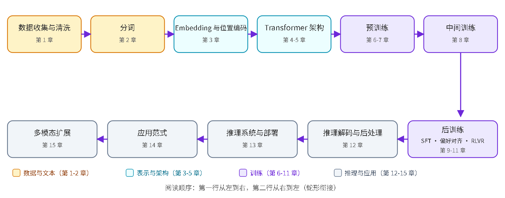
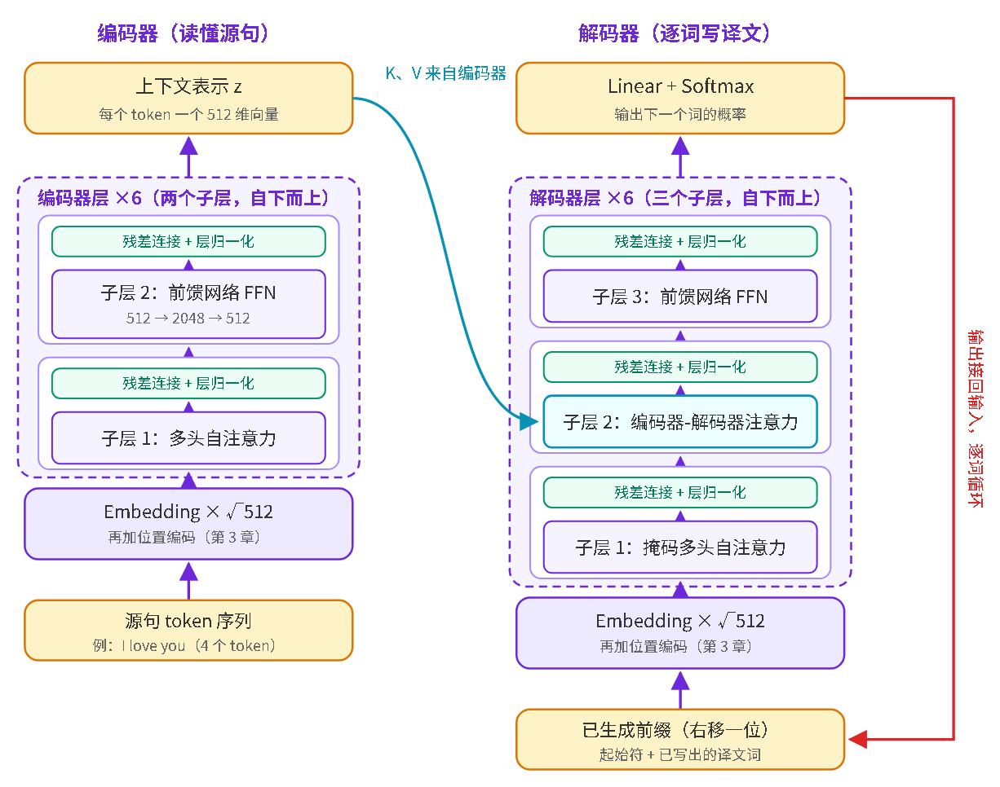

# LLM 机制学习手册

　　中文 | [English](README_en.md)

　　[](https://github.com/chenchen8486/LLM_learning/stargazers)
　　[](#内容骨架)

　　一套可离线浏览的中文 LLM 全链路手册：从训练数据、分词、Transformer 架构，一路讲到预训练、后训练、推理部署与应用范式，逐条机制拆开讲透。带公式推导、原创示意图（页面内 SVG）与真实代码印证，讲解对标高校公开课，先直觉类比再上公式，非本专业读者也能跟着读懂。

　　在线直接看（推荐，无需克隆）：<https://chenchen8486.github.io/LLM_learning/>。从侧边栏按章节顺序阅读即可。

<div align="center">
  
  <br/>
  <sub>注意力机制动画示意（画面风格引自 3Blue1Brown《Attention in transformers》）</sub>
</div>





## 这套手册有什么不一样

- 全链路，不跳步：按 LLM 生命周期组织，第 0 章到第 15 章覆盖数据 → 分词 → 词向量与位置编码 → 架构 → 预训练 → 中间训练 → 后训练（SFT / 偏好对齐 / 推理训练）→ 推理与后处理 → 部署优化 → 应用范式 → 多模态，一条主线走完。
- 机制讲透，不贴术语：每个术语都有最小可用解释，关键公式逐符号注解，抽象机制配原创示意图（矩阵、注意力、KV Cache、量化、投机采样都有图）。
- 有代码印证：机制描述对照开源项目 [minimind](https://github.com/jingyaogong/minimind) 的 PyTorch 实现，引用处标注文件名与行号，理论和能跑的小模型对得上。
- 附录补齐前置数学：向量与旋转、点积与余弦相似度、softmax 与温度、交叉熵与困惑度、反向传播、激活与归一化、幂律与对数坐标等 13 节，看不懂正文时回头补。
- 可个人标注：阅读时选中文字即可五色马克笔高亮，支持换色、删除、清空与导出备份。标注只存在你自己的浏览器里（localStorage），不上传、不进仓库。

## 内容骨架

```
第 0 章  全景导论：LLM 流水线总览
第 1 章  训练数据：收集、清洗、去重、配比与合成数据
第 2 章  分词：文本如何变成 Token
第 3 章  词向量与位置编码（含长度外推）
第 4 章  Transformer 架构精讲
第 5 章  现代架构变体与效率改进（RMSNorm / SwiGLU / GQA / MLA / MoE 等）
第 6 章  预训练：目标、优化与 Scaling Law
第 7 章  预训练工程：分布式并行、混合精度、稳定性与算力估算
第 8 章  中间训练（Mid-training）：长上下文扩展与领域适配
第 9 章  后训练 I：监督微调与参数高效微调（SFT / LoRA）
第 10 章 后训练 II：偏好对齐（RLHF / PPO / DPO 家族 / 安全对齐）
第 11 章 后训练 III：推理能力训练（RLVR / GRPO / 长思维链）
第 12 章 推理机制与后处理：解码策略、停止条件、结构化输出
第 13 章 推理系统与部署：KV Cache、量化、蒸馏、投机采样、推理时扩展
第 14 章 应用范式：Prompt / CoT / RAG / Function Calling / Agent
第 15 章 多模态扩展：ViT、CLIP、连接器、VLM 训练流水线、统一架构
附录     数学与深度学习基础速览（A.1–A.13）
```

　　每章拆成若干页面，页面内用“快速浏览卡片、正文、图、要点回顾、参考来源”的统一结构组织。第 4 章以 Attention 原论文译文为依据，其余章节以原始论文（arXiv）与官方技术报告为依据，每页末尾附出处。

## 本地直接阅读（无需构建）

　　成品页面已随库发布：克隆后用浏览器打开 `output/html/ch0_1_what_is_llm.html`，从侧边栏逐章阅读。公式与字体走 CDN（KaTeX、Noto Sans SC），首次打开需联网一次。

## 重新构建（仅改动正文后需要）

```bash
python output/html/build.py
```

　　正文源文件在 `output/html/pages/`，构建产物（`output/html/ch*.html`）也提交在库中，构建只是重新生成它们。

## 目录结构

```
LLM_learning/
├── README.md / README_en.md  # 中文与英文说明
├── LICENSE                 # 正文许可（CC BY-NC-SA 4.0）
├── assets/                 # README 预览图
├── docs/                   # 开发方案、编写规范与发布材料
├── ref_paper/              # 参考论文（只读素材）
├── minimind-master/        # 可读代码参考（Apache 2.0，上游 jingyaogong/minimind）
└── output/html/
    ├── build.py            # 构建脚本
    ├── template.html       # 页面骨架
    ├── static/global.css   # 全局样式
    ├── static/annotate.js  # 页面标注工具（数据存浏览器本地）
    ├── pages/              # 页面片段（手册正文源文件）
    └── ch*.html            # 构建产物（可离线直接打开）
```

## 素材与出处

- 第 4 章以 `ref_paper/2016_attention_is_all_you_need/` 的论文译文为唯一依据。
- 正文中的代码对照引用自 minimind（Apache 2.0），引用处均注明文件与行号。
- 其余章节内容以原始论文（arXiv）与官方技术报告为依据，每页末尾附参考来源。

## 鸣谢

　　本手册的代码对照离不开开源项目 [minimind](https://github.com/jingyaogong/minimind)（作者 jingyaogong，Apache 2.0 许可证）。minimind 用极简代码完整实现了从分词、RoPE、RMSNorm、SwiGLU、GQA 到预训练与微调的全流程，本手册多章以其源码作为机制描述的工程印证，引用处均在页面内注明出处文件。`minimind-master/` 目录为其上游仓库的只读副本，保留原始 `LICENSE`，一切权利归原作者所有。在此向作者及项目贡献者致谢。

## 许可证

　　手册正文采用 CC BY-NC-SA 4.0（署名-非商业性使用-相同方式共享）许可协议：欢迎自由阅读、引用与分享，禁止商业使用。协议全文见根目录 [LICENSE](LICENSE)。`minimind-master/` 目录遵循其原有 Apache 2.0 许可证（详见该目录下的 `LICENSE` 文件），`ref_paper/` 目录的著作权归原论文作者与出版方所有。

---

　　如果这本手册帮你理清了某个机制，欢迎点个 Star 让更多人看到。发现错误或有想补充的章节，提 Issue 即可。
