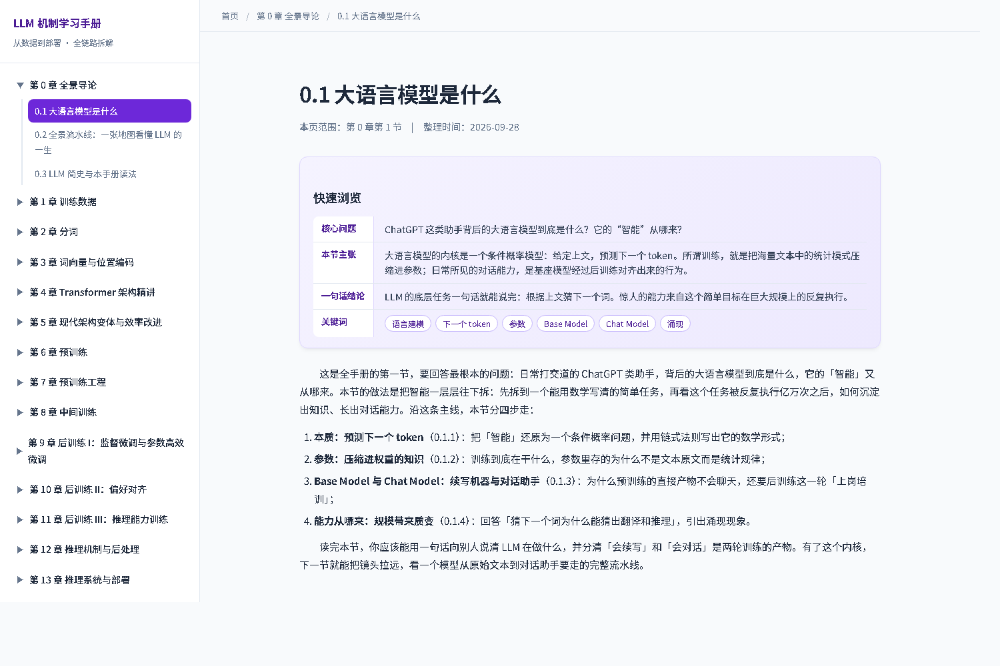
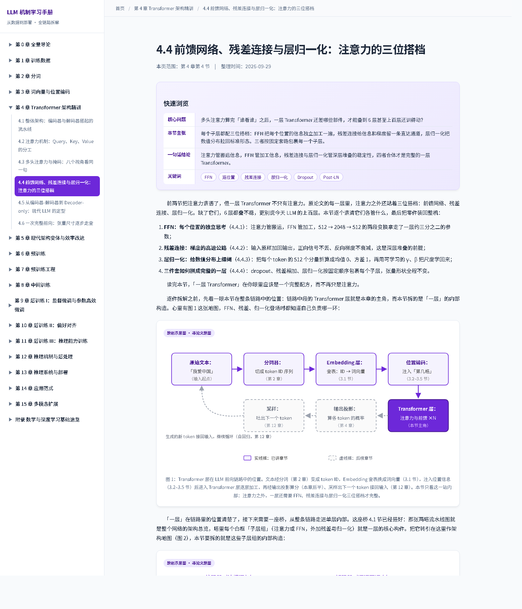
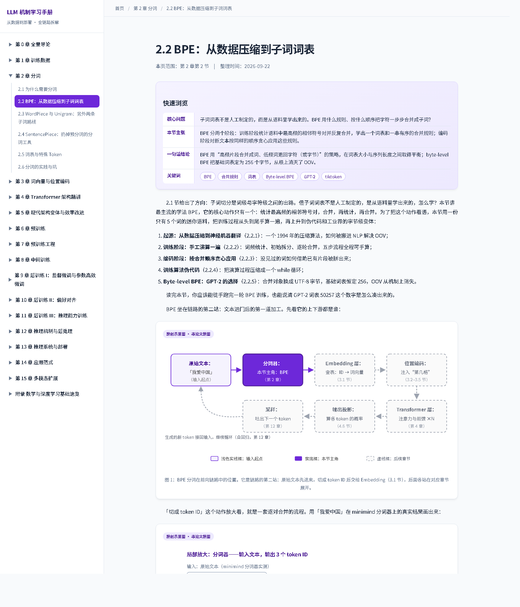

# LLM Mechanics Handbook (Chinese)

[](https://github.com/chenchen8486/LLM_learning/stargazers)
[](#table-of-contents)

**An offline-friendly, fully illustrated Chinese handbook on how large language models actually work — from training data all the way to deployment.**

Every mechanism is explained from first principles: intuition first, then the math. Formulas are rendered with KaTeX, abstract ideas come with hand-drawn SVG diagrams, and each mechanism is cross-checked against a real PyTorch implementation.

> The handbook itself is written in Chinese. This file is the English entry point for readers who want to evaluate or share the project.

## Read it online

No clone, no install — just open the sidebar and read chapter by chapter:

**https://chenchen8486.github.io/LLM_learning/output/html/ch0_1_what_is_llm.html**

## What makes it different

- **Full pipeline, no gaps** — follows the LLM lifecycle: data collection and cleaning, tokenization, embeddings and positional encoding, Transformer architecture, pre-training, mid-training, post-training (SFT / preference alignment / reasoning training), decoding, inference serving, application patterns, and multimodal extensions.
- **Mechanisms, not jargon** — every term gets a minimal working explanation, key formulas are annotated symbol by symbol, and abstract mechanisms come with original diagrams.
- **Code-checked** — mechanism descriptions are verified against the PyTorch implementation of [minimind](https://github.com/jingyaogong/minimind), with file names and line numbers cited.
- **Prerequisites included** — a 13-section appendix covers vectors and rotation, dot products and cosine similarity, softmax and temperature, cross-entropy and perplexity, backpropagation, activation and normalization functions, power laws and log scales, and more.

## Preview





## Table of contents

```
Ch. 0   Overview: the LLM pipeline end to end
Ch. 1   Training data: collection, cleaning, dedup, mixture, synthetic data
Ch. 2   Tokenization: how text becomes tokens
Ch. 3   Word embeddings and positional encoding (incl. length extrapolation)
Ch. 4   Transformer architecture in depth
Ch. 5   Modern architectural variants and efficiency (RMSNorm / SwiGLU / GQA / MLA / MoE)
Ch. 6   Pre-training: objectives, optimization and scaling laws
Ch. 7   Pre-training engineering: parallelism, mixed precision, stability, compute budgeting
Ch. 8   Mid-training: long-context extension and domain adaptation
Ch. 9   Post-training I: supervised fine-tuning and PEFT (SFT / LoRA)
Ch. 10  Post-training II: preference alignment (RLHF / PPO / DPO family / safety)
Ch. 11  Post-training III: reasoning training (RLVR / GRPO / long chain-of-thought)
Ch. 12  Inference mechanics and post-processing: decoding, stopping, structured output
Ch. 13  Inference serving and deployment: KV cache, quantization, distillation, speculative decoding, test-time scaling
Ch. 14  Application patterns: prompting / CoT / RAG / function calling / agents
Ch. 15  Multimodal extensions: ViT, CLIP, connectors, VLM training, unified architectures
App.    Math and deep learning refresher (A.1–A.13)
```

## Read locally (no build required)

Prebuilt pages are committed. Clone the repo and open `output/html/ch0_1_what_is_llm.html` in a browser, then navigate via the sidebar. Formulas and fonts load from a CDN (KaTeX, Noto Sans SC), so an internet connection is needed on first open.

## Rebuild (only needed after editing content)

```bash
python output/html/build.py
```

Source fragments live in `output/html/pages/`; the build merely regenerates the committed output under `output/html/`.

## Repository layout

```
LLM_learning/
├── README.md / README_en.md
├── LICENSE
├── assets/                 # preview images for README
├── docs/                   # writing guide and development plan
├── ref_paper/              # reference papers (read-only source material)
├── minimind-master/        # readable reference implementation (Apache 2.0, upstream jingyaogong/minimind)
└── output/html/
    ├── build.py            # build script
    ├── template.html       # page shell
    ├── static/global.css   # global styles
    ├── pages/              # source fragments (handbook content)
    └── ch*.html            # build output (openable offline)
```

## Sources and credit

- Chapter 4 is based solely on the Chinese translation of the original "Attention Is All You Need" paper under `ref_paper/`.
- Code comparisons reference minimind (Apache 2.0); every citation includes file and line numbers.
- All other chapters are grounded in original papers (arXiv) and official technical reports, listed at the end of each page.

　　This handbook's code comparisons would not be possible without the open-source project [minimind](https://github.com/jingyaogong/minimind) by jingyaogong (Apache 2.0). minimind implements the full pipeline — tokenization, RoPE, RMSNorm, SwiGLU, GQA, pre-training and fine-tuning — in remarkably little code, and several chapters use its source as the engineering cross-check, citing exact files inline. The `minimind-master/` directory is a read-only copy of the upstream repository and retains its original `LICENSE`; all rights belong to the original author. Thanks to the author and all contributors.

## License

　　Content is released under **CC BY-NC-SA 4.0** (see [LICENSE](LICENSE)): read, cite and share freely; commercial use is not permitted. `minimind-master/` keeps its original Apache 2.0 license. You are welcome to read, cite, and share; a Star helps more readers find it, and issues for corrections or missing topics are appreciated.
