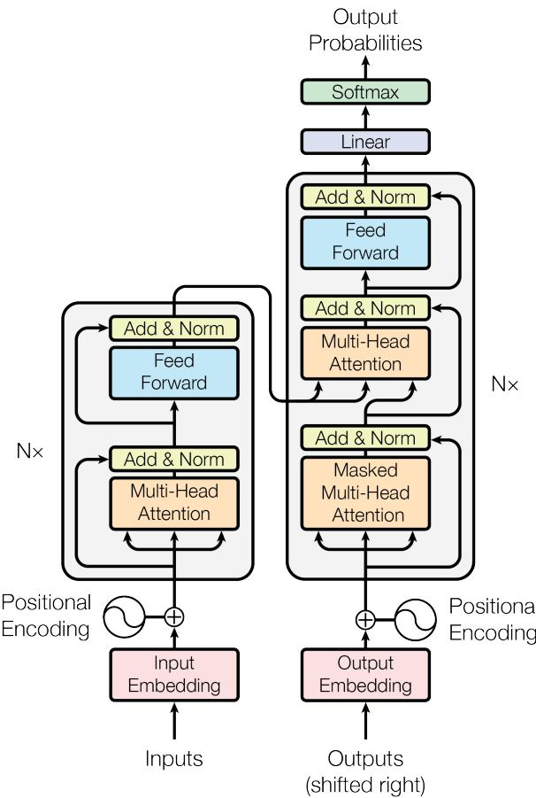
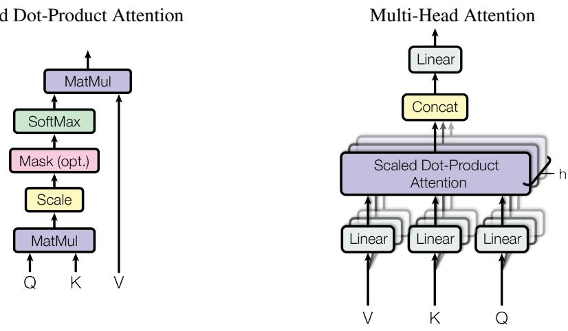
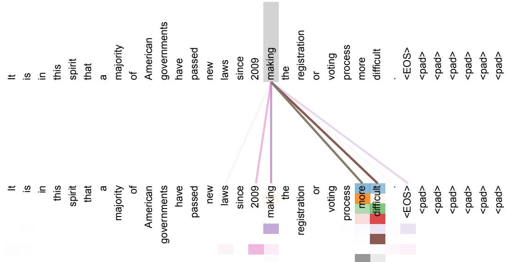
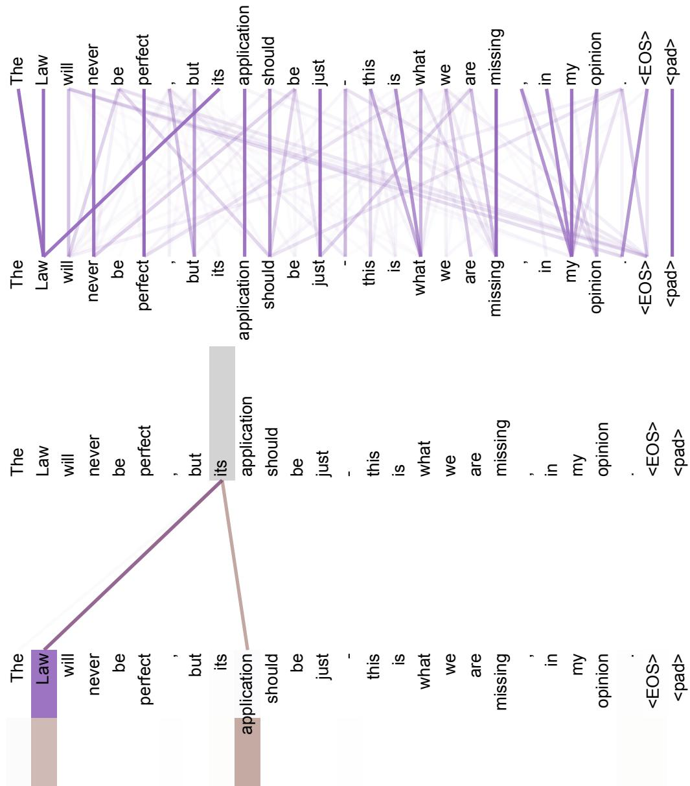
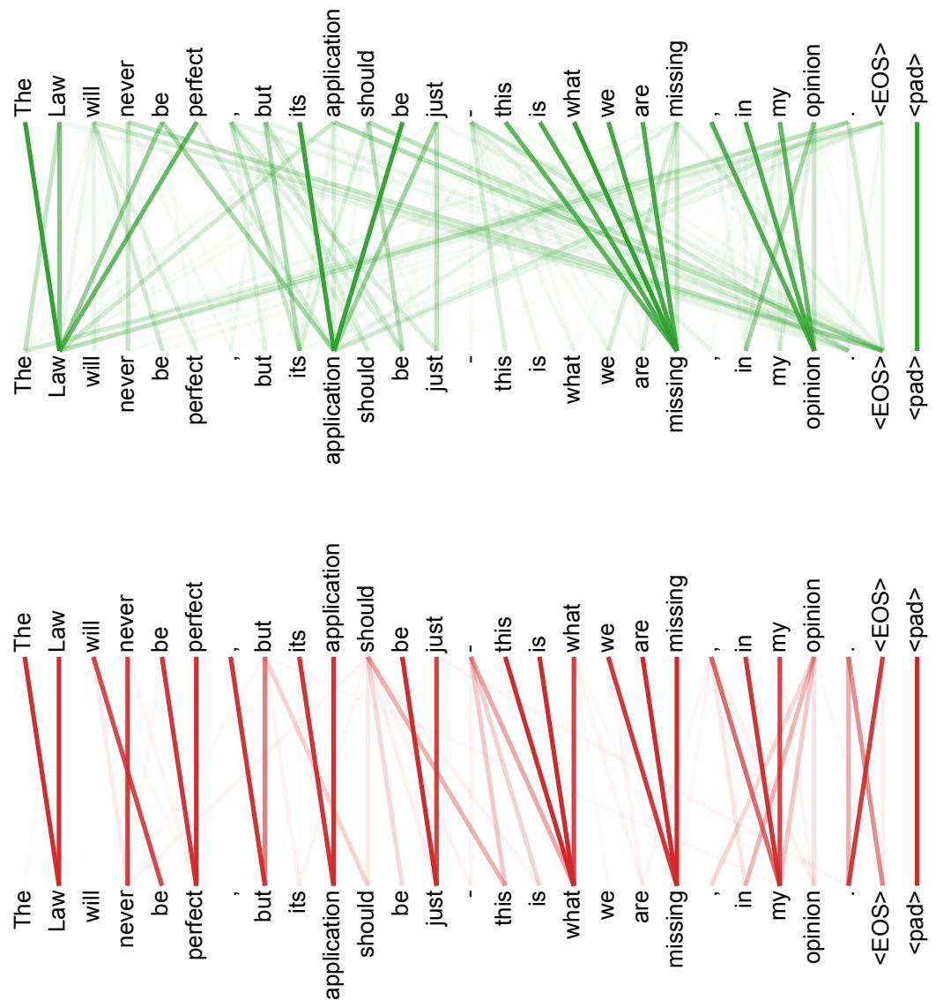

在提供适当署名的前提下，谷歌特此授权复制本文中的表格和图片，仅限用于新闻或学术作品。

# 注意力机制即一切

Ashish Vaswani∗ Google Brain avaswani@google.com

Noam Shazeer∗ Google Brain noam@google.com

Niki Parmar∗ Google Research nikip@google.com

Jakob Uszkoreit∗ Google Research usz@google.com

Llion Jones∗ Google Research llion@google.com

Aidan N. Gomez∗ † 多伦多大学 aidan@cs.toronto.edu

Łukasz Kaiser∗ Google Brain lukaszkaiser@google.com

Illia Polosukhin∗ ‡ illia.polosukhin@gmail.com

## 摘要

主流的序列转换模型基于复杂的循环或卷积神经网络，这些网络包含编码器和解码器。性能最佳的模型还通过注意力机制连接编码器和解码器。我们提出了一种新的简单网络架构——Transformer，它完全基于注意力机制，完全摒弃了循环和卷积。在两个机器翻译任务上的实验表明，这些模型在质量上更优，同时具有更高的并行性，并且训练所需时间显著减少。我们的模型在WMT 2014英德翻译任务上达到了28.4 BLEU，比现有最佳结果（包括集成方法）提高了超过2 BLEU。在WMT 2014英法翻译任务上，我们的模型在八块GPU上训练3.5天后，建立了新的单模型最先进BLEU分数41.8，这仅是文献中最佳模型训练成本的一小部分。我们通过将Transformer成功应用于英语成分句法分析（无论是大规模还是有限训练数据），展示了其良好的泛化能力。

## 1 引言

循环神经网络，特别是长短期记忆网络[13]和门控循环神经网络[7]，已被牢固确立为序列建模和转换问题（如语言建模和机器翻译[35, 2, 5]）的最先进方法。此后，众多研究不断推动循环语言模型和编码器-解码器架构的边界[38, 24, 15]。

循环模型通常沿着输入和输出序列的符号位置进行因子化计算。通过将位置与计算时间步对齐，它们生成一系列隐藏状态$h_t$，作为前一个隐藏状态$h_{t-1}$和位置t输入的函数。这种固有的顺序性质阻碍了训练样本内的并行化，这在序列长度较长时变得至关重要，因为内存限制限制了跨样本的批处理。最近的工作通过因子化技巧[21]和条件计算[32]在计算效率上取得了显著改进，同时在后一种情况下还提升了模型性能。然而，顺序计算的根本约束仍然存在。

注意力机制已成为各类任务中序列建模和转换模型不可或缺的组成部分，它能够建模输入或输出序列中任意距离的依赖关系 [2, 19]。然而，除少数情况外 [27]，这类注意力机制通常与循环网络结合使用。

在本工作中，我们提出Transformer模型架构，该架构摒弃循环结构，完全依赖注意力机制来捕捉输入与输出之间的全局依赖关系。Transformer实现了显著的并行化能力，在八块P100 GPU上仅需训练十二小时，即可在翻译质量上达到新的最优水平。

## 2 背景

减少序列计算的目标也是扩展神经GPU [16]、ByteNet [18] 和 ConvS2S [9] 的基础，这些模型均以卷积神经网络为基本构建模块，并行计算所有输入和输出位置的隐藏表示。在这些模型中，关联任意两个输入或输出位置信号所需的操作次数随位置距离增长——ConvS2S呈线性增长，ByteNet呈对数增长。这使得远距离位置间的依赖关系学习更加困难 [12]。而在Transformer中，该操作次数被降为常数，但代价是通过平均注意力加权位置降低了有效分辨率——我们通过第3.2节描述的多头注意力机制来抵消这一影响。

自注意力（亦称内部注意力）是一种注意力机制，通过关联单个序列的不同位置来计算序列表示。自注意力已成功应用于阅读理解、抽象式摘要、文本蕴含及学习任务无关的句子表示等多种任务 [4, 27, 28, 22]。

端到端记忆网络基于循环注意力机制而非序列对齐的循环结构，已在简单语言问答和语言建模任务中展现出优异性能 [34]。

然而据我们所知，Transformer是首个完全依赖自注意力计算输入和输出表示、且不使用序列对齐RNN或卷积的转换模型。在后续章节中，我们将描述Transformer架构，阐述自注意力的动机，并讨论其相较于 [17, 18] 和 [9] 等模型的优势。

## 3 模型架构

大多数具有竞争力的神经序列转导模型都采用编码器-解码器结构[5, 2, 35]。其中，编码器将输入符号表示序列 $( x _ { 1 } , . . . , x _ { n } )$ 映射为连续表示序列 $\textbf { z } = ~ ( z _ { 1 } , . . . , z _ { n } )$。给定 z，解码器随后逐个元素地生成输出符号序列 $\left( y _ { 1 } , . . . , y _ { m } \right)$。每一步模型都是自回归的[10]，即在生成下一个符号时，会将先前生成的符号作为额外输入。

  
图1：Transformer - 模型架构。

Transformer 遵循这一整体架构，在编码器和解码器中均使用堆叠的自注意力机制和逐点全连接层，分别如图1的左半部分和右半部分所示。

## 3.1 编码器和解码器堆栈

编码器：编码器由 N = 6 个相同层的堆栈组成。每一层包含两个子层。第一个子层是多头自注意力机制，第二个子层是简单的、位置逐点的全连接前馈网络。我们在每个子层周围采用残差连接[11]，随后进行层归一化[1]。也就是说，每个子层的输出为 LayerNorm(x + Sublayer(x))，其中 Sublayer(x) 是子层本身实现的函数。为便于这些残差连接，模型中的所有子层以及嵌入层都输出维度为 $d _ { \mathrm { m o d e l } } = 5 1 2$ 的结果。

解码器：解码器同样由 N = 6 个相同层的堆栈组成。除了每个编码器层中的两个子层外，解码器还插入第三个子层，该子层对编码器堆栈的输出执行多头注意力。与编码器类似，我们在每个子层周围采用残差连接，随后进行层归一化。我们还修改了解码器堆栈中的自注意力子层，以防止位置关注后续位置。这种掩码操作，结合输出嵌入偏移一个位置的事实，确保对位置 i 的预测只能依赖于小于 i 的位置上的已知输出。

## 3.2 注意力

注意力函数可以描述为将查询和一组键值对映射到输出，其中查询、键、值和输出均为向量。输出计算为值的加权和，

  
图2：（左）缩放点积注意力。（右）多头注意力由多个并行运行的注意力层组成。

其中每个值的权重由查询与对应键的兼容性函数计算得出。

## 3.2.1 缩放点积注意力

我们将这种特定的注意力机制称为“缩放点积注意力”（图2）。其输入包括维度为 $d_k$ 的查询和键，以及维度为 $\sqrt{d_v}$ 的值。我们计算查询与所有键的点积，每个结果除以 $\sqrt{d_k}$，然后应用 softmax 函数来获得值的权重。

在实际应用中，我们同时对一组查询计算注意力函数，这些查询被组合成一个矩阵 $Q$。键和值也分别组合成矩阵 $K$ 和 $V$。输出矩阵的计算方式如下：

$$
\mathrm{Attention}(Q, K, V) = \mathrm{softmax}\left(\frac{QK^T}{\sqrt{d_k}}\right)V \tag{1}
$$

两种最常用的注意力函数是加性注意力 [2] 和点积（乘法）注意力。点积注意力与我们的算法相同，只是缺少缩放因子 $\frac{1}{\sqrt{d_k}}$。加性注意力则使用一个带单隐藏层的前馈网络来计算兼容性函数。虽然两者在理论复杂度上相似，但点积注意力在实践中更快且更节省空间，因为它可以利用高度优化的矩阵乘法代码实现。

对于较小的 $d_k$ 值，两种机制表现相似；但对于较大的 $d_k$ 值，加性注意力优于未缩放的的点积注意力 [3]。我们推测，当 $d_k$ 较大时，点积的数值会变得很大，从而将 softmax 函数推入梯度极小的区域 [4]。为了抵消这种影响，我们通过 $\frac{1}{\sqrt{d_k}}$ 来缩放点积。

## 3.2.2 多头注意力

与其使用 $d_{\mathrm{model}}$ 维的键、值和查询来执行单一的注意力函数，我们发现将查询、键和值分别通过不同的、可学习的线性投影 h 次，投影到 $d_k$、$d_k$ 和 $d_v$ 维度是有益的。然后，我们对这些投影后的查询、键和值的每个版本并行执行注意力函数，得到 $d_v$ 维的输出值。这些输出值被拼接起来，并再次进行投影，得到最终的值，如图 2 所示。

多头注意力允许模型在不同位置共同关注来自不同表示子空间的信息。使用单个注意力头时，平均操作会抑制这种能力。

$$
\begin{array}{r}
\begin{array}{rl}
& \mathrm{MultiHead}(Q, K, V) = \mathrm{Concat}(\mathrm{head}_1, ..., \mathrm{head}_{\mathrm{h}})W^O \\
& \qquad \mathrm{where~head}_{\mathrm{i}} = \mathrm{Attention}(QW_i^Q, KW_i^K, VW_i^V)
\end{array}
\end{array}
$$

其中，投影矩阵为 $\begin{array} { r } { W _ { i } ^ { Q } \in \mathbb { R } ^ { d _ { \operatorname* { m o d e l } } \times d _ { k } } , W _ { i } ^ { K } \in \mathbb { R } ^ { d _ { \operatorname* { m o d e l } } \times d _ { k } } , W _ { i } ^ { V } \in \mathbb { R } ^ { d _ { \operatorname* { m o d e l } } \times d _ { \imath } } } \end{array}$ 和 $W ^ { O } \in \mathbb R ^ { \bar { h } d _ { v } \times d _ { \mathrm { m o d e l } } }$。

在本工作中，我们使用了 $h \ : = \ : 8$ 个并行注意力层，即注意力头。对于每个头，我们设置 $d _ { k } = d _ { v } = d _ { \mathrm { m o d e l } } / h \stackrel {  } { = } \dot { 6 } 4$。由于每个头的维度降低，总计算成本与使用全维度的单头注意力相似。

## 3.2.3 注意力在模型中的应用

Transformer 以三种不同方式使用多头注意力：

• 在“编码器-解码器注意力”层中，查询来自前一个解码器层，而记忆键和值来自编码器的输出。这使得解码器中的每个位置都能关注输入序列中的所有位置。这模仿了序列到序列模型（如 [38, 2, 9]）中典型的编码器-解码器注意力机制。

• 编码器包含自注意力层。在自注意力层中，所有键、值和查询都来自同一位置，即编码器中前一层的输出。编码器中的每个位置都能关注编码器前一层的所有位置。

• 类似地，解码器中的自注意力层允许解码器中的每个位置关注解码器中直到该位置（包括该位置）的所有位置。我们需要防止解码器中的信息向左流动，以保持自回归特性。我们通过在缩放点积注意力中屏蔽（设置为 −∞）softmax 输入中所有对应非法连接的值来实现这一点。参见图 2。

## 3.3 位置级前馈网络

除了注意力子层外，编码器和解码器中的每一层都包含一个全连接的前馈网络，该网络分别且相同地应用于每个位置。它由两个线性变换组成，中间有一个 ReLU 激活函数。

$$
\mathrm { F F N } ( x ) = \operatorname* { m a x } ( 0 , x W _ { 1 } + b _ { 1 } ) W _ { 2 } + b _ { 2 }\tag{2}
$$

虽然线性变换在不同位置上是相同的，但它们在层与层之间使用不同的参数。另一种描述方式是将其视为两个核大小为 1 的卷积。输入和输出的维度为 $d _ { \mathrm { m o d e l } } = 5 1 2$，内层维度为 $d _ { f f } = 2 0 4 8$。

## 3.4 嵌入和 Softmax

与其他序列转换模型类似，我们使用学习到的嵌入将输入和输出令牌转换为维度为 $d _ { \mathrm { m o d e l } }$ 的向量。我们还使用常规的学习线性变换和softmax函数将解码器输出转换为预测的下一个令牌概率。在我们的模型中，我们在两个嵌入层和softmax之前的线性变换之间共享相同的权重矩阵，类似于[30]。在嵌入层中，我们将这些权重乘以 $\sqrt { d _ { \mathrm { { m o d e l } } } }$。

表1：不同层类型的最大路径长度、每层复杂度和最小顺序操作数。n是序列长度，d是表示维度，k是卷积核大小，r是受限自注意力中的邻域大小。
<table><tr><td>层类型</td><td>每层复杂度</td><td>顺序操作数</td><td>最大路径长度</td></tr><tr><td>自注意力</td><td> $\overline { { O ( n ^ { 2 } \cdot d ) } }$ </td><td>0(1)</td><td>0(1)</td></tr><tr><td>循环</td><td> $O ( n \cdot d ^ { 2 } )$ </td><td>O(n)</td><td> $O ( n )$ </td></tr><tr><td>卷积</td><td> $O ( k \cdot n \cdot \dot { d } ^ { 2 } )$ </td><td>0(1)</td><td> $O ( l o g _ { k } ( n ) )$ </td></tr><tr><td>自注意力（受限）</td><td> ${ \dot { O ( r \cdot n \cdot d ) } }$ </td><td>0(1)</td><td> $O ( n / r )$ </td></tr></table>

## 3.5 位置编码

由于我们的模型不包含循环和卷积，为了让模型利用序列的顺序信息，我们必须注入关于序列中令牌相对或绝对位置的信息。为此，我们在编码器和解码器堆栈底部的输入嵌入中添加了“位置编码”。位置编码与嵌入具有相同的维度 $d _ { \mathrm { m o d e l } }$，以便两者可以相加。位置编码有多种选择，可以是学习得到的，也可以是固定的[9]。

在这项工作中，我们使用不同频率的正弦和余弦函数：

$$
\begin{array} { r } { P E _ { ( p o s , 2 i ) } = s i n ( p o s / 1 0 0 0 0 ^ { 2 i / d _ { \mathrm { m o d e l } } } ) } \\ { P E _ { ( p o s , 2 i + 1 ) } = c o s ( p o s / 1 0 0 0 0 ^ { 2 i / d _ { \mathrm { m o d e l } } } ) } \end{array}
$$

其中pos是位置，i是维度。也就是说，位置编码的每个维度对应一个正弦波。波长从2π到10000·2π形成几何级数。我们选择这个函数是因为我们假设它能让模型更容易地通过相对位置进行注意力学习，因为对于任何固定的偏移量k，$P E _ { p o s + k }$ 可以表示为 $P E _ { p o s }$ 的线性函数。

我们还尝试了使用学习到的位置嵌入[9]，并发现两种版本产生了几乎相同的结果（见表3第(E)行）。我们选择正弦波版本，是因为它可能允许模型外推到比训练时遇到的序列长度更长的序列。

## 4 为何选择自注意力机制

本节将自注意力层与常用于将变长符号表示序列 $( x _ { 1 } , . . . , x _ { n } )$ 映射到等长序列 $\left( z _ { 1 } , . . . , z _ { n } \right)$ 的循环层和卷积层进行多方面比较，其中 $x _ { i } , z _ { i } \in \mathbb { R } ^ { d }$，例如典型序列转导编码器或解码器中的隐藏层。我们使用自注意力机制的动机基于三个需求。

一是每层的总计算复杂度。二是可并行化的计算量，以所需的最小顺序操作数衡量。

三是网络中长距离依赖的路径长度。学习长距离依赖是许多序列转导任务中的关键挑战。影响此类依赖学习能力的关键因素之一是网络中前向和后向信号必须经过的路径长度。输入和输出序列中任意位置组合之间的路径越短，学习长距离依赖就越容易[12]。因此，我们还比较了由不同层类型组成的网络中任意两个输入和输出位置之间的最大路径长度。

如表1所示，自注意力层通过恒定数量的顺序执行操作连接所有位置，而循环层需要 $O ( n )$ 个顺序操作。在计算复杂度方面，当序列长度 n 小于表示维度 d 时，自注意力层比循环层更快，这在机器翻译最先进模型（如词片[38]和字节对[31]表示）使用的句子表示中最为常见。为了提升处理极长序列任务的计算性能，自注意力可限制为仅考虑输入序列中以相应输出位置为中心的邻域大小 r。这将使最大路径长度增加到 $O ( n / r )$。我们计划在未来的工作中进一步研究此方法。

一个卷积核宽度为 $k < n$ 的单一卷积层无法连接所有输入和输出位置对。要实现这一连接，在连续卷积核的情况下需要堆叠 $O(n/k)$ 个卷积层，而在扩张卷积[18]的情况下则需要 $O(\log_k(n))$ 个卷积层，这会增加网络中任意两个位置之间最长路径的长度。卷积层通常比循环层成本更高，其计算复杂度是循环层的 $k$ 倍。然而，可分离卷积[6]能显著降低复杂度，达到 $\overset{\cdot}{O}(k \cdot n \cdot d + n \cdot d^2)$。但即使当 $k = n$ 时，可分离卷积的复杂度仍与自注意力层和逐点前馈层的组合相当，而后者正是我们模型所采用的方法。

作为额外的好处，自注意力机制可以产生更具可解释性的模型。我们检查了模型中的注意力分布，并在附录中展示和讨论了相关示例。不仅单个注意力头明显学会了执行不同的任务，许多注意力头还表现出与句子的句法和语义结构相关的行为。

## 5 训练

本节描述我们模型的训练方案。

## 5.1 训练数据与批处理

我们在标准的 WMT 2014 英德数据集上进行了训练，该数据集包含约 450 万个句子对。句子采用字节对编码[3]进行编码，共享的源-目标词汇表包含约 37000 个词元。对于英法翻译，我们使用了规模更大的 WMT 2014 英法数据集，包含 3600 万个句子，并将词元分割为 32000 个词片词汇表[38]。句子对按近似序列长度进行批处理。每个训练批次包含一组句子对，其中包含约 25000 个源语言词元和 25000 个目标语言词元。

## 5.2 硬件与时间安排

我们在配备 8 块 NVIDIA P100 GPU 的单台机器上训练模型。对于使用本文所述超参数的基础模型，每个训练步骤大约需要 0.4 秒。我们总共训练了基础模型 100,000 步，即 12 小时。对于大型模型（如表 3 底行所述），每个步骤耗时 1.0 秒。大型模型训练了 300,000 步（3.5 天）。

## 5.3 优化器

我们使用了 Adam 优化器[20]，参数设置为 $\beta_1 = 0.9$，$\beta_2 = 0.98$，$\epsilon = 10^{-9}$。在训练过程中，我们根据以下公式调整学习率：

$$
lrate = d_{\mathrm{model}}^{-0.5} \cdot \min(step\_num^{-0.5}, step\_num \cdot warmup\_steps^{-1.5}) \tag{3}
$$

这对应于在前 warmup\_steps 个训练步骤中线性增加学习率，之后按步数的平方根倒数成比例减小学习率。我们使用的 warmup\_steps = 4000。

## 5.4 正则化

我们在训练过程中采用了三种正则化方法：

表2：Transformer 在英德和英法 newstest2014 测试集上以更低的训练成本取得了优于先前最先进模型的 BLEU 分数。
<table><tr><td rowspan="2">模型</td><td colspan="2">BLEU</td><td colspan="2">训练成本（FLOPs）</td></tr><tr><td>英-德</td><td>英-法</td><td>英-德</td><td>英-法</td></tr><tr><td>ByteNet [18]</td><td>23.75</td><td></td><td></td><td></td></tr><tr><td>Deep-Att + PosUnk [39]</td><td></td><td>39.2</td><td></td><td> $1 . 0 \cdot 1 0 ^ { 2 0 }$ </td></tr><tr><td>GNMT + RL [38]</td><td>24.6</td><td>39.92</td><td> $2 . 3 \cdot 1 0 ^ { 1 9 }$ </td><td> $1 . 4 \cdot 1 0 ^ { 2 0 }$ </td></tr><tr><td>ConvS2S [9]</td><td>25.16</td><td>40.46</td><td> $9 . 6 \cdot 1 0 ^ { 1 8 }$ </td><td> $1 . 5 \cdot 1 0 ^ { 2 0 }$ </td></tr><tr><td>MoE[32]</td><td>26.03</td><td>40.56</td><td> $2 . 0 \cdot 1 0 ^ { 1 9 }$ </td><td> $1 . 2 \cdot 1 0 ^ { 2 0 }$ </td></tr><tr><td>Deep-Att + PosUnk 集成 [39]</td><td></td><td>40.4</td><td></td><td> $\overline { { 8 . 0 \cdot 1 0 ^ { 2 0 } } }$ </td></tr><tr><td> $\mathrm { G N M T } + \mathrm { R I }$  集成 [38]</td><td>26.30</td><td>41.16</td><td> $1 . 8 \cdot 1 0 ^ { 2 0 }$ </td><td> $1 . 1 \cdot 1 0 ^ { 2 1 }$ </td></tr><tr><td>ConvS2S 集成 [9]</td><td>26.36</td><td>41.29</td><td> $7 . 7 \cdot 1 0 ^ { 1 9 }$ </td><td> $1 . 2 \cdot 1 0 ^ { 2 1 }$ </td></tr><tr><td>Transformer（基础模型）</td><td>27.3</td><td>38.1</td><td> $\mathbf { 3 . 3 \cdot 1 0 ^ { 1 8 } }$ </td><td></td></tr><tr><td>Transformer（大型）</td><td>28.4</td><td>41.8</td><td> $2 . 3 \cdot 1 0 ^ { 1 9 }$ </td><td></td></tr></table>

残差丢弃 我们在每个子层输出上应用丢弃法 [33]，在将其添加到子层输入并进行归一化之前。此外，我们在编码器和解码器堆栈中对嵌入和位置编码的总和也应用了丢弃法。对于基础模型，我们使用的丢弃率为 $P _ { d r o p } = 0 . 1$。

标签平滑 在训练过程中，我们采用了值为 $\epsilon _ { l s } = 0 . 1 [ 3 6 ]$ 的标签平滑。这会降低困惑度，因为模型学会了更加不确定，但提高了准确率和 BLEU 分数。

## 6 结果

## 6.1 机器翻译

在 WMT 2014 英德翻译任务中，大型 Transformer 模型（表2中的 Transformer（大型））比之前最佳报告模型（包括集成模型）高出超过 2.0 BLEU，建立了新的最先进 BLEU 分数 28.4。该模型的配置列在表3的最后一行。训练在 8 块 P100 GPU 上耗时 3.5 天。即使是我们的基础模型，也以远低于任何竞争模型的训练成本，超越了所有先前发布的模型和集成模型。

在WMT 2014英法翻译任务中，我们的大型模型取得了41.0的BLEU分数，超越了所有此前发布的单一模型，且训练成本不到此前最优模型的四分之一。用于英法翻译的Transformer（大型）模型采用了0.1的丢弃率（$P_{drop}=0.1$），而非0.3。

对于基础模型，我们使用了最后5个检查点的平均结果（这些检查点每10分钟保存一次）。对于大型模型，我们平均了最后20个检查点。我们采用波束大小为4的波束搜索，并设置长度惩罚系数$\alpha = 0.6$[38]。这些超参数是在开发集上经过实验后选定的。推理时，我们将最大输出长度设为输入长度+50，并在可能时提前终止[38]。

表2总结了我们的结果，并将我们的翻译质量与训练成本同文献中的其他模型架构进行了比较。我们通过将训练时间、使用的GPU数量以及每个GPU的持续单精度浮点运算能力估计值相乘，来估算训练模型所需的浮点运算次数$^5$。

## 6.2 模型变体

为评估Transformer不同组件的重要性，我们以不同方式调整基础模型，并在开发集newstest2013上衡量英德翻译性能的变化。我们采用上一节所述的波束搜索，但未使用检查点平均。这些结果展示在表3中。

表3：Transformer架构的变体。未列出的值与基础模型相同。所有指标均基于英德翻译开发集newstest2013。列出的困惑度是按字节对编码后的词片计算的，不应与按词计算的困惑度进行比较。
<table><tr><td rowspan="2"></td><td rowspan="2"> $N$   $d _ { \mathrm { m o d e l } }$ </td><td rowspan="2"> $d _ { \mathrm { f f } }$ </td><td rowspan="2">h</td><td rowspan="2"> $d _ { k }$ </td><td rowspan="2"> $d _ { v }$ </td><td rowspan="2"> $P _ { d r o p }$ </td><td rowspan="2"> $\epsilon _ { l s }$ </td><td rowspan="2">训练步数</td><td rowspan="2">困惑度（开发集）</td><td rowspan="2">BLEU（开发集）</td><td rowspan="2">参数  $\times 1 0 ^ { 6 }$ </td></tr><tr><td></td></tr><tr><td>基础</td><td>6</td><td>512</td><td>2048</td><td>8</td><td>64</td><td>64</td><td>0.1</td><td>0.1 100K</td><td></td><td>4.92</td><td>25.8</td><td>65</td></tr><tr><td rowspan="3">(A)</td><td></td><td></td><td>1</td><td>512</td><td>512 128</td><td></td><td></td><td></td><td>5.29</td><td></td><td>24.9</td><td></td></tr><tr><td></td><td></td><td>4</td><td>128</td><td></td><td></td><td></td><td></td><td></td><td>5.00</td><td>25.5</td><td></td></tr><tr><td></td><td></td><td>16 32</td><td>32 16</td><td>32 16</td><td></td><td></td><td></td><td>4.91 5.01</td><td>25.8 25.4</td><td></td><td></td></tr><tr><td>(B)</td><td></td><td></td><td></td><td></td><td>16 32</td><td></td><td></td><td></td><td></td><td>5.16 5.01</td><td>25.1 25.4</td><td>58 60</td></tr><tr><td>(C)</td><td>248 256 1024</td><td>1024 4096</td><td></td><td>32 128</td><td>32 128</td><td></td><td></td><td></td><td></td><td>6.11 5.19 4.88 5.75 4.66 5.12</td><td>23.7 25.3 25.5 24.5 26.0 25.4</td><td>36 50 80 28 168 53</td></tr><tr><td>(D)</td><td></td><td></td><td></td><td></td><td></td><td></td><td>0.0 0.2 0.0</td><td></td><td></td><td>4.75 5.77 4.95</td><td>26.2 24.6 25.5 25.3</td><td>90</td></tr><tr><td>(E)</td><td></td><td>使用位置嵌入代替正弦函数</td><td></td><td></td><td></td><td></td><td></td><td>0.2</td><td></td><td>4.67 5.47</td><td>25.7</td><td></td></tr><tr><td>大型</td><td>6</td><td>1024</td><td>4096 16</td><td></td><td></td><td></td><td>0.3</td><td></td><td>300K</td><td>4.92 4.33</td><td>25.7 26.4</td><td>213</td></tr></table>

在表3的(A)行中，我们改变了注意力头的数量以及注意力键和值的维度，同时保持计算量不变，如第3.2.2节所述。虽然单头注意力比最佳设置低了0.9个BLEU值，但注意力头过多时质量也会下降。

在表3的（B）行中，我们观察到减小注意力键大小 $d _ { k }$ 会损害模型质量。这表明确定兼容性并非易事，且比点积更复杂的兼容性函数可能更有益。我们进一步在（C）和（D）行中观察到，正如预期，更大的模型效果更好，而dropout在避免过拟合方面非常有效。在（E）行中，我们将正弦位置编码替换为学习得到的位置嵌入[9]，并观察到与基础模型几乎相同的结果。

## 6.3 英语成分句法分析

为了评估Transformer能否泛化到其他任务，我们进行了英语成分句法分析实验。该任务面临特定挑战：输出受强结构约束，且长度显著长于输入。此外，RNN序列到序列模型在小数据场景下未能达到最先进水平[37]。

我们在华尔街日报（WSJ）部分的宾州树库[25]（约4万训练句子）上训练了一个4层Transformer，其中 $d _ { m o d e l } = 1 0 2 4$。我们还采用半监督设置进行训练，使用了包含约1700万句子的更大规模高置信度语料库和BerkleyParser语料库[37]。在仅使用WSJ的设置中，我们使用了16K词元的词汇表；在半监督设置中，则使用了32K词元的词汇表。

我们仅进行了少量实验，在Section 22开发集上选择了dropout（包括注意力和残差dropout，见第5.4节）、学习率和束搜索大小，所有其他参数均与英语到德语基础翻译模型保持一致。推理时，我们将最大输出长度增加到输入长度+300。对于仅使用WSJ和半监督设置，我们均使用束搜索大小为21，α=0.3。

**表4：Transformer在英语成分句法分析中的良好泛化能力（结果基于WSJ第23节）**

<table><tr><td>解析器</td><td>训练方式</td><td>WSJ 23 F1值</td></tr><tr><td>Vinyals & Kaiser 等人 (2014) [37] Petrov 等人 (2006) [29]</td><td>仅WSJ，判别式 仅WSJ，判别式</td><td>88.3 90.4</td></tr><tr><td>Zhu 等人 (2013) [40]</td><td>仅WSJ，判别式</td><td>90.4</td></tr><tr><td>Dyer 等人 (2016) [8]</td><td>仅WSJ，判别式</td><td>91.7</td></tr><tr><td>Transformer（4层）</td><td>仅WSJ，判别式</td><td>91.3</td></tr><tr><td>Zhu 等人 (2013) [40]</td><td>半监督</td><td>91.3</td></tr><tr><td>Huang & Harper (2009) [14]</td><td>半监督</td><td>91.3</td></tr><tr><td>McClosky 等人 (2006) [26]</td><td>半监督</td><td>92.1</td></tr><tr><td>Vinyals & Kaiser 等人 (2014)[37]</td><td>半监督</td><td></td></tr><tr><td>Transformer（4层）</td><td></td><td>92.1</td></tr><tr><td>Luong 等人 (2015) [23]</td><td>半监督多任务</td><td>92.7</td></tr><tr><td>Dyer 等人 (2016) [8]</td><td>生成式</td><td>93.0</td></tr><tr><td></td><td></td><td>93.3</td></tr></table>

我们在表4中的结果表明，尽管缺乏针对特定任务的调优，我们的模型表现依然出人意料地好，超越了除循环神经网络语法[8]之外所有先前报告的模型。

与RNN序列到序列模型[37]相比，即使仅在包含4万句子的WSJ训练集上进行训练，Transformer的表现也优于Berkeley解析器[29]。

## 7 结论

在这项工作中，我们提出了Transformer——首个完全基于注意力的序列转换模型，用多头自注意力机制取代了编码器-解码器架构中最常用的循环层。

在翻译任务中，Transformer的训练速度显著快于基于循环层或卷积层的架构。在WMT 2014英德翻译和WMT 2014英法翻译任务中，我们均取得了新的最优结果。在前一项任务中，我们最好的模型甚至超越了所有此前报告的集成模型。

我们对基于注意力的模型的未来充满期待，并计划将其应用于其他任务。我们计划将Transformer扩展到涉及文本以外输入和输出模态的问题，并研究局部受限注意力机制，以高效处理图像、音频和视频等大规模输入和输出。使生成过程减少序列化是我们的另一个研究目标。

我们用于训练和评估模型的代码可在 https://github.com/tensorflow/tensor2tensor 获取。

致谢 我们感谢Nal Kalchbrenner和Stephan Gouws富有成效的评论、修正和启发。

## 参考文献

[1] Jimmy Lei Ba, Jamie Ryan Kiros, and Geoffrey E Hinton. Layer normalization. arXiv preprint arXiv:1607.06450, 2016.

[2] Dzmitry Bahdanau、Kyunghyun Cho 和 Yoshua Bengio。通过联合学习对齐和翻译的神经机器翻译。CoRR，abs/1409.0473，2014年。

[3] Denny Britz、Anna Goldie、Minh-Thang Luong 和 Quoc V. Le。神经机器翻译架构的大规模探索。CoRR，abs/1703.03906，2017年。

[4] Jianpeng Cheng、Li Dong 和 Mirella Lapata。用于机器阅读的长短期记忆网络。arXiv预印本 arXiv:1601.06733，2016年。

[5] Kyunghyun Cho、Bart van Merrienboer、Caglar Gulcehre、Fethi Bougares、Holger Schwenk 和 Yoshua Bengio。使用RNN编码器-解码器学习短语表示以用于统计机器翻译。CoRR，abs/1406.1078，2014年。

[6] Francois Chollet。Xception：使用深度可分离卷积的深度学习。arXiv预印本 arXiv:1610.02357，2016年。

[7] Junyoung Chung、Çaglar Gülçehre、Kyunghyun Cho 和 Yoshua Bengio。门控循环神经网络在序列建模中的实证评估。CoRR，abs/1412.3555，2014年。

[8] Chris Dyer、Adhiguna Kuncoro、Miguel Ballesteros 和 Noah A. Smith。循环神经网络文法。载于NAACL会议论文集，2016年。

[9] Jonas Gehring、Michael Auli、David Grangier、Denis Yarats 和 Yann N. Dauphin。卷积序列到序列学习。arXiv预印本 arXiv:1705.03122v2，2017年。

[10] Alex Graves。使用循环神经网络生成序列。arXiv预印本 arXiv:1308.0850，2013年。

[11] Kaiming He、Xiangyu Zhang、Shaoqing Ren 和 Jian Sun。用于图像识别的深度残差学习。载于IEEE计算机视觉与模式识别会议论文集，第770–778页，2016年。

[12] Sepp Hochreiter、Yoshua Bengio、Paolo Frasconi 和 Jürgen Schmidhuber。循环网络中的梯度流：学习长期依赖的困难，2001年。

[13] Sepp Hochreiter 和 Jürgen Schmidhuber。长短期记忆。神经计算，9(8)：1735–1780，1997年。

[14] Zhongqiang Huang 和 Mary Harper。跨语言使用潜在标注的自训练PCFG文法。载于2009年自然语言处理实证方法会议论文集，第832–841页。ACL，2009年8月。

[15] Rafal Jozefowicz、Oriol Vinyals、Mike Schuster、Noam Shazeer 和 Yonghui Wu。探索语言建模的极限。arXiv预印本 arXiv:1602.02410，2016年。

[16] Łukasz Kaiser 和 Samy Bengio。主动记忆能否替代注意力？载于神经信息处理系统进展（NIPS），2016年。

[17] Łukasz Kaiser 和 Ilya Sutskever。神经GPU学习算法。载于国际学习表征会议（ICLR），2016年。

[18] Nal Kalchbrenner、Lasse Espeholt、Karen Simonyan、Aaron van den Oord、Alex Graves 和 Koray Kavukcuoglu。线性时间神经机器翻译。arXiv预印本 arXiv:1610.10099v2，2017年。

[19] Yoon Kim、Carl Denton、Luong Hoang 和 Alexander M. Rush。结构化注意力网络。载于国际学习表征会议，2017年。

[20] Diederik Kingma 和 Jimmy Ba。Adam：一种随机优化方法。载于ICLR，2015年。

[21] Oleksii Kuchaiev 与 Boris Ginsburg. LSTM网络的因式分解技巧. arXiv预印本 arXiv:1703.10722, 2017.

[22] Zhouhan Lin, Minwei Feng, Cicero Nogueira dos Santos, Mo Yu, Bing Xiang, Bowen Zhou 与 Yoshua Bengio. 结构化自注意力句子嵌入. arXiv预印本 arXiv:1703.03130, 2017.

[23] Minh-Thang Luong, Quoc V. Le, Ilya Sutskever, Oriol Vinyals 与 Lukasz Kaiser. 多任务序列到序列学习. arXiv预印本 arXiv:1511.06114, 2015.

[24] Minh-Thang Luong, Hieu Pham 与 Christopher D Manning. 基于注意力的神经机器翻译有效方法. arXiv预印本 arXiv:1508.04025, 2015.

[25] Mitchell P Marcus, Mary Ann Marcinkiewicz 与 Beatrice Santorini. 构建大型英语标注语料库：宾夕法尼亚树库. 计算语言学, 19(2):313–330, 1993.

[26] David McClosky, Eugene Charniak 与 Mark Johnson. 有效的自训练解析方法. 载于《NAACL人类语言技术会议论文集·主会议》, 第152–159页. ACL, 2006年6月.

[27] Ankur Parikh, Oscar Täckström, Dipanjan Das 与 Jakob Uszkoreit. 可分解注意力模型. 载于《自然语言处理经验方法会议》, 2016.

[28] Romain Paulus, Caiming Xiong 与 Richard Socher. 基于深度强化学习的抽象式摘要模型. arXiv预印本 arXiv:1705.04304, 2017.

[29] Slav Petrov, Leon Barrett, Romain Thibaux 与 Dan Klein. 学习精确、紧凑且可解释的树标注. 载于《第21届国际计算语言学会议及第44届ACL年会论文集》, 第433–440页. ACL, 2006年7月.

[30] Ofir Press 与 Lior Wolf. 利用输出嵌入改进语言模型. arXiv预印本 arXiv:1608.05859, 2016.

[31] Rico Sennrich, Barry Haddow 与 Alexandra Birch. 基于子词单元的罕见词神经机器翻译. arXiv预印本 arXiv:1508.07909, 2015.

[32] Noam Shazeer, Azalia Mirhoseini, Krzysztof Maziarz, Andy Davis, Quoc Le, Geoffrey Hinton 与 Jeff Dean. 超大规模神经网络：稀疏门控混合专家层. arXiv预印本 arXiv:1701.06538, 2017.

[33] Nitish Srivastava, Geoffrey E Hinton, Alex Krizhevsky, Ilya Sutskever 与 Ruslan Salakhutdinov. Dropout：一种防止神经网络过拟合的简单方法. 机器学习研究期刊, 15(1):1929–1958, 2014.

[34] Sainbayar Sukhbaatar, Arthur Szlam, Jason Weston 与 Rob Fergus. 端到端记忆网络. 载于C. Cortes, N. D. Lawrence, D. D. Lee, M. Sugiyama 与 R. Garnett 编《神经信息处理系统进展28》, 第2440–2448页. Curran Associates公司, 2015.

[35] Ilya Sutskever, Oriol Vinyals 与 Quoc VV Le. 基于神经网络的序列到序列学习. 载于《神经信息处理系统进展》, 第3104–3112页, 2014.

[36] Christian Szegedy, Vincent Vanhoucke, Sergey Ioffe, Jonathon Shlens 与 Zbigniew Wojna. 重新思考计算机视觉的Inception架构. CoRR, abs/1512.00567, 2015.

[37] Vinyals & Kaiser, Koo, Petrov, Sutskever, 和 Hinton. 将语法视为外语. 收录于《神经信息处理系统进展》, 2015年.

[38] Yonghui Wu, Mike Schuster, Zhifeng Chen, Quoc V Le, Mohammad Norouzi, Wolfgang Macherey, Maxim Krikun, Yuan Cao, Qin Gao, Klaus Macherey, 等. 谷歌神经机器翻译系统：弥合人机翻译差距. arXiv预印本 arXiv:1609.08144, 2016年.

[39] Jie Zhou, Ying Cao, Xuguang Wang, Peng Li, 和 Wei Xu. 基于前向连接深度循环模型的神经机器翻译. CoRR, abs/1606.04199, 2016年.

[40] Muhua Zhu, Yue Zhang, Wenliang Chen, Min Zhang, 和 Jingbo Zhu. 快速准确的移进-归约成分句法分析. 收录于《第51届ACL年会论文集（第1卷：长论文）》, 第434–443页. ACL, 2013年8月.

注意力可视化  
输入-输入层  
  
图3：注意力机制在编码器自注意力第5层（共6层）中遵循长距离依赖关系的示例。多个注意力头关注动词“making”的远距离依赖，完成短语“making...more difficult”。此处仅显示单词“making”的注意力分布。不同颜色代表不同注意力头。建议彩色查看。

  
图4：同样在第5层（共6层）的两个注意力头，似乎参与了指代消解。上图：第5个注意力头的完整注意力分布。下图：仅针对单词“its”的第5和第6注意力头的孤立注意力分布。注意该单词的注意力分布非常集中。

  
图5：许多注意力头表现出与句子结构相关的行为。以上给出两个示例，分别来自编码器自注意力第5层（共6层）的两个不同注意力头。这些注意力头显然学会了执行不同的任务。