# 一张图像等价于16×16个词：面向大规模图像识别的Transformer

Alexey Dosovitskiy∗,†, Lucas Beyer∗, Alexander Kolesnikov∗, Dirk Weissenborn∗,

Xiaohua Zhai∗, Thomas Unterthiner, Mostafa Dehghani, Matthias Minderer,

Georg Heigold, Sylvain Gelly, Jakob Uszkoreit, Neil Houlsby∗,†

∗同等技术贡献，†同等指导贡献 谷歌研究院，Brain团队 {adosovitskiy, neilhoulsby}@google.com

## 摘要

尽管Transformer架构已成为自然语言处理任务的事实标准，但其在计算机视觉领域的应用仍然有限。在视觉任务中，注意力机制要么与卷积网络结合使用，要么用于替换卷积网络的某些组件，同时保留其整体结构。我们证明这种对CNN的依赖并非必要，直接将纯Transformer应用于图像块序列，可以在图像分类任务上取得出色表现。当在大量数据上预训练并迁移到多个中型或小型图像识别基准（ImageNet、CIFAR-100、VTAB等）时，视觉Transformer（ViT）相比最先进的卷积网络取得了优异的结果，同时训练所需计算资源大幅减少。1

## 1 引言

基于自注意力的架构，特别是Transformer（Vaswani等人，2017），已成为自然语言处理（NLP）中的首选模型。主流方法是在大型文本语料库上进行预训练，然后在较小的特定任务数据集上进行微调（Devlin等人，2019）。得益于Transformer的计算效率和可扩展性，训练具有超过1000亿参数的史无前例规模的模型已成为可能（Brown等人，2020；Lepikhin等人，2020）。随着模型和数据集规模的增长，性能仍未出现饱和迹象。

然而在计算机视觉领域，卷积架构仍然占据主导地位（LeCun等人，1989；Krizhevsky等人，2012；He等人，2016）。受NLP成功经验的启发，多项工作尝试将CNN类架构与自注意力相结合（Wang等人，2018；Carion等人，2020），有些甚至完全替换卷积（Ramachandran等人，2019；Wang等人，2020a）。后者模型虽然理论上高效，但由于使用了专门的注意力模式，尚未在现代硬件加速器上实现有效扩展。因此在大规模图像识别中，经典的ResNet类架构仍然是当前最优（Mahajan等人，2018；Xie等人，2020；Kolesnikov等人，2020）。

受自然语言处理中Transformer扩展成功的启发，我们尝试将标准Transformer直接应用于图像，并尽可能减少修改。为此，我们将图像分割成多个块（patch），并将这些块的线性嵌入序列作为Transformer的输入。图像块的处理方式与NLP应用中的词元（token）相同。我们以监督方式在图像分类任务上训练该模型。

当在ImageNet等中等规模数据集上训练且未使用强正则化时，这些模型的准确率仅比同等规模的ResNet低几个百分点。这一看似令人沮丧的结果可能在意料之中：Transformer缺乏CNN固有的某些归纳偏置（如平移等变性和局部性），因此在数据量不足时难以良好泛化。

然而，当模型在更大规模数据集（1400万至3亿张图像）上训练时，情况发生了变化。我们发现大规模训练能够超越归纳偏置的影响。我们的视觉Transformer（ViT）在充分预训练后，迁移到数据量较少的任务时取得了优异结果。当在公开的ImageNet-21k数据集或内部JFT-300M数据集上预训练时，ViT在多个图像识别基准上接近或超越了当前最优水平。具体而言，最佳模型在ImageNet上达到88.55%的准确率，在ImageNet-ReaL上达到90.72%，在CIFAR-100上达到94.55%，在包含19个任务的VTAB基准上达到77.63%。

## 2 相关工作

Transformer由Vaswani等人（2017）为机器翻译提出，此后成为许多NLP任务中的最优方法。大型Transformer模型通常在大规模语料库上预训练，然后针对具体任务进行微调：BERT（Devlin等人，2019）采用去噪自监督预训练任务，而GPT系列工作则使用语言建模作为预训练任务（Radford等人，2018；2019；Brown等人，2020）。

将自注意力机制直接应用于图像时，每个像素需要关注所有其他像素，这会导致计算复杂度随像素数量呈二次增长，无法适应实际输入尺寸。因此，在图像处理中应用Transformer时，过去尝试了多种近似方法。Parmar等人（2018）将自注意力限制在每个查询像素的局部邻域内，而非全局范围。这种局部多头点积自注意力模块可以完全替代卷积操作（Hu等人，2019；Ramachandran等人，2019；Zhao等人，2020）。另一条研究路线中，稀疏Transformer（Child等人，2019）采用可扩展的全局自注意力近似方法，使其适用于图像处理。另一种扩展注意力的方式是在不同大小的块中应用注意力（Weissenborn等人，2019），极端情况下仅沿单个轴进行（Ho等人，2019；Wang等人，2020a）。这些专用注意力架构在计算机视觉任务中展现出良好效果，但需要在硬件加速器上进行复杂的工程实现才能高效运行。

与我们的工作最相关的是Cordonnier等人（2020）的模型，该模型从输入图像中提取2×2像素的块，并在其上应用完整自注意力。该模型与ViT非常相似，但我们的工作进一步证明，大规模预训练能使标准Transformer与最先进的CNN相媲美（甚至更优）。此外，Cordonnier等人（2020）使用2×2像素的小块尺寸，使得模型仅适用于小分辨率图像，而我们的方法也能处理中等分辨率图像。

将卷积神经网络（CNN）与自注意力形式相结合也引起了广泛关注，例如通过增强图像分类的特征图（Bello等人，2019），或使用自注意力进一步处理CNN的输出，应用于目标检测（Hu等人，2018；Carion等人，2020）、视频处理（Wang等人，2018；Sun等人，2019）、图像分类（Wu等人，2020）、无监督目标发现（Locatello等人，2020）或统一文本-视觉任务（Chen等人，2020c；Lu等人，2019；Li等人，2019）。

另一个近期相关模型是图像GPT（iGPT）（Chen等人，2020a），该模型在降低图像分辨率和颜色空间后，将Transformer应用于图像像素。该模型以无监督方式作为生成模型进行训练，得到的表示可通过微调或线性探测用于分类任务，在ImageNet上达到72%的最高准确率。

我们的工作进一步丰富了在比标准ImageNet数据集更大规模上进行图像识别的研究。通过使用额外的数据源，我们能够在标准基准测试上取得最先进的结果（Mahajan等人，2018；Touvron等人，2019；Xie等人，2020）。此外，Sun等人（2017）研究了CNN性能如何随数据集规模扩展，而Kolesnikov等人（2020）和Djolonga等人（2020）则对从ImageNet-21k和JFT-300M等大规模数据集进行CNN迁移学习进行了实证探索。我们也聚焦于这两个数据集，但训练的是Transformer模型，而非先前工作中使用的基于ResNet的模型。

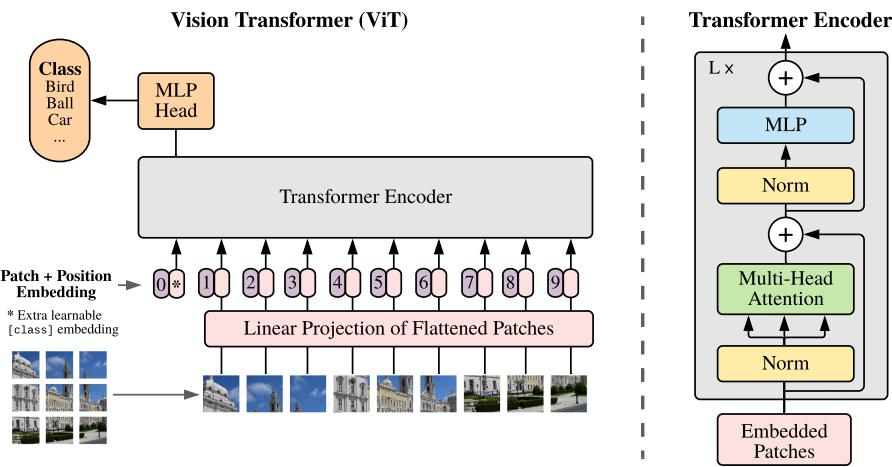  
图1：模型概览。我们将图像分割成固定大小的块，对每个块进行线性嵌入，添加位置嵌入，并将得到的向量序列输入到标准Transformer编码器中。为了进行分类，我们采用标准方法，在序列中添加一个额外的可学习“分类标记”。Transformer编码器的示意图灵感来源于Vaswani等人（2017）。

## 3 方法

在模型设计上，我们尽可能遵循原始Transformer（Vaswani等人，2017）。这种有意简化的设置的一个优势是，可扩展的NLP Transformer架构及其高效实现几乎可以开箱即用。

## 3.1 视觉Transformer（ViT）

模型概览如图1所示。标准Transformer接收一维的标记嵌入序列作为输入。为了处理二维图像，我们将图像 $\mathbf { x } \in \mathbb { R } ^ { H \times W \times \overset { \bullet } { C } }$ 重塑为展平的二维块序列 $\mathbf { x } _ { p } \in \mathbb { R } ^ { N \times ( P ^ { 2 } \cdot C ) }$，其中 $( H , W )$ 是原始图像的分辨率，C是通道数，$( P , P )$ 是每个图像块的分辨率，而 $N = H W / P ^ { 2 }$ 是生成的块数量，同时也作为Transformer的有效输入序列长度。Transformer在其所有层中使用恒定的潜在向量维度D，因此我们将块展平并通过可训练的线性投影映射到D维（公式1）。我们将此投影的输出称为块嵌入。

类似于BERT的[class]标记，我们在嵌入块序列前添加一个可学习的嵌入 $( \mathbf { z } _ { 0 } ^ { 0 } = \mathbf { x } _ { \mathrm { c l a s s } } )$，其在Transformer编码器输出处的状态 $( \mathbf { \bar { z } } _ { L } ^ { 0 } )$ 作为图像表示y（公式4）。在预训练和微调期间，分类头都附加在 $\mathbf { z } _ { L } ^ { 0 }$ 上。分类头在预训练时由一个带单隐藏层的MLP实现，在微调时则由一个单线性层实现。

位置嵌入被添加到补丁嵌入中以保留位置信息。我们使用标准的可学习一维位置嵌入，因为未观察到使用更先进的二维感知位置嵌入能带来显著的性能提升（附录D.4）。由此产生的嵌入向量序列作为编码器的输入。

Transformer编码器（Vaswani等人，2017）由交替的多头自注意力（MSA，见附录A）和MLP块（公式2、3）组成。每个块之前应用层归一化（LN），每个块之后添加残差连接（Wang等人，2019；Baevski & Auli，2019）。

MLP包含两层，并采用GELU非线性激活函数。

$$
\mathbf { z } _ { 0 } = [ \mathbf { x } _ { \mathrm { c l a s s } } ; \mathbf { x } _ { p } ^ { 1 } \mathbf { E } ; \mathbf { x } _ { p } ^ { 2 } \mathbf { E } ; \cdot \cdot \cdot \cdot ; \mathbf { x } _ { p } ^ { N } \mathbf { E } ] + \mathbf { E } _ { p o s } , \mathbf { E } \in \mathbb { R } ^ { ( P ^ { 2 } \cdot C ) \times D } , \mathbf { E } _ { p o s } \in \mathbb { R } ^ { ( N + 1 ) \times D }\tag{1}
$$

$$
\begin{array} { r } { { \mathbf { z } ^ { \prime } } _ { \ell } = \mathrm { M S A } ( \mathrm { L N } ( { \mathbf { z } } _ { \ell - 1 } ) ) + { \mathbf { z } } _ { \ell - 1 } , \qquad \qquad \ell = 1 \dots L } \end{array}\tag{2}
$$

$$
\begin{array} { r } { { \bf z } _ { \ell } = \mathrm { M L P } ( \mathrm { L N } ( { \bf z } ^ { \prime } { } _ { \ell } ) ) + { \bf z } ^ { \prime } { } _ { \ell } , \qquad \ell = 1 \dots L } \end{array}\tag{3}
$$

$$
\mathbf { y } = \mathrm { L N } ( \mathbf { z } _ { L } ^ { 0 } )\tag{4}
$$

归纳偏置。我们注意到，视觉Transformer相比CNN具有更少的图像特定归纳偏置。在CNN中，局部性、二维邻域结构和平移等变性被嵌入到整个模型的每一层中。而在ViT中，只有MLP层是局部且平移等变的，而自注意力层是全局的。二维邻域结构的使用非常有限：在模型开始时通过将图像切割成补丁，以及在微调时调整位置嵌入以适应不同分辨率的图像（如下所述）。除此之外，初始化时的位置嵌入不携带关于补丁二维位置的任何信息，所有补丁之间的空间关系都必须从头学习。

混合架构。作为原始图像补丁的替代方案，输入序列可以由CNN的特征图形成（LeCun等人，1989）。在这种混合模型中，补丁嵌入投影E（公式1）应用于从CNN特征图中提取的补丁。作为一种特殊情况，补丁的空间尺寸可以是1x1，这意味着输入序列是通过简单地将特征图的空间维度展平并投影到Transformer维度而获得的。分类输入嵌入和位置嵌入按上述方式添加。

## 3.2 微调与更高分辨率

通常，我们在大型数据集上预训练ViT，然后微调到（较小的）下游任务。为此，我们移除预训练预测头，并附加一个零初始化的D×K前馈层，其中K是下游类别的数量。在比预训练更高的分辨率下进行微调通常是有益的（Touvron等人，2019；Kolesnikov等人，2020）。当输入更高分辨率的图像时，我们保持补丁大小不变，这会导致更长的有效序列长度。Vision Transformer可以处理任意序列长度（受内存限制），然而，预训练的位置嵌入可能不再有意义。因此，我们根据预训练位置嵌入在原始图像中的位置，对其进行二维插值。请注意，这种分辨率调整和补丁提取是唯一将关于图像二维结构的归纳偏差手动注入Vision Transformer的环节。

## 4 实验

我们评估了ResNet、Vision Transformer（ViT）以及混合模型的表示学习能力。为了理解每个模型对数据的需求，我们在不同大小的数据集上进行预训练，并评估多个基准任务。在考虑预训练模型的计算成本时，ViT表现非常出色，以较低的预训练成本在大多数识别基准上达到了最先进水平。最后，我们使用自监督方法进行了一项小型实验，并表明自监督ViT在未来具有潜力。

## 4.1 设置

数据集。为了探索模型的可扩展性，我们使用了ILSVRC-2012 ImageNet数据集（包含1k个类别和1.3M张图像，下文简称ImageNet）、其超集ImageNet-21k（包含21k个类别和14M张图像）（Deng等人，2009）以及JFT（Sun等人，2017）（包含18k个类别和303M张高分辨率图像）。我们按照Kolesnikov等人（2020）的方法，对预训练数据集进行去重，以排除与下游任务测试集重叠的数据。我们将这些数据集上训练的模型迁移到多个基准任务上：原始验证标签和清理后的ReaL标签上的ImageNet（Beyer等人，2020）、CIFAR-10/100（Krizhevsky，2009）、Oxford-IIIT Pets（Parkhi等人，2012）以及Oxford Flowers-102（Nilsback & Zisserman，2008）。对于这些数据集，预处理遵循Kolesnikov等人（2020）的方法。

<table><tr><td>模型</td><td>层数</td><td>隐藏层大小 D</td><td>MLP 大小</td><td>注意力头数</td><td>参数量</td></tr><tr><td>ViT-Base</td><td>12</td><td>768</td><td>3072</td><td>12</td><td>86M</td></tr><tr><td>ViT-Large</td><td>24</td><td>1024</td><td>4096</td><td>16</td><td>307M</td></tr><tr><td>ViT-Huge</td><td>32</td><td>1280</td><td>5120</td><td>16</td><td>632M</td></tr></table>

表1：Vision Transformer模型变体的详细信息。

我们还对包含19个任务的VTAB分类套件（Zhai等人，2019b）进行了评估。VTAB评估了在低数据量下向多样化任务迁移的能力，每个任务使用1000个训练样本。这些任务分为三组：自然类任务（如上述任务、Pets、CIFAR等）、专业类任务（医学和卫星图像）以及结构类任务（需要几何理解的任务，如定位）。

**模型变体。** 我们将ViT配置基于BERT（Devlin等人，2019）所使用的配置，如表1所示。“Base”和“Large”模型直接采用BERT的配置，并增加了更大的“Huge”模型。在下文中，我们使用简写符号来表示模型大小和输入块大小：例如，ViT-L/16表示“Large”变体，输入块大小为16×16。需要注意的是，Transformer的序列长度与块大小的平方成反比，因此块大小较小的模型计算成本更高。

对于基线CNN，我们使用ResNet（He等人，2016），但将批归一化层（Ioffe & Szegedy，2015）替换为组归一化（Wu & He，2018），并采用标准化卷积（Qiao等人，2019）。这些修改提升了迁移性能（Kolesnikov等人，2020），我们将修改后的模型称为“ResNet (BiT)”。对于混合模型，我们将中间特征图输入ViT，块大小设为1个“像素”。为了实验不同的序列长度，我们采用以下两种方式：(i) 使用常规ResNet50第4阶段的输出，或 (ii) 移除第4阶段，将相同数量的层放置在第3阶段（保持总层数不变），并取扩展后的第3阶段输出。方式(ii)导致序列长度增加4倍，ViT模型的计算成本也更高。

**训练与微调。** 我们使用Adam（Kingma & Ba，2015）训练所有模型（包括ResNet），参数设置为$\beta _ { 1 } = 0 . 9 , \beta _ { 2 } = 0 . 9 9 9$，批量大小为4096，并应用0.1的高权重衰减。我们发现这对所有模型的迁移都有帮助（附录D.1显示，与常见做法相反，在我们的设置中，Adam对ResNet的效果略优于SGD）。我们使用线性学习率预热和衰减，详见附录B.1。对于微调，所有模型均使用带动量的SGD，批量大小为512，详见附录B.1.1。对于表2中的ImageNet结果，我们在更高分辨率下进行微调：ViT-L/16为512，ViT-H/14为518，并使用了Polyak & Juditsky（1992）的指数移动平均方法，系数为0.9999（Ramachandran等人，2019；Wang等人，2020b）。

## 指标

我们通过少样本或微调准确率报告下游数据集的结果。微调准确率反映了每个模型在相应数据集上微调后的性能。少样本准确率通过求解一个正则化最小二乘回归问题获得，该问题将（冻结的）训练图像子集表示映射到 $\{ - 1 , 1 \} ^ { K }$ 目标向量。这种公式使我们能够以封闭形式恢复精确解。尽管我们主要关注微调性能，但有时会使用线性少样本准确率进行快速即时评估，因为微调成本过高。

## 4.2 与现有最优方法的比较

我们首先将最大模型——ViT-H/14 和 ViT-L/16——与文献中的最优 CNN 进行比较。第一个比较对象是 Big Transfer (BiT) (Kolesnikov 等, 2020)，该方法使用大型 ResNet 进行监督迁移学习。第二个是 Noisy Student (Xie 等, 2020)，这是一种大型 EfficientNet，通过在移除标签的 ImageNet 和 JFT-300M 上使用半监督学习训练。目前，Noisy Student 是 ImageNet 上的最优模型，而 BiT-L 在本文报告的其他数据集上表现最佳。所有模型均在 TPUv3 硬件上训练，我们报告了每个模型预训练所需的 TPUv3 核心天数，即用于训练的 TPU v3 核心数（每芯片 2 个）乘以训练天数。

表 2 展示了结果。在 JFT-300M 上预训练的较小 ViT-L/16 模型在所有任务上均优于 BiT-L（在同一数据集上预训练），同时训练所需计算资源显著减少。更大的 ViT-H/14 模型进一步提升了性能，尤其是在更具挑战性的数据集上——ImageNet、CIFAR-100 和 VTAB 套件。值得注意的是，该模型预训练所需的计算量仍远低于先前的最优方法。然而，我们注意到预训练效率不仅受架构选择影响，还取决于其他参数，如训练计划、优化器、权重衰减等。我们在第 4.4 节对不同架构的性能与计算量进行了受控研究。最后，在公开 ImageNet-21k 数据集上预训练的 ViT-L/16 模型在大多数数据集上也表现良好，同时预训练所需资源更少：使用标准云 TPUv3（8 核心）约需 30 天即可完成训练。

<table><tr><td></td><td>Ours-JFT (ViT-H/14)</td><td>Ours-JFT (ViT-L/16)</td><td>Ours-I21k (ViT-L/16)</td><td>BiT-L (ResNet152x4)</td><td>Noisy Student (EfficientNet-L2)</td></tr><tr><td>ImageNet</td><td> $\mathbf { 8 8 . 5 5 \pm 0 . 0 4 }$ </td><td> $8 7 . 7 6 \pm 0 . 0 3$ </td><td> $8 5 . 3 0 \pm 0 . 0 2$ </td><td> $8 7 . 5 4 \pm 0 . 0 2$ </td><td> $8 8 . 4 / 8 8 . 5 ^ { * }$ </td></tr><tr><td>ImageNet ReaL</td><td> $\mathbf { 9 0 . 7 2 \pm 0 . 0 5 }$ </td><td> $9 0 . 5 4 \pm 0 . 0 3$ </td><td> $8 8 . 6 2 \pm 0 . 0 5$ </td><td>90.54</td><td>90.55</td></tr><tr><td>CIFAR-10</td><td> $\mathbf { 9 9 . 5 0 } \pm 0 . 0 6$ </td><td> $9 9 . 4 2 \pm 0 . 0 3$ </td><td> $9 9 . 1 5 \pm 0 . 0 3$ </td><td> $9 9 . 3 7 \pm 0 . 0 6$ </td><td>1</td></tr><tr><td>CIFAR-100</td><td> $\mathbf { 9 4 . 5 5 \pm 0 . 0 4 }$ </td><td> $9 3 . 9 0 \pm 0 . 0 5$ </td><td> $9 3 . 2 5 \pm 0 . 0 5$ </td><td> $9 3 . 5 1 \pm 0 . 0 8$ </td><td></td></tr><tr><td>Oxford-IIITPets</td><td> $\mathbf { 9 7 . 5 6 \pm 0 . 0 3 }$ </td><td> $9 7 . 3 2 \pm 0 . 1 1$ </td><td> $9 4 . 6 7 \pm 0 . 1 5$ </td><td> $9 6 . 6 2 \pm 0 . 2 3$ </td><td></td></tr><tr><td>Oxford Flowers-102</td><td> $9 9 . 6 8 \pm 0 . 0 2$ </td><td> $\mathbf { 9 9 . 7 4 \pm 0 . 0 0 }$ </td><td> $9 9 . 6 1 \pm 0 . 0 2$ </td><td> $9 9 . 6 3 \pm 0 . 0 3$ </td><td></td></tr><tr><td>VTAB (19个任务)</td><td> $7 7 . 6 3 \pm 0 . 2 3$ </td><td> $7 6 . 2 8 \pm 0 . 4 6$ </td><td> $7 2 . 7 2 \pm 0 . 2 1$ </td><td> $7 6 . 2 9 \pm 1 . 7 0$ </td><td></td></tr><tr><td>TPUv3核心天数</td><td>2.5k</td><td>0.68k</td><td>0.23k</td><td>9.9k</td><td>12.3k</td></tr></table>

表2：与主流图像分类基准测试中现有最优方法的比较。我们报告了三次微调运行的平均准确率及其标准差。在JFT-300M数据集上预训练的Vision Transformer模型在所有数据集上均优于基于ResNet的基线模型，同时预训练所需计算资源大幅减少。在较小的公开ImageNet-21k数据集上预训练的ViT也表现良好。∗Touvron等人（2020）报告了略微提升的88.5%结果。

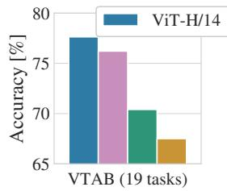

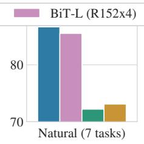

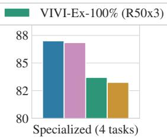

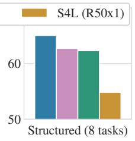  
图2：VTAB在自然、专业和结构化任务组中的性能分解。

图2将VTAB任务分解为各自的任务组，并与该基准测试中先前的最优方法进行比较：BiT、VIVI（在ImageNet和Youtube上共同训练的ResNet，Tschannen等人，2020）以及S4L（在ImageNet上进行监督加半监督学习，Zhai等人，2019a）。ViT-H/14在自然和结构化任务上优于BiT-R152x4及其他方法。在专业任务上，排名前两位的模型性能相近。

## 4.3 预训练数据需求

Vision Transformer 在大型 JFT-300M 数据集上预训练时表现优异。与 ResNet 相比，其视觉归纳偏置更少，那么数据集规模究竟有多关键？我们进行了两组实验。

首先，我们在规模递增的数据集上预训练 ViT 模型：ImageNet、ImageNet-21k 和 JFT-300M。为提升在较小数据集上的性能，我们优化了三个基本正则化参数——权重衰减、丢弃率和标签平滑。图 3 展示了微调至 ImageNet 后的结果（其他数据集的结果见表 $5$）²。当在最小数据集 ImageNet 上预训练时，尽管采用了（适度）正则化，ViT-Large 模型的表现仍不如 ViT-Base 模型。使用 ImageNet-21k 预训练时，两者性能相近。只有在 JFT-300M 上，我们才看到更大模型的全部优势。图 3 还显示了不同规模 BiT 模型的性能区间。BiT CNN 在 ImageNet 上优于 ViT，但在更大数据集上，ViT 实现了反超。

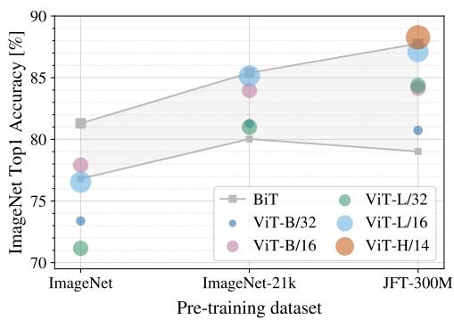

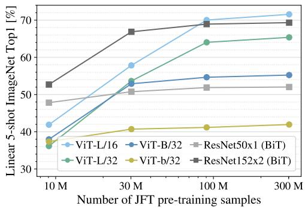  
图 4：ImageNet 上的线性少样本评估与预训练规模的关系。ResNet 在较小预训练数据集上表现更好，但比 ViT 更早达到平台期；而 ViT 在更大预训练数据集上表现更优。ViT-b 是将 ViT-B 所有隐藏维度减半的版本。

图 3：迁移至 ImageNet 的结果。当在小型数据集上预训练时，大型 ViT 模型表现不如 BiT ResNet（阴影区域），但在更大数据集上预训练时则大放异彩。同样，随着数据集规模增长，更大的 ViT 变体也超越了较小的变体。  
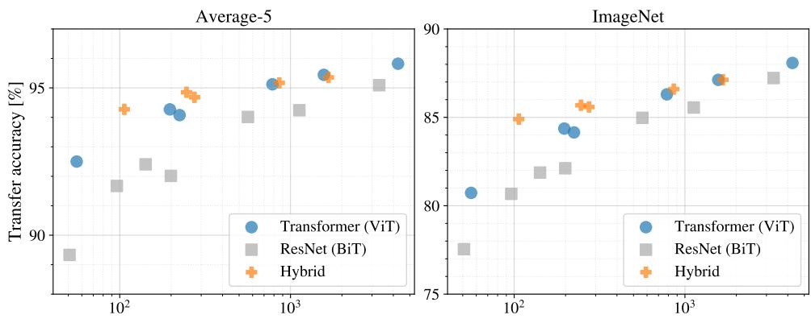  
总预训练计算量 [exaFLOPs]  
图 5：不同架构（Vision Transformer、ResNet 和混合模型）的性能与预训练计算量的关系。在相同计算预算下，Vision Transformer 通常优于 ResNet。对于较小模型，混合模型相比纯 Transformer 有所改进，但较大模型时差距消失。

其次，我们在9M、30M、90M的随机子集以及完整的JFT-300M数据集上训练模型。对于较小的子集，我们不进行额外的正则化处理，所有设置均使用相同的超参数。这样我们评估的是模型的内在特性，而非正则化的效果。不过，我们确实采用了早停法，并报告训练期间达到的最佳验证准确率。为节省计算资源，我们报告的是少样本线性准确率，而非完整微调准确率。图4展示了结果。在较小数据集上，视觉Transformer（ViT）比计算成本相当的ResNet更容易过拟合。例如，ViT-B/32比ResNet50略快；在9M子集上表现差得多，但在90M及以上子集上表现更好。ResNet152x2和ViT-L/16也是如此。这一结果强化了以下直觉：卷积归纳偏置对较小数据集有用，但对于较大数据集，直接从数据中学习相关模式就足够了，甚至更有利。

总体而言，ImageNet上的少样本结果（图4）以及VTAB上的低数据结果（表2）在极低数据迁移方面似乎很有前景。进一步分析ViT的少样本特性是未来研究的一个令人兴奋的方向。

## 4.4 缩放研究

我们通过评估从JFT-300M迁移的性能，对不同模型进行了受控的缩放研究。在此设置下，数据规模不会成为模型性能的瓶颈，我们评估的是每个模型的性能与预训练成本之间的关系。模型集包括：7个ResNet模型（R50x1、R50x2、R101x1、R152x1、R152x2，预训练7个周期），以及R152x2和R200x3（预训练14个周期）；6个视觉Transformer模型（ViT-B/32、B/16、L/32、L/16，预训练7个周期），以及L/16和H/14（预训练14个周期）；5个混合模型（R50+ViT-B/32、B/16、L/32、L/16，预训练7个周期），以及R50+ViT-L/16（预训练14个周期）（对于混合模型，模型名称末尾的数字不代表补丁大小，而是ResNet主干中的总下采样比例）。

图5展示了迁移性能与总预训练计算量之间的关系（计算成本详情见附录D.5）。每个模型的详细结果见附录中的表6。可以观察到几个模式。首先，在性能/计算量权衡上，视觉Transformer优于ResNet。ViT大约需要2-4倍更少的计算量就能达到相同的性能（5个数据集的平均值）。其次，在较小的计算预算下，混合模型略优于ViT，但对于较大模型，这种差异消失了。这一结果有些出人意料，因为人们可能预期卷积局部特征处理在任何规模下都能辅助ViT。第三，视觉Transformer在尝试的范围内似乎尚未饱和，这激励了未来的缩放研究。

## 4.5 检查视觉Transformer

为了理解Vision Transformer如何处理图像数据，我们首先分析其内部表征。Vision Transformer的第一层将展平的图像块线性投影到低维空间（公式1）。图7（左）展示了学习到的嵌入滤波器的前几个主成分。这些成分类似于对每个图像块内部精细结构进行低维表示的合理基函数。

投影之后，学习到的位置嵌入被添加到图像块表征中。图7（中）显示模型学会了在位置嵌入的相似性中编码图像内的距离，即距离较近的图像块往往具有更相似的位置嵌入。此外，行-列结构也显现出来：同一行/列的图像块具有相似的嵌入。最后，对于较大的网格，有时会出现正弦结构（附录D）。位置嵌入能够学习表示二维图像拓扑结构，这解释了为何手工设计的二维感知嵌入变体未能带来改进（附录D.4）。

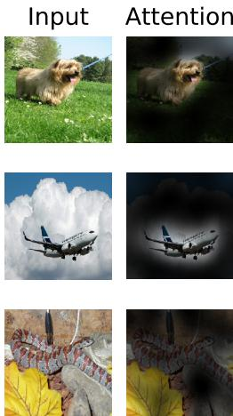

自注意力机制使ViT即使在最底层也能整合整个图像的信息。我们研究了网络在多大程度上利用了这种能力。具体而言，我们基于注意力权重计算了信息整合所跨越的图像空间平均距离（图7，右）。这个"注意力距离"类似于CNN中的感受野大小。

图6：从输出令牌到输入空间的注意力代表性示例。详见附录D.7。

我们发现，某些注意力头在最底层就已经关注到图像的大部分区域，这表明模型确实利用了全局信息整合的能力。其他注意力头在低层则始终保持较小的注意力距离。这种高度局部化的注意力在混合模型（在Transformer之前应用ResNet）中不太明显（图7，右），暗示其可能起到类似于CNN中早期卷积层的作用。此外，注意力距离随网络深度增加而增大。总体而言，我们发现模型会关注与分类语义相关的图像区域（图6）。

## 4.6 自监督学习

Transformer在自然语言处理任务中展现了卓越的性能。然而，其成功很大程度上不仅归功于出色的可扩展性，还依赖于大规模的自监督预训练（Devlin 等人，2019；Radford 等人，2018）。我们还初步探索了用于自监督的掩码补丁预测，模仿了BERT中使用的掩码语言建模任务。通过自监督预训练，我们较小的ViT-B/16模型在ImageNet上达到了79.9%的准确率，相比从头训练提升了2%，但仍比监督预训练低4%。附录B.1.2提供了更多细节。我们将对比预训练的探索（Chen 等人，2020b；He 等人，2020；Bachman 等人，2019；Henaff 等人，2020）留待未来工作。

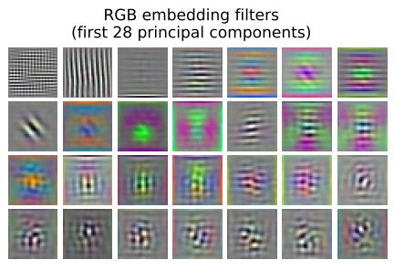

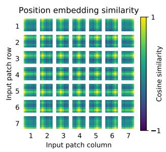

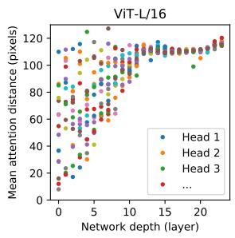  
图7：左图：ViT-L/32的RGB值初始线性嵌入的滤波器。中图：ViT-L/32位置嵌入的相似性。图块显示了指定行列补丁的位置嵌入与所有其他补丁位置嵌入之间的余弦相似度。右图：按注意力头和网络深度划分的注意力区域大小。每个点表示一层中16个注意力头之一在所有图像上的平均注意力距离。详见附录D.7。

## 5 结论

我们探索了Transformer在图像识别中的直接应用。与先前在计算机视觉中使用自注意力的工作不同，除了初始的补丁提取步骤外，我们没有在架构中引入图像特定的归纳偏置。相反，我们将图像解释为一系列补丁，并使用标准Transformer编码器（如NLP中使用的）进行处理。这种简单且可扩展的策略，在与大规模数据集上的预训练相结合时，效果出奇地好。因此，Vision Transformer在许多图像分类数据集上达到或超越了当前最先进水平，同时预训练成本相对较低。

尽管这些初步结果令人鼓舞，但仍面临许多挑战。其中之一是将ViT应用于其他计算机视觉任务，如检测和分割。我们的结果，结合Carion等人（2020）的工作，表明了这种方法的潜力。另一个挑战是继续探索自监督预训练方法。我们的初步实验显示自监督预训练带来了改进，但自监督与大规模监督预训练之间仍存在较大差距。最后，进一步扩展ViT可能会带来性能提升。

## 致谢

该工作分别在柏林、苏黎世和阿姆斯特丹开展。我们感谢谷歌的众多同事提供的帮助，特别感谢安德烈亚斯·施泰纳在基础设施建设和代码开源发布方面的关键支持；感谢琼·普伊格塞尔弗和马克西姆·诺伊曼在大规模训练基础设施方面的协助；感谢德米特里·莱皮欣、阿拉温德·马亨德兰、丹尼尔·凯瑟斯、马里奥·卢契奇、诺姆·沙泽尔、阿什什·瓦斯瓦尼和科林·拉费尔在富有成效的讨论中提供的宝贵意见。

## 参考文献

Samira Abnar 和 Willem Zuidema. 量化Transformer中的注意力流. 发表于 ACL, 2020.

Philip Bachman, R Devon Hjelm 和 William Buchwalter. 通过跨视角最大化互信息学习表征. 发表于 NeurIPS, 2019.

Alexei Baevski 和 Michael Auli. 神经语言建模的自适应输入表征. 发表于 ICLR, 2019.

I. Bello, B. Zoph, Q. Le, A. Vaswani 和 J. Shlens. 注意力增强卷积网络. 发表于 ICCV, 2019.

Lucas Beyer, Olivier J. Henaff, Alexander Kolesnikov, Xiaohua Zhai 和 Aarón van den Oord. 我们是否已完成ImageNet任务？ arXiv, 2020.

Tom B Brown, Benjamin Mann, Nick Ryder, Melanie Subbiah, Jared Kaplan, Prafulla Dhariwal, Arvind Neelakantan, Pranav Shyam, Girish Sastry, Amanda Askell 等. 语言模型是少样本学习器. arXiv, 2020.

Nicolas Carion, Francisco Massa, Gabriel Synnaeve, Nicolas Usunier, Alexander Kirillov 和 Sergey Zagoruyko. 基于Transformer的端到端目标检测. 发表于 ECCV, 2020.

Mark Chen, Alec Radford, Rewon Child, Jeff Wu 和 Heewoo Jun. 基于像素的生成式预训练. 发表于 ICML, 2020a.

Ting Chen, Simon Kornblith, Mohammad Norouzi 和 Geoffrey E. Hinton. 视觉表征对比学习的简单框架. 发表于 ICML, 2020b.

Yen-Chun Chen, Linjie Li, Licheng Yu, Ahmed El Kholy, Faisal Ahmed, Zhe Gan, Yu Cheng 和 Jingjing Liu. UNITER：通用图像-文本表征学习. 发表于 ECCV, 2020c.

Rewon Child, Scott Gray, Alec Radford 和 Ilya Sutskever. 基于稀疏Transformer的长序列生成. arXiv, 2019.

Jean-Baptiste Cordonnier, Andreas Loukas 和 Martin Jaggi. 自注意力与卷积层的关系研究. 发表于 ICLR, 2020.

J. Deng, W. Dong, R. Socher, L. Li, Kai Li 和 Li Fei-Fei. ImageNet：大规模分层图像数据库. 发表于 CVPR, 2009.

Jacob Devlin, Ming-Wei Chang, Kenton Lee 和 Kristina Toutanova. BERT：深度双向Transformer的语言理解预训练. 发表于 NAACL, 2019.

Josip Djolonga, Jessica Yung, Michael Tschannen, Rob Romijnders, Lucas Beyer, Alexander Kolesnikov, Joan Puigcerver, Matthias Minderer, Alexander D’Amour, Dan Moldovan, Sylvan Gelly, Neil Houlsby, Xiaohua Zhai 和 Mario Lucic. 卷积神经网络的鲁棒性与可迁移性研究. arXiv, 2020.

Kaiming He, Xiangyu Zhang, Shaoqing Ren 和 Jian Sun. 用于图像识别的深度残差学习. 发表于 CVPR, 2016.

何恺明、范浩琪、吴宇鑫、谢赛宁、Ross Girshick。用于无监督视觉表征学习的动量对比。CVPR，2020年。

Jonathan Ho、Nal Kalchbrenner、Dirk Weissenborn、Tim Salimans。多维变换器中的轴向注意力。arXiv，2019年。

胡瀚、顾嘉元、张铮、戴继飞、魏一晨。用于目标检测的关系网络。CVPR，2018年。

胡瀚、张铮、谢振达、Stephen Lin。用于图像识别的局部关系网络。ICCV，2019年。

黄子龙、王兴刚、魏云超、黄立超、Humphrey Shi、刘文予、Thomas S. Huang。CCNet：用于语义分割的十字交叉注意力。ICCV，2020年。

Olivier J. Henaff、Aravind Srinivas、Jeffrey De Fauw、Ali Razavi、Carl Doersch、S. M. Ali Eslami、Aaron van den Oord。基于对比预测编码的数据高效图像识别。ICML，2020年。

Sergey Ioffe、Christian Szegedy。批归一化：通过减少内部协变量偏移加速深度网络训练。2015年。

Diederik P. Kingma、Jimmy Ba。Adam：一种随机优化方法。ICLR，2015年。

Alexander Kolesnikov、Lucas Beyer、翟晓华、Joan Puigcerver、Jessica Yung、Sylvain Gelly、Neil Houlsby。大迁移（BiT）：通用视觉表征学习。ECCV，2020年。

Alex Krizhevsky。从微小图像中学习多层特征。技术报告，2009年。

Alex Krizhevsky、Ilya Sutskever、Geoffrey E. Hinton。基于深度卷积神经网络的ImageNet分类。NIPS，2012年。

Y. LeCun、B. Boser、J. Denker、D. Henderson、R. Howard、W. Hubbard、L. Jackel。反向传播在手写邮政编码识别中的应用。神经计算，1:541–551，1989年。

Dmitry Lepikhin、HyoukJoong Lee、徐元忠、陈德浩、Orhan Firat、黄艳萍、Maxim Krikun、Noam Shazeer、陈志峰。GShard：通过条件计算和自动分片扩展巨型模型。arXiv，2020年。

Liunian Harold Li、Mark Yatskar、尹达、Cho-Jui Hsieh、Kai-Wei Chang。VisualBERT：一种简单且高性能的视觉与语言基线。Arxiv，2019年。

Francesco Locatello、Dirk Weissenborn、Thomas Unterthiner、Aravindh Mahendran、Georg Heigold、Jakob Uszkoreit、Alexey Dosovitskiy、Thomas Kipf。基于槽注意力的以对象为中心的学习。arXiv，2020年。

陆嘉森、Dhruv Batra、Devi Parikh、Stefan Lee。ViLBERT：用于视觉与语言任务的预训练任务无关视觉语言表征。NeurIPS，2019年。

Dhruv Mahajan、Ross Girshick、Vignesh Ramanathan、何恺明、Manohar Paluri、李宜轩、Ashwin Bharambe、Laurens van der Maaten。探索弱监督预训练的极限。ECCV，2018年。

M. Nilsback、A. Zisserman。基于大量类别的自动化花卉分类。ICVGIP，2008年。

Omkar M. Parkhi、Andrea Vedaldi、Andrew Zisserman、C. V. Jawahar。猫与狗。CVPR，2012年。

Niki Parmar, Ashish Vaswani, Jakob Uszkoreit, Lukasz Kaiser, Noam Shazeer, Alexander Ku, 和 Dustin Tran. 图像变换器. 收录于 ICML, 2018.

B. T. Polyak 和 A. B. Juditsky. 通过平均加速随机逼近. SIAM 控制与优化杂志, 30(4):838–855, 1992. doi: 10.1137/0330046. URL https://doi.org/10.1137/0330046.

Siyuan Qiao, Huiyu Wang, Chenxi Liu, Wei Shen, 和 Alan Yuille. 权重标准化. arXiv 预印本 arXiv:1903.10520, 2019.

Alec Radford, Karthik Narasimhan, Tim Salimans, 和 Ilya Sutskever. 通过无监督学习改进语言理解. 技术报告, 2018.

Alec Radford, Jeff Wu, Rewon Child, David Luan, Dario Amodei, 和 Ilya Sutskever. 语言模型是无监督的多任务学习者. 技术报告, 2019.

Prajit Ramachandran, Niki Parmar, Ashish Vaswani, Irwan Bello, Anselm Levskaya, 和 Jon Shlens. 视觉模型中的独立自注意力. 收录于 NeurIPS, 2019.

Chen Sun, Abhinav Shrivastava, Saurabh Singh, 和 Abhinav Gupta. 重新审视深度学习时代数据的非理性有效性. 收录于 ICCV, 2017.

Chen Sun, Austin Myers, Carl Vondrick, Kevin Murphy, 和 Cordelia Schmid. Videobert: 视频与语言表征学习的联合模型. 收录于 ICCV, 2019.

Hugo Touvron, Andrea Vedaldi, Matthijs Douze, 和 Herve Jegou. 修复训练-测试分辨率差异. 收录于 NeurIPS, 2019.

Hugo Touvron, Andrea Vedaldi, Matthijs Douze, 和 Herve Jegou. 修复训练-测试分辨率差异: Fixefficientnet. arXiv 预印本 arXiv:2003.08237, 2020.

Michael Tschannen, Josip Djolonga, Marvin Ritter, Aravindh Mahendran, Neil Houlsby, Sylvain Gelly, 和 Mario Lucic. 视频诱导视觉不变性的自监督学习. 收录于 IEEE/CVF 计算机视觉与模式识别会议 (CVPR) 论文集, 2020年6月.

Ashish Vaswani, Noam Shazeer, Niki Parmar, Jakob Uszkoreit, Llion Jones, Aidan N Gomez, Łukasz Kaiser, 和 Illia Polosukhin. 注意力就是一切. 收录于 NIPS, 2017.

Huiyu Wang, Yukun Zhu, Bradley Green, Hartwig Adam, Alan Yuille, 和 Liang-Chieh Chen. Axial-deeplab: 用于全景分割的独立轴向注意力. 收录于 ECCV, 2020a.

Huiyu Wang, Yukun Zhu, Bradley Green, Hartwig Adam, Alan Yuille, 和 Liang-Chieh Chen. Axial-deeplab: 用于全景分割的独立轴向注意力. arXiv 预印本 arXiv:2003.07853, 2020b.

Qiang Wang, Bei Li, Tong Xiao, Jingbo Zhu, Changliang Li, Derek F. Wong, 和 Lidia S. Chao. 学习深度变换器模型用于机器翻译. 收录于 ACL, 2019.

Xiaolong Wang, Ross Girshick, Abhinav Gupta, 和 Kaiming He. 非局部神经网络. 收录于 CVPR, 2018.

Dirk Weissenborn, Oscar Tackstr ¨ om, 和 Jakob Uszkoreit. 扩展自回归视频模型. 收录于 ICLR, 2019.

Bichen Wu, Chenfeng Xu, Xiaoliang Dai, Alvin Wan, Peizhao Zhang, Masayoshi Tomizuka, Kurt Keutzer, 和 Peter Vajda. 视觉变换器: 基于令牌的图像表示与处理用于计算机视觉. arxiv, 2020.

吴宇欣与何恺明。组归一化。发表于ECCV，2018年。

谢启哲、Minh-Thang Luong、Eduard Hovy、Le Q.V.。基于噪声学生自训练提升ImageNet分类性能。发表于CVPR，2020年。

翟晓华、Avital Oliver、Alexander Kolesnikov、Lucas Beyer。S4L：自监督半监督学习。发表于ICCV，2019a。

翟晓华、Joan Puigcerver、Alexander Kolesnikov、Pierre Ruyssen、Carlos Riquelme、Mario Lucic、Josip Djolonga、Andre Susano Pinto、Maxim Neumann、Alexey Dosovitskiy等。基于视觉任务适应基准的表示学习大规模研究。arXiv预印本arXiv:1910.04867，2019b。

赵恒爽、贾佳亚、Vladlen Koltun。探索图像识别中的自注意力机制。发表于CVPR，2020年。

<table><tr><td>模型</td><td>数据集</td><td>训练轮数</td><td>基础学习率</td><td>学习率衰减</td><td>权重衰减</td><td>丢弃率</td></tr><tr><td>ViT-B/{16,32}</td><td>JFT-300M</td><td>7</td><td> $8 \cdot 1 0 ^ { - 4 }$ </td><td>线性</td><td>0.1</td><td>0.0</td></tr><tr><td>ViT-L/32</td><td>JFT-300M</td><td>7</td><td> $6 \cdot 1 0 ^ { - 4 }$ </td><td>线性</td><td>0.1</td><td>0.0</td></tr><tr><td>ViT-L/16</td><td>JFT-300M</td><td>7/14</td><td> $4 \cdot 1 0 ^ { - 4 } $ </td><td>线性</td><td>0.1</td><td>0.0</td></tr><tr><td>ViT-H/14</td><td>JFT-300M</td><td>14</td><td> $3 \cdot 1 0 ^ { - 4 }$ </td><td>线性</td><td>0.1</td><td>0.0</td></tr><tr><td>R50x{1,2}</td><td>JFT-300M</td><td>7</td><td> $1 0 ^ { - 3 }$ </td><td>线性</td><td>0.1</td><td>0.0</td></tr><tr><td>R101x1</td><td>JFT-300M</td><td>7</td><td> $8 \cdot 1 0 ^ { - 4 }$ </td><td>线性</td><td>0.1</td><td>0.0</td></tr><tr><td>R152x{1,2}</td><td>JFT-300M</td><td>7</td><td> $6 \cdot 1 0 ^ { - 4 }$ </td><td>线性</td><td>0.1</td><td>0.0</td></tr><tr><td>R50+ViT-B/{16,32}</td><td>JFT-300M</td><td>7</td><td> $8 \cdot 1 0 ^ { - 4 }$ </td><td>线性</td><td>0.1</td><td>0.0</td></tr><tr><td>R50+ViT-L/32</td><td>JFT-300M</td><td>7</td><td> $2 \cdot 1 0 ^ { - 4 }$ </td><td>线性</td><td>0.1</td><td>0.0</td></tr><tr><td>R50+ViT-L/16</td><td>JFT-300M</td><td>7/14</td><td> $4 \cdot 1 0 ^ { - 4 } $ </td><td>线性</td><td>0.1</td><td>0.0</td></tr><tr><td>ViT-B/{16,32}</td><td>ImageNet-21k</td><td>90</td><td> $1 0 ^ { - 3 }$ </td><td>线性</td><td>0.03</td><td>0.1</td></tr><tr><td>ViT-L/{16,32}</td><td>ImageNet-21k</td><td>30/90</td><td> $1 0 ^ { - 3 }$ </td><td>线性</td><td>0.03</td><td>0.1</td></tr><tr><td>ViT-*</td><td>ImageNet</td><td>300</td><td> $3 \cdot 1 0 ^ { - 3 }$ </td><td>余弦</td><td>0.3</td><td>0.1</td></tr></table>

表3：训练超参数。所有模型均采用批量大小4096及10k步学习率预热进行训练。对于ImageNet，我们发现额外应用全局范数1的梯度裁剪有益。训练分辨率为224。

## 附录

## A 多头自注意力机制

标准qkv自注意力（SA, Vaswani et al. (2017)）是神经架构中常用的构建模块。对于输入序列 $\mathbf { z } \in \dot { \mathbb { R } } ^ { N \times D }$ 中的每个元素，我们计算序列中所有值 v 的加权和。注意力权重 $A _ { i j }$ 基于序列中两个元素之间的成对相似性及其各自的查询 $\mathbf { q } ^ { i }$ 和键 $\mathbf { k } ^ { j }$ 表示。

$$
[ \mathbf { q } , \mathbf { k } , \mathbf { v } ] = \mathbf { z } \mathbf { U } _ { q k v }
$$

$$
\mathbf { U } _ { q k v } \in \mathbb { R } ^ { D \times 3 D _ { h } } ,\tag{5}
$$

$$
A = \mathrm { s o f t m a x } \left( { \bf q k } ^ { \top } / \sqrt { D _ { h } } \right)
$$

$$
A \in \mathbb { R } ^ { N \times N } ,\tag{6}
$$

$$
\mathrm { S A } ( \mathbf { z } ) = A \mathbf { v } .\tag{7}
$$

多头自注意力（MSA）是SA的扩展，其中我们并行运行k个自注意力操作（称为“头”），并将其拼接后的输出进行投影。为了在改变k时保持计算量和参数数量不变，$D _ { h }$（公式5）通常设置为 $D/k$。

$$
\begin{array} { r } { \mathrm { M S A } ( \mathbf { z } ) = [ \mathrm { S A } _ { 1 } ( z ) ; \mathrm { S A } _ { 2 } ( z ) ; \cdots \ ; \mathrm { S A } _ { k } ( z ) ] \mathbf { U } _ { m s a } \qquad \quad \mathbf { U } _ { m s a } \in \mathbb { R } ^ { k \cdot D _ { h } \times D } } \end{array}\tag{8}
$$

## B 实验细节

## B.1 训练

表3总结了我们在不同模型上的训练设置。我们发现，在ImageNet上从头训练模型时，强正则化是关键。Dropout（如果使用）应用于每个密集层之后，但qkv投影层和位置嵌入添加到补丁嵌入之后直接应用的层除外。混合模型使用与其ViT对应模型完全相同的设置进行训练。最后，所有训练均在224分辨率下进行。

## B.1.1 微调

我们使用动量为0.9的SGD对所有ViT模型进行微调。我们对学习率进行小范围网格搜索，学习率范围见表4。为此，我们从训练集中划分出小的子集（Pets和Flowers为10%，CIFAR为2%，ImageNet为1%）作为开发集，并在剩余数据上训练。对于最终结果，我们在整个训练集上训练，并在相应的测试数据上评估。对于微调ResNet和混合模型，我们使用完全相同的设置，唯一的例外是ImageNet，我们在学习率扫描中额外添加了值0.06。此外，对于ResNet，我们还运行了Kolesnikov等人（2020）的设置，并在此次运行和我们的扫描中选择最佳结果。最后，除非另有说明，所有微调实验均在384分辨率下运行（在不同分辨率下进行微调训练是常见做法（Kolesnikov等人，2020））。

<table><tr><td>数据集</td><td>步数</td><td>基础学习率</td></tr><tr><td>ImageNet</td><td>20000</td><td>{0.003,0.01,0.03,0.06}</td></tr><tr><td>CIFAR100</td><td>10 000</td><td>{0.001,0.003,0.01,0.03}</td></tr><tr><td>CIFAR10</td><td>10000</td><td>{0.001,0.003,0.01, 0.03}</td></tr><tr><td>Oxford-IIIT Pets</td><td>500</td><td>{0.001,0.003,0.01, 0.03}</td></tr><tr><td>Oxford Flowers-102</td><td>500</td><td>{0.001,0.003,0.01,0.03}</td></tr><tr><td>VTAB（19个任务）</td><td>2.500</td><td>0.01</td></tr></table>

表4：微调超参数。所有模型均采用余弦学习率衰减、批量大小为512、无权重衰减，并在全局范数1处进行梯度裁剪。除非另有说明，微调分辨率为384。

在将ViT模型迁移到其他数据集时，我们移除整个头部（两个线性层），并用一个初始化为零的线性层替换，该层输出目标数据集所需的类别数量。我们发现这比简单重新初始化最后一层更稳健。

对于VTAB，我们遵循Kolesnikov等人（2020）的协议，并对所有任务使用相同的超参数设置。我们使用0.01的学习率，训练2500步（表4）。我们通过在小范围内尝试两种学习率和两种调度方案，并在200样本验证集上选择VTAB得分最高的设置。我们遵循Kolesnikov等人（2020）使用的预处理方法，但未使用任务特定的输入分辨率。相反，我们发现Vision Transformer在所有任务中受益于高分辨率（384 × 384）。

## B.1.2 自监督学习

我们采用掩码补丁预测目标进行初步的自监督实验。为此，我们通过以下方式破坏50%的补丁嵌入：用可学习的[mask]嵌入替换（80%）、用随机其他补丁嵌入替换（10%），或保持原样（10%）。该设置与Devlin等人（2019）在语言领域使用的设置非常相似。最后，我们利用每个被破坏补丁的表示预测其3位平均颜色（即总共512种颜色）。

我们在JFT上以4096的批量大小训练了自监督模型100万步（约14个周期）。我们使用Adam优化器，基础学习率为$2 \cdot 10^{-4}$，预热步数为1万步，并采用余弦学习率衰减。作为预训练的预测目标，我们尝试了以下设置：1）仅预测均值，3位颜色（即1个512种颜色的预测）；2）并行预测$16 \times 16$块的$4 \times 4$缩小版本，使用3位颜色（即16个512种颜色的预测）；3）使用L2对完整块进行回归（即对3个RGB通道进行256次回归）。令人惊讶的是，我们发现所有方法都表现良好，尽管L2略逊一筹。我们仅报告选项1的最终结果，因为它在少样本性能上表现最佳。我们还尝试了Devlin等人（2019）使用的15%损坏率，但在我们的少样本指标上结果也略差。

最后，我们想指出，我们的掩码块预测实例化并不需要如此大量的预训练或像JFT这样的大型数据集，就能在ImageNet分类上获得类似的性能提升。也就是说，我们在预训练10万步后观察到下游性能的收益递减，并且在ImageNet上进行预训练时也看到了类似的收益。

## C 附加结果

我们报告了与论文中图表对应的详细结果。表5对应论文中的图3，展示了在不同规模数据集（ImageNet、ImageNet-21k和JFT-300M）上预训练的不同ViT模型的迁移性能。表6对应

<table><tr><td></td><td></td><td>ViT-B/16</td><td>ViT-B/32</td><td>ViT-L/16</td><td>ViT-L/32</td><td>ViT-H/14</td></tr><tr><td>ImageNet</td><td>CIFAR-10</td><td>98.13</td><td>97.77</td><td>97.86</td><td>97.94</td><td></td></tr><tr><td></td><td>CIFAR-100</td><td>87.13</td><td>86.31</td><td>86.35</td><td>87.07</td><td></td></tr><tr><td></td><td>ImageNet</td><td>77.91</td><td>73.38</td><td>76.53</td><td>71.16</td><td></td></tr><tr><td></td><td>ImageNet ReaL</td><td>83.57</td><td>79.56</td><td>82.19</td><td>77.83</td><td></td></tr><tr><td></td><td>牛津花卉-102</td><td>89.49</td><td>85.43</td><td>89.66</td><td>86.36</td><td></td></tr><tr><td></td><td>牛津-IIIT 宠物</td><td>93.81</td><td>92.04</td><td>93.64</td><td>91.35</td><td>=</td></tr><tr><td>ImageNet-21k</td><td>CIFAR-10</td><td>98.95</td><td>98.79</td><td>99.16</td><td>99.13</td><td>99.27</td></tr><tr><td></td><td>CIFAR-100</td><td>91.67</td><td>91.97</td><td>93.44</td><td>93.04</td><td>93.82</td></tr><tr><td></td><td>ImageNet</td><td>83.97</td><td>81.28</td><td>85.15</td><td>80.99</td><td>85.13</td></tr><tr><td></td><td>ImageNet ReaL</td><td>88.35</td><td>86.63</td><td>88.40</td><td>85.65</td><td>88.70</td></tr><tr><td></td><td>牛津花卉-102</td><td>99.38</td><td>99.11</td><td>99.61</td><td>99.19</td><td>99.51</td></tr><tr><td></td><td>牛津-IIIT 宠物</td><td>94.43</td><td>93.02</td><td>94.73</td><td>93.09</td><td>94.82</td></tr><tr><td>JFT-300M</td><td>CIFAR-10</td><td>99.00</td><td>98.61</td><td>99.38</td><td>99.19</td><td>99.50</td></tr><tr><td></td><td>CIFAR-100</td><td>91.87</td><td>90.49</td><td>94.04</td><td>92.52</td><td>94.55</td></tr><tr><td></td><td>ImageNet</td><td>84.15</td><td>80.73</td><td>87.12</td><td>84.37</td><td>88.04</td></tr><tr><td></td><td>ImageNet ReaL</td><td>88.85</td><td>86.27</td><td>89.99</td><td>88.28</td><td>90.33</td></tr><tr><td></td><td>牛津花卉-102</td><td>99.56</td><td>99.27</td><td>99.56</td><td>99.45</td><td>99.68</td></tr><tr><td></td><td>牛津-IIIT 宠物</td><td>95.80</td><td>93.40</td><td>97.11</td><td>95.83</td><td>97.56</td></tr></table>

表5：在ImageNet、ImageNet-21k或JFT300M上预训练后，Vision Transformer在各数据集上的Top1准确率（%）。这些数值对应正文中的图3。模型在384分辨率下进行微调。注意，ImageNet结果未使用表2中达到结果所需的额外技术（Polyak平均和512分辨率图像）进行计算。

<table><tr><td></td><td>训练轮数</td><td>ImageNet</td><td>ImageNet ReaL</td><td>CIFAR-10</td><td>CIFAR-100</td><td>Pets</td><td>Flowers</td><td>exaFLOPs</td></tr><tr><td>名称 ViT-B/32</td><td>7</td><td>80.73</td><td>86.27</td><td>98.61</td><td>90.49</td><td>93.40</td><td>99.27</td><td>55</td></tr><tr><td>ViT-B/16</td><td>7</td><td>84.15</td><td>88.85</td><td>99.00</td><td>91.87</td><td>95.80</td><td>99.56</td><td>224</td></tr><tr><td>ViT-L/32</td><td>7</td><td>84.37</td><td>88.28</td><td>99.19</td><td>92.52</td><td>95.83</td><td>99.45</td><td>196</td></tr><tr><td>ViT-L/16</td><td>7</td><td>86.30</td><td>89.43</td><td>99.38</td><td>93.46</td><td>96.81</td><td>99.66</td><td>783</td></tr><tr><td>ViT-L/16</td><td>14</td><td>87.12</td><td>89.99</td><td>99.38</td><td>94.04</td><td>97.11</td><td>99.56</td><td>1567</td></tr><tr><td>ViT-H/14</td><td>14</td><td>88.08</td><td>90.36</td><td>99.50</td><td>94.71</td><td>97.11</td><td>99.71</td><td>4262</td></tr><tr><td>ResNet50x1</td><td>7</td><td>77.54</td><td>84.56</td><td>97.67</td><td>86.07</td><td>91.11</td><td>94.26</td><td>50</td></tr><tr><td>ResNet50x2</td><td>7</td><td>82.12</td><td>87.94</td><td>98.29</td><td>89.20</td><td>93.43</td><td>97.02</td><td>199</td></tr><tr><td>ResNet101x1</td><td>7</td><td>80.67</td><td>87.07</td><td>98.48</td><td>89.17</td><td>94.08</td><td>95.95</td><td>96</td></tr><tr><td>ResNet152x1</td><td>7</td><td>81.88</td><td>87.96</td><td>98.82</td><td>90.22</td><td>94.17</td><td>96.94</td><td>141</td></tr><tr><td>ResNet152x2</td><td>7</td><td>84.97</td><td>89.69</td><td>99.06</td><td>92.05</td><td>95.37</td><td>98.62</td><td>563</td></tr><tr><td>ResNet152x2</td><td>14</td><td>85.56</td><td>89.89</td><td>99.24</td><td>91.92</td><td>95.75</td><td>98.75</td><td>1126</td></tr><tr><td>ResNet200x3</td><td>14</td><td>87.22</td><td>90.15</td><td>99.34</td><td>93.53</td><td>96.32</td><td>99.04</td><td>3306</td></tr><tr><td>R50x1+ViT-B/32</td><td>7</td><td>84.90</td><td>89.15</td><td>99.01</td><td>92.24</td><td>95.75</td><td>99.46</td><td>106</td></tr><tr><td>R50x1+ViT-B/16</td><td>7</td><td>85.58</td><td>89.65</td><td>99.14</td><td>92.63</td><td>96.65</td><td>99.40</td><td>274</td></tr><tr><td>R50x1+ViT-L/32</td><td>7</td><td>85.68</td><td>89.04</td><td>99.24</td><td>92.93</td><td>96.97</td><td>99.43</td><td>246</td></tr><tr><td>R50x1+ViT-L/16</td><td>7</td><td>86.60</td><td>89.72</td><td>99.18</td><td>93.64</td><td>97.03</td><td>99.40</td><td>859</td></tr><tr><td>R50x1+ViT-L/16</td><td>14</td><td>87.12</td><td>89.76</td><td>99.31</td><td>93.89</td><td>97.36</td><td>99.11</td><td>1668</td></tr></table>

表6：模型规模扩展实验的详细结果。这些结果对应主论文中的图5。我们展示了多个数据集上的迁移准确率，以及预训练计算量（以exaFLOPs为单位）。

图5来自论文，展示了不同规模的ViT、ResNet和混合模型的迁移性能，以及其预训练的估计计算成本。

## D 附加分析

## D.1 ResNet的SGD与ADAM对比

ResNet通常使用SGD进行训练，而我们采用Adam作为优化器则相当非传统。此处展示促使我们做出这一选择的实验。具体而言，我们比较了两个在JFT上分别使用SGD和Adam预训练的ResNet模型——50x1和152x2——的微调性能。对于SGD，我们采用Kolesnikov等人（2020）推荐的超参数。结果如表7所示。在大多数数据集上以及平均性能方面，Adam预训练均优于SGD预训练。这证明了选择Adam作为在JFT上预训练ResNet的优化器的合理性。需要注意的是，由于我们仅预训练了7个epoch而非30个，因此绝对数值低于Kolesnikov等人（2020）报告的结果。

<table><tr><td colspan="3">ResNet50</td><td colspan="2">ResNet152x2</td></tr><tr><td>数据集</td><td>Adam</td><td>SGD</td><td>Adam</td><td>SGD</td></tr><tr><td>ImageNet</td><td>77.54</td><td>78.24</td><td>84.97</td><td>84.37</td></tr><tr><td>CIFAR10</td><td>97.67</td><td>97.46</td><td>99.06</td><td>99.07</td></tr><tr><td>CIFAR100</td><td>86.07</td><td>85.17</td><td>92.05</td><td>91.06</td></tr><tr><td>Oxford-IIITPets</td><td>91.11</td><td>91.00</td><td>95.37</td><td>94.79</td></tr><tr><td>Oxford Flowers-102</td><td>94.26</td><td>92.06</td><td>98.62</td><td>99.32</td></tr><tr><td>平均</td><td>89.33</td><td>88.79</td><td>94.01</td><td>93.72</td></tr></table>

表7：使用Adam和SGD预训练的ResNet模型的微调结果。

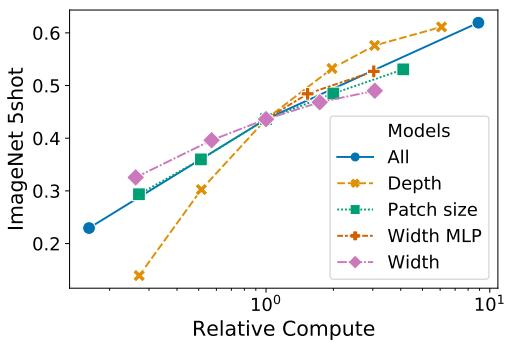

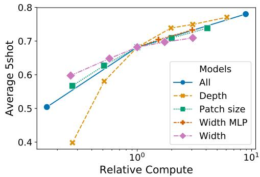  
图8：缩放Vision Transformer的不同模型维度。

## D.2 变换器形状

我们对Transformer架构不同维度的缩放进行了消融实验，以确定哪些维度最适合扩展到超大规模模型。图8展示了不同配置在ImageNet上的5-shot性能。所有配置均基于ViT模型，包含8层、D=1024、$D_{MLP}=2048$，且patch大小为32（所有曲线的交点）。可以看出，缩放深度带来的提升最为显著，在64层之前效果明显。然而，在16层之后已出现收益递减现象。有趣的是，缩放网络宽度似乎带来的变化最小。减小patch大小（从而增加有效序列长度）在未引入额外参数的情况下展现出惊人的稳健提升。这些发现表明，计算量可能比参数量更能预测性能，且若需侧重某一维度，深度应优先于宽度。总体而言，我们发现按比例缩放所有维度能带来稳健的性能提升。

## D.3 头部类型与分类令牌

为尽可能贴近原始Transformer模型，我们使用了额外的[class]令牌，并将其输出作为图像表示。该令牌的输出通过一个小型多层感知机（MLP）转换为类别预测，该MLP在单个隐藏层中使用tanh作为非线性激活函数。

这一设计继承自文本Transformer模型，并在主论文中全程使用。最初尝试仅使用图像块嵌入、对其进行全局平均池化（GAP）后接线性分类器（类似ResNet的最终特征图）的方法表现极差。然而，我们发现这既非额外令牌所致，也非GAP操作的问题。相反，性能差异完全源于对学习率的不同需求，如图9所示。

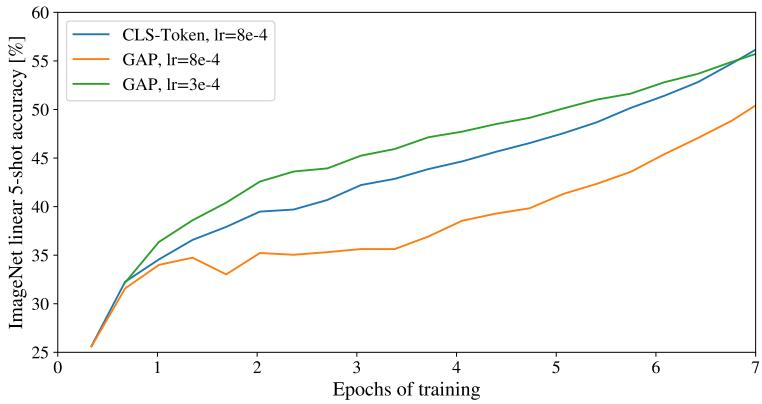

图9：分类令牌与全局平均池化分类器的对比。两者性能相当，但需要不同的学习率。
<table><tr><td>位置编码</td><td>默认/主干</td><td>每层</td><td>每层共享</td></tr><tr><td>无位置编码</td><td>0.61382</td><td>N/A</td><td>N/A</td></tr><tr><td>1-D位置编码</td><td>0.64206</td><td>0.63964</td><td>0.64292</td></tr><tr><td>2-D位置编码</td><td>0.64001</td><td>0.64046</td><td>0.64022</td></tr><tr><td>相对位置编码</td><td>0.64032</td><td>N/A</td><td>N/A</td></tr></table>

表8：使用ViT-B/16模型在ImageNet 5-shot线性评估上的位置编码消融实验结果。

## D.4 位置编码

我们对使用位置编码编码空间信息的不同方式进行了消融实验。尝试了以下情况：

• 不提供位置信息：将输入视为图像块集合。

• 一维位置嵌入：将输入视为按光栅顺序排列的补丁序列（本文所有其他实验的默认设置）。

• 二维位置嵌入：将输入视为二维网格中的补丁。在这种情况下，学习两组嵌入，分别对应 X 轴和 Y 轴，每组嵌入大小为 $D / 2$。然后，根据输入路径上的坐标，将 X 和 Y 嵌入拼接起来，得到该补丁的最终位置嵌入。

• 相对位置嵌入：利用补丁之间的相对距离（而非绝对位置）来编码空间信息。为此，我们使用一维相对注意力机制，定义所有可能补丁对之间的相对距离。因此，对于每一对（一个作为查询，另一个作为注意力机制中的键/值），我们有一个偏移量 $p _ { q } - p _ { k }$，每个偏移量对应一个嵌入。然后，我们简单地运行额外的注意力机制，使用原始查询（查询的内容），但将相对位置嵌入作为键。接着，我们将相对注意力机制得到的 logits 作为偏置项，在应用 softmax 之前将其添加到主注意力机制（基于内容的注意力机制）的 logits 中。

除了不同的空间信息编码方式外，我们还尝试了不同的方式将这些信息融入模型。对于一维和二维位置嵌入，我们尝试了三种不同情况：（1）在模型主干之后、将输入馈送到 Transformer 编码器之前，将位置嵌入添加到输入中（本文所有其他实验的默认设置）；（2）在每一层开始时学习并将位置嵌入添加到输入中；（3）在每一层开始时将学习到的位置嵌入添加到输入中（各层共享）。

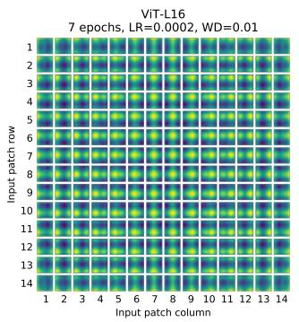

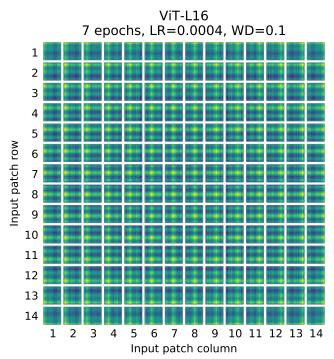

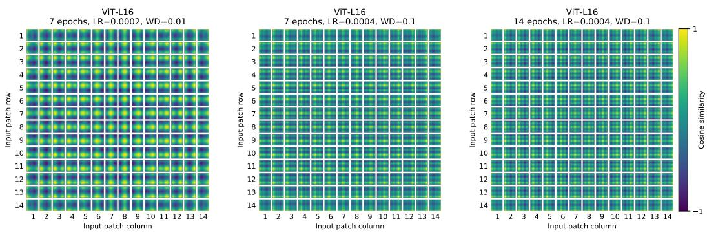

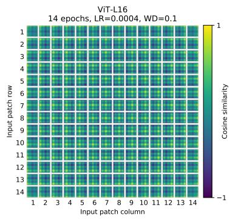  
图 10：使用不同超参数训练的模型的位置嵌入。

表8总结了在ViT-B/16模型上进行的消融实验结果。可以看出，虽然无位置嵌入的模型与有位置嵌入的模型在性能上存在显著差距，但不同位置信息编码方式之间的差异微乎其微。我们推测，由于Transformer编码器处理的是图像块级别的输入（而非像素级别），空间信息编码方式的差异变得不那么重要。具体而言，在图像块级别的输入中，空间维度远小于原始像素级输入（例如14×14对比$2 2 4 \times 2 2 4$），在此分辨率下学习空间关系对于这些不同的位置编码策略而言同样容易。即便如此，网络学习到的位置嵌入相似性具体模式仍取决于训练超参数（图10）。

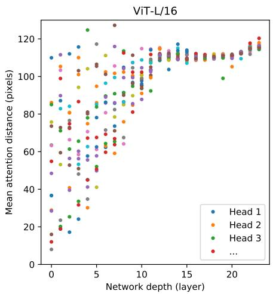

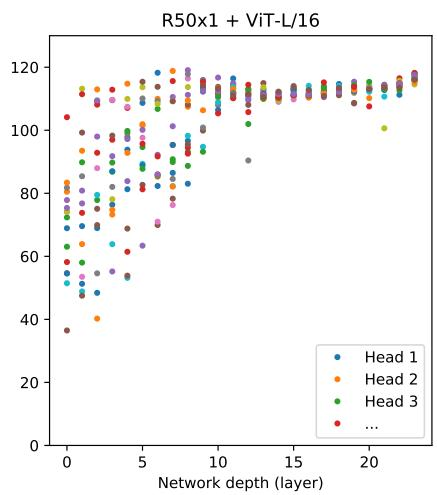  
图11：按注意力头和网络深度划分的注意力区域大小。通过计算128张示例图像中查询像素与所有其他像素之间距离的加权平均值（以注意力权重为权重），得到注意力距离。每个点表示某一层中16个注意力头之一在所有图像上的平均注意力距离。图像宽度为224像素。

## D.5 实际计算成本

我们还关注各架构在我们硬件上的实际运行速度——由于通道宽度和缓存大小等细节，理论FLOPs并不总能准确预测实际速度。为此，我们在TPUv3加速器上对主要模型的推理速度进行了计时；推理与反向传播速度的差异是一个与模型无关的常数因子。

图12（左）展示了在不同输入尺寸下，单个核心每秒可处理的图像数量。每个数据点对应在多种批量大小下测得的峰值性能。可以看出，ViT随图像尺寸的理论双二次缩放效应仅在最大模型处理最高分辨率时才开始显现。

另一个值得关注的指标是每个核心能容纳的最大批量大小（越大越有利于扩展至大规模数据集）。图12（右）展示了相同模型集合的这一指标。这表明，大型ViT模型在内存效率方面明显优于ResNet模型。

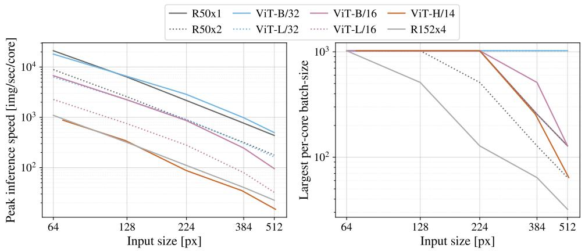  
图12：左图：不同架构在不同输入尺寸下的实际时钟计时。ViT模型的速度与同类ResNet相当。右图：不同架构在不同输入尺寸下设备上可容纳的最大单核心批量大小。ViT模型显然具有更高的内存效率。

## D.6 轴向注意力

轴向注意力（Huang et al., 2020; Ho et al., 2019）是一种简单而有效的技术，用于对组织为多维张量的大规模输入执行自注意力。轴向注意力的一般思想是执行多次注意力操作，每次沿输入张量的单个轴进行，而不是对输入的扁平化版本应用一维注意力。在轴向注意力中，每次注意力沿特定轴混合信息，同时保持其他轴上的信息独立。沿着这一思路，Wang et al. (2020b) 提出了AxialResNet模型，其中ResNet50中所有核大小为3×3的卷积被替换为轴向自注意力（即行和列注意力），并辅以相对位置编码。我们已将AxialResNet作为基线模型实现。

此外，我们修改了ViT，使其以二维形状处理输入（而非一维的块序列），并引入了轴向Transformer块。在这些块中，不再是自注意力后接MLP，而是行自注意力加MLP，再接列自注意力加MLP。

图13展示了在JFT数据集上预训练后，Axial ResNet、Axial-ViT-B/32和Axial-ViT-B/16在ImageNet 5-shot线性评估中的性能，与预训练计算量（以FLOPs数量和推理时间（每秒处理样本数）表示）的对比。如图所示，Axial-ViT-B/32和Axial-ViT-B/16在性能上均优于对应的ViT-B模型，但代价是计算量更大。这是因为在Axial-ViT模型中，每个包含全局自注意力的Transformer块被替换为两个轴向Transformer块（一个用于行自注意力，一个用于列自注意力）。尽管轴向情况下自注意力处理的序列长度更小，但每个轴向ViT块中多了一个MLP。对于AxialResNet，虽然其在精度/计算量权衡上表现合理（图13左），但其朴素实现在TPU上运行极慢（图13右）。

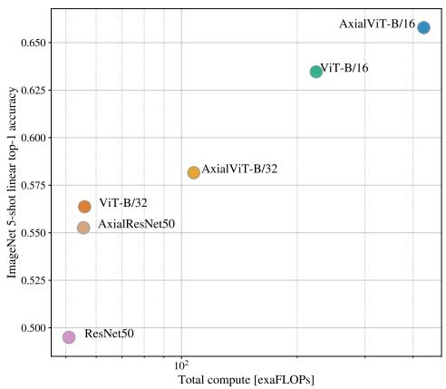

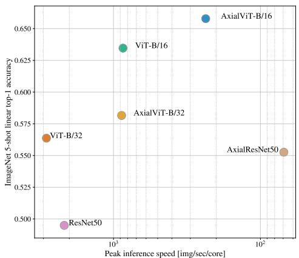  
图13：基于轴向注意力的模型在ImageNet 5-shot线性评估中的top-1准确率，与其速度（以FLOPs数量（左）和推理时间（右）表示）的对比。

## D.7 注意力距离

为了理解ViT如何利用自注意力机制整合图像中的信息，我们分析了不同层中注意力权重所覆盖的平均距离（图11）。这个“注意力距离”类似于CNN中的感受野大小。在较低层中，不同注意力头的平均距离差异很大，有些头关注图像的大部分区域，而另一些则关注查询位置附近的小区域。随着网络深度增加，所有注意力头的注意力距离也随之增大。在网络的后半部分，大多数头广泛关注各个token。

## D.8 注意力图

为了计算从输出token到输入空间的注意力图（图6和图14），我们使用了注意力展开方法（Abnar & Zuidema, 2020）。简而言之，我们平均了ViT-L/16所有头的注意力权重，然后递归地乘以所有层的权重矩阵。这考虑了所有层中token之间注意力的混合。

## D.9 ObjectNet结果

我们还按照Kolesnikov等人（2020）的评估设置，在ObjectNet基准上评估了我们的旗舰模型ViT-H/14，取得了82.1%的top-5准确率和61.7%的top-1准确率。

## D.10 VTAB细分

表9展示了在每个VTAB-1k任务上获得的分数。

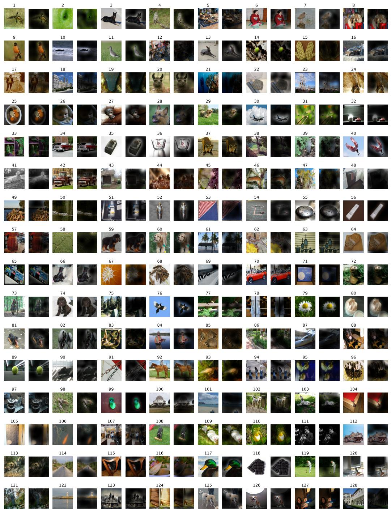  
图14：与图6类似的更多注意力图示例（随机选择）。

表9：VTAB-1k各任务性能细分。
<table><tr><td></td><td>CEereeaer ：</td><td>CIIPAPIO ：</td><td>DEE .</td><td>ToISE</td><td>sied</td><td>L63uns</td><td>NHAS</td><td>gaai.</td><td>Pto.I</td><td>Pssss5</td><td>Prrdorgner</td><td>Cerrelr</td><td>Cir-glst</td><td>qTia.</td><td>5oT-Jdsp </td><td>Qo-Idsp·</td><td>JTT-ILTT</td><td>STIIH-SRAIm</td><td>SIHTTEE</td><td>2aa</td></tr><tr><td>ViT-H/14 (JFT)</td><td>95.3</td><td>85.5</td><td>75.2</td><td>99.7</td><td>97.2</td><td>65.0</td><td>88.9</td><td>83.3</td><td>96.7</td><td>91.4</td><td>76.6</td><td>91.7</td><td>63.8</td><td>53.1</td><td>79.4</td><td>63.3</td><td>84.5</td><td>33.2</td><td>51.2</td><td>77.6</td></tr><tr><td>ViT-L/16 (JFT)</td><td>95.4</td><td>81.9</td><td>74.3</td><td>99.7</td><td>96.7</td><td>63.5</td><td>87.4</td><td>83.6</td><td>96.5</td><td>89.7</td><td>77.1</td><td>86.4</td><td>63.1</td><td>49.7</td><td>74.5</td><td>60.5</td><td>82. .2</td><td>36.2</td><td>51.1</td><td>76.3</td></tr><tr><td>ViT-L/16 (I21k)</td><td>90.8</td><td>84.1</td><td>74.1</td><td>99.3</td><td>92.7</td><td>61.0</td><td>80.9</td><td>82.5</td><td>95.6</td><td>85.2</td><td>75.3</td><td>70.3</td><td>56.1</td><td>41.9</td><td>74.7</td><td>64.9</td><td>79.9</td><td>30.5</td><td>41.7</td><td>72.7</td></tr></table>