# 自监督视觉Transformer中的涌现特性

Mathilde Caron1,2 Hugo Touvron1,3 Ishan Misra1 Herve Jegou ´ 1 Julien Mairal2 Piotr Bojanowski1 Armand Joulin1

1 Facebook AI Research 2 Inria∗ 3 索邦大学

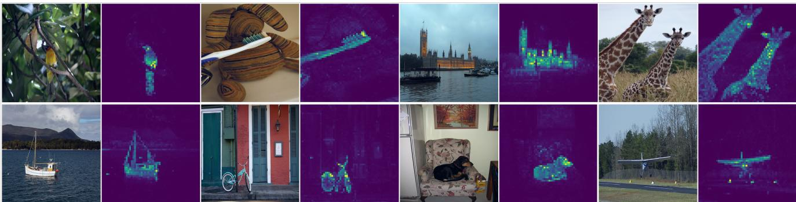  
图1：使用8×8图像块进行无监督训练的视觉Transformer的自注意力机制。我们观察最后一层各注意力头中[CLS]令牌的自注意力。该令牌未关联任何标签或监督信息。这些热图表明模型自动学习到类别特定特征，从而实现了无监督目标分割。

## 摘要

本文探究自监督学习是否为视觉Transformer（ViT）[19]提供了区别于卷积网络（convnets）的新特性。除了自监督方法在该架构上表现尤为出色外，我们观察到以下现象：首先，自监督ViT特征包含关于图像语义分割的显式信息，而监督ViT或卷积网络均未明显涌现此类特征。其次，这些特征同时也是优秀的k-NN分类器，在ImageNet上使用小型ViT即可达到78.3%的top-1准确率。我们的研究还强调了动量编码器[33]、多裁剪训练[10]以及ViT中小尺寸图像块的重要性。我们将这些发现整合为一种简单的自监督方法DINO，可将其解释为无标签的自蒸馏形式。通过ViT-Base在ImageNet线性评估中达到80.1%的top-1准确率，我们展示了DINO与ViT之间的协同效应。

## 1. 引言

Transformer[70]近期已成为视觉识别领域卷积神经网络（convnets）的替代方案[19, 69, 83]。其应用借鉴了自然语言处理（NLP）的训练策略，即在大规模数据上预训练，然后在目标数据集上微调[18, 55]。由此产生的视觉Transformer（ViT）[19]虽与卷积网络具有竞争力，但尚未展现出超越后者的明显优势：它们计算需求更高、需要更多训练数据，且其特征未表现出独特性质。

在本文中，我们质疑视觉Transformer表现平平是否可归因于其预训练中使用的监督方式。我们的动机源于：Transformer在自然语言处理领域成功的关键因素之一，是采用了自监督预训练——例如BERT中的完形填空任务[18]或GPT中的语言建模[55]。这些自监督预训练目标利用句子中的词语构建前置任务，相比为每个句子预测单一标签的监督目标，能提供更丰富的学习信号。类似地，在图像领域，图像级监督往往将图像中丰富的视觉信息简化为从预定义的数千个物体类别[60]中选出的单一概念。

尽管自然语言处理中使用的自监督前置任务具有文本特异性，但现有许多自监督方法已通过卷积神经网络在图像领域展现出潜力[10,12,30,33]。这些方法通常具有相似的结构，但采用不同组件来避免平凡解（坍缩）或提升性能[16]。受这些方法启发，本研究探讨了自监督预训练对ViT特征的影响。值得注意的是，我们发现了监督式ViT和卷积神经网络均未展现的若干有趣特性：

• 自监督ViT特征显式包含场景布局，特别是物体边界（如图1所示）。这些信息可直接从最后一个模块的自注意力层中获取。

• 自监督ViT特征在无需微调、线性分类器或数据增强的情况下，仅通过基础最近邻分类器（k-NN）即可在ImageNet上达到78.3%的top-1准确率。

分割掩码的涌现似乎是自监督方法的共有特性。但k-NN的优异性能仅在使用动量编码器[33]和多裁剪增强[10]等特定组件组合时才会出现。本研究的另一发现是：在ViT中使用更小尺寸的图像块对提升特征质量至关重要。

综合这些组件重要性的发现，我们设计了一种简单的自监督方法，可解释为无标签的知识蒸馏[35]。该框架DINO通过标准交叉熵损失直接预测教师网络（基于动量编码器构建）的输出，简化了自监督训练。有趣的是，该方法仅需对教师输出进行居中化和锐化处理即可避免坍缩，而预测器[30]、高级归一化[10]或对比损失[33]等其他流行组件在稳定性或性能方面贡献甚微。尤为重要的是，该框架具有灵活性，无需修改架构或调整内部归一化[58]即可同时适用于卷积神经网络和ViT。

我们进一步验证了DINO与ViT之间的协同作用，在ImageNet线性分类基准测试中，使用小补丁的ViT-Base模型取得了80.1%的top-1准确率，超越了之前的自监督特征。我们还通过ResNet-50架构匹配当前最优水平，证实了DINO在卷积网络上的有效性。最后，我们讨论了在计算和内存容量有限的情况下，使用DINO与ViT的不同场景。特别地，使用ViT训练DINO仅需两台8-GPU服务器运行3天，即可在ImageNet线性基准测试中达到76.1%的准确率，这超越了同等规模且计算需求显著降低的基于卷积网络的自监督系统[10, 30]。

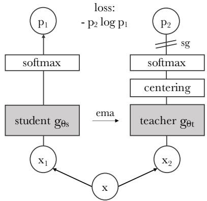  
图2：无标签的自蒸馏。为简化说明，我们展示了仅有一对视图（x1, x2）的情况。模型将输入图像经过两种不同的随机变换后分别输入学生网络和教师网络。两个网络具有相同的架构但参数不同。教师网络的输出通过批次均值进行中心化处理。每个网络输出一个K维特征，该特征在特征维度上通过温度softmax进行归一化。随后通过交叉熵损失衡量两者的相似性。我们在教师网络上应用停止梯度（sg）操作，使梯度仅通过学生网络传播。教师网络的参数通过学生网络参数的指数移动平均（ema）进行更新。

## 2. 相关工作

自监督学习。大量自监督学习研究聚焦于判别式方法，即所谓的实例分类[12, 20, 33, 73]，该方法将每张图像视为一个不同的类别，并通过数据增强来区分它们以训练模型。然而，显式学习一个分类器来区分所有图像[20]在图像数量增加时难以扩展。Wu等人[73]提出使用噪声对比估计（NCE）[32]来比较实例而非进行分类。这种方法的一个缺陷是需要同时比较大量图像的特征。在实践中，这需要大批量数据[12]或记忆库[33, 73]。多种变体允许以聚类形式自动对实例进行分组[2, 8, 9, 36, 42, 74, 80, 85]。

近期研究表明，我们可以在不区分图像的情况下学习无监督特征。其中特别值得关注的是，Grill等人[30]提出的度量学习框架BYOL，通过将特征与动量编码器获得的表征进行匹配训练。即使没有动量编码器，BYOL这类方法仍能工作，但性能会有所下降[16,30]。其他多项研究也呼应了这一方向，表明可以匹配更复杂的表征[26,27]、将特征训练至均匀分布[6]或通过白化方法[23,81]进行匹配。我们的方法受BYOL启发，但采用不同的相似度匹配损失函数，并且学生网络与教师网络使用完全相同的架构。通过这种方式，我们的研究完善了BYOL对自监督学习的解释——将其视为一种无标签的均值教师自蒸馏形式[65]。

**自训练与知识蒸馏**。自训练旨在通过将少量初始标注传播到大量无标签实例来提升特征质量。这种传播可通过硬标签分配[41,78,79]或软标签分配[76]实现。使用软标签时，该方法通常被称为知识蒸馏[7,35]，最初设计用于训练小型网络模仿大型网络输出以实现模型压缩。Xie等人[76]证明，蒸馏可用于在自训练流程中向无标签数据传播软伪标签，从而建立了自训练与知识蒸馏之间的重要联系。我们的工作基于这一关联，将知识蒸馏扩展至无标签场景。此前研究也已将自监督学习与知识蒸馏结合[25,63,13,47]，实现了自监督模型压缩与性能提升。但这些方法依赖预训练的固定教师网络，而我们的教师网络在训练过程中动态构建。通过这种方式，知识蒸馏不再作为自监督预训练的后处理步骤，而是直接成为自监督学习目标。最后，我们的工作还与协同蒸馏[1]相关——其中学生与教师采用相同架构并在训练中使用蒸馏。但协同蒸馏中的教师也会从学生处进行蒸馏，而我们的教师网络则通过学生网络的平均值进行更新。

## 3. 方法

## 3.1 基于知识蒸馏的自监督学习

本工作采用的框架DINO与近期自监督方法[10,16,12,30,33]具有相同的整体结构。但我们的方法也与知识蒸馏[35]存在相似性，并以此视角进行阐述。我们在图2中展示了DINO框架，并在算法1中提供了伪代码实现。

知识蒸馏是一种学习范式，其中我们训练一个学生网络 $g _ { \boldsymbol { \theta } _ { s } }$ 来匹配给定教师网络 $g _ { \boldsymbol { \theta } _ { t } }$ 的输出，这两个网络分别由参数 $\theta _ { s }$ 和 $\theta _ { t }$ 参数化。给定一个输入图像 $x$，两个网络输出 $K$ 维上的概率分布，分别记为 $P _ { s }$ 和 $P _ { t }$。概率 $P$ 是通过对网络 $g$ 的输出使用 softmax 函数进行归一化得到的。更精确地说，

$$
P _ { s } ( \boldsymbol { x } ) ^ { ( i ) } = \frac { \exp ( g _ { \theta _ { s } } ( \boldsymbol { x } ) ^ { ( i ) } / \tau _ { s } ) } { \sum _ { k = 1 } ^ { K } \exp ( g _ { \theta _ { s } } ( \boldsymbol { x } ) ^ { ( k ) } / \tau _ { s } ) } ,\tag{1}
$$

其中 $\tau _ { s } ~ > ~ 0$ 是一个温度参数，用于控制输出分布的尖锐程度，而 $P _ { t }$ 的类似公式成立，其温度为 $\tau _ { t }$。给定一个固定的教师网络 $g _ { \theta _ { t } }$，我们通过最小化关于学生网络参数 $\theta _ { s }$ 的交叉熵损失来学习匹配这些分布：

# gs, gt: 学生和教师网络   
# C: 中心 (K)   
# tps, tpt: 学生和教师温度   
# l, m: 网络和中心动量率   
gt.params = gs.params   
for x in loader: # 加载一个包含 n 个样本的小批量 x   
x1, x2 = augment(x), augment(x) # 随机视图   
s1, s2 = gs(x1), gs(x2) # 学生输出 n-by-K   
t1, t2 = gt(x1), gt(x2) # 教师输出 n-by-K   
loss = H(t1, s2)/2 + H(t2, s1)/2   
loss.backward() # 反向传播   
# 学生、教师和中心更新   
update(gs) # SGD   
gt.params = l\*gt.params + (1-l)\*gs.params   
C = m\*C + (1-m)\*cat([t1, t2]).mean(dim=0)   
def H(t, s):   
t = t.detach() # 停止梯度   
s = softmax(s / tps, dim=1)   
t = softmax((t - C) / tpt, dim=1) # 中心化 + 锐化   
return - (t \* log(s)).sum(dim=1).mean()

$$
\operatorname* { m i n } _ { \theta _ { s } } H ( P _ { t } ( x ) , P _ { s } ( x ) ) ,\tag{2}
$$

其中 $H ( a , b ) = - a \log b .$

接下来，我们详细说明如何将公式 (2) 中的问题适应到自监督学习。首先，我们使用多裁剪策略 [10] 构建同一图像的不同失真视图或裁剪块。更精确地说，从给定图像中，我们生成一组 $V$ 的不同视图。这组视图包含两个全局视图 $x _ { 1 } ^ { g }$ 和 $x _ { 2 } ^ { g }$，以及几个分辨率较小的局部视图。所有裁剪块都通过学生网络，而只有全局视图通过教师网络，从而鼓励“局部到全局”的对应关系。我们最小化损失：

$$
\operatorname* { m i n } _ { \theta _ { s } } \sum _ { x \in \{ x _ { 1 } ^ { g } , x _ { 2 } ^ { g } \} } \quad \sum _ { x ^ { \prime } \in V } \quad H ( P _ { t } ( x ) , P _ { s } ( x ^ { \prime } ) ) .\tag{3}
$$

该损失函数具有通用性，可应用于任意数量的视图，甚至仅两个视图。然而，我们遵循多裁剪的标准设置，使用2个分辨率为$2 2 4 ^ { \bar { 2 } }$的全局视图覆盖原始图像的大面积区域（例如大于50%），以及若干分辨率为$9 6 ^ { 2 }$的局部视图仅覆盖原始图像的小面积区域（例如小于50%）。除非另有说明，我们将此设置称为DINO的基本参数化。

两个网络共享相同的架构$g$，但具有不同的参数集$\theta _ { s }$和$\theta _ { t }$。我们通过随机梯度下降最小化公式(3)来学习参数$\theta _ { s }$。

表1：网络配置。"Blocks"表示Transformer块的数量，"dim"表示通道维度，"heads"表示多头注意力中的头数。"# tokens"表示考虑$2 2 4 ^ { 2 }$分辨率输入时的令牌序列长度，"# params"表示总参数量（不包含投影头），"im/s"表示在NVIDIA V100 GPU上每次前向传播处理128个样本时的推理时间。
<table><tr><td>模型</td><td>块数 维度 头数 令牌数 参数量 推理速度(im/s)</td><td></td><td></td><td></td><td></td></tr><tr><td>ResNet-50</td><td>1</td><td>2048</td><td>1 1</td><td>23M</td><td>1237</td></tr><tr><td>ViT-S/16</td><td>12</td><td>384</td><td>6 197</td><td>21M</td><td>1007</td></tr><tr><td>ViT-S/8</td><td>12</td><td>384</td><td>6 785</td><td>21M</td><td>180</td></tr><tr><td>ViT-B/16</td><td>12</td><td>768</td><td>12 197</td><td>85M</td><td>312</td></tr><tr><td>ViT-B/8</td><td>12</td><td>768</td><td>12 785</td><td>85M</td><td>63</td></tr></table>

教师网络。与知识蒸馏不同，我们并没有预先给定的教师网络 gθ，因此我们通过学生网络的历史迭代来构建它。我们在第5.2节中研究了教师网络的不同更新规则，并发现冻结教师网络一个周期在我们的框架中效果出奇地好，而直接复制学生权重则会导致无法收敛。特别值得注意的是，对学生权重使用指数移动平均（EMA），即动量编码器[33]，非常适合我们的框架。更新规则为 $\theta _ { t } \gets \lambda \theta _ { t } + ( 1 - \lambda ) \theta _ { s }$，其中 λ 在训练过程中遵循从0.996到1的余弦调度[30]。动量编码器最初被引入作为对比学习中的队列替代品[33]。然而，在我们的框架中，其作用有所不同，因为我们既没有队列也没有对比损失，可能更接近于自训练中使用的均值教师[65]的作用。实际上，我们观察到这种教师网络执行了一种类似于指数衰减的Polyak-Ruppert平均的模型集成形式[51, 59]。使用Polyak-Ruppert平均进行模型集成是提升模型性能的标准做法[38]。我们观察到，在整个训练过程中，这种教师网络的性能始终优于学生网络，因此通过提供更高质量的目标特征来指导学生网络的训练。这种动态在以往的研究中并未被观察到[30, 58]。

网络架构。神经网络 g 由主干网络 f（ViT [19] 或 ResNet [34]）和投影头 h 组成：$g = h \circ f$。下游任务中使用的特征是主干网络 f 的输出。投影头由一个隐藏维度为2048的3层多层感知器（MLP）构成，随后进行 $\ell_2$ 归一化，并连接一个具有K维度的权重归一化全连接层[61]，这与SwAV[10]的设计类似。我们测试了其他投影头，发现这种特定设计在DINO中效果最佳（附录C）。我们没有使用预测器[30, 16]，因此学生网络和教师网络采用完全相同的架构。特别值得注意的是，与标准卷积网络不同，ViT架构默认不使用批归一化（BN）。因此，当将DINO应用于ViT时，我们在投影头中也不使用任何BN，使得整个系统完全无需BN。

避免坍塌。多种自监督方法通过不同操作来避免坍塌，例如对比损失[73]、聚类约束[8, 10]、预测器[30]或批归一化[30, 58]。虽然我们的框架可以通过多种归一化[10]来稳定，但也可以仅通过动量教师输出的中心化和锐化来避免模型坍塌。如第5.3节实验所示，中心化可防止某一维度主导，但会促使输出向均匀分布坍塌，而锐化则具有相反效果。同时应用这两种操作可平衡其效果，足以在动量教师存在时避免坍塌。选择此方法避免坍塌时，以稳定性换取对批次的较低依赖：中心化操作仅依赖于一阶批次统计量，可解释为向教师输出添加偏置项c：$g _ { t } ( x ) \gets g _ { t } ( x ) + c$。中心c通过指数移动平均更新，使得该方法在不同批次大小下均能良好运行（如第5.5节所示）：

$$
c \leftarrow m c + (1 - m) \frac{1}{B} \sum_{i=1}^{B} g_{\theta_t}(x_i), \tag{4}
$$

其中$m > 0$为速率参数，$B$为批次大小。输出锐化通过设置教师softmax归一化中的低温参数$\tau_t$实现。

## 3.2. 实现与评估协议

本节提供使用DINO进行训练的详细实现，并介绍实验中采用的评估协议。

视觉Transformer。我们简要描述视觉Transformer（ViT）[19, 70]的机制，关于Transformer的细节请参考Vaswani等人[70]，关于其在图像上的适配请参考Dosovitskiy等人[19]。我们遵循DeiT[69]中的实现。表1总结了本文使用的不同网络配置。ViT架构将输入图像划分为分辨率为$N \times N$的非重叠连续图像块网格。本文通常使用$N=16$（$^6/_{16}^9$）或$N=8$（$^{66}/_8^9$）。这些图像块随后通过线性层形成一组嵌入。我们向序列中添加一个额外的可学习标记[18, 19]，该标记的作用是聚合整个序列的信息，并将投影头h附加在其输出上。为与先前工作[18, 19, 69]保持一致，我们称此标记为类别标记[CLS]，尽管在本研究中它不关联任何标签或监督。图像块标记和[CLS]标记的集合被输入到采用“预归一化”层归一化[11, 39]的标准Transformer网络中。Transformer由自注意力层和前馈层组成，并通过跳跃连接并行化。自注意力层通过注意力机制[4]查看其他标记表示来更新标记表示。

实现细节。我们在ImageNet数据集[60]上无标签预训练模型。使用AdamW优化器[44]进行训练，批大小为1024，当使用ViT-S/16时分布在16个GPU上。学习率在前10个epoch线性上升至基础值，该基础值由以下线性缩放规则[29]确定：lr = 0.0005 ∗ batchsize/256。预热后，我们采用余弦调度[43]衰减学习率。权重衰减也遵循从0.04到0.4的余弦调度。温度参数τ_s设为0.1，同时在前30个epoch对τ_t采用从0.04到0.07的线性预热。我们沿用BYOL[30]的数据增强方法（颜色抖动、高斯模糊和曝光过度）以及多裁剪[10]策略，并使用双三次插值调整位置嵌入以适应不同尺度[19, 69]。用于复现结果的代码和模型已公开。

评估协议。自监督学习的标准协议包括在冻结特征上训练线性分类器[82, 33]，或在下游任务中对特征进行微调。在线性评估中，我们在训练时应用随机裁剪和水平翻转增强，并报告中心裁剪的准确率。在微调评估中，我们使用预训练权重初始化网络并在训练过程中进行调整。然而，这两种评估对超参数敏感，例如当改变学习率时，我们观察到不同运行间的准确率存在较大差异。因此，我们还采用[73]中的简单加权最近邻分类器（k-NN）评估特征质量。我们冻结预训练模型，计算并存储下游任务训练数据的特征。最近邻分类器将图像特征与存储的k个最近特征进行匹配，由这些特征投票决定标签。我们遍历不同数量的最近邻，发现20个最近邻在大多数运行中表现最佳。该评估协议无需调整其他超参数或数据增强，仅需对下游数据集进行一次遍历即可完成，极大简化了特征评估流程。

表2：ImageNet上的线性与k-NN分类。我们报告了不同自监督方法在ImageNet验证集上的线性与k-NN评估的top-1准确率。主要关注ResNet-50和ViT-small架构，同时也列出了各架构下的最佳结果。标有∗的为我们的复现结果。我们对官方发布权重的模型进行了k-NN评估。吞吐量（im/s）基于NVIDIA V100 GPU计算，每次前向传播使用128个样本。参数量（M）为特征提取器的参数。

<table><tr><td>方法</td><td>架构</td><td>参数量</td><td>im/s</td><td>线性</td><td>k-NN</td></tr><tr><td>有监督</td><td>RN50</td><td>23</td><td>1237</td><td>79.3</td><td>79.3</td></tr><tr><td>SCLR [12]</td><td>RN50</td><td>23</td><td>1237</td><td>69.1</td><td>60.7</td></tr><tr><td>MoCov2[15]</td><td>RN50</td><td>23</td><td>1237</td><td>71.1</td><td>61.9</td></tr><tr><td>InfoMin [67]</td><td>RN50</td><td>23</td><td>1237</td><td>73.0</td><td>65.3</td></tr><tr><td>BarlowT [81]</td><td>RN50</td><td>23</td><td>1237</td><td>73.2</td><td>66.0</td></tr><tr><td>OBoW [27]</td><td>RN50</td><td>23</td><td>1237</td><td>73.8</td><td>61.9</td></tr><tr><td>BYOL [30]</td><td>RN50</td><td>23</td><td>1237</td><td>74.4</td><td>64.8</td></tr><tr><td>DCv2 [10]</td><td>RN50</td><td>23</td><td>1237</td><td>75.2</td><td>67.1</td></tr><tr><td>SwAV[10]</td><td>RN50</td><td>23</td><td>1237</td><td>75.3</td><td>65.7</td></tr><tr><td>DINO</td><td>RN50</td><td>23</td><td>1237</td><td>75.3</td><td>67.5</td></tr><tr><td>有监督</td><td>ViT-S</td><td>21</td><td>1007</td><td>79.8</td><td>79.8</td></tr><tr><td>BYOL* [30]</td><td>ViT-S</td><td>21</td><td>1007</td><td>71.4</td><td>66.6</td></tr><tr><td>MoCov2* [15]</td><td>ViT-S</td><td>21</td><td>1007</td><td>72.7</td><td>64.4</td></tr><tr><td>SwAV* [10]</td><td>ViT-S</td><td>21</td><td>1007</td><td>73.5</td><td>66.3</td></tr><tr><td>DINO</td><td>ViT-S</td><td>21</td><td>1007</td><td>77.0</td><td>74.5</td></tr><tr><td colspan="6">跨架构对比</td></tr><tr><td>SCLR [12]</td><td>RN50w4</td><td>375</td><td>117</td><td>76.8</td><td>69.3</td></tr><tr><td>SwAV[10]</td><td>RN50w2</td><td>93</td><td>384</td><td>77.3</td><td>67.3</td></tr><tr><td>BYOL [30]</td><td>RN50w2</td><td>93</td><td>384</td><td>77.4</td><td>1</td></tr><tr><td>DINO</td><td>ViT-B/16</td><td>85</td><td>312</td><td>78.2</td><td>76.1</td></tr><tr><td>SwAV [10]</td><td>RN50w5</td><td>586</td><td>76</td><td>78.5</td><td>67.1</td></tr><tr><td>BYOL [30]</td><td>RN50w4</td><td>375</td><td>117</td><td>78.6</td><td>1</td></tr><tr><td>BYOL [30]</td><td>RN200w2</td><td>250</td><td>123</td><td>79.6</td><td>73.9</td></tr><tr><td>DINO</td><td>ViT-S/8</td><td>21</td><td>180</td><td>79.7</td><td>78.3</td></tr><tr><td>SCLRv2 [13]</td><td>RN152w3+SK1</td><td>794</td><td>46</td><td>79.8</td><td>73.1</td></tr><tr><td>DINO</td><td>ViT-B/8</td><td>85</td><td>63</td><td>80.1</td><td>77.4</td></tr></table>

## 4. 主要结果

我们首先使用ImageNet上的标准自监督基准验证本研究中使用的DINO框架。随后，我们研究由此产生的特征在检索、目标发现和迁移学习中的特性。

## 4.1. 与ImageNet上的SSL框架对比

我们考虑两种不同的设置：相同架构下的对比和跨架构对比。

**相同架构下的对比。** 在表2的上半部分，我们将DINO与其他自监督方法在相同架构下进行比较，架构为ResNet-50 [34] 或ViT-small（遵循DeiT-S [69]的设计）。选择ViT-S的原因是它与ResNet-50在多个维度上具有相似性：参数量（21M vs 23M）、吞吐量（1237张/秒 vs 1007张/秒）以及采用[69]训练流程在ImageNet上的监督性能（79.3% vs 79.8%）。我们在附录D中探索了ViT-S的变体。首先，我们观察到DINO在ResNet-50上的表现与当前最优方法相当，验证了DINO在标准设置下的有效性。当切换到ViT架构时，DINO在线性分类上比BYOL、MoCov2和SwAV高出+3.5%，在k-NN评估中高出+7.9%。更令人惊讶的是，使用简单的k-NN分类器时，其性能几乎与线性分类器相当（74.5% vs 77.0%）。这一特性仅在使用ViT架构的DINO时出现，而在其他现有自监督方法或ResNet-50上并未显现。

表3：图像检索。我们比较了在ImageNet和Google地标v2（GLDv2）数据集上使用监督预训练或DINO预训练的现成特征的检索性能。报告了在revisited Oxford和Paris数据集上的mAP。在地标数据集上使用DINO预训练表现尤为出色。作为参考，我们还报告了使用现成特征的最佳检索方法[57]。
<table><tr><td colspan="3"></td><td colspan="2">ROx</td><td colspan="2">RPar</td></tr><tr><td>预训练</td><td>架构</td><td>预训练数据集</td><td>M</td><td>H</td><td>M</td><td>H</td></tr><tr><td>监督 [57]</td><td>RN101+R-MAC</td><td>ImNet</td><td>49.8</td><td>18.5</td><td>74.0</td><td>52.1</td></tr><tr><td>监督</td><td>ViT-S/16</td><td>ImNet</td><td>33.5</td><td>8.9</td><td>63.0</td><td>37.2</td></tr><tr><td>DINO</td><td>ResNet-50</td><td>ImNet</td><td>35.4</td><td>11.1</td><td>55.9</td><td>27.5</td></tr><tr><td>DINO</td><td>ViT-S/16</td><td>ImNet</td><td>41.8</td><td>13.7</td><td>63.1</td><td>34.4</td></tr><tr><td>DINO</td><td>ViT-S/16</td><td>GLDv2</td><td>51.5</td><td>24.3</td><td>75.3</td><td>51.6</td></tr></table>

## 跨架构比较

在表2的下半部分，我们比较了不同架构下的最佳性能。此设置的目的是不直接比较方法，而是评估使用DINO训练的ViT在扩展到更大架构时的性能极限。虽然使用DINO训练更大的ViT能提升性能，但减小补丁尺寸（“/8”变体）对性能的影响更大。尽管减小补丁尺寸不会增加参数量，但仍会导致运行时间显著减少和内存占用增加。尽管如此，使用DINO训练的8×8补丁基础ViT在线性分类中达到了80.1%的top-1准确率，在k-NN分类器中达到77.4%，其参数量比之前的最优方法[13]少10倍，运行速度快1.4倍。

## 4.2 使用SSL训练的ViT的特性

我们评估了DINO特征在最近邻搜索、保留物体位置信息以及向下游任务迁移方面的特性。

表4：复制检测。我们报告了在Copydays“强”子集[21]上的复制检测mAP性能。作为参考，我们还报告了专门针对特定物体检索训练的multigrain模型[5]的性能。
<table><tr><td>方法</td><td>架构</td><td>维度</td><td>分辨率</td><td>mAP</td></tr><tr><td>Multigrain [5]</td><td>ResNet-50</td><td>2048</td><td> $2 2 4 ^ { 2 }$ </td><td>75.1</td></tr><tr><td> Multigrain [5]</td><td>ResNet-50</td><td>2048</td><td>最长边800</td><td>82.5</td></tr><tr><td>监督学习 [69]</td><td>ViT-B/16</td><td>1536</td><td> $2 2 4 ^ { 2 }$ </td><td>76.4</td></tr><tr><td>DINO</td><td>ViT-B/16</td><td>1536</td><td> $2 2 4 ^ { 2 }$ </td><td>81.7</td></tr><tr><td>DINO</td><td>ViT-B/8</td><td>1536</td><td> $3 2 0 ^ { 2 }$ </td><td>85.5</td></tr></table>

## 4.2.1 使用DINO ViT进行最近邻检索

ImageNet分类的结果已经揭示了我们的特征在依赖最近邻检索的任务中的潜力。在本组实验中，我们进一步在地标检索和复制检测任务中巩固了这一发现。

图像检索。我们考虑了重新审视的[53]牛津和巴黎图像检索数据集[50]。它们包含3个难度逐渐增加的不同分割，每个分割包含查询/数据库对。我们报告了中等（M）和困难（H）分割的平均精度均值（mAP）。在表3中，我们比较了通过监督学习或DINO训练获得的不同现成特征的性能。我们冻结特征并直接应用k-NN进行检索。我们观察到，DINO特征优于那些在ImageNet上使用标签训练的特征。

SSL方法的一个优势在于，它们可以在任何数据集上进行训练，无需任何形式的标注。我们在Google Landmarks v2（GLDv2）[72]的120万张干净图像上训练了DINO，该数据集是一个专为检索任务设计的地标数据集。在GLDv2上训练的DINO ViT特征表现极为出色，超越了此前基于现成描述符的方法[68, 57]。

**复制检测。** 我们还评估了使用DINO训练的ViT在复制检测任务上的性能。我们在INRIA Copydays数据集[21]的“强”子集上报告了平均精度均值。该任务旨在识别经过模糊、插入、打印和扫描等扭曲处理的图像。遵循先前工作[5]，我们添加了从YFCC100M数据集[66]中随机采样的1万张干扰图像。我们直接使用预训练网络提取的特征进行余弦相似度计算，以完成复制检测。这些特征由输出[CLS]令牌和GeM池化[54]后的输出补丁令牌拼接而成，对于ViT-B模型，这生成了一个1536维的描述符。按照[5]的方法，我们对特征应用了白化处理。我们在从YFCC100M中额外选取的2万张随机图像上学习这一变换，这些图像与干扰图像不重复。表4显示，使用DINO训练的ViT在复制检测上具有很强的竞争力。

**表5：DAVIS 2017视频对象分割。** 我们评估了冻结特征在视频实例跟踪中的质量。报告了平均区域相似度$\mathcal { I } _ { m }$和平均轮廓精度$\mathcal { F } _ { m }$。我们与现有的自监督方法以及在ImageNet上训练的有监督ViT-S/8进行了比较。图像分辨率为480p。
<table><tr><td>方法</td><td>数据</td><td>架构</td><td> $( \mathcal { I } \& \mathcal { F } ) _ { m }$ </td><td> $\mathcal { I } _ { m }$ </td><td> $\mathcal { F } _ { m }$ </td></tr><tr><td>有监督</td><td></td><td></td><td></td><td></td><td></td></tr><tr><td>ImageNet</td><td>INet</td><td>ViT-S/8</td><td>66.0</td><td>63.9</td><td>68.1</td></tr><tr><td>STM [48]</td><td>I/D/Y</td><td>RN50</td><td>81.8</td><td>79.2</td><td>84.3</td></tr><tr><td colspan="6">自监督</td></tr><tr><td>CT [71]</td><td>VLOG</td><td>RN50</td><td>48.7</td><td>46.4</td><td>50.0</td></tr><tr><td>MAST[40]</td><td>YT-VOS</td><td>RN18</td><td>65.5</td><td>63.3</td><td>67.6</td></tr><tr><td>STC [37]</td><td>Kinetics</td><td>RN18</td><td>67.6</td><td>64.8</td><td>70.2</td></tr><tr><td>DINO</td><td>INet</td><td>ViT-S/16</td><td>61.8</td><td>60.2</td><td>63.4</td></tr><tr><td>DINO</td><td>INet</td><td>ViT-B/16</td><td>62.3</td><td>60.7</td><td>63.9</td></tr><tr><td>DINO</td><td>INet</td><td>ViT-S/8</td><td>69.9</td><td>66.6</td><td>73.1</td></tr><tr><td> DINO</td><td>INet</td><td>ViT-B/8</td><td>71.4</td><td>67.9</td><td>74.9</td></tr></table>

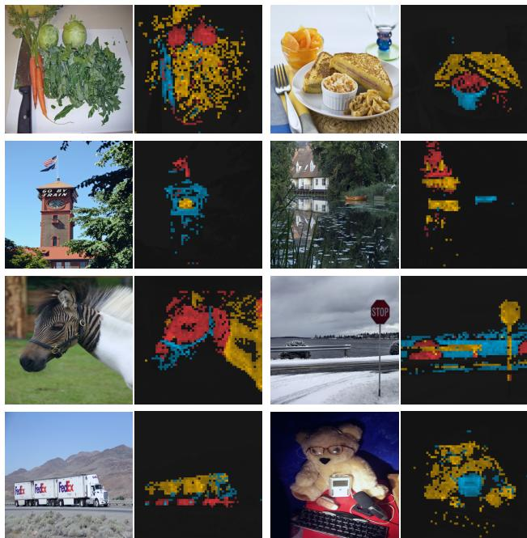  
图3：多头注意力图。我们选取了使用DINO训练的ViT-S/8最后一层的注意力头，并展示了[CLS]令牌查询的自注意力结果。不同颜色代表不同的注意力头，它们聚焦于图像中代表不同物体或部位的不同位置（更多示例见附录）。

## 4.2.2 发现场景的语义布局

如图1的定性结果所示，我们的自注意力图包含了图像分割的相关信息。在本研究中，我们通过标准基准测试以及直接评估从这些注意力图生成掩码的质量，来衡量这一特性。

视频实例分割。在表5中，我们评估了输出补丁令牌在DAVIS-2017视频实例分割基准[52]上的表现。我们遵循Jabri等人[37]的实验协议，通过连续帧之间的最近邻方法对场景进行分割；因此，我们既未在特征之上训练任何模型，也未针对该任务微调任何权重。从表5中可以看出，尽管我们的训练目标或架构并非为密集任务设计，但在此基准上的表现仍具有竞争力。由于网络未经过微调，模型的输出必然保留了一定的空间信息。最后，对于这一密集识别任务，小补丁（“/8”）的变体表现更优（ViT-B的$( \mathcal { I } \& \mathcal { F } ) _ { m }$提升了+9.1%）。

自注意力图探测。在图3中，我们展示了不同注意力头能够关注图像中不同的语义区域，即使这些区域被遮挡（第三行的灌木丛）或很小（第二行的旗帜）。可视化结果基于480p图像，对于ViT-S/8，生成了包含3601个令牌的序列。在图4中，我们通过定性和定量分析表明，有监督的ViT在杂乱场景中无法很好地关注物体。我们报告了真实分割掩码与通过阈值化自注意力图（保留60%质量）所得掩码之间的杰卡德相似度。需要注意的是，自注意力图是平滑的，且未针对生成掩码进行优化。尽管如此，我们仍观察到有监督模型与DINO模型之间存在显著差异，杰卡德相似度差距明显。此外，自监督卷积网络也包含分割信息，但需要专门的方法从其权重中提取[31]。

## 4.2.3 下游任务的迁移学习

在表6中，我们评估了使用DINO预训练的特征在不同下游任务上的质量。我们将其与在ImageNet上通过监督学习训练的相同架构的特征进行了比较。我们遵循Touvron等人[69]使用的协议，在每个下游任务上对特征进行微调。我们观察到，对于ViT架构，自监督预训练的迁移效果优于监督训练的特征，这与在卷积网络上观察到的结果一致[10, 33, 62]。最后，自监督预训练在ImageNet上显著提升了结果（+1-2%）。

## 5. DINO的消融研究

在本节中，我们实证研究了应用于ViT的DINO。本研究的模型为ViT-S。我们还请读者参考附录以获取更多研究。

## 5.1. 不同组件的重要性

我们展示了在基于我们的框架训练的ViT上，添加自监督学习的不同组件所带来的影响。

监督学习  
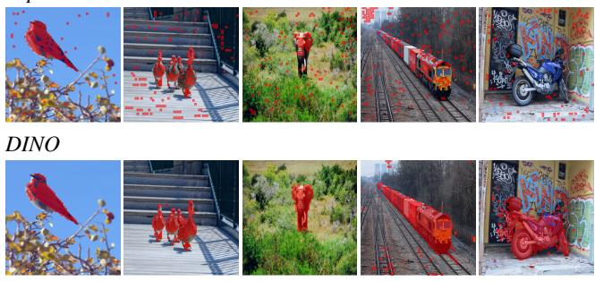

<table><tr><td></td><td>随机</td><td>监督学习</td><td>DINO</td></tr><tr><td>ViT-S/16</td><td>22.0</td><td>27.3</td><td>45.9</td></tr><tr><td>ViT-S/8</td><td>21.8</td><td>23.7</td><td>44.7</td></tr></table>

图4：监督学习与DINO的分割结果。我们展示了通过阈值化自注意力图以保留60%质量而获得的掩码。上方展示了使用监督学习和DINO训练的ViT-S/8的掩码结果。我们展示了两个模型的最佳头部。底部的表格比较了PASCAL VOC12数据集验证图像上这些掩码与真实标签的Jaccard相似度。

表6：通过在不同数据集上微调预训练模型进行迁移学习。我们报告了top-1准确率。使用DINO的自监督预训练迁移效果优于监督预训练。
<table><tr><td></td><td>Cifar10 Cifar100</td><td></td><td> $\mathrm { I N a t _ { 1 8 } }$ </td><td> $\mathrm { I N a t _ { 1 9 } }$ </td><td>Flwrs Cars INet</td><td></td><td></td></tr><tr><td>ViT-S/16</td><td></td><td></td><td></td><td></td><td></td><td></td><td></td></tr><tr><td>监督学习 [69]</td><td>99.0</td><td>89.5</td><td>70.7</td><td>76.6</td><td></td><td></td><td>98.292.1 79.9</td></tr><tr><td>DINO</td><td>99.0</td><td>90.5</td><td>72.0</td><td>78.2</td><td>98.5 93.0 81.5</td><td></td><td></td></tr><tr><td>ViT-B/16</td><td></td><td></td><td></td><td></td><td></td><td></td><td></td></tr><tr><td>监督学习 [69]</td><td>99.0</td><td>90.8</td><td>73.2</td><td>77.7</td><td></td><td></td><td>98.492.1 81.8</td></tr><tr><td>DINO</td><td>99.1</td><td>91.7</td><td>72.6</td><td>78.6</td><td></td><td></td><td>98.8 93.0 82.8</td></tr></table>

在表7中，我们报告了添加或移除不同组件后的模型变体。首先，我们观察到在没有动量的情况下，我们的框架无法工作（第2行），并且需要更高级的操作（例如SK）来避免崩溃（第9行）。然而，在使用动量时，SK的影响很小（第3行）。此外，比较第3行和第9行凸显了动量编码器对性能的重要性。其次，在第4行和第5行中，我们观察到多裁剪训练和DINO中的交叉熵损失是获得良好特征的重要组件。我们还观察到，在学生网络中添加预测器影响很小（第6行），而在BYOL中，预测器对于防止崩溃至关重要[16, 30]。为完整起见，我们在附录B中提供了此消融研究的扩展版本。

**补丁大小的重要性。** 在图5中，我们比较了使用不同补丁大小（16×16、8×8和5×5）训练的ViT-S模型的k-NN分类性能。我们还与使用16×16和8×8补丁的ViT-B进行了比较。所有模型均训练了300个epoch。我们观察到，随着补丁尺寸的减小，性能显著提升。有趣的是，在不增加额外参数的情况下，性能可以大幅提高。然而，使用更小补丁带来的性能提升是以吞吐量为代价的：当使用5×5补丁时，吞吐量降至44 im/s，而8×8补丁为180 im/s。

**表7：自监督ViT预训练的重要组件。** 模型使用ViT-S/16训练300个epoch。我们研究了在k-NN和线性（“Lin.”）评估中重要的不同组件。对于不同变体，我们标出了与默认DINO设置的差异。最佳组合是动量编码器结合多裁剪增强和交叉熵损失。我们还报告了BYOL [30]、MoCo-v2 [15]和SwAV [10]的结果。
<table><tr><td>方法</td><td>动量</td><td>SK</td><td>多裁剪</td><td>损失</td><td>预测器</td><td>k-NN</td><td>线性</td></tr><tr><td>DINO 1</td><td>√</td><td>×</td><td>√</td><td>CE</td><td>×</td><td>72.8</td><td>76.1</td></tr><tr><td>2</td><td>×</td><td>×</td><td>√</td><td>CE</td><td>×</td><td>0.1</td><td>0.1</td></tr><tr><td>3</td><td>√</td><td>√</td><td>√</td><td>CE</td><td>×</td><td>72.2</td><td>76.0</td></tr><tr><td>4</td><td>√</td><td>×</td><td>×</td><td>CE</td><td>×</td><td>67.9</td><td>72.5</td></tr><tr><td>5</td><td>√</td><td>×</td><td>√</td><td>MSE</td><td>×</td><td>52.6</td><td>62.4</td></tr><tr><td>6</td><td>√</td><td>×</td><td>√</td><td>CE</td><td>√</td><td>71.8</td><td>75.6</td></tr><tr><td>7 BYOL</td><td>√</td><td>×</td><td>×</td><td>MSE</td><td>√</td><td>66.6</td><td>71.4</td></tr><tr><td>8 MoCov2</td><td>√</td><td>×</td><td>×</td><td>INCE</td><td>×</td><td>62.0</td><td>71.6</td></tr><tr><td>9 SwAV</td><td>×</td><td>√</td><td>√</td><td>CE</td><td>×</td><td>64.7</td><td>71.8</td></tr></table>

SK：Sinkhorn-Knopp，MC：多裁剪，Pred.：预测器，CE：交叉熵，MSE：均方误差，INCE：InfoNCE

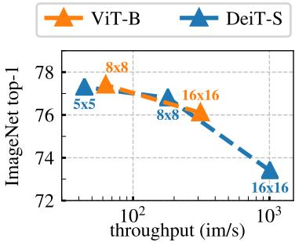  
图5：补丁大小的影响。使用ViT-B和ViT-S在不同输入补丁大小下，k-NN评估结果与吞吐量的关系。模型训练了300个周期。

## 5.2. 教师网络选择的影响

在本消融实验中，我们尝试不同的教师网络，以理解其在DINO中的作用。我们比较了使用k-NN协议训练300个周期的模型。

从学生网络构建不同的教师网络。在图6（右）中，我们比较了除动量教师外，从学生网络先前实例构建教师网络的不同策略。首先，我们考虑使用前一个周期的学生网络作为教师。该策略已在记忆库[73]或作为聚类硬蒸馏形式[8, 2, 14]中使用。其次，我们考虑使用前一次迭代的学生网络，以及学生网络的副本作为教师。在我们的设置中，使用基于学生网络近期版本的教师网络无法收敛。该设置需要更多归一化才能工作。有趣的是，我们观察到使用前一个周期的教师网络不会崩溃，其k-NN评估性能与MoCo-v2或BYOL等现有框架相当。虽然使用动量编码器明显优于这种朴素教师网络，但这一发现表明，仍有空间探索教师网络的替代方案。

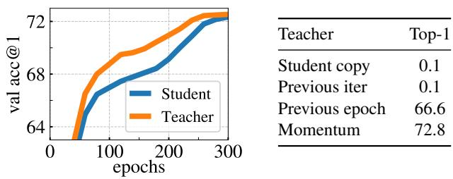  
图6：ImageNet验证集上使用k-NN分类器的Top-1准确率。（左）训练过程中动量教师与学生性能的比较。（右）不同类型教师网络的比较。动量编码器性能最佳，但并非唯一可行选项。

分析训练动态。为进一步理解动量教师网络在我们框架中表现良好的原因，我们在图6左面板中研究了ViT训练过程中的动态。一个关键观察是，该教师网络在训练过程中始终优于学生网络，我们在使用ResNet-50训练时也观察到相同行为（附录D）。其他使用动量的框架[33, 30]或从先前周期构建教师网络时均未观察到这一行为。我们提出将DINO中的动量教师网络解释为一种具有指数衰减的Polyak-Ruppert平均[51, 59]。Polyak-Ruppert平均常用于模拟模型集成，以提升训练结束时网络的性能[38]。我们的方法可解释为在训练过程中应用Polyak-Ruppert平均，持续构建具有优越性能的模型集成，然后该模型集成指导学生网络的训练[65]。

## 5.3. 避免坍缩

我们研究了中心化和目标锐化在避免坍缩中的互补作用。坍缩有两种形式：无论输入如何，模型输出要么在所有维度上均匀分布，要么被单一维度主导。中心化避免了由主导维度引起的坍缩，但会促使输出均匀化。而锐化则产生相反的效果。我们通过将交叉熵 H 分解为熵 h 和 KL 散度 $D _ { K L } \mathbf { \hat { . } }$ 来展示这种互补性。

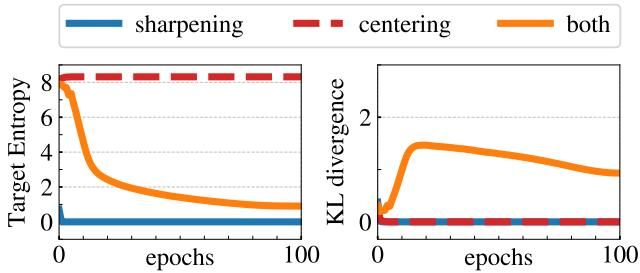  
图 7：坍缩研究。（左）：训练过程中教师目标熵的演变；（右）：教师与学生输出之间 KL 散度的演变。

表 8：时间与内存需求。我们展示了在两台 8-GPU 机器上运行 ViT-S/16 DINO 模型时的总运行时间和每 GPU 峰值内存（“mem.”）。我们报告了多种多裁剪变体（每种具有不同的计算需求）在 ImageNet 验证集上的 top-1 线性评估准确率。
<table><tr><td rowspan="2"> 多裁剪</td><td colspan="2">100 轮</td><td colspan="2">300 轮</td><td rowspan="2">内存</td></tr><tr><td>top-1</td><td>时间</td><td>top-1</td><td>时间</td></tr><tr><td> $2 \times 2 2 4 ^ { 2 }$ </td><td>67.8</td><td>15.3h</td><td>72.5</td><td>45.9h</td><td>9.3G</td></tr><tr><td> $2 \times 2 2 4 ^ { 2 } + 2 \times 9 6 ^ { 2 }$ </td><td>71.5</td><td>17.0h</td><td>74.5</td><td>51.0h</td><td>10.5G</td></tr><tr><td> $2 \times 2 2 4 ^ { 2 } + 6 \times 9 6 ^ { 2 }$ </td><td>73.8</td><td>20.3h</td><td>75.9</td><td>60.9h 1</td><td>12.9G</td></tr><tr><td> $2 \times 2 2 4 ^ { 2 } + 1 0 \times 9 6 ^ { 2 }$ </td><td>74.6</td><td>24.2h</td><td>76.1</td><td></td><td>72.6h 15.4G</td></tr><tr><td></td><td></td><td></td><td></td><td></td><td></td></tr></table>

$$
H ( P _ { t } , P _ { s } ) = h ( P _ { t } ) + D _ { K L } ( P _ { t } | P _ { s } ) .\tag{5}
$$

KL 散度为零表示输出恒定，从而发生坍缩。在图 7 中，我们绘制了在有无中心化和锐化情况下的训练过程中熵和 KL 散度的变化。如果缺少其中一种操作，KL 散度会收敛到零，表明发生坍缩。然而，熵 h 收敛到不同的值：无中心化时为 0，无锐化时为 $- \log ( 1 / K )$，这表明两种操作会导致不同形式的坍缩。同时应用这两种操作可以平衡这些效应（关于锐化参数 $\tau _ { t }$ 的研究见附录 D）。

## 5.4. 计算需求

在表 8 中，我们详细列出了在两台 8-GPU 机器上运行 ViT-S/16 DINO 模型时的时间和 GPU 内存需求。我们报告了多种多裁剪训练变体的结果，每种变体具有不同的计算需求。从表 8 中我们观察到，使用多裁剪可以改善 DINO 运行的准确率与运行时间之间的权衡。

例如，在不使用多裁剪（即2×224²）的情况下训练46小时后性能为72.5%，而DINO在$2 \times 224^2 + 10 \times 96^2$裁剪设置下仅需24小时即可达到74.6%。这实现了+2%的提升，同时所需时间减少一半，尽管内存占用更高（15.4G对比9.3G）。我们观察到，多裁剪带来的性能提升无法通过$2 \times 224^2$设置下的更长时间训练来弥补，这体现了"局部到全局"增强的价值。最后，在更长时间训练中，增加更多视图带来的增益逐渐减弱（从6×到10×96²裁剪仅提升+0.2%）。

总体而言，使用Vision Transformer训练DINO在3天内通过两台8-GPU服务器实现了76.1%的top-1准确率。这一结果超越了基于相似规模卷积网络的最先进自监督系统，同时显著降低了计算需求[30, 10]。我们的代码可在有限GPU数量上训练自监督ViT。

## 5.5. 小批量训练

<table><tr><td>批量大小</td><td>128</td><td>256</td><td>512</td><td>1024</td></tr><tr><td>top-1</td><td>57.9</td><td>59.1</td><td>59.6</td><td>59.9</td></tr></table>

表9：批量大小的影响。使用k-NN的top-1结果，模型训练100轮且未使用多裁剪。

在表9中，我们研究了批量大小对DINO特征的影响。同时研究了附录D中公式4的居中更新规则中平滑参数m的影响。我们根据批量大小线性调整学习率[29]：lr = 0.0005 * 批量大小/256。表9证实了我们可以通过小批量训练出高性能模型。较小批量（bs=128）的结果略低于默认训练设置（bs=1024），可能需要重新调整超参数（如动量率）。值得注意的是，批量大小为128的实验仅使用1块GPU运行。我们还探索了批量大小为8的训练，在50轮后达到35.2%，展示了训练每块GPU仅容纳单张图像的大模型的潜力。

## 6. 结论

在本工作中，我们展示了自监督预训练标准ViT模型的潜力，其性能可与专为此场景设计的最佳卷积网络相媲美。我们还发现了两个可在未来应用中利用的特性：k-NN分类中的特征质量在图像检索领域具有潜力（ViT已展现出令人期待的结果[22]）；特征中包含的场景布局信息也有助于弱监督图像分割。然而，本文的主要结论是：我们有证据表明自监督学习可能是基于ViT开发类似BERT模型的关键。未来，我们计划探索使用DINO在随机未筛选图像上预训练大型ViT模型是否能突破视觉特征的极限[28]。

致谢。我们感谢Mahmoud Assran、Matthijs Douze、Allan Jabri、Jure Zbontar、Alaaeldin El-Nouby、Y-Lan Boureau、Kaiming He、Thomas Lucas以及Thoth和FAIR团队在本项目中的帮助、支持与讨论。Julien Mairal获得了ERC资助（编号714381，SOLARIS项目）和ANR 3IA MIAI@Grenoble Alpes（ANR-19-P3IA-0003）的资助。

## 参考文献

[1] Rohan Anil, Gabriel Pereyra, Alexandre Passos, Robert Ormandi, George E Dahl, and Geoffrey E Hinton. 通过在线蒸馏的大规模分布式神经网络训练. arXiv预印本 arXiv:1804.03235, 2018. 3

[2] Yuki Markus Asano, Christian Rupprecht, and Andrea Vedaldi. 通过同步聚类与表示学习的自标注. 载于ICLR, 2020. 2, 9

[3] Mahmoud Assran, Nicolas Ballas, Lluis Castrejon, and Michael Rabbat. 在对比半监督视觉表示学习中恢复千万亿次浮点运算. 预印本 arXiv:2006.10803, 2020. 14

[4] Dzmitry Bahdanau, Kyunghyun Cho, and Yoshua Bengio. 通过联合学习对齐与翻译的神经机器翻译. 预印本 arXiv:1409.0473, 2014. 5

[5] Maxim Berman, Herve J ´ egou, Vedaldi Andrea, Iasonas ´ Kokkinos, and Matthijs Douze. MultiGrain：面向类别与实例的统一图像嵌入. arXiv预印本 arXiv:1902.05509, 2019. 6

[6] Piotr Bojanowski and Armand Joulin. 通过预测噪声的无监督学习. 载于ICML, 2017. 2

[7] Cristian Bucilua, Rich Caruana, and Alexandru Niculescu- ˇ Mizil. 模型压缩. 载于SIGKDD, 2006. 3

[8] Mathilde Caron, Piotr Bojanowski, Armand Joulin, and Matthijs Douze. 用于无监督学习视觉特征的深度聚类. 载于ECCV, 2018. 2, 4, 9, 16

[9] Mathilde Caron, Piotr Bojanowski, Julien Mairal, and Armand Joulin. 在非策划数据上的图像特征无监督预训练. 载于ICCV, 2019. 2, 16

[10] Mathilde Caron, Ishan Misra, Julien Mairal, Priya Goyal, Piotr Bojanowski, and Armand Joulin. 通过对比聚类分配的无监督视觉特征学习. 载于NeurIPS, 2020. 1, 2, 3, 4, 5, 7, 8, 10, 14, 15, 16, 17, 18

[11] Mia Xu Chen, Orhan Firat, Ankur Bapna, Melvin Johnson, Wolfgang Macherey, George Foster, Llion Jones, Niki Parmar, Mike Schuster, Zhifeng Chen, 等. 两全其美：结合神经机器翻译的最新进展. 预印本 arXiv:1804.09849, 2018. 5

[12] Ting Chen, Simon Kornblith, Mohammad Norouzi, and Geoffrey Hinton. 用于视觉表示对比学习的简单框架. 预印本 arXiv:2002.05709, 2020. 2, 3, 5, 16, 17

[13] Ting Chen, Simon Kornblith, Kevin Swersky, Mohammad Norouzi, and Geoffrey Hinton. 大型自监督模型是强大的半监督学习者. 载于NeurIPS, 2020. 3, 5, 6, 14

[14] Weijie Chen, Shiliang Pu, Di Xie, Shicai Yang, Yilu Guo, and Luojun Lin. 用于深度表示学习的无监督图像分类. arXiv预印本 arXiv:2006.11480, 2020. 9, 15

[15] 陈鑫磊、范浩奇、罗斯·吉尔希克、何恺明。基于动量对比学习的改进基线。预印本 arXiv:2003.04297，2020年。第5、8、14、15、18页。

[16] 陈鑫磊、何恺明。探索简单孪生表示学习。预印本 arXiv:2011.10566，2020年。第2、3、4、8、14、16、18页。

[17] 马尔科·库图里。Sinkhorn距离：最优传输的光速计算。发表于NeurIPS，2013年。第15页。

[18] 雅各布·德夫林、张明伟、肯顿·李、克里斯蒂娜·图塔诺娃。Bert：用于语言理解的深度双向Transformer预训练。预印本 arXiv:1810.04805，2018年。第1、4、5、19页。

[19] 阿列克谢·多索维茨基、卢卡斯·拜尔、亚历山大·科列斯尼科夫、德克·魏森伯恩、翟晓华、托马斯·温特辛纳、穆斯塔法·德赫加尼、马蒂亚斯·明德勒、格奥尔格·海戈尔德、西尔万·热利等。一张图像等于16x16个词：用于大规模图像识别的Transformer。预印本 arXiv:2010.11929，2020年。第1、4、5、13页。

[20] 阿列克谢·多索维茨基、菲利普·费舍尔、约斯特·托比亚斯·斯普林根伯格、马丁·里德米勒、托马斯·布罗克斯。基于示例卷积神经网络的判别式无监督特征学习。TPAMI，2016年。第2页。

[21] 马泰斯·杜兹、埃尔韦·热古、哈西姆拉特·桑达瓦利亚、洛朗·阿姆萨莱格、科迪莉亚·施密德。面向网络规模图像搜索的GIST描述符评估。发表于CIVR，2009年。第6页。

[22] 阿拉埃尔丁·埃尔-努比、娜塔莉亚·涅韦罗娃、伊万·拉普捷夫、埃尔韦·热古。训练用于图像检索的视觉Transformer。预印本 arXiv:2102.05644，2021年。第10页。

[23] 亚历山大·叶尔莫洛夫、亚历山大·西亚罗欣、恩维尔·桑吉内托、尼库·塞贝。用于自监督表示学习的白化处理。预印本 arXiv:2007.06346，2020年。第2页。

[24] 马克·埃弗林厄姆、吕克·范·古尔、克里斯托弗·KI·威廉姆斯、约翰·温、安德鲁·齐瑟曼。PASCAL视觉对象类别（VOC）挑战赛。IJCV，2010年。第13页。

[25] 方志远、王剑锋、王丽娟、张磊、杨叶舟、刘子成。Seed：用于视觉表示的自监督蒸馏。2021年。第3页。

[26] 斯皮罗斯·吉达里斯、安德烈·布尔苏克、尼科斯·科莫达基斯、帕特里克·佩雷斯、马蒂厄·科尔德。通过预测视觉词袋学习表示。发表于CVPR，2020年。第2页。

[27] 斯皮罗斯·吉达里斯、安德烈·布尔苏克、吉勒·皮伊、尼科斯·科莫达基斯、马蒂厄·科尔德、帕特里克·佩雷斯。用于无监督表示学习的在线视觉词袋生成。arXiv预印本 arXiv:2012.11552，2020年。第2、5页。

[28] 普里亚·戈亚尔、马蒂尔德·卡隆、本杰明·勒福多、徐敏、王鹏超、维韦克·帕伊、曼纳特·辛格、维塔利·利普钦斯基、伊尚·米斯拉、阿尔芒·朱兰等。野外视觉特征的自监督预训练。预印本 arXiv:2103.01988，2021年。第10页。

[29] 普里亚·戈亚尔、彼得·多拉尔、罗斯·吉尔希克、彼得·诺尔德赫伊斯、卢卡什·韦索沃夫斯基、阿波·屈勒莱、安德鲁·塔洛克、贾阳青、何恺明。准确的大批量SGD：一小时内训练ImageNet。预印本 arXiv:1706.02677，2017年。第5、10页。

[30] Jean-Bastien Grill, Florian Strub, Florent Altche, Corentin Tallec, Pierre H Richemond, Elena Buchatskaya, Carl Doersch, Bernardo Avila Pires, Zhaohan Daniel Guo, Mohammad Gheshlaghi Azar, Bilal Piot, Koray Kavukcuoglu, Remi Munos, 和 Michal Valko. 自举你的潜在表示：一种新的自监督学习方法. 发表于 NeurIPS, 2020. 2, 3, 4, 5, 8, 9, 10, 14, 15, 16, 18

[31] Shir Gur, Ameen Ali, 和 Lior Wolf. 通过归因引导分解可视化有监督和自监督神经网络. 预印本 arXiv:2012.02166, 2020. 7

[32] Michael Gutmann 和 Aapo Hyvarinen. 噪声对比估计：非归一化统计模型的新估计原理. 发表于国际人工智能与统计会议, 2010. 2

[33] Kaiming He, Haoqi Fan, Yuxin Wu, Saining Xie, 和 Ross Girshick. 用于无监督视觉表示学习的动量对比. 发表于 CVPR, 2020. 1, 2, 3, 4, 5, 7, 9, 16

[34] Kaiming He, Xiangyu Zhang, Shaoqing Ren, 和 Jian Sun. 用于图像识别的深度残差学习. 发表于 CVPR, 2016. 4, 5

[35] Geoffrey Hinton, Oriol Vinyals, 和 Jeff Dean. 在神经网络中蒸馏知识. 预印本 arXiv:1503.02531, 2015. 2, 3

[36] Jiabo Huang, Qi Dong, Shaogang Gong, 和 Xiatian Zhu. 通过邻域发现进行无监督深度学习. 发表于 ICML, 2019. 2

[37] Allan Jabri, Andrew Owens, 和 Alexei A Efros. 时空对应作为对比随机游走. 2020. 7

[38] Sebastien Jean, Kyunghyun Cho, Roland Memisevic, 和 Yoshua Bengio. 关于在神经机器翻译中使用非常大的目标词汇表. 预印本 arXiv:1412.2007, 2014. 4, 9

[39] Guillaume Klein, Yoon Kim, Yuntian Deng, Jean Senellart, 和 Alexander M Rush. Opennmt：用于神经机器翻译的开源工具包. 预印本 arXiv:1701.02810, 2017. 5

[40] Zihang Lai, Erika Lu, 和 Weidi Xie. Mast：一种记忆增强的自监督跟踪器. 发表于 CVPR, 2020. 7

[41] Dong-Hyun Lee 等. 伪标签：用于深度神经网络的简单高效半监督学习方法. 发表于 ICML 表示学习挑战研讨会, 2013. 3

[42] Junnan Li, Pan Zhou, Caiming Xiong, 和 Steven C.H. Hoi. 无监督表示的原型对比学习. ICLR, 2021. 2

[43] Ilya Loshchilov 和 Frank Hutter. Sgdr：带热重启的随机梯度下降. 预印本 arXiv:1608.03983, 2016. 5

[44] Ilya Loshchilov 和 Frank Hutter. 修复 Adam 中的权重衰减正则化. 2018. 5

[45] Julien Mairal. Cyanure：用于 Python、C++ 及更多语言的经验风险最小化开源工具箱. 预印本 arXiv:1912.08165, 2019. 13, 14

[46] Maria-Elena Nilsback 和 Andrew Zisserman. 基于大量类别的自动花卉分类. 发表于 2008 年第六届印度计算机视觉、图形与图像处理会议, 2008. 13

[47] Mehdi Noroozi, Ananth Vinjimoor, Paolo Favaro, 和 Hamed Pirsiavash. 通过知识迁移提升自监督学习. 发表于 CVPR, 2018. 3

[48] Seoung Wug Oh, Joon-Young Lee, Ning Xu, and Seon Joo Kim. 基于时空记忆网络的视频目标分割. 见于ICCV, 2019. 7

[49] Hieu Pham, Qizhe Xie, Zihang Dai, and Quoc V Le. 元伪标签. 预印本arXiv:2003.10580, 2020. 14

[50] James Philbin, Ondrej Chum, Michael Isard, Josef Sivic, and Andrew Zisserman. 量化中的迷失：改进大规模图像数据库中的特定目标检索. 见于CVPR, 2008. 6

[51] Boris T Polyak and Anatoli B Juditsky. 通过平均加速随机逼近. SIAM控制与优化杂志, 30(4):838–855, 1992. 4, 9, 17

[52] Jordi Pont-Tuset, Federico Perazzi, Sergi Caelles, Pablo Arbelaez, Alex Sorkine-Hornung, and Luc Van Gool. 2017年DAVIS视频目标分割挑战赛. 预印本arXiv:1704.00675, 2017. 7

[53] Filip Radenovic, Ahmet Iscen, Giorgos Tolias, Yannis Avrithis, and Ondrej Chum. 重新审视牛津与巴黎：大规模图像检索基准测试. 2018. 6

[54] Filip Radenovic, Giorgos Tolias, and Ondrej Chum. 无人工标注的CNN图像检索微调. IEEE模式分析与机器智能汇刊, 2018. 6

[55] Alec Radford, Jeffrey Wu, Rewon Child, David Luan, Dario Amodei, and Ilya Sutskever. 语言模型是无监督的多任务学习器. 1

[56] Ilija Radosavovic, Raj Prateek Kosaraju, Ross Girshick, Kaiming He, and Piotr Dollar. 设计网络设计空间. 见于CVPR, 2020. 13

[57] Jerome Revaud, Jon Almazan, Rafael S Rezende, and Cesar Roberto de Souza. 基于平均精度的学习：使用列表损失训练图像检索. 见于ICCV, 2019. 6

[58] Pierre H Richemond, Jean-Bastien Grill, Florent Altche, Corentin Tallec, Florian Strub, Andrew Brock, Samuel Smith, Soham De, Razvan Pascanu, Bilal Piot, et al. BYOL即使没有批量统计也能工作. 预印本arXiv:2010.10241, 2020. 2, 4

[59] David Ruppert. 基于慢收敛Robbins-Monro过程的高效估计. 技术报告, 1988. 4, 9

[60] Olga Russakovsky, Jia Deng, Hao Su, Jonathan Krause, Sanjeev Satheesh, Sean Ma, Zhiheng Huang, Andrej Karpathy, Aditya Khosla, Michael Bernstein, Alexander C Berg, and Li Fei-Fei. ImageNet大规模视觉识别挑战赛. IJCV, 2015. 1, 5, 13

[61] Tim Salimans and Diederik P Kingma. 权重归一化：一种加速深度神经网络训练的简单重参数化方法. NeurIPS, 2016. 4, 16

[62] Mert Bulent Sariyildiz, Yannis Kalantidis, Diane Larlus, and Karteek Alahari. 视觉表示学习中的概念泛化. arXiv预印本arXiv:2012.05649, 2020. 7

[63] Zhiqiang Shen, Zechun Liu, Jie Qin, Lei Huang, Kwang-Ting Cheng, and Marios Savvides. S2-BNN：通过引导分布校准弥合自监督实值网络与1位神经网络之间的差距. arXiv预印本arXiv:2102.08946, 2021. 3

[64] Kihyuk Sohn, David Berthelot, Chun-Liang Li, Zizhao Zhang, Nicholas Carlini, Ekin D Cubuk, Alex Kurakin, Han Zhang, 和 Colin Raffel. Fixmatch: 利用一致性和置信度简化半监督学习. 发表于 NeurIPS, 2020. 14

[65] Antti Tarvainen 和 Harri Valpola. 均值教师是更好的角色模型：加权平均一致性目标改进半监督深度学习结果. 预印本 arXiv:1703.01780, 2017. 3, 4, 9, 17

[66] Bart Thomee, David A Shamma, Gerald Friedland, Benjamin Elizalde, Karl Ni, Douglas Poland, Damian Borth, 和 Li-Jia Li. Yfcc100m: 多媒体研究中的新数据. arXiv 预印本 arXiv:1503.01817, 2015. 6

[67] Yonglong Tian, Chen Sun, Ben Poole, Dilip Krishnan, Cordelia Schmid, 和 Phillip Isola. 什么构成对比学习中的良好视图. NeurIPS, 2020. 5

[68] Giorgos Tolias, Ronan Sicre, 和 Herve J´egou. 利用CNN激活的积分最大池化进行特定物体检索. arXiv 预印本 arXiv:1511.05879, 2015. 6

[69] Hugo Touvron, Matthieu Cord, Matthijs Douze, Francisco Massa, Alexandre Sablayrolles, 和 Herve J´egou. 训练数据高效的图像变换器及通过注意力进行蒸馏. 预印本 arXiv:2012.12877, 2020. 1, 4, 5, 6, 7, 8, 13, 17

[70] Ashish Vaswani, Noam Shazeer, Niki Parmar, Jakob Uszkoreit, Llion Jones, Aidan N Gomez, Łukasz Kaiser, 和 Illia Polosukhin. 注意力机制即一切. 发表于 NeurIPS, 2017. 1, 4

[71] Xiaolong Wang, Allan Jabri, 和 Alexei A Efros. 从时间循环一致性中学习对应关系. 发表于 CVPR, 2019. 7

[72] Tobias Weyand, Andre Araujo, Bingyi Cao, 和 Jack Sim. Google地标数据集v2——用于实例级识别与检索的大规模基准. 2020. 6

[73] Zhirong Wu, Yuanjun Xiong, Stella X Yu, 和 Dahua Lin. 通过非参数实例判别进行无监督特征学习. 发表于 CVPR, 2018. 2, 4, 5, 9, 18

[74] Junyuan Xie, Ross Girshick, 和 Ali Farhadi. 用于聚类分析的无监督深度嵌入. 发表于 ICML, 2016. 2

[75] Qizhe Xie, Zihang Dai Dai, Eduard Hovy, Minh-Thang Luong, 和 Quoc V. Le. 用于一致性训练的无监督数据增强. 预印本 arXiv:1904.12848, 2020. 14

[76] Qizhe Xie, Minh-Thang Luong, Eduard Hovy, 和 Quoc V Le. 带噪声学生的自训练改进ImageNet分类. 发表于 CVPR, 2020. 3

[77] Haohang Xu, Xiaopeng Zhang, Hao Li, Lingxi Xie, Hongkai Xiong, 和 Qi Tian. 播种视图：用于对比表示学习的层次语义对齐. arXiv 预印本 arXiv:2012.02733, 2021. 16

[78] Qiantong Xu, Tatiana Likhomanenko, Jacob Kahn, Awni Hannun, Gabriel Synnaeve, 和 Ronan Collobert. 用于语音识别的迭代伪标签方法. 预印本 arXiv:2005.09267, 2020. 3

[79] I Zeki Yalniz, Herve J´egou, Kan Chen, Manohar Paluri, 和 Dhruv Mahajan. 十亿级半监督学习用于图像分类. 预印本 arXiv:1905.00546, 2019. 3

[80] Jianwei Yang, Devi Parikh, 和 Dhruv Batra. 联合无监督学习深度表示与图像聚类. 载于 CVPR, 2016. 2

[81] Jure Zbontar, Li Jing, Ishan Misra, Yann LeCun, 和 Stephane ´ Deny. 巴洛双胞胎：通过冗余减少实现自监督学习. arXiv预印本 arXiv:2103.03230, 2021. 2, 5

[82] Richard Zhang, Phillip Isola, 和 Alexei A Efros. 彩色图像着色. 载于 ECCV, 2016. 5

[83] Hengshuang Zhao, Jiaya Jia, 和 Vladlen Koltun. 探索图像识别的自注意力机制. 载于 CVPR, 2020. 1

[84] Bolei Zhou, Agata Lapedriza, Jianxiong Xiao, Antonio Torralba, 和 Aude Oliva. 利用场景数据库学习场景识别的深度特征. 载于 NeurIPS, 2014. 13

[85] Chengxu Zhuang, Alex Lin Zhai, 和 Daniel Yamins. 用于无监督视觉嵌入学习的局部聚合. 载于 ICCV, 2019. 2

## 附录

## A. 附加结果

**k-NN 分类.** 在表10中，我们评估了使用DINO预训练的ResNet-50或ViT-small提供的冻结表示，采用两种评估协议：线性分类或k-NN分类。对于这两种评估，我们从预训练网络中提取表示，且不使用任何数据增强。然后，我们使用加权k-NN或通过cyanure库[45]学习的线性回归进行分类。在表10中，我们看到ViT-S的准确率在使用线性分类器或k-NN分类器时均优于RN50。然而，使用k-NN评估时的性能差距比线性评估时更为显著。例如，在ImageNet 1%上，ViT-S通过k-NN评估以+14.1%的大幅优势超越ResNet-50。这表明，使用DINO训练的Transformer架构可能提供更大的模型灵活性，从而有利于k-NN评估。k-NN分类器具有快速且轻量部署的巨大优势，且无需任何领域适应。总体而言，使用DINO训练的ViT提供的特征与k-NN分类器结合得尤为出色。

ViT的自监督ImageNet预训练。在本实验中，我们研究了使用我们的方法对监督ViT模型进行预训练的影响。在表11中，我们比较了使用不同预训练初始化或在训练过程中使用额外预训练卷积网络引导的监督ViT模型的性能。第一组模型在包含3亿张图像的大型精选数据集上，分别使用有监督和无监督方式进行预训练。第二组模型通过从预训练的有监督RegNetY [56]进行硬知识蒸馏来训练。最后一组模型不使用任何额外数据或模型，要么随机初始化，要么在ImageNet上使用DINO进行预训练后初始化。与随机初始化相比，使用DINO预训练带来了+1%的性能提升。这并非由更长的训练时间导致，因为使用有监督预训练而非DINO并未提升性能。使用自监督预训练缩小了与使用额外数据预训练或从卷积网络蒸馏的模型之间的差距。

表10：使用DINO预训练的ViT-S/16和ResNet-50的k-NN和线性评估。我们使用了ImageNet-1k [60]（“Inet”）、Places205 [84]、PASCAL VOC [24]和Oxford-102花卉（“FLOWERS”）[46]。使用DINO训练的ViT提供的特征特别适合k-NN。
<table><tr><td rowspan="2"></td><td colspan="3">逻辑回归</td><td colspan="3">k-NN</td></tr><tr><td>RN50</td><td>ViT-S</td><td>△</td><td>RN50</td><td>ViT-S</td><td>△</td></tr><tr><td>Inet 100%</td><td>72.1</td><td>75.7</td><td>3.6</td><td>67.5</td><td>74.5</td><td>7.0</td></tr><tr><td>Inet 10%</td><td>67.8</td><td>72.2</td><td>4.4</td><td>59.3</td><td>69.1</td><td>9.8</td></tr><tr><td>Inet 1%</td><td>55.1</td><td>64.5</td><td>9.4</td><td>47.2</td><td>61.3</td><td>14.1</td></tr><tr><td>P1. 10%</td><td>53.4</td><td>52.1</td><td>-1.3</td><td>46.9</td><td>48.6</td><td>1.7</td></tr><tr><td>P1. 1%</td><td>46.5</td><td>46.3</td><td>-0.2</td><td>39.2</td><td>41.3</td><td>2.1</td></tr><tr><td>VOC07</td><td>88.9</td><td>89.2</td><td>0.3</td><td>84.9</td><td>88.0</td><td>3.1</td></tr><tr><td>FLOWERS</td><td>95.6</td><td>96.4</td><td>0.8</td><td>87.9</td><td>89.1</td><td>1.2</td></tr><tr><td>平均△</td><td></td><td></td><td>2.4</td><td></td><td></td><td>5.6</td></tr></table>

表11：不同预训练方式下的ImageNet分类结果。使用不同预训练方法或额外预训练卷积网络指导训练的监督ViT-B/16模型在ImageNet上的Top-1准确率。各方法采用不同图像分辨率（"res."）和训练流程（"tr. proc."），即数据增强与优化策略。"MPP"为掩码补丁预测。
<table><tr><td colspan="2">预训练</td><td colspan="3"></td></tr><tr><td>方法</td><td>数据</td><td>分辨率</td><td>训练流程</td><td>Top-1</td></tr><tr><td colspan="5">额外数据预训练</td></tr><tr><td>MPP</td><td>JFT-300M</td><td>384</td><td>[19]</td><td>79.9</td></tr><tr><td>监督学习</td><td>JFT-300M</td><td>384</td><td>[19]</td><td>84.2</td></tr><tr><td colspan="5">使用额外模型训练</td></tr><tr><td>随机初始化</td><td>=</td><td>224</td><td>[69]</td><td>83.4</td></tr><tr><td colspan="5">无额外数据或模型</td></tr><tr><td>随机初始化</td><td></td><td>224</td><td>[19]</td><td>77.9</td></tr><tr><td>随机初始化</td><td></td><td>224</td><td>[69]</td><td>81.8</td></tr><tr><td>监督学习</td><td>ImNet</td><td>224</td><td>[69]</td><td>81.9</td></tr><tr><td>DINO</td><td>ImNet</td><td>224</td><td>[69]</td><td>82.8</td></tr></table>

表12：基于冻结ViT特征的ImageNet小样本学习。我们在冻结特征（FROZEN）上训练逻辑回归模型。注意，此FROZEN评估未进行任何微调或数据增强。报告Top-1准确率。作为参考，我们展示了先前发表的采用微调和半监督学习的结果。
<table><tr><td></td><td colspan="3">Top1</td></tr><tr><td>方法</td><td>架构</td><td>参数量 1%</td><td>10%</td></tr><tr><td colspan="4">自监督预训练+微调</td></tr><tr><td>UDA [75]</td><td>RN50 23</td><td></td><td>68.1</td></tr><tr><td>SimCLRv2[13]</td><td>RN50 23</td><td>57.9</td><td>68.4</td></tr><tr><td>BYOL [30]</td><td>RN50 23</td><td>53.2</td><td>68.8</td></tr><tr><td>SwAV[10]</td><td>RN50 23</td><td>53.9</td><td>70.2</td></tr><tr><td>SimCLRv2 [16]</td><td>RN50w4</td><td>375 63.0</td><td>74.4</td></tr><tr><td>BYOL [30]</td><td>RN200w2 250</td><td>71.2</td><td>77.7</td></tr><tr><td colspan="4">半监督方法</td></tr><tr><td>SimCLRv2+KD[13]</td><td>RN50</td><td>23 60.0</td><td>70.5</td></tr><tr><td>SwAV+CT[3]</td><td>RN50</td><td></td><td>70.8</td></tr><tr><td>FixMatch [64]</td><td>RN50</td><td>23 23 /</td><td>71.5</td></tr><tr><td>MPL [49]</td><td>RN50</td><td>23</td><td>73.9</td></tr><tr><td>SimCLRv2+KD[13]</td><td>RN152w3+SK</td><td>794 76.6</td><td>80.9</td></tr><tr><td colspan="4">冻结自监督特征</td></tr><tr><td>DINO -FROZEN</td><td>ViT-S/16</td><td>21</td><td>64.5 72.2</td></tr></table>

## ImageNet上的小样本学习

我们评估了将DINO应用于ViT-S所提取特征在小样本学习中的表现。在表12中，我们报告了使用冻结特征（FROZEN）并仅用1%和10%标签训练的逻辑回归模型的验证准确率。该逻辑回归模型通过cyanure库[45]进行训练。在比较参数数量和图像处理速度相近的模型时，我们发现我们的特征与最先进的半监督模型性能相当。有趣的是，这一性能是通过在冻结特征上训练多类逻辑回归模型实现的，既未使用数据增强也未进行微调。

## B. 方法对比

我们比较了不同自监督框架（MoCo-v2 [15]、SwAV [10]和BYOL [30]）在使用卷积网络或ViT时的性能。在表13中，我们可以看到，当使用ResNet-50（卷积网络）训练时，DINO的性能与SwAV和BYOL相当。然而，DINO在使用ViT时展现出其潜力，以较大优势超越了MoCo-v2、SwAV和BYOL（线性评估提升+4.3%，k-NN评估提升+6.2%）。在本节的其余部分，我们将进行消融实验，以更深入地理解DINO应用于ViT时的性能表现。特别是，我们将与使用动量编码器的方法（即MoCo-v2和BYOL）以及使用多裁剪的方法（即SwAV）进行详细对比。

表13：DEIT-small和ResNet-50的方法对比。我们报告了在300个epoch预训练后，ImageNet线性评估和k-NN评估的验证准确率。所有数据均由我们运行得出，与已发表结果持平或更优。
<table><tr><td></td><td>ResNet-50</td><td colspan="2">ViT-small</td></tr><tr><td>方法</td><td>线性 k-NN</td><td>线性</td><td>k-NN</td></tr><tr><td>MoCo-v2</td><td>71.1 62.9</td><td>71.6</td><td>62.0</td></tr><tr><td>BYOL</td><td>72.7 65.4</td><td>71.4</td><td>66.6</td></tr><tr><td>SwAV</td><td>74.1 65.4</td><td>71.8</td><td>64.7</td></tr><tr><td>DINO</td><td>74.5 65.6</td><td>76.1</td><td>72.8</td></tr></table>

与MoCo-v2和BYOL的关系。在表14中，我们展示了DINO、MoCo-v2和BYOL之间不同组件的消融影响：损失函数的选择、学生头部的预测器、中心化操作、投影头中的批归一化，以及多裁剪增强。DINO中的损失函数是对锐化后的softmax输出进行交叉熵（CE），而MoCo-v2使用InfoNCE对比损失（INCE），BYOL则使用L2归一化输出的均方误差（MSE）。MSE准则下不应用锐化。不过，令人惊讶的是，DINO在将损失函数改为MSE后仍能工作，但这会显著改变性能（见第(1,2)行和第(4,9)行）。我们还观察到，添加预测器影响不大（第(1,3)行）。然而，在BYOL中，预测器对于防止崩溃至关重要（第(7,8)行），这与先前研究[16,30]一致。有趣的是，我们观察到，在BYOL中，教师输出的中心化可以在没有预测器或批归一化的情况下避免崩溃（第(7,9)行），但性能显著下降，这很可能是因为我们的中心化操作设计为与锐化结合使用。最后，我们观察到多裁剪增强在DINO和MoCo-v2中效果尤其好，移除它会使性能下降2-4%（第1行对比第4行，第5行对比第6行）。将多裁剪增强添加到BYOL中无法直接生效（第(7,10)行），详见附录E，可能需要进一步调整。

与SwAV的关系。在表15中，我们评估了DINO与SwAV之间的差异：动量编码器的存在以及教师输出上的操作。在没有动量编码器的情况下，使用带有停止梯度的学生副本。我们考虑了教师输出上的三种操作：中心化、Sinkhorn-Knopp或沿批次轴的Softmax。Softmax类似于单次Sinkhorn-Knopp迭代，详见下一段。首先，这些消融实验表明，使用动量编码器显著提升了ViT的性能（第3行对比第6行，第2行对比第5行）。其次，动量编码器在使用仅中心化时也能避免崩溃（第1行）。在没有动量编码器的情况下，对输出进行中心化无效（第4行），需要更高级的操作（第5,6行）。总体而言，这些消融实验凸显了动量编码器的重要性——不仅是为了性能，也是为了稳定训练，从而消除了中心化之外的其他归一化需求。

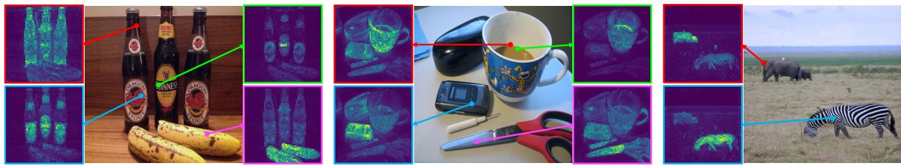  
图8：一组参考点的自注意力可视化。我们展示了使用DINO训练的ViT-S/8最后一个块中的自注意力模块。尽管网络在完全没有监督的情况下训练，它仍能分离出物体。

表14：与MoCo-v2和BYOL的关系。我们消融了DINO、MoCo-v2和BYOL之间的差异组件：损失函数（交叉熵CE、InfoNCE INCE、均方误差MSE）、多裁剪训练、中心化操作、投影头中的批归一化以及学生预测器。模型使用ViT-S/16训练300个周期。报告ImageNet线性评估的top-1准确率。
<table><tr><td></td><td>方法</td><td>损失函数</td><td>多裁剪</td><td>中心化</td><td>批归一化</td><td>预测器 Top-1</td></tr><tr><td>1</td><td>DINO</td><td>CE</td><td>√</td><td>√</td><td></td><td>76.1</td></tr><tr><td>2</td><td>1</td><td>MSE</td><td>√</td><td>√</td><td></td><td>62.4</td></tr><tr><td>3</td><td></td><td>CE</td><td>√</td><td>√</td><td>厂</td><td>75.6</td></tr><tr><td>4</td><td>1</td><td>CE</td><td></td><td>√</td><td></td><td>72.5</td></tr><tr><td>5</td><td>MoCov2</td><td>INCE</td><td></td><td></td><td></td><td>71.4</td></tr><tr><td>6</td><td></td><td>INCE</td><td>厂</td><td>√</td><td></td><td>73.4</td></tr><tr><td>7</td><td>BYOL</td><td>MSE</td><td></td><td></td><td>√</td><td>71.4</td></tr><tr><td>8</td><td>/</td><td>MSE</td><td></td><td></td><td></td><td>0.1</td></tr><tr><td>9</td><td></td><td>MSE</td><td></td><td>1</td><td></td><td>52.6</td></tr><tr><td>10</td><td>1</td><td>MSE</td><td>厂</td><td></td><td>厂</td><td>64.8</td></tr></table>

表15：与SwAV的关系。我们在教师输出上变化操作，包括中心化、在批次维度上应用softmax以及Sinkhorn-Knopp算法。我们还通过用SwAV中使用的学生硬拷贝（带停止梯度）替换动量编码器来进行消融。模型使用ViT-S/16训练300个周期。报告ImageNet线性评估的top-1准确率。
<table><tr><td></td><td>方法</td><td>动量</td><td>操作</td><td>Top-1</td></tr><tr><td>1</td><td>DINO</td><td>√</td><td>中心化</td><td>76.1</td></tr><tr><td>2</td><td>1</td><td>√</td><td>Softmax(批次)</td><td>75.8</td></tr><tr><td>3</td><td></td><td>√</td><td>Sinkhorn-Knopp</td><td>76.0</td></tr><tr><td>4</td><td></td><td></td><td>中心化</td><td>0.1</td></tr><tr><td>5</td><td></td><td></td><td>Softmax(批次)</td><td>72.2</td></tr><tr><td>6</td><td>SwAV</td><td></td><td>Sinkhorn-Knopp</td><td>71.8</td></tr></table>

关于Softmax(批次)变体的细节。SwAV [10] 中使用的迭代Sinkhorn-Knopp算法 [17] 通过以下PyTorch风格代码简单实现。

# x 是 n-by-K   
# tau 是 Sinkhorn 正则化参数   
x = exp(x / tau)   
for \_ in range(num\_iters): # 1次Sinkhorn迭代   
# 每个维度（或聚类）的总权重   
c = sum(x, dim=0, keepdim=True)   
x /= c   
# 每个样本的总权重   
n = sum(x, dim=1, keepdim=True)   
# x 对每个样本求和为1（分配）   
x /= n

当执行单次Sinkhorn迭代（num iters=1）时，实现可以高度简化为仅两行代码，这就是我们的softmax(批次)变体：

x = softmax(x / tau, dim=0)   
x /= sum(x, dim=1, keepdim=True)

我们在表15中看到，这种高度简化的SwAV变体与SwAV的性能相当。直观上，在批次轴上的softmax操作允许为每个维度（或“簇”）选择其在批次中的最佳匹配。

验证我们的实现。我们在表13中观察到，我们对BYOL、MoCo-v2、SwAV的复现结果与使用ResNet-50的相应已发表数据相匹配或更优。确实，我们在300个epoch的设置下，BYOL获得了72.7%的准确率，而[30]报告为72.5%。MoCo在300个epoch训练后获得71.1%的准确率，而[15]在800个epoch训练后报告为71.1%。我们相比[15]实现的改进可以归因于使用了更大的投影头（3层，使用批归一化，投影维度为256）。

与其他工作的关系。DINO也与UIC [14]相关，后者使用前一个epoch的输出作为“无监督分类”的硬伪标签。然而，我们使用中心化来防止坍塌，而UIC则采用[8]中的平衡采样技术。我们的工作可以解释为带有动量教师的软UIC变体。

同期工作CsMI [77]也展示了在ImageNet上使用简单k-NN分类器的强大性能，即使使用卷积网络也是如此。与DINO一样，CsMI结合了动量网络和多裁剪训练，我们在ViT实验中看到这两者对良好的k-NN性能都至关重要。我们相信研究这项工作将有助于我们更精确地识别对良好k-NN性能重要的组件，并将此研究留待未来工作。

## C. 投影头

与其他自监督框架类似，使用投影头[12]可以显著提高我们方法的准确性。投影头从一个n层多层感知器（MLP）开始。隐藏层为2048维，并使用高斯误差线性单元（GELU）激活函数。MLP的最后一层不使用GELU。然后我们应用$\ell _ { 2 }$归一化和一个K维的权重归一化全连接层[16, 61]。这种设计灵感来自SwAV [10]中使用的带有“原型层”的投影头。我们不使用批归一化。

无BN系统。与标准卷积网络不同，ViT架构默认不使用批归一化（BN）。
<table><tr><td>ViT-S, 100个epochs无BN的heads有BN的heads</td><td></td><td></td></tr><tr><td>k-NN top-1</td><td>69.7</td><td>68.6</td></tr></table>

因此，在将 DINO 应用于 ViT 时，我们在投影头中也完全不使用批归一化（BN）。本表评估了在投影头中添加 BN 的影响。我们观察到，在投影头中添加 BN 影响甚微，表明 BN 在我们的框架中并不重要。总体而言，当将 DINO 应用于 ViT 时，我们在任何地方都不使用 BN，使系统完全无 BN。这是 DINO + ViT 的一大优势，能够在无需任何 BN 的情况下达到最先进的性能。事实上，使用 BN 进行训练通常会显著降低训练速度，尤其是当这些 BN 模块需要在不同进程间同步时 [33, 10, 9, 30]。

投影头中的 L2 归一化瓶颈。我们在图 9 中展示了带或不带 L2 归一化瓶颈的投影头设计。我们评估了准确率。
<table><tr><td>投影头线性层数</td><td>1</td><td>2</td><td>3</td><td>4</td></tr><tr><td>带 L2 归一化瓶颈</td><td>1</td><td>62.2</td><td>68.0</td><td>69.3</td></tr><tr><td>不带 L2 归一化瓶颈</td><td>61.6</td><td>62.9</td><td>0.1</td><td>0.1</td></tr></table>

对使用或不使用 L2 归一化瓶颈训练的 DINO 模型进行评估，并改变投影头中的线性层数。使用 L2 瓶颈时，线性层总数为 n + 1（MLP 中的 n 层加上权重归一化层中的 1 层），而不使用瓶颈时，投影头中的线性层总数为 n。在本表中，我们报告了使用 ViT-S/16 进行 100 轮预训练后的 ImageNet top-1 k-NN 评估准确率。本实验中输出维度 K 设置为 4096。我们观察到，当增加投影头深度时，不使用 L2 归一化瓶颈的 DINO 训练会失败。L2 归一化瓶颈稳定了具有深度投影头的 DINO 训练。我们观察到，增加投影头深度可提高准确率。我们的默认设置是使用总共 4 个线性层：3 个在 MLP 中，1 个在 L2 瓶颈之后。

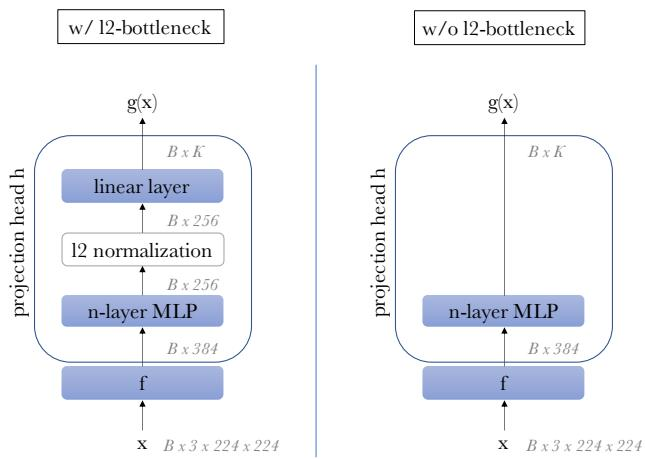  
图 9：带或不带 L2 归一化瓶颈的投影头设计。

输出维度。在本表中，我们评估了改变输出维度 K 的效果。我们观察到，
<table><tr><td>K</td><td>1024</td><td>4096</td><td>16384</td><td>65536</td><td>262144</td></tr><tr><td>k-NN top-1</td><td>67.8</td><td>69.3</td><td>69.2</td><td>69.7</td><td>69.1</td></tr></table>

GELU 激活函数。默认情况下，ViT 中使用的激活函数是高斯误差线性单元（GELU）。因此，为了架构内的一致性，
<table><tr><td>ViT-S, 100 轮</td><td>使用 GELU 的投影头</td><td>使用 ReLU 的投影头</td></tr><tr><td>k-NN top-1</td><td>69.7</td><td>68.9</td></tr></table>

我们选择在投影头中也使用 GELU。我们在本表中评估了使用 ReLU 替代 GELU 的效果，并观察到将激活单元改为 ReLU 影响相对较小。

## D. 额外消融实验

我们在主论文中详细说明了中心化和锐化操作的组合对于避免DINO中的崩溃至关重要。以下我们对这两个操作的超参数进行消融实验，同时研究训练时长以及ViT网络的一些设计选择的影响。

在线中心化。我们研究了教师网络输出中使用的中心c更新规则中平滑参数的影响。收敛性具有鲁棒性：
<table><tr><td>m</td><td>0 0.9</td><td>0.99</td><td>0.999</td></tr><tr><td>k-NN top-1 69.1</td><td>69.7</td><td>69.4</td><td>0.1</td></tr></table>
该参数在较大范围内均表现稳定，仅当更新过慢（即m = 0.999）时模型才会崩溃。

锐化。我们通过调整教师网络的softmax温度参数$\tau _ { t }$来强制生成锐化目标。从下表中观察到，温度需低于0.06才能避免崩溃。当温度高于0.06时：
<table><tr><td>Tt 0 0.02 0.04 0.06</td></tr><tr><td>0.08 0.04 → 0.07 k-NN top-1 43.9 66.7 69.6 68.7 0.1 69.7</td></tr></table>
训练损失会持续收敛到$l n ( K )$。然而，我们发现若从较小温度值开始训练并在初始阶段逐步升高，即使使用高于0.06的温度也不会导致崩溃。实际训练中，我们在前30个epoch对$\tau _ { t }$采用从0.04到0.07的线性预热。最后需注意，$\tau = 0$（极端锐化）对应argmax操作，会产生独热硬分布。

更长训练。下表显示，延长训练时长可提升DINO在ViT-Small上的性能。这一观察结果与卷积架构[12]的自监督实验结果一致：
<table><tr><td>DINO ViT-S</td><td>100-ep</td><td>300-ep</td><td>800-ep</td></tr><tr><td>k-NN top-1</td><td>70.9</td><td>72.8</td><td>74.5</td></tr></table>
我们注意到，在ViT-S上使用BYOL进行超过300个epoch的训练会导致性能下降（相比300 epoch的结果）。因此，我们在表2中报告BYOL的300 epoch结果，而SwAV、MoCo-v2和DINO均训练800 epoch。

教师网络优于学生网络。我们在图6中展示了动量教师网络在ViT上优于学生网络，本图进一步表明该现象在ResNet-50上同样成立。教师网络持续优于学生网络这一事实，强化了将DINO解释为一种Mean Teacher [65]自蒸馏形式的观点。正如Tarvainen等人[65]所论证的，对头部进行权重平均可提升性能，但会略微降低吞吐量。本文所有实验均采用默认的DeiT-S模型[69]，即仅使用6个注意力头。

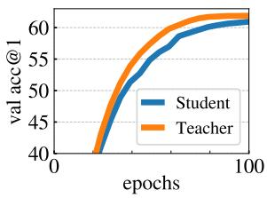  
通常比每次迭代中的单个模型产生更好的模型 [51]。通过以优于学生的教师模型为目标，学生的表征能力得以提升。因此，由于教师模型直接由学生权重构建，其性能也随之提高。

监督学习与自监督学习的自注意力图对比。我们评估了通过阈值化自注意力图以保留80%质量所获得的掩码。比较了不同框架训练的ViT-S在PASCAL VOC12数据集验证图像上的杰卡德相似度。
<table><tr><td rowspan=1 colspan=2>ViT-S/16 权重</td></tr><tr><td rowspan=1 colspan=2>随机权重      22.0</td></tr><tr><td rowspan=1 colspan=2>监督学习            27.3</td></tr><tr><td rowspan=2 colspan=2>DINO                  45.9DINO 无多裁剪  45.1</td></tr><tr><td rowspan=1 colspan=1>DINO 无多裁剪</td></tr><tr><td rowspan=1 colspan=1>MoCo-v2</td><td rowspan=1 colspan=1>46.3</td></tr><tr><td rowspan=1 colspan=2>BYOL                  47.8SwAV                  46.8</td></tr></table>

ViT的自注意力图明确包含场景布局，特别是物体边界，这一特性在不同自监督方法中均得到体现。

ViT-S中注意力头数量的影响。我们研究了ViT-S中注意力头数量对准确率和吞吐量（单张V100 GPU推理时每秒处理的图像数）的影响。发现增加注意力头数量
<table><tr><td>头数</td><td>维度</td><td>每头维度</td><td>参数量</td><td>图像/秒</td><td>k-NN</td></tr><tr><td>6</td><td>384</td><td>64</td><td>21</td><td>1007</td><td>72.8</td></tr><tr><td>8</td><td>384</td><td>48</td><td>21</td><td>971</td><td>73.1</td></tr><tr><td>12</td><td>384</td><td>32</td><td>21</td><td>927</td><td>73.7</td></tr><tr><td>16</td><td>384</td><td>24</td><td>21</td><td>860</td><td>73.8</td></tr></table>

## E. 多裁剪

在本附录中，我们研究了DINO的核心组件：多裁剪训练 [10]。

多裁剪中的尺度范围。为生成不同视图，我们使用PyTorch中torchvision.transforms模块的RandomResizedCrop方法。采样两个全局视图，尺度范围为 (s, 1) 之前 (0.05, s), (s, 1), s: 0.08 0.16 0.24 0.32 0.48 k-NN top-1 65.6 68.0 69.7 69.8 69.5

将它们调整为 $2 2 4 ^ { 2}$ 像素，以及 6 个局部视图，其尺度在范围 (0.05, s) 内采样，并调整为 $9 6 ^ { 2}$ 像素。请注意，我们按照 SwAV 的原始设计，任意选择了全局视图和局部视图的非重叠缩放范围。然而，这些范围完全可以重叠，并且通过更精细的超参数搜索实验，可能会找到更优的设置。在此表中，我们变化参数 s，它控制多裁剪中使用的尺度范围，并在我们的实验中发现最优值约为 0.3。我们注意到，这高于 SwAV 中使用的参数 0.14。

不同自监督框架中的多裁剪。我们比较了不同的近期自监督学习框架，即 MoCo-v2 [15]、BYOL [30] 和 SwAV [10]，均采用 ViT-S/16 架构。为了公平比较，所有模型
<table><tr><td rowspan="2">裁剪评估</td><td colspan="2"> $2 \times 2 2 4 ^ { 2}$ </td><td colspan="2"> $2 \times 2 2 4 ^ { 2} + 6 \times 9 6 ^ { 2}$ </td></tr><tr><td>k-NN</td><td>线性</td><td>k-NN</td><td>线性</td></tr><tr><td>BYOL</td><td>66.6</td><td>71.4</td><td>59.8</td><td>64.8</td></tr><tr><td>SwAV</td><td>60.5</td><td>68.5</td><td>64.7</td><td>71.8</td></tr><tr><td>MoCo-v2</td><td>62.0</td><td>71.6</td><td>65.4</td><td>73.4</td></tr><tr><td>DINO</td><td>67.9</td><td>72.5</td><td>72.7</td><td>75.9</td></tr></table>

要么使用两个 $2 2 4 ^ { 2}$ 裁剪进行预训练，要么使用多裁剪 [10] 训练，即每张图像使用两个 $2 2 4 ^ { 2}$ 裁剪和六个 $9 6 ^ { 2}$ 裁剪。我们报告了经过 300 个训练周期后的 k-NN 和线性探测评估结果。多裁剪并非对所有框架都有同等益处，这一点在仅考虑两个裁剪设置的基准测试 [16] 中被忽略了。多裁剪的有效性取决于所考虑的框架，这使得多裁剪成为模型的核心组成部分，而非简单的“附加组件”，能够以相同方式提升任何框架。在没有多裁剪的情况下，DINO 的准确率高于其他框架，尽管差距不大（1%）。值得注意的是，DINO 从多裁剪训练中获益最多（线性评估中提升 3.4%）。有趣的是，我们还观察到框架的排名取决于所采用的评估协议。

使用多裁剪训练 BYOL。当对采用 ViT-S 的 BYOL 应用多裁剪时，我们观察到在最初的训练周期中，迁移性能高于没有多裁剪的基线。然而，迁移性能的增长速度逐渐放缓，并在一定时间后下降。

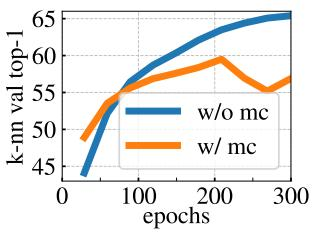  
训练量。我们针对此设置进行了学习率、权重衰减和多裁剪参数的扫描，并系统性地观察到相同的模式。更具体地说，我们实验了学习率基值 $\{ 1 e ^ { - 5 } , 3 e ^ { - 5 } , 1 \bar { e } ^ { - 4 } , 3 e ^ { - 4 } , 1 \bar { e } ^ { - 3 } , 3 e ^ { - \bar { 3 } } \}$，权重衰减 $\{ 0 . 0 2 , 0 . 0 5 , 0 . 1 \}$，以及不同数量的小裁剪：{2, 4, 6}。我们所有的运行都在头部使用了同步批归一化。当使用低学习率时，我们没有观察到性能断点，即迁移性能在训练过程中持续提升，但整体准确率较低。我们尝试了一次在ResNet-50上使用多裁剪训练的运行，也观察到了相同的行为。由于将多裁剪训练集成到BYOL并非本研究的重点，我们没有进一步推进这一方向。然而，我们认为值得探究为什么多裁剪在我们的实验中与BYOL结合不佳，并将此留作未来工作。

## F. 评估协议

## F.1 k-NN分类

遵循Wu等人[73]的设置，我们使用一个简单的加权k最近邻分类器来评估特征质量。我们冻结预训练模型，计算并存储下游任务训练数据的特征。为了对测试图像x进行分类，我们计算其表示，并将其与所有存储的训练特征$T$进行比较。图像的表示由输出[CLS]标记给出：对于ViT-S，其维度为$d = 3 8 4$；对于ViT-B，维度为d = 768。使用前k个最近邻（记为$\mathcal { N } _ { k }$）通过加权投票进行预测。具体来说，类别c获得的总权重为$\begin{array} { r } { \sum _ { i \in \mathcal { N } _ { k } } \alpha _ { i } \mathbf { 1 } _ { c _ { i } = c } , } \end{array}$，其中$\alpha _ { i }$是贡献权重。我们使用$\alpha _ { i } = \exp ( T _ { i } x / \tau )$，τ等于0.07，如[73]中所述，我们未对其进行调整。我们评估了不同的k值，并发现$k = 2 0$在我们的所有运行中始终能带来最佳准确率。此评估协议不需要超参数调整，也不需要数据增强，并且只需对下游数据集进行一次遍历即可运行。

## F.2 线性分类

遵循自监督学习中的常见做法，我们使用线性分类器评估表示质量。移除投影头，并在冻结特征之上训练一个监督线性分类器。该线性分类器使用SGD进行训练，批大小为1024。

在ImageNet上训练100个周期。我们不使用权重衰减。对于每个模型，我们遍历学习率值。训练过程中，仅采用随机裁剪缩放（使用PyTorch RandomResizedCrop的默认参数）和水平翻转作为数据增强。我们报告中心裁剪后的top-1准确率。评估卷积网络时，常见做法是在线性分类器前对最终特征图进行全局平均池化。以下将描述我们在评估ViT时如何调整这一设计。

ViT-S的线性评估表示。遵循BERT[18]中基于特征的评估方法，我们将最后l层的[CLS]令牌进行拼接。我们实验了不同层数l的拼接效果，与[18]类似，发现l=4为最优选择。

<table><tr><td>拼接最后l层</td><td>1</td><td>2</td><td>4</td><td>6</td></tr><tr><td>表示维度</td><td>384</td><td>768</td><td>1536</td><td>2304</td></tr><tr><td>ViT-S/16线性评估</td><td>76.1</td><td>76.6</td><td>77.0</td><td>77.0</td></tr></table>

ViT-B的线性评估表示。对于ViT-B，我们发现拼接最后l层的表示并未带来性能提升，因此仅使用最后一层（l=1）。在此设置下，我们调整了卷积网络中常用的全局平均池化流程，对输出补丁令牌进行池化，并将这些池化特征与最终的[CLS]输出令牌拼接。

<table><tr><td>池化策略</td><td>仅[CLS]令牌</td><td>拼接[CLS]令牌与平均池化的补丁令牌</td></tr><tr><td>表示维度</td><td>768</td><td>1536</td></tr><tr><td>ViT-B/16线性评估</td><td>78.0</td><td>78.2</td></tr></table>

## G. 自注意力可视化

我们在图8和图10中提供了更多自注意力可视化结果。这些图像随机选自COCO验证集，未在DINO训练中使用。图8展示了DINO ViT-S/8最后一层自注意力在多个参考点上的表现。

## H. 类别表示

作为最终可视化，我们观察DINO特征空间中ImageNet概念的分布。我们使用每个类别验证图像的均值特征向量表示该类。通过PCA将特征维度降至30，然后以困惑度20、学习率200运行t-SNE 5000次迭代。图11展示了最终的类别嵌入结果。我们的模型成功恢复了类别间的结构关系：相似动物物种被聚类在一起，形成鸟类（顶部）、犬类（尤其是猎犬，最右侧）的连贯簇群。

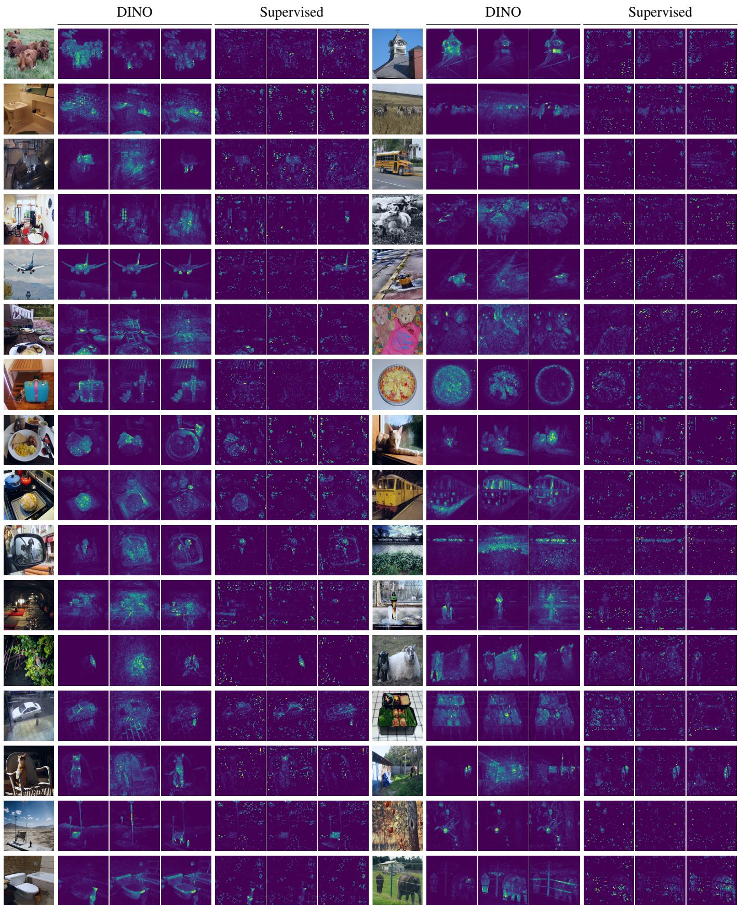  
图10：最后一层的自注意力头。我们展示了以[CLS]令牌作为查询时，最后一层不同注意力头的注意力图。注意[CLS]令牌未与任何标签或监督信号关联。

金翅雀 山雀 公鸡 母鸡 鸵鸟 燕雀 家朱雀 靛蓝彩鹀 知更鸟 松鸦 鹎 喜鹊 鸢 白头海雕 秃鹫 孔雀 非洲灰鹦鹉 硫磺冠凤头鹦鹉 鸦鹃 蜂鸟 犀鸟 鹟䴕 巨嘴鸟 公鸭 红胸秋沙鸭 黑天鹅 欧洲黑水鸡 美洲白骨顶 翻石鹬 红背鹬 红脚鹬 半蹼鹬 蛎鹬 王企鹅 灯草鹀 家朱雀 鸦鹃 喜鹊 公鸭 美洲白骨顶 大灰鸮 河乌 黑琴鸡 草原松鸡 鹌鹑 山鹑 麻鳽 披肩榛鸡 鹮鹳 雷鸟 黑鹳 火烈鸟 小蓝鹭 美洲白鹭 鹤 鸨 鹈鹕

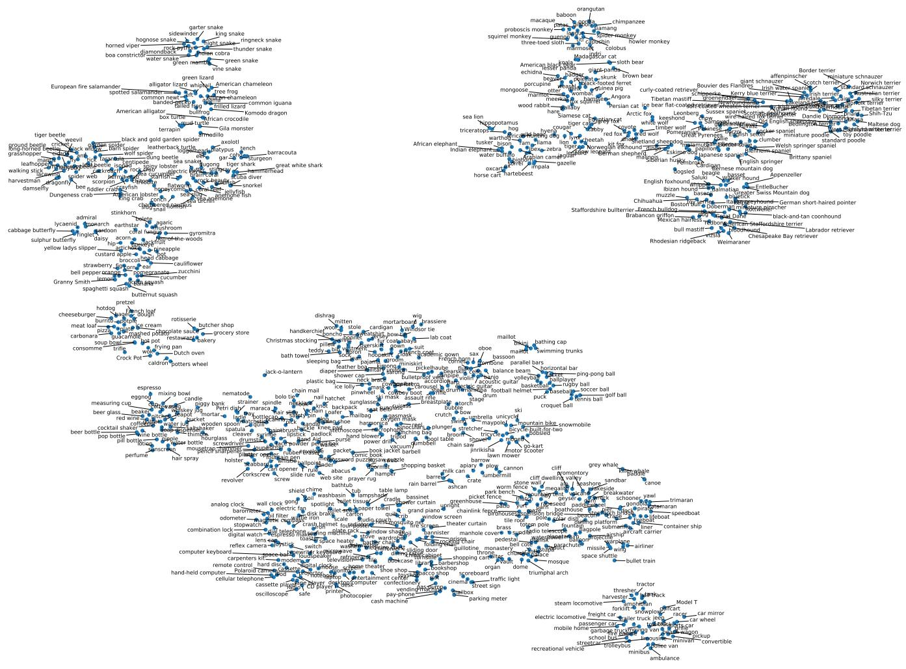  
图11：使用DINO表示的ImageNet类别的t-SNE可视化。对于每个类别，我们通过取验证集中该类所有图像的平均特征来获得嵌入。