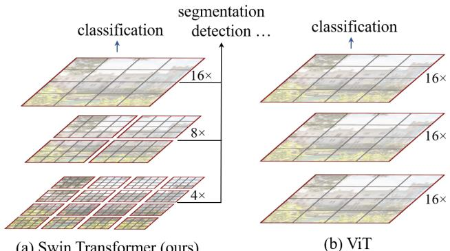
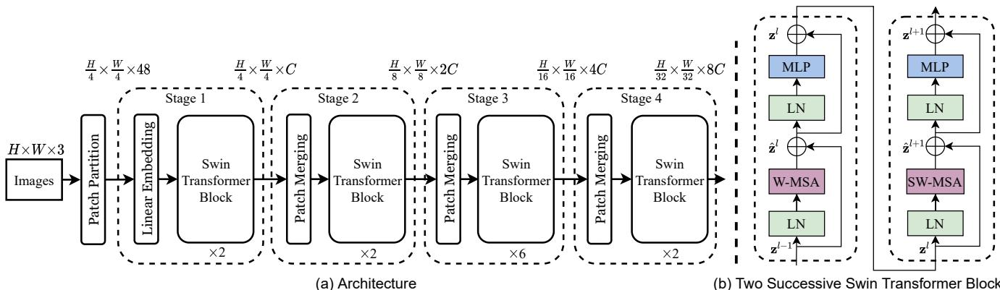
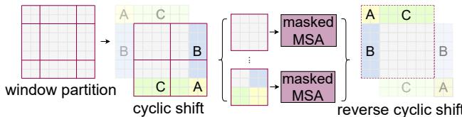

# Swin Transformer: 使用移位窗口的分层视觉Transformer

Ze Liu†\* Yutong Lin†\* Yue Cao\* Han Hu\*‡ Yixuan Wei†

Zheng Zhang Stephen Lin Baining Guo

微软亚洲研究院

{v-zeliu1,v-yutlin,yuecao,hanhu,v-yixwe,zhez,stevelin,bainguo}@microsoft.com

## 摘要

本文提出了一种新的视觉Transformer——Swin Transformer，它能够作为计算机视觉的通用骨干网络。将Transformer从语言领域适应到视觉领域的挑战源于两个领域之间的差异，例如视觉实体尺度的巨大变化以及图像中像素相对于文本中单词的高分辨率。为了解决这些差异，我们提出了一种分层Transformer，其表示通过移位窗口进行计算。移位窗口方案通过将自注意力计算限制在非重叠的局部窗口内，同时允许跨窗口连接，从而提高了效率。这种分层架构具有在不同尺度上建模的灵活性，并且计算复杂度与图像大小呈线性关系。Swin Transformer的这些特性使其能够兼容广泛的视觉任务，包括图像分类（ImageNet-1K上top-1准确率87.3%）和密集预测任务，如目标检测（COCO testdev上box AP 58.7和mask AP 51.1）以及语义分割（ADE20K val上mIoU 53.5）。其性能在COCO上以+2.7 box AP和+2.6 mask AP的大幅优势超越了之前的最先进水平，在ADE20K上以+3.2 mIoU超越，展示了基于Transformer的模型作为视觉骨干网络的潜力。分层设计和移位窗口方法也被证明对所有MLP架构有益。代码和模型可在https://github.com/microsoft/Swin-Transformer公开获取。

## 1. 引言

计算机视觉中的建模长期以来一直由卷积神经网络（CNN）主导。从AlexNet [39]及其在ImageNet图像分类挑战中的革命性表现开始，CNN架构通过更大的规模[30, 76]、更广泛的连接[34]以及更复杂的卷积形式[70, 18, 84]变得越来越强大。由于CNN作为各种视觉任务的骨干网络，这些架构上的进步带来了性能提升，从而广泛推动了整个领域的发展。

  
(a) Swin Transformer（我们的方法）  
图1. (a) 提出的Swin Transformer通过在深层网络中合并图像块（灰色部分）构建层次化特征图，并且由于仅在每个局部窗口（红色部分）内计算自注意力，其计算复杂度与输入图像大小呈线性关系。因此，它可作为图像分类和密集识别任务的通用骨干网络。(b) 相比之下，先前的视觉Transformer [20] 仅生成单一低分辨率的特征图，且由于全局自注意力计算，其计算复杂度与输入图像大小呈二次关系。

另一方面，自然语言处理（NLP）中网络架构的演变则走上了不同的道路，当前主流架构是Transformer [64]。Transformer专为序列建模和转换任务设计，其显著特点是通过注意力机制建模数据中的长距离依赖关系。它在语言领域的巨大成功促使研究者探索其在计算机视觉中的适配，近期已在特定任务（尤其是图像分类 [20] 和视觉-语言联合建模 [47]）上展现出令人鼓舞的结果。

在本文中，我们旨在扩展Transformer的适用性，使其能够像在自然语言处理领域以及卷积神经网络在视觉领域那样，成为计算机视觉的通用骨干网络。我们观察到，将Transformer在语言领域的高性能迁移到视觉领域时面临重大挑战，这些挑战可通过两种模态间的差异来解释。其中一个差异涉及尺度问题。与作为语言Transformer处理基本元素的词元不同，视觉元素的尺度可能差异显著——这一问题在目标检测等任务中备受关注[42,53,54]。现有基于Transformer的模型[64,20]中，所有词元均采用固定尺度，这种特性并不适用于上述视觉应用。另一个差异在于图像像素的分辨率远高于文本段落中的词汇。许多视觉任务（如语义分割）需要在像素级别进行密集预测，而Transformer在高分辨率图像上处理此类任务时，其自注意力机制的计算复杂度与图像尺寸呈二次方关系，导致难以实现。为解决这些问题，我们提出一种通用型Transformer骨干网络——Swin Transformer，该网络构建了层级特征图，且计算复杂度与图像尺寸呈线性关系。如图1(a)所示，Swin Transformer通过从较小尺寸的图像块（灰色轮廓）开始，并在深层Transformer层中逐步合并相邻图像块，从而构建层级化表征。借助这些层级特征图，Swin Transformer模型可便捷地利用特征金字塔网络（FPN）[42]或U-Net[51]等密集预测先进技术。线性计算复杂度通过将自注意力计算限制在划分图像的非重叠窗口（红色轮廓）内实现。每个窗口中的图像块数量固定，因此复杂度与图像尺寸呈线性关系。这些优势使Swin Transformer成为适用于各类视觉任务的通用骨干网络，而此前基于Transformer的架构[20]仅能生成单一分辨率的特征图且具有二次方复杂度。

Swin Transformer的一个关键设计元素是在连续自注意力层之间移动窗口分区，如图2所示。移动窗口连接了前一层的窗口，提供了它们之间的连接，从而显著增强了建模能力（见表4）。这种策略在实际延迟方面也很高效：一个窗口内的所有查询补丁共享相同的键集1，这有助于硬件中的内存访问。相比之下，早期基于滑动窗口的自注意力方法[33, 50]由于不同查询像素对应不同的键集2，在通用硬件上延迟较高。我们的实验表明，所提出的移动窗口方法比滑动窗口方法延迟低得多，但建模能力相似（见表5和表6）。移动窗口方法也被证明对所有MLP架构[61]有益。

  
图2：在提出的Swin Transformer架构中，用于计算自注意力的移动窗口方法示意图。在第l层（左），采用常规窗口分区方案，并在每个窗口内计算自注意力。在下一层l+1（右），窗口分区发生移动，形成新的窗口。新窗口中的自注意力计算跨越了第l层先前窗口的边界，从而提供了它们之间的连接。

提出的Swin Transformer在图像分类、目标检测和语义分割等识别任务上取得了强劲性能。在这三项任务上，它显著优于ViT/DeiT[20, 63]和ResNe(X)t模型[30, 70]，且延迟相似。在COCO测试开发集上，其58.7的框AP和51.1的掩码AP超越了之前的最优结果，分别高出+2.7框AP（无外部数据的Copy-paste[26]）和+2.6掩码AP（DetectoRS[46]）。在ADE20K语义分割任务上，它在验证集上获得了53.5的mIoU，比之前的最优结果（SETR[81]）提高了+3.2 mIoU。在ImageNet-1K图像分类上，它还达到了87.3%的top-1准确率。

我们相信，计算机视觉和自然语言处理之间的统一架构可以使两个领域受益，因为它将促进视觉和文本信号的联合建模，并且两个领域的建模知识可以更深入地共享。我们希望Swin Transformer在各种视觉问题上的强劲表现能够加深社区对这一信念的认同，并鼓励视觉和语言信号的统一建模。

## 2. 相关工作

CNN及其变体 作为计算机视觉领域的标准网络模型。尽管CNN已存在数十年[40]，但直到AlexNet[39]的提出，CNN才真正兴起并成为主流。此后，更深层、更高效的卷积神经网络架构不断涌现，进一步推动了计算机视觉领域的深度学习浪潮，例如VGG[52]、GoogleNet[57]、ResNet[30]、DenseNet[34]、HRNet[65]和EfficientNet[58]。除了这些架构上的进步，针对单个卷积层的改进工作也层出不穷，如深度可分离卷积[70]和可变形卷积[18, 84]。尽管CNN及其变体仍是计算机视觉应用的主要骨干架构，但我们强调类似Transformer的架构在视觉与语言统一建模方面的巨大潜力。我们的工作在多个基础视觉识别任务上取得了优异性能，并希望推动建模方式的转变。

基于自注意力的骨干架构 受NLP领域自注意力层和Transformer架构成功的启发，一些研究尝试用自注意力层替代流行ResNet[33, 50, 80]中的部分或全部空间卷积层。在这些工作中，自注意力在每个像素的局部窗口内计算以加速优化[33]，并实现了比对应ResNet架构略优的精度/FLOPs权衡。然而，其高昂的内存访问成本导致实际延迟显著高于卷积网络[33]。我们未采用滑动窗口，而是提出在连续层之间进行窗口移位，从而在通用硬件上实现更高效的部署。

自注意力/Transformer对CNN的补充 另一类工作是将自注意力层或Transformer集成到标准CNN架构中。自注意力层通过编码长距离依赖或异质交互，能够补充骨干网络[67, 7, 3, 71, 23, 74, 55]或头部网络[32, 27]的能力。近期，Transformer中的编码器-解码器设计已被应用于目标检测和实例分割任务[8, 13, 85, 56]。我们的工作探索了Transformer在基础视觉特征提取中的适配，并与这些研究形成互补。

基于Transformer的视觉骨干网络  
与我们的工作最相关的是视觉Transformer（ViT）[20]及其后续工作[63, 72, 15, 28, 66]。ViT的开创性工作直接将Transformer架构应用于非重叠的中等大小图像块，用于图像分类。与卷积网络相比，它在图像分类上实现了令人印象深刻的精度-速度权衡。虽然ViT需要大规模训练数据集（如JFT-300M）才能表现良好，但DeiT [63]引入了多种训练策略，使得ViT也能在较小的ImageNet-1K数据集上有效工作。ViT在图像分类上的结果令人鼓舞，但其架构不适合作为通用骨干网络用于密集视觉任务或高分辨率输入图像，原因在于其低分辨率特征图以及随图像尺寸呈二次增长的复杂度。有一些工作通过直接上采样或反卷积将ViT模型应用于目标检测和语义分割等密集视觉任务，但性能相对较低[2, 81]。与我们的工作同期，还有一些研究修改了ViT架构[72, 15, 28]以改进图像分类。根据经验，我们发现我们的Swin Transformer架构在这些方法中实现了图像分类上最佳的精度-速度权衡，尽管我们的工作侧重于通用性能而非专门针对分类。另一项同期工作[66]探索了类似思路，在Transformer上构建多分辨率特征图。其复杂度仍与图像尺寸呈二次关系，而我们的复杂度是线性的，并且局部操作已被证明有助于建模视觉信号中的高相关性[36, 25, 41]。我们的方法既高效又有效，在COCO目标检测和ADE20K语义分割上均达到了最先进的精度。

## 3. 方法

## 3.1. 整体架构

Swin Transformer架构的概览如图3所示，图中展示了其小型版本（Swin-T）。它首先通过一个图像块分割模块将输入的RGB图像分割成非重叠的图像块，类似于ViT。每个图像块被视为一个“令牌”，其特征设置为原始像素RGB值的拼接。在我们的实现中，我们使用4×4的图像块大小，因此每个图像块的特征维度为$4 \times 4 \times 3 = 48$。一个线性嵌入层被应用于这个原始值特征，将其投影到任意维度（记为C）。

在这些图像块令牌上应用了多个具有改进自注意力计算的Transformer块（Swin Transformer块）。这些Transformer块保持令牌数量为$\begin{array} { r } { ( \frac { H } { 4 } \times \frac { W } { 4 } ) } \end{array}$，并与线性嵌入层一起被称为“阶段1”。

为生成层次化表示，随着网络加深，通过补丁合并层减少令牌数量。第一个补丁合并层将每组 $2 \times 2$ 相邻补丁的特征进行拼接，并对 4C 维的拼接特征应用线性层。这将令牌数量减少 $2 \times 2 = 4$ 倍（分辨率下采样 $2 \times$），并将输出维度设为 $2 C$。随后应用 Swin Transformer 块进行特征变换，分辨率保持为 ${ \frac { H } { 8 } } \times { \frac { W } { 8 } }$。这第一个补丁合并与特征变换的模块记为“阶段 $2 ^ { \circ }$”。该过程重复两次，分别记为“阶段 $3 ^ { \circ }$”和“阶段 $4 ^ { \circ }$”，输出分辨率分别为 $\frac { H } { 1 6 } \times \frac { W } { 1 6 }$ 和 $\frac { H } { 3 2 } \times \frac { W } { 3 2 }$。这些阶段共同生成层次化表示，其特征图分辨率与典型卷积网络（如 VGG [52] 和 ResNet [30]）相同。因此，所提出的架构可以方便地替代现有方法中用于各种视觉任务的骨干网络。

  
图 3. (a) Swin Transformer (Swin-T) 的架构；(b) 两个连续的 Swin Transformer 块（符号表示见公式 (3)）。W-MSA 和 SW-MSA 分别是采用常规窗口和移位窗口配置的多头自注意力模块。

Swin Transformer 块 Swin Transformer 通过将 Transformer 块中的标准多头自注意力（MSA）模块替换为基于移位窗口的模块（详见第 3.2 节），同时保持其他层不变来构建。如图 3(b) 所示，一个 Swin Transformer 块包含一个基于移位窗口的 MSA 模块，后接一个中间带有 GELU 非线性的两层 MLP。在每个 MSA 模块和每个 MLP 之前应用层归一化（LN），并在每个模块之后应用残差连接。

## 3.2. 基于移位窗口的自注意力

标准的 Transformer 架构 [64] 及其在图像分类中的适配 [20] 都执行全局自注意力，即计算一个令牌与所有其他令牌之间的关系。全局计算导致复杂度与令牌数量呈二次关系，使其不适用于许多需要大量令牌进行密集预测或表示高分辨率图像的视觉问题。

非重叠窗口中的自注意力 为了实现高效建模，我们提出在局部窗口内计算自注意力。窗口以不重叠的方式均匀划分图像。假设每个窗口包含 $M \times M$ 个补丁，则对于一张 $h \times w$ 个补丁的图像，全局 MSA 模块和基于窗口的 MSA 模块的计算复杂度分别为3：

$$
\Omega ( \mathrm { M S A } ) = 4 h w C ^ { 2 } + 2 ( h w ) ^ { 2 } C ,\tag{1}
$$

$$
\Omega ( \mathbf { W } \mathbf { - M S A } ) = 4 h w C ^ { 2 } + 2 M ^ { 2 } h w C ,\tag{2}
$$

其中，前者与补丁数量 $hw$ 呈二次关系，而后者在 $M$ 固定（默认设为 7）时呈线性关系。全局自注意力计算通常对于较大的 $hw$ 来说成本过高，而基于窗口的自注意力则具有可扩展性。

连续块中的移位窗口划分 基于窗口的自注意力模块缺乏跨窗口的连接，这限制了其建模能力。为了在保持非重叠窗口高效计算的同时引入跨窗口连接，我们提出了一种移位窗口划分方法，该方法在连续的 Swin Transformer 块中交替使用两种划分配置。

如图 2 所示，第一个模块使用从左上角像素开始的常规窗口划分策略，将 $8 \times 8$ 的特征图均匀划分为 $2 \times 2$ 个大小为 $4 \times 4 ( M = 4 )$ 的窗口。然后，下一个模块采用与前一层不同的窗口配置，通过将窗口从常规划分的窗口位置移动 $\begin{array} { r } { \big ( \big \lfloor \frac { M } { 2 } \big \rfloor , \big \lfloor \frac { M } { 2 } \big \rfloor \big ) } \end{array}$ 个像素来实现。

通过移位窗口划分方法，连续的 Swin Transformer 块的计算如下：

$$
\begin{array} { r l } & { \hat { \mathbf { z } } ^ { l } = \mathbf { W } \mathbf { - M S A } \left( \mathbf { L N } \left( \mathbf { z } ^ { l - 1 } \right) \right) + \mathbf { z } ^ { l - 1 } , } \\ & { \mathbf { z } ^ { l } = \mathbf { M L P } \left( \mathbf { L N } \left( \hat { \mathbf { z } } ^ { l } \right) \right) + \hat { \mathbf { z } } ^ { l } , } \\ & { \hat { \mathbf { z } } ^ { l + 1 } = \mathbf { S W } \mathbf { - M S A } \left( \mathbf { L N } \left( \mathbf { z } ^ { l } \right) \right) + \mathbf { z } ^ { l } , } \\ & { \mathbf { z } ^ { l + 1 } = \mathbf { M L P } \left( \mathbf { L N } \left( \hat { \mathbf { z } } ^ { l + 1 } \right) \right) + \hat { \mathbf { z } } ^ { l + 1 } , } \end{array}\tag{3}
$$

其中，$\hat { \mathbf { z } } ^ { l }$ 和 $\mathbf { z } ^ { l }$ 分别表示第 $l$ 个块中 (S)W-MSA 模块和 MLP 模块的输出特征；

  
图 4. 移位窗口划分中自注意力高效批量计算方法的示意图。

W-MSA 和 SW-MSA 分别表示使用常规和移位窗口划分配置的基于窗口的多头自注意力。

移位窗口划分方法引入了前一层中相邻非重叠窗口之间的连接，并在图像分类、目标检测和语义分割中被证明是有效的，如表 4 所示。

### 移位配置的高效批量计算

移位窗口划分的一个问题是会导致窗口数量增加，从 $\begin{array} { r } { \lceil \frac { \bar { h } } { M } \rceil \times \lceil \frac { w } { M } \rceil ^ { - } \mathrm { t o } \left( \lceil \frac { h } { M } \rceil + 1 \right) \ } \end{array}$ × $\left( \lceil \frac { w } { M } \rceil + 1 \right)$ 变为移位配置下的更多窗口，并且其中一些窗口会小于 $M \times M$ 。一种简单的解决方案是将较小的窗口填充到 $M \times M$ 大小，并在计算注意力时屏蔽填充的值。当常规划分中的窗口数量较少时，例如 $2 \times 2$ ，这种简单方案带来的计算量增加相当可观（从 $2 \times 2$ 到 $3 \times 3$ ，增加了 2.25 倍）。在此，我们提出了一种更高效的批量计算方法，通过向左上方向进行循环移位，如图 4 所示。经过此次移位后，一个批量窗口可能由特征图中不相邻的多个子窗口组成，因此采用掩码机制将自注意力计算限制在每个子窗口内。通过循环移位，批量窗口的数量与常规窗口划分保持一致，因此同样高效。该方法的低延迟性能如表 5 所示。

### 相对位置偏置

在计算自注意力时，我们遵循 [49, 1, 32, 33] 的方法，在计算相似度时为每个头引入一个相对位置偏置 $\boldsymbol { B } \in \mathbb { R } ^ { M ^ { 2 } \times M ^ { 2 } }$ ：

$$
\operatorname { A t t e n t i o n } ( Q , K , V ) = \operatorname { S o f t M a x } ( Q K ^ { T } / \sqrt { d } + B ) V ,\tag{4}
$$

其中 $Q , K , V \in \mathbb { R } ^ { M ^ { 2 } \times d }$ 分别是查询、键和值矩阵；d 是查询/键的维度，$M ^ { 2 }$ 是一个窗口中的补丁数量。由于每个轴上的相对位置范围在 $\left[ - M + 1 , M - 1 \right]$ 内，我们参数化一个更小的偏置矩阵 $\hat { B } \in \mathbb { R } ^ { ( 2 M - 1 ) \times ( \hat { 2 M } - 1 ) }$ ，B 中的值取自 $\hat { B }$ 。

我们观察到，与没有此偏置项或使用绝对位置嵌入的对应方法相比，性能有显著提升，如表 4 所示。如 [20] 中那样进一步在输入中添加绝对位置嵌入会略微降低性能，因此我们的实现中未采用此方法。

预训练中学到的相对位置偏置也可以通过双三次插值 [20, 63] 用于初始化具有不同窗口大小的微调模型。

## 3.3. 架构变体

我们构建的基础模型称为Swin-B，其模型规模和计算复杂度与ViT-B/DeiT-B相近。此外，我们还推出了Swin-T、Swin-S和Swin-L，它们的模型规模和计算复杂度分别约为Swin-B的0.25倍、0.5倍和2倍。需要注意的是，Swin-T和Swin-S的复杂度分别与ResNet-50（DeiT-S）和ResNet-101相当。默认情况下，窗口大小设为M = 7。在所有实验中，每个注意力头的查询维度为d = 32，每个MLP的扩展层参数为$\alpha = 4$。这些模型变体的架构超参数如下：

• Swin-T: C = 96, 层数 = {2, 2, 6, 2}

• Swin-S: C = 96, 层数 = {2, 2, 18, 2}

• Swin-B: C = 128, 层数 = {2, 2, 18, 2}

$$
\bullet \ \operatorname { S w i n - L : } C = 1 9 2 , \mathrm { l a y e r ~ n u m b e r s } = \{ 2 , 2 , 1 8 , 2 \}
$$

其中C是第一级隐藏层的通道数。表1列出了这些模型变体在ImageNet图像分类任务中的模型规模、理论计算复杂度（FLOPs）和吞吐量。

## 4. 实验

我们在ImageNet-1K图像分类[19]、COCO目标检测[43]和ADE20K语义分割[83]上进行了实验。接下来，我们首先将提出的Swin Transformer架构与这三个任务上先前的最先进方法进行比较。然后，我们对Swin Transformer的重要设计元素进行消融研究。

## 4.1. ImageNet-1K图像分类

设置 对于图像分类，我们在ImageNet-1K [19]上对提出的Swin Transformer进行基准测试，该数据集包含来自1,000个类别的128万张训练图像和5万张验证图像。报告了单次裁剪的top-1准确率。我们考虑了两种训练设置：

• 常规ImageNet-1K训练。该设置主要遵循[63]。我们使用AdamW [37]优化器进行300个epoch的训练，采用余弦衰减学习率调度器和20个epoch的线性预热。批量大小为1024，初始学习率为0.001，权重衰减为0.05。我们在训练中包含了[63]中的大部分数据增强和正则化策略，但重复增强[31]和EMA [45]除外，因为它们并未提升性能。需要注意的是，这与[63]相反，在[63]中重复增强对于稳定ViT的训练至关重要。

• 在ImageNet-22K上预训练并在ImageNet-1K上微调。我们还在更大的ImageNet-22K数据集上进行预训练，该数据集包含1420万张图像和22K个类别。我们使用AdamW优化器进行90个epoch的训练，采用线性衰减学习率调度器和5个epoch的线性预热。批量大小为4096，初始学习率为0.001，权重衰减为0.01。在ImageNet-1K微调中，我们训练模型30个epoch，批量大小为1024，恒定学习率为$1 0 ^ { - 5 }$，权重衰减为$1 0 ^ { - 8 }$。

### 常规ImageNet-1K训练结果  
表1(a)展示了与其他骨干网络的对比，包括基于Transformer和基于ConvNet的架构，均采用常规ImageNet-1K训练。  

与先前最先进的基于Transformer的架构（即DeiT [63]）相比，Swin Transformer在相似复杂度下显著超越对应DeiT架构：在224²输入下，Swin-T（81.3%）比DeiT-S（79.8%）提升1.5%；在224²/384²输入下，Swin-B（83.3%/84.5%）比DeiT-B（81.8%/83.1%）分别提升1.5%/1.4%。  

与最先进的ConvNet（即RegNet [48]和EfficientNet [58]）相比，Swin Transformer在速度与精度权衡上略占优势。值得注意的是，RegNet [48]和EfficientNet [58]通过彻底的架构搜索获得，而提出的Swin Transformer则基于标准Transformer改进，具有进一步优化的巨大潜力。  

### ImageNet-22K预训练结果  
我们还在ImageNet-22K上预训练了更大容量的Swin-B和Swin-L模型。在ImageNet-1K图像分类任务上的微调结果如表1(b)所示。对于Swin-B，ImageNet-22K预训练相比从头训练带来1.8%∼1.9%的提升。与先前ImageNet-22K预训练的最佳结果相比，我们的模型在速度与精度权衡上表现更优：Swin-B达到86.4%的Top-1准确率，比推理吞吐量相近的ViT（84.7 vs. 85.9 images/sec）高出2.4%，且FLOPs略低（47.0G vs. 55.4G）。更大的Swin-L模型达到87.3%的Top-1准确率，比Swin-B提升0.9%。

<table><tr><td colspan="5">(a) 常规 ImageNet-1K 训练模型</td></tr><tr><td>方法</td><td>图像尺寸</td><td>参数量 FLOPs</td><td>吞吐量|ImageNet (图像/秒)</td><td>Top-1 准确率</td></tr><tr><td>RegNetY-4G[48] RegNetY-8G [48]</td><td>224² 224²</td><td>21M 4.0G 39M 8.0G</td><td>1156.7 591.6</td><td>80.0 81.7</td></tr><tr><td>RegNetY-16G [48] EffNet-B3 [58]</td><td>224² 300² 12M</td><td>84M 16.0G 1.8G</td><td>334.7 732.1</td><td>82.9</td></tr><tr><td>EffNet-B4 [58]</td><td>380²</td><td>19M 4.2G</td><td>349.4</td><td>81.6 82.9</td></tr><tr><td>EffNet-B5 [58]</td><td>456²</td><td>30M 9.9G</td><td>169.1</td><td>83.6</td></tr><tr><td>EffNet-B6 [58]</td><td>528² 43M</td><td>19.0G</td><td>96.9</td><td>84.0</td></tr><tr><td>EffNet-B7 [58]</td><td>600² 66M</td><td>37.0G</td><td>55.1</td><td>84.3</td></tr><tr><td>ViT-B/16 [20]</td><td>384²</td><td>86M</td><td>85.9</td><td></td></tr><tr><td></td><td>384²</td><td>55.4G</td><td></td><td>77.9</td></tr><tr><td>ViT-L/16 [20]</td><td></td><td>307M 190.7G</td><td>27.3</td><td>76.5</td></tr><tr><td>DeiT-S [63]</td><td>224²</td><td>22M 4.6G</td><td>940.4</td><td>79.8</td></tr><tr><td>DeiT-B [63]</td><td>224²</td><td>86M 17.5G</td><td>292.3</td><td>81.8</td></tr><tr><td>DeiT-B [63]</td><td>384²</td><td>86M 55.4G</td><td>85.9</td><td>83.1</td></tr><tr><td>Swin-T</td><td>224²</td><td>29M 4.5G</td><td>755.2</td><td>81.3</td></tr><tr><td>Swin-S</td><td>224²</td><td>50M 8.7G</td><td>436.9</td><td>83.0</td></tr><tr><td>Swin-B</td><td>224²</td><td>88M 15.4G</td><td>278.1</td><td>83.5</td></tr><tr><td></td><td>384²</td><td></td><td></td><td></td></tr><tr><td>Swin-B</td><td></td><td>88M 47.0G</td><td>84.7</td><td>84.5</td></tr></table>

(b) ImageNet-22K 预训练模型
<table><tr><td>方法</td><td>图像尺寸</td><td>参数量 FLOPs</td><td>(图像/秒) Top-1 准确率</td><td>吞吐量|ImageNet</td></tr><tr><td>R-101x3[38]</td><td>384²</td><td>388M 204.6G</td><td>1</td><td>84.4</td></tr><tr><td>R-152x4 [38]</td><td>480²</td><td>937M 840.5G</td><td>1</td><td>85.4</td></tr><tr><td>ViT-B/16 [20]</td><td>384²</td><td>86M 55.4G</td><td>85.9</td><td>84.0</td></tr><tr><td>ViT-L/16 [20]</td><td>384²</td><td>307M 190.7G</td><td>27.3</td><td>85.2</td></tr><tr><td>Swin-B</td><td>224²</td><td>88M 15.4G</td><td>278.1</td><td>85.2</td></tr><tr><td>Swin-B</td><td>384²</td><td>88M 47.0G</td><td>84.7</td><td>86.4</td></tr><tr><td>Swin-L</td><td>384²</td><td>197M 103.9G</td><td>42.1</td><td>87.3</td></tr></table>

表 1. 不同骨干网络在 ImageNet-1K 分类任务上的比较。吞吐量使用 [68] 的 GitHub 仓库和 V100 GPU 测量，遵循 [63] 的方法。

## 4.2. COCO 数据集上的目标检测

设置  
目标检测和实例分割实验在 COCO 2017 数据集上进行，该数据集包含 118K 张训练图像、5K 张验证图像和 20K 张测试开发图像。消融研究使用验证集进行，系统级比较则在测试开发集上报告。在消融研究中，我们考虑了 mmdetection [10] 中的四种典型目标检测框架：Cascade Mask R-CNN [29, 6]、ATSS [79]、RepPoints v2 [12] 和 Sparse RCNN [56]。对于这四种框架，我们使用相同的设置：多尺度训练 [8, 56]（将输入图像调整大小，使短边在 480 到 800 之间，长边最多为 1333）、AdamW [44] 优化器（初始学习率为 0.0001，权重衰减为 0.05，批量大小为 16）以及 3x 调度（36 个周期）。对于系统级比较，我们采用改进的 HTC [9]（记为 HTC++），并使用了 instaboost [22]、更强的多尺度训练 [7]、6x 调度（72 个周期）、soft-NMS [5] 以及 ImageNet-22K 预训练模型作为初始化。

我们将 Swin Transformer 与标准卷积网络（如 ResNe(X)t）以及之前的 Transformer 网络（如 DeiT）进行比较。比较时仅更换骨干网络，其他设置保持不变。需要注意的是，Swin Transformer 和 ResNe(X)t 因其层次化特征图可直接应用于上述所有框架，而 DeiT 仅生成单一分辨率的特征图，无法直接应用。为了公平比较，我们遵循 [81] 的方法，使用反卷积层为 DeiT 构建层次化特征图。

<table><tr><td colspan="5">(a) 各种框架</td></tr><tr><td>方法</td><td>骨干网络|APbox</td><td>AP0</td><td>AP</td><td>#参数 FLOPs FPS</td></tr><tr><td>Cascade</td><td>R-50</td><td>46.3</td><td>64.3 50.5</td><td>82M 739G 18.0</td></tr><tr><td>Mask R-CNN ATSS</td><td>Swin-T R-50</td><td>50.5 43.5</td><td>69.3 54.9 61.9 47.0</td><td>86M 745G 15.3 32M 205G 28.3</td></tr><tr><td></td><td>Swin-T</td><td>47.2</td><td>66.5 51.3</td><td>36M 215G 22.3</td></tr><tr><td>RepPointsV2</td><td>R-50 Swin-T</td><td>46.5 50.0</td><td>64.6 50.3 68.5 54.2</td><td>42M 274G 13.6 45M 283G 12.0</td></tr><tr><td>Sparse R-CNN</td><td>R-50 Swin-T</td><td>44.5 47.9</td><td>63.4 48.2 67.3 52.3</td><td>106M 166G 21.0 110M 172G 18.4</td></tr></table>

(b) 使用 Cascade Mask R-CNN 的各种骨干网络
<table><tr><td></td><td>APbox APbox APbx</td><td>APmask</td><td>APmask</td><td>APmssk|p</td><td>参数 FLOPs FPS</td></tr><tr><td>DeiT-St R50</td><td>48.0 67.2 51.7 46.3 64.3 50.5</td><td>41.4 40.1 43.7</td><td>64.2 61.7</td><td>44.3 43.4</td><td>80M 889G 10.4 82M 739G 18.0</td></tr><tr><td>Swin-T X101-32 Swin-S</td><td>50.5 69.3 54.9 48.1 66.5 52.4 51.8 70.4 56.3</td><td>41.6 44.7</td><td>66.6 63.9 67.9</td><td>47.1 45.2 48.5</td><td>86M 745G 15.3 101M 819G 12.8 107M 838G 12.0</td></tr><tr><td>X101-64 Swin-B</td><td>48.3 66.4 52.3 51.9 70.9 56.5</td><td>41.7 45.0</td><td>64.0 68.4</td><td>45.1 48.7</td><td>140M 972G 10.4 145M 982G 11.6</td></tr></table>

### (c) 系统级对比

| 方法 | mini-val APbox APmask | test-dev APbox APmask | #参数 FLOPs |
|---|---|---|---|
| RepPointsV2* [12] | - 1 | 52.1 - | = - |
| GCNet*[7] | 51.8 44.7 | 52.3 45.4 | 1041G = |
| RelationNet++*[13] | - - | 52.7 1 | = - |
| SpineNet-190 [21] | 52.6 - | 52.8 - | 164M 1885G |
| ResNeSt-200* [78] | 52.5 - | 53.3 47.1 | - - |
| EfficientDet-D7 [59] | 54.4 1 | 55.1 - | 77M 410G |
| DetectoRS* [46] | - - | 55.7 48.5 | 1 |
| YOLOv4 P7* [4] | - 1 | 55.8 - | - = |
| Copy-paste [26] | 55.9 47.2 | 56.0 47.4 | 185M 1440G |
| X101-64 (HTC++) | 52.3 46.0 | - 1 | 155M 1033G |
| Swin-B (HTC++) | 56.4 49.1 | - | 160M 1043G |
| | 57.1 49.5 | 1 57.7 50.2 | 284M 1470G |
| Swin-L (HTC++) | | | |
| Swin-L (HTC++)* | 58.0 50.4 | 58.7 51.1 | 284M |

表2. COCO目标检测与实例分割结果。†表示使用额外的反卷积层生成层次化特征图。*表示多尺度测试。

**与ResNe(X)t对比** 表2(a)列出了Swin-T和ResNet-50在四种目标检测框架上的结果。我们的Swin-T架构在模型尺寸、FLOPs和延迟略大的情况下，相较于ResNet-50带来了持续的+3.4~4.2 box AP提升。

表2(b)使用Cascade Mask R-CNN在不同模型容量下比较了Swin Transformer和ResNe(X)t。Swin Transformer实现了51.9 box AP和45.0 mask AP的高检测精度，相较于具有相似模型尺寸、FLOPs和延迟的ResNeXt101-64x4d，分别获得了+3.6 box AP和+3.3 mask AP的显著提升。在使用改进的HTC框架达到52.3 box AP和46.0 mask AP的更高基线时，Swin Transformer的提升仍然显著，分别为+4.1 box AP和+3.1 mask AP（见表2(c)）。关于推理速度，虽然ResNe(X)t基于高度优化的Cudnn函数构建，但我们的架构使用PyTorch内置函数实现，这些函数并非全部经过充分优化。全面的内核优化超出了本文的范围。

<table><tr><td colspan="2">ADE20K</td><td rowspan="2">验证集 mIoU</td><td rowspan="2">测试集分数</td><td rowspan="2">参数量 FLOPs</td><td rowspan="2">FPS</td></tr><tr><td>方法</td><td>骨干网络</td></tr><tr><td>DANet [23]</td><td>ResNet-101</td><td>45.2</td><td>-</td><td>69M</td><td>1119G 15.2</td></tr><tr><td>DLab.v3+[11]</td><td>ResNet-101</td><td>44.1</td><td>-</td><td>63M</td><td>1021G 16.0</td></tr><tr><td>ACNet [24]</td><td>ResNet-101</td><td>45.9</td><td>38.5</td><td>-</td><td></td></tr><tr><td>DNL [71]</td><td>ResNet-101</td><td>46.0</td><td>56.2</td><td>69M</td><td>1249G 14.8</td></tr><tr><td>OCRNet [73]</td><td>ResNet-101</td><td>45.3</td><td>56.0</td><td>56M</td><td>923G 19.3</td></tr><tr><td>UperNet [69]</td><td>ResNet-101</td><td>44.9</td><td>-</td><td>86M</td><td>1029G 20.1</td></tr><tr><td>OCRNet [73]</td><td>HRNet-w48</td><td>45.7</td><td>-</td><td>71M</td><td>664G 12.5</td></tr><tr><td>DLab.v3+[11]</td><td>ResNeSt-101</td><td>46.9</td><td>55.1</td><td>66M</td><td>1051G 11.9</td></tr><tr><td>DLab.v3+[11]</td><td>ResNeSt-200</td><td>48.4</td><td>-</td><td>88M</td><td>1381G 8.1</td></tr><tr><td>SETR [81]</td><td>T-Large</td><td>50.3</td><td>61.7</td><td>308M</td><td>- -</td></tr><tr><td>UperNet</td><td>DeiT-St</td><td>44.0</td><td>-</td><td>52M</td><td>1099G 16.2</td></tr><tr><td>UperNet</td><td>Swin-T</td><td>46.1</td><td>-</td><td>60M</td><td>945G 18.5</td></tr><tr><td>UperNet</td><td>Swin-S</td><td>49.3</td><td>1</td><td>81M</td><td>1038G 15.2</td></tr><tr><td>UperNet</td><td>Swin-Bt</td><td>51.6</td><td>/</td><td>121M</td><td>1841G 8.7</td></tr><tr><td>UperNet</td><td>Swin-L</td><td>53.5</td><td>62.8</td><td>234M</td><td>3230G 6.2</td></tr></table>

表 3. 在 ADE20K 验证集和测试集上的语义分割结果。† 表示使用了额外的反卷积层来生成层次化特征图。‡ 表示模型在 ImageNet-22K 上进行了预训练。

与 DeiT 的比较 使用 Cascade Mask R-CNN 框架的 DeiT-S 性能如表 2(b) 所示。Swin-T 的结果比 DeiT-S 高出 +2.5 的 box AP 和 +2.3 的 mask AP，且模型大小相近（86M 对比 80M），推理速度显著更高（15.3 FPS 对比 10.4 FPS）。DeiT 推理速度较低的主要原因是其对输入图像尺寸具有二次复杂度。

与先前最先进方法的比较 表 2(c) 将我们的最佳结果与先前最先进模型的结果进行了比较。我们的最佳模型在 COCO test-dev 上达到了 58.7 的 box AP 和 51.1 的 mask AP，分别超越了先前最佳结果 +2.7 的 box AP（不使用外部数据的 Copy-paste [26]）和 +2.6 的 mask AP（DetectoRS [46]）。

## 4.3. 在 ADE20K 上的语义分割

设置 ADE20K [83] 是一个广泛使用的语义分割数据集，涵盖150个语义类别。该数据集共有25K张图像，其中20K用于训练，2K用于验证，另外3K用于测试。我们采用 mmseg [16] 中的 UperNet [69] 作为基础框架，因其具有高效性。更多细节见附录。

<table><tr><td rowspan=1 colspan=1></td><td rowspan=1 colspan=1>ImageNettop-1top-5</td><td rowspan=1 colspan=1>COCOApboxApmask</td><td rowspan=1 colspan=1>ADE20kmIoU</td></tr><tr><td rowspan=1 colspan=1>无移位移位窗口</td><td rowspan=1 colspan=1>80.2 95.181.3 95.6</td><td rowspan=1 colspan=1>47.7  41.550.5  43.7</td><td rowspan=1 colspan=1>43.346.1</td></tr><tr><td rowspan=1 colspan=1>无位置编码</td><td rowspan=1 colspan=1>80.1 94.9</td><td rowspan=1 colspan=1>49.2  42.6</td><td rowspan=1 colspan=1>43.8</td></tr><tr><td rowspan=1 colspan=1>绝对位置编码</td><td rowspan=1 colspan=1>80.5 95.2</td><td rowspan=1 colspan=1>49.0  42.4</td><td rowspan=1 colspan=1>43.2</td></tr><tr><td rowspan=1 colspan=1>绝对+相对位置编码</td><td rowspan=1 colspan=1>81.3 95.6</td><td rowspan=1 colspan=1>50.2  43.4</td><td rowspan=1 colspan=1>44.0</td></tr><tr><td rowspan=2 colspan=1>相对位置编码（无外观项）相对位置编码</td><td rowspan=1 colspan=1>79.3 94.7</td><td rowspan=1 colspan=1>48.2  41.9</td><td rowspan=1 colspan=1>44.1</td></tr><tr><td rowspan=1 colspan=1>81.3 95.6</td><td rowspan=1 colspan=1>50.5  43.7</td><td rowspan=1 colspan=1>46.1</td></tr></table>

表4. 基于Swin-T架构，在三个基准上对移位窗口方法和不同位置嵌入方法的消融研究。w/o shifting：所有自注意力模块采用常规窗口划分，无移位；abs. pos.：ViT的绝对位置嵌入项；rel. pos.：默认设置，包含额外的相对位置偏置项（见公式(4)）；app.：公式(4)中的第一个缩放点积项。

结果 表3列出了不同方法/骨干网络组合的mIoU、模型大小（#参数）、FLOPs和FPS。从这些结果可以看出，在相似计算成本下，Swin-S的mIoU比DeiT-S高5.3（49.3 vs. 44.0）。同时，它比ResNet-101高4.4 mIoU，比ResNeSt-101 [78]高2.4 mIoU。我们的Swin-L模型经过ImageNet-22K预训练，在验证集上达到53.5 mIoU，比之前的最佳模型（SETR [81]的50.3 mIoU，且模型更大）高出3.2 mIoU。

## 4.4. 消融研究

本节中，我们使用ImageNet-1K图像分类、COCO目标检测上的Cascade Mask R-CNN以及ADE20K语义分割上的UperNet，对所提出的Swin Transformer中的重要设计元素进行消融分析。

### 移位窗口
表4报告了在三个任务上对移位窗口方法进行的消融实验。采用移位窗口划分的Swin-T在ImageNet-1K上比每阶段使用单一窗口划分的模型高出+1.1%的top-1准确率，在COCO上高出+2.8 box AP/+2.2 mask AP，在ADE20K上高出+2.8 mIoU。结果表明，使用移位窗口在前层之间建立连接是有效的。如表5所示，移位窗口带来的延迟开销也很小。

### 相对位置偏置
表4展示了不同位置嵌入方法的比较。与无位置编码和使用绝对位置嵌入的方法相比，采用相对位置偏置的Swin-T在ImageNet-1K上分别提升+1.2%/+0.8%的top-1准确率，在COCO上提升+1.3/+1.5 box AP和+1.1/+1.3 mask AP，在ADE20K上提升+2.3/+2.9 mIoU，这表明了相对位置偏置的有效性。同时需注意，虽然加入绝对位置嵌入能提升图像分类准确率（+0.4%），但会损害目标检测和语义分割性能（COCO上-0.2 box/mask AP，ADE20K上-0.6 mIoU）。

<table><tr><td>方法</td><td>阶段内MSA耗时（毫秒） S1 S2</td><td>S3 S4</td><td>架构（FPS） T S B</td></tr>
<tr><td>滑动窗口（朴素） 滑动窗口（核）</td><td>122.5 38.3 7.6 4.7</td><td>12.1 7.6 1.8</td><td>183 109 77</td></tr>
<tr><td>Performer [14]</td><td>4.8 2.8</td><td>2.7 1.8 1.5</td><td>488 283 187 638 370 241</td></tr>
<tr><td>窗口（无移位）</td><td>2.8 1.7</td><td>1.2 0.9</td><td>770 444 280</td></tr>
<tr><td>移位窗口（填充） 移位窗口（循环）</td><td>3.3 2.3 3.0 1.9</td><td>1.9 2.2 1.3 1.0</td><td>670 371 236 755 437 278</td></tr>
</table>

表5. 不同自注意力计算方法及实现在V100 GPU上的实际速度。

尽管近期ViT/DeiT模型在图像分类中放弃了平移不变性（而平移不变性长期以来被证明对视觉建模至关重要），但我们发现，鼓励特定平移不变性的归纳偏置对于通用视觉建模仍然更可取，特别是对于目标检测和语义分割这类密集预测任务。

### 不同自注意力方法
表5比较了不同自注意力计算方法及实现的实际速度。我们的循环实现比朴素填充方法在硬件上更高效，尤其在较深层阶段。总体而言，它在Swin-T、Swin-S和Swin-B上分别带来了13%、18%和18%的速度提升。

基于所提出的移位窗口方法构建的自注意力模块，在四个网络阶段中，相较于滑动窗口的朴素/内核实现，效率分别提升了40.8倍/2.5倍、20.2倍/2.5倍、9.3倍/2.1倍和7.6倍/1.8倍。总体而言，基于移位窗口构建的Swin Transformer架构（Swin-T、Swin-S、Swin-B）比基于滑动窗口的变体分别快4.1倍/1.5倍、4.0倍/1.5倍、3.6倍/1.5倍。表6比较了它们在三个任务上的准确率，表明它们在视觉建模方面具有相似的准确性。

与最快的Transformer架构之一Performer [14]（参见[60]）相比，所提出的基于移位窗口的自注意力计算以及整体Swin Transformer架构略快（见表5），同时在使用Swin-T时，在ImageNet-1K上相比Performer实现了+2.3%的top-1准确率提升（见表6）。

## 5. 结论

本文提出了Swin Transformer，这是一种新型视觉Transformer，它生成层次化特征表示，并且计算复杂度与输入图像大小呈线性关系。Swin Transformer在COCO目标检测和ADE20K语义分割任务上达到了最先进的性能，显著超越了以往的最佳方法。我们希望Swin Transformer在各种视觉问题上的强大表现能够促进视觉和语言信号的统一建模。

<table><tr><td rowspan=1 colspan=1></td><td rowspan=1 colspan=1>骨干网络</td><td rowspan=1 colspan=1>ImageNet top-1 top-5</td><td rowspan=1 colspan=1>COCO $\mathsf { A P } ^ { \mathsf { b o x } }$  $\mathbf { A P } ^ { \mathrm { m a s k } }$ </td><td rowspan=1 colspan=1>ADE20K mIoU</td></tr><tr><td rowspan=1 colspan=1>滑动窗口 Performer [14]</td><td rowspan=1 colspan=1>Swin-T Swin-T</td><td rowspan=1 colspan=1>81.4 95.6 79.0 94.2</td><td rowspan=1 colspan=1>50.2 43.5 - 1</td><td rowspan=1 colspan=1>45.8 -</td></tr><tr><td rowspan=1 colspan=1>移位窗口</td><td rowspan=1 colspan=1>Swin-T</td><td rowspan=1 colspan=1>81.3 95.6</td><td rowspan=1 colspan=1>50.5 43.7</td><td rowspan=1 colspan=1>46.1</td></tr></table>

表6. 使用不同自注意力计算方法在三个基准测试上Swin Transformer的准确率。

作为Swin Transformer的关键组成部分，基于移位窗口的自注意力在视觉问题上被证明是有效且高效的，我们也期待将其应用于自然语言处理领域的研究。

## 致谢

我们感谢微软众多同事的帮助，特别是与李栋和魏福来的有益讨论；感谢肖斌、袁路和张磊在数据集方面的帮助。

## A1. 详细架构

详细的架构规格如表7所示，所有架构均假设输入图像尺寸为224×224。“Concat $n \times n ^ { \prime \prime }$”表示在补丁中拼接n×n相邻特征。此操作会导致特征图按n倍率下采样。“96-d”表示输出维度为96的线性层。“win. sz. $7 \times 7 ^ { 5 }$”表示窗口大小为$7 \times 7$的多头自注意力模块。

## A2. 详细实验设置

## A2.1. ImageNet-1K图像分类

图像分类通过在最后阶段的输出特征图上应用全局平均池化层，随后连接一个线性分类器来实现。我们发现该策略与ViT [20]和DeiT [63]中使用额外类别标记的方法具有同等精度。评估时，报告使用单次裁剪的top-1准确率。

常规ImageNet-1K训练 训练设置主要遵循[63]。对于所有模型变体，我们采用默认输入图像分辨率$2 2 4 ^ { 2 }$。对于其他分辨率（如$3 8 4 ^ { 2 }$），我们微调在$2 2 4 ^ { 2 }$分辨率下训练的模型，而非从头训练，以减少GPU消耗。

当使用$2 2 4 ^ { 2 }$输入从头训练时，我们采用AdamW [37]优化器进行300轮训练，使用余弦衰减学习率调度器，并包含20轮线性预热。批量大小为1024，初始学习率为0.001，权重衰减为0.05，梯度裁剪最大范数为1。我们在训练中包含了[63]中的大部分增强和正则化策略，包括RandAugment [17]、Mixup [77]、Cutmix [75]、随机擦除 [82]和随机深度 [35]，但不包含重复增强 [31]和指数移动平均（EMA）[45]，因为这些并未提升性能。注意这与[63]相反，其中重复增强对稳定ViT训练至关重要。对于更大模型，采用递增的随机深度增强程度，即Swin-T、Swin-S和Swin-B分别对应0.2、0.3和0.5。

对于更大分辨率输入的微调，我们采用AdamW [37]优化器进行30轮训练，使用恒定学习率$1 0 ^ { - 5 }$，权重衰减$1 0 ^ { - 8 }$，并采用与第一阶段相同的数据增强和正则化，但将随机深度比例设为0.1。

ImageNet-22K 预训练 我们还在更大的 ImageNet-22K 数据集上进行了预训练，该数据集包含 1420 万张图像和 22K 个类别。训练分为两个阶段。在第一阶段，输入尺寸为 $2 2 4 ^ { 2 }$，我们使用 AdamW 优化器进行 90 个 epoch 的训练，采用线性衰减学习率调度器，并包含 5 个 epoch 的线性预热。使用的批量大小为 4096，初始学习率为 0.001，权重衰减为 0.01。在第二阶段，即 ImageNet-1K 微调阶段，输入尺寸为 $2 2 4 ^ { 2 } / 3 8 4 ^ { 2 }$，我们训练模型 30 个 epoch，批量大小为 1024，恒定学习率为 $1 0 ^ { - 5 }$，权重衰减为 10−8。

## A2.2. COCO 上的目标检测

为了进行消融研究，我们考虑了 mmdetection [10] 中的四种典型目标检测框架：Cascade Mask R-CNN [29, 6]、ATSS [79]、RepPoints v2 [12] 和 Sparse RCNN [56]。对于这四种框架，我们使用相同的设置：多尺度训练 [8, 56]（将输入图像调整大小，使短边在 480 到 800 之间，长边最多为 1333）、AdamW [44] 优化器（初始学习率为 0.0001，权重衰减为 0.05，批量大小为 16）以及 3x 调度（36 个 epoch，学习率在第 27 和 33 个 epoch 时衰减 10 倍）。

对于系统级比较，我们采用了改进的 HTC [9]（记为 HTC++），并使用了 instaboost [22]、更强的多尺度训练 [7]（将输入图像调整大小，使短边在 400 到 1400 之间，长边最多为 1600）、6x 调度（72 个 epoch，学习率在第 63 和 69 个 epoch 时衰减 0.1 倍）、soft-NMS [5]，以及在最后一个阶段输出后附加一个额外的全局自注意力层，并使用 ImageNet-22K 预训练模型作为初始化。对于所有 Swin Transformer 模型，我们采用随机深度，比率为 0.2。

<table><tr><td rowspan=1 colspan=1></td><td rowspan=1 colspan=1>下采样率（输出尺寸）</td><td rowspan=1 colspan=3>Swin-T</td><td rowspan=1 colspan=4>Swin-S</td><td rowspan=1 colspan=4>Swin-B</td><td rowspan=1 colspan=3>Swin-L</td></tr><tr><td rowspan=2 colspan=1>阶段 1</td><td rowspan=2 colspan=1>4×(56×56)</td><td rowspan=1 colspan=3>拼接 4×4, 96维, LN</td><td rowspan=1 colspan=4>拼接 4×4, 96维, LN</td><td rowspan=1 colspan=4>拼接 4×4, 128维, LN</td><td rowspan=1 colspan=3>拼接 4×4, 192维, LN</td></tr><tr><td rowspan=1 colspan=1></td><td rowspan=1 colspan=1> $\left[ { \begin{array} { l } { \operatorname { 窗口大小 } 7 \times 7 , } \\ { \operatorname { 维度 } 96 , \operatorname { 头数 } 3 } \end{array} } \right] \times 2$ </td><td rowspan=1 colspan=1></td><td rowspan=1 colspan=2></td><td rowspan=1 colspan=1> $\left[ { \begin{array} { l } { \operatorname { 窗口大小 } 7 \times 7 , } \\ { \operatorname { 维度 } 96 , \operatorname { 头数 } 3 } \end{array} } \right] \times 2$ </td><td rowspan=1 colspan=1></td><td rowspan=1 colspan=2></td><td rowspan=1 colspan=1> $\biggl [ \underset { \mathrm { 维度 } 128 , \mathrm { 头数 } 4 } { \mathrm { 窗口大小 } } \biggr ] \times 2$ </td><td rowspan=1 colspan=1></td><td rowspan=1 colspan=1></td><td rowspan=1 colspan=1>窗口大小 7×7, 维度 192, 头数 6</td><td rowspan=1 colspan=1>×2</td></tr><tr><td rowspan=2 colspan=1>阶段 2</td><td rowspan=2 colspan=1>8×(28×28)</td><td rowspan=1 colspan=3>拼接 2×2, 192维, LN</td><td rowspan=1 colspan=3>拼接 2×2, 192维, LN</td><td rowspan=1 colspan=1>1, LN</td><td rowspan=1 colspan=3>拼接 2×2, 256维, LN</td><td rowspan=1 colspan=1>1, LN</td><td rowspan=1 colspan=2>拼接 2×2, 384维, LN</td><td rowspan=1 colspan=1>, LN</td></tr><tr><td rowspan=1 colspan=1></td><td rowspan=1 colspan=1>窗口大小 7×7, 维度 192, 头数 6</td><td rowspan=1 colspan=1>×2</td><td rowspan=1 colspan=1></td><td></td><td rowspan=1 colspan=1>窗口大小 7×7, 维度 192, 头数 6</td><td rowspan=1 colspan=1>×2</td><td rowspan=1 colspan=2></td><td rowspan=1 colspan=1>窗口大小 7×7, 维度 256, 头数 8</td><td rowspan=1 colspan=1>×2</td><td rowspan=1 colspan=1></td><td rowspan=1 colspan=1>窗口大小 7×7, 维度 384, 头数 12</td><td rowspan=1 colspan=1>×2</td></tr><tr><td rowspan=2 colspan=1>阶段 3</td><td rowspan=2 colspan=1>16×(14×14)</td><td rowspan=1 colspan=2>拼接 2×2, 384维, LN</td><td rowspan=1 colspan=1>, LN</td><td rowspan=1 colspan=3>拼接 2×2, 384维, LN</td><td rowspan=1 colspan=1>1, LN</td><td rowspan=1 colspan=3>拼接 2×2, 512维, LN</td><td rowspan=1 colspan=1>1, LN</td><td rowspan=1 colspan=2>拼接 2×2, 768维, LN</td><td rowspan=1 colspan=1>, LN</td></tr><tr><td rowspan=1 colspan=1></td><td rowspan=1 colspan=1>窗口大小 7×7, 维度 384, 头数 12</td><td rowspan=1 colspan=1>×6</td><td rowspan=1 colspan=1></td><td rowspan=1 colspan=2>窗口大小 7×7, 维度 384, 头数 12</td><td rowspan=1 colspan=1>×18</td><td rowspan=1 colspan=1></td><td rowspan=1 colspan=2>窗口大小 7×7, 维度 512, 头数 16</td><td rowspan=1 colspan=1>×18</td><td rowspan=1 colspan=1></td><td rowspan=1 colspan=1>窗口大小 7×7, 维度 768, 头数 24</td><td rowspan=1 colspan=1>×18</td></tr><tr><td rowspan=2 colspan=1>阶段 4</td><td rowspan=2 colspan=1>32×(7×7)</td><td rowspan=1 colspan=2>拼接 2×2, 768维, LN</td><td rowspan=1 colspan=1>, LN</td><td rowspan=1 colspan=3>拼接 2×2, 768维, LN</td><td rowspan=1 colspan=1>，LN</td><td rowspan=1 colspan=4>拼接 2×2, 1024维, LN</td><td rowspan=1 colspan=3>拼接 2×2, 1536维, LN</td></tr><tr><td rowspan=1 colspan=1></td><td rowspan=1 colspan=1>窗口大小 7×7, 维度 768, 头数 24</td><td rowspan=1 colspan=1>×2</td><td rowspan=1 colspan=1></td><td rowspan=1 colspan=2>窗口大小 7×7, 维度 768, 头数 24</td><td rowspan=1 colspan=1>×2</td><td rowspan=1 colspan=1></td><td rowspan=1 colspan=2>窗口大小 7×7, 维度 1024, 头数 32</td><td rowspan=1 colspan=1>×2</td><td rowspan=1 colspan=1></td><td rowspan=1 colspan=1>窗口大小 7×7, 维度 1536, 头数 48</td><td rowspan=1 colspan=1>×2</td></tr></table>

表7. 详细架构规格。

## A2.3. ADE20K上的语义分割

ADE20K [83] 是一个广泛使用的语义分割数据集，涵盖150个语义类别。该数据集共有25K张图像，其中20K用于训练，2K用于验证，另外3K用于测试。我们采用mmsegmentation [16]中的UperNet [69]作为基础框架，因其高效性。

在训练中，我们使用AdamW [44]优化器，初始学习率为$6 \times 10^{-5}$，权重衰减为0.01，采用线性学习率衰减调度器，并设置1500次迭代的线性预热。模型在8块GPU上训练，每块GPU处理2张图像，共进行160K次迭代。数据增强方面，我们采用mmsegmentation的默认设置：随机水平翻转、比例范围[0.5, 2.0]内的随机缩放以及随机光度畸变。所有Swin Transformer模型均应用随机深度，比例为0.2。Swin-T和Swin-S按照先前方法的标准设置进行训练，输入尺寸为512×512。带有‡标记的Swin-B和Swin-L模型在ImageNet-22K上预训练，并以640×640的输入尺寸进行训练。

在推理阶段，采用多尺度测试，分辨率分别为训练时的[0.5, 0.75, 1.0, 1.25, 1.5, 1.75]倍。报告测试分数时，按照常见做法[71]，同时使用训练图像和验证图像进行训练。

## A3. 更多实验

## A3.1. 不同输入尺寸下的图像分类

表8列出了Swin Transformer在不同输入图像尺寸（从224²到384²）下的性能。总体而言，更大的输入分辨率能带来更高的top-1准确率，但推理速度会变慢。

<table><tr><td>输入</td><td colspan="2">Swin-T top-1 吞吐量</td><td colspan="2">Swin-S top-1 吞吐量</td><td colspan="2">Swin-B top-1 吞吐量</td></tr><tr><td>尺寸 224²</td><td>准确率 81.3</td><td>(图像/秒) 755.2</td><td>准确率 83.0</td><td>(图像/秒) 436.9</td><td>准确率 83.3</td><td>(图像/秒) 278.1</td></tr><tr><td>256²</td><td>81.6</td><td>580.9</td><td>83.4</td><td>336.7</td><td>83.7</td><td>208.1</td></tr><tr><td>320²</td><td>82.1</td><td>342.0</td><td>83.7</td><td>198.2</td><td>84.0</td><td>132.0</td></tr><tr><td>384²</td><td>82.2</td><td>219.5</td><td>83.9</td><td>127.6</td><td>84.5</td><td>84.7</td></tr><tr><td></td><td></td><td></td><td></td><td></td><td></td><td></td></tr></table>

表8. Swin Transformer在ImageNet-1K分类中不同输入图像尺寸下的性能。

<table><tr><td>骨干网络</td><td>优化器</td><td>APbox AP0</td><td>AP</td><td>APmask</td><td> $\overline { { \mathrm { A P } _ { 5 0 } ^ { \mathrm { m a s k } } } }$ </td><td>APms</td></tr><tr><td rowspan="2">R50</td><td>SGD</td><td>45.0 62.9</td><td>48.8</td><td>38.5</td><td>59.9</td><td>41.4</td></tr><tr><td>AdamW</td><td>46.3 64.3</td><td>50.5</td><td>40.1</td><td>61.7</td><td>43.4</td></tr><tr><td rowspan="2">X101-32x4d</td><td>SGD</td><td>47.8 65.9</td><td>51.9</td><td>40.4</td><td>62.9</td><td>43.5</td></tr><tr><td>AdamW</td><td>48.1 66.5</td><td>52.4</td><td>41.6</td><td>63.9</td><td>45.2</td></tr><tr><td rowspan="2">X101-64x4d</td><td>SGD</td><td>48.8 66.9</td><td>53.0</td><td>41.4</td><td>63.9</td><td>44.7</td></tr><tr><td>AdamW</td><td>48.3 66.4</td><td>52.3</td><td>41.7</td><td>64.0</td><td>45.1</td></tr></table>

表9. 在COCO目标检测任务中，使用Cascade Mask R-CNN框架对ResNe(X)t骨干网络进行SGD与AdamW优化器的比较。

## A3.2. ResNe(X)t在COCO上的不同优化器对比

表9比较了ResNe(X)t骨干网络在COCO目标检测任务中使用AdamW和SGD优化器的效果。该比较采用Cascade Mask R-CNN框架。虽然SGD是Cascade Mask R-CNN框架的默认优化器，但我们普遍观察到，将其替换为AdamW优化器后精度有所提升，尤其对于较小的骨干网络。因此，在与所提出的Swin Transformer架构进行比较时，我们对ResNe(X)t骨干网络使用AdamW优化器。

## A3.3. Swin MLP-Mixer

我们将所提出的层级化设计和移位窗口方法应用于MLP-Mixer架构[61]，称为Swin-Mixer。表10展示了Swin-Mixer与原始MLP-Mixer架构[61]及后续方法ResMLP[61]的性能对比。Swin-Mixer在计算预算略低的情况下（10.4G vs. 12.7G），性能显著优于MLP-Mixer（81.3% vs. 76.4%）。与ResMLP[62]相比，它在速度与精度之间也取得了更好的平衡。这些结果表明所提出的层级化设计和移位窗口方法具有良好的泛化能力。

<table><tr><td>方法</td><td>图像尺寸</td><td>参数量</td><td>FLOPs</td><td>吞吐量（图像/秒）</td><td>ImageNet Top-1 准确率</td></tr><tr><td>MLP-Mixer-B/16 [61]</td><td>$224^2$</td><td>59M</td><td>12.7G</td><td>-</td><td>76.4</td></tr><tr><td>ResMLP-S24 [62]</td><td>$224^2$</td><td>30M</td><td>6.0G</td><td>715</td><td>79.4</td></tr><tr><td>ResMLP-B24 [62]</td><td>$224^2$</td><td>116M</td><td>23.0G</td><td>231</td><td>81.0</td></tr><tr><td>Swin-T/D24（Transformer）</td><td>$256^2$</td><td>28M</td><td>5.9G</td><td>563</td><td>81.6</td></tr><tr><td>Swin-Mixer-T/D24</td><td>$256^2$</td><td>20M</td><td>4.0G</td><td>807</td><td>79.4</td></tr><tr><td>Swin-Mixer-T/D12</td><td>$256^2$</td><td>21M</td><td>4.0G</td><td>792</td><td>79.6</td></tr><tr><td>Swin-Mixer-T/D6</td><td>$256^2$</td><td>23M</td><td>4.0G</td><td>766</td><td>79.7</td></tr><tr><td>Swin-Mixer-B/D24（无移位）</td><td>$224^2$</td><td>61M</td><td>10.4G</td><td>409</td><td>80.3</td></tr><tr><td>Swin-Mixer-B/D24</td><td>$224^2$</td><td>61M</td><td>10.4G</td><td>409</td><td>81.3</td></tr></table>

表 10. Swin MLP-Mixer 在 ImageNet-1K 分类上的性能。D 表示每个头的通道数。吞吐量使用 [68] 的 GitHub 仓库和 V100 GPU 测量，遵循 [63]。

## 参考文献

[1] Hangbo Bao, Li Dong, Furu Wei, Wenhui Wang, Nan Yang, Xiaodong Liu, Yu Wang, Jianfeng Gao, Songhao Piao, Ming Zhou, 等. Unilmv2: 用于统一语言模型预训练的伪掩码语言模型. 见国际机器学习大会, 第 642–652 页. PMLR, 2020. 5

[2] Josh Beal, Eric Kim, Eric Tzeng, Dong Huk Park, Andrew Zhai, 和 Dmitry Kislyuk. 面向基于Transformer的目标检测. arXiv预印本 arXiv:2012.09958, 2020. 3

[3] Irwan Bello, Barret Zoph, Ashish Vaswani, Jonathon Shlens, 和 Quoc V. Le. 注意力增强卷积网络, 2020. 3

[4] Alexey Bochkovskiy, Chien-Yao Wang, 和 Hong-Yuan Mark Liao. Yolov4: 目标检测的最优速度与精度. arXiv预印本 arXiv:2004.10934, 2020. 7

[5] Navaneeth Bodla, Bharat Singh, Rama Chellappa, 和 Larry S. Davis. Soft-nms – 用一行代码改进目标检测. 见 IEEE 国际计算机视觉大会 (ICCV) 论文集, 2017年10月. 6, 9

[6] Zhaowei Cai 和 Nuno Vasconcelos. Cascade r-cnn: 深入高质量目标检测. 见 IEEE 计算机视觉与模式识别大会论文集, 第 6154–6162 页, 2018. 6, 9

[7] Yue Cao, Jiarui Xu, Stephen Lin, Fangyun Wei, 和 Han Hu. Gcnet: 非局部网络遇见挤压激励网络及超越. 见 IEEE/CVF 国际计算机视觉大会 (ICCV) 研讨会论文集, 2019年10月. 3, 6, 7, 9

[8] Nicolas Carion, Francisco Massa, Gabriel Synnaeve, Nicolas Usunier, Alexander Kirillov, 和 Sergey Zagoruyko. 端到端目标检测与Transformer. 见欧洲计算机视觉大会 (ECCV), 2020. 3, 6, 7, 9

使用Transformer进行端到端目标检测。载于《欧洲计算机视觉会议》，第213–229页。Springer, 2020年。3, 6, 9

[9] Kai Chen, Jiangmiao Pang, Jiaqi Wang, Yu Xiong, Xiaoxiao Li, Shuyang Sun, Wansen Feng, Ziwei Liu, Jianping Shi, Wanli Ouyang 等。用于实例分割的混合任务级联。载于《IEEE/CVF计算机视觉与模式识别会议论文集》，第4974–4983页，2019年。6, 9

[10] Kai Chen, Jiaqi Wang, Jiangmiao Pang, Yuhang Cao, Yu Xiong, Xiaoxiao Li, Shuyang Sun, Wansen Feng, Ziwei Liu, Jiarui Xu 等。MMDetection：开放MMLab检测工具箱与基准。arXiv预印本 arXiv:1906.07155，2019年。6, 9

[11] Liang-Chieh Chen, Yukun Zhu, George Papandreou, Florian Schroff 和 Hartwig Adam。用于语义图像分割的带空洞可分离卷积的编码器-解码器。载于《欧洲计算机视觉会议（ECCV）论文集》，第801–818页，2018年。7

[12] Yihong Chen, Zheng Zhang, Yue Cao, Liwei Wang, Stephen Lin 和 Han Hu。RepPoints v2：用于目标检测的验证与回归结合。载于NeurIPS，2020年。6, 7, 9

[13] Cheng Chi, Fangyun Wei 和 Han Hu。RelationNet++：通过Transformer解码器桥接目标检测的视觉表示。载于NeurIPS，2020年。3, 7

[14] Krzysztof Marcin Choromanski, Valerii Likhosherstov, David Dohan, Xingyou Song, Andreea Gane, Tamas Sarlos, Peter Hawkins, Jared Quincy Davis, Afroz Mohiuddin, Lukasz Kaiser, David Benjamin Belanger, Lucy J Colwell 和 Adrian Weller。用Performer重新思考注意力。载于《国际学习表征会议》，2021年。8, 9

[15] Xiangxiang Chu, Bo Zhang, Zhi Tian, Xiaolin Wei 和 Huaxia Xia。视觉Transformer真的需要显式位置编码吗？arXiv预印本 arXiv:2102.10882，2021年。3

[16] MMSegmentation贡献者。MMSegmentation：OpenMMLab语义分割工具箱与基准。https://github.com/open-mmlab/mmsegmentation，2020年。8, 10

[17] Ekin D Cubuk, Barret Zoph, Jonathon Shlens 和 Quoc V Le。RandAugment：在缩减搜索空间中的实用自动化数据增强。载于《IEEE/CVF计算机视觉与模式识别会议研讨会论文集》，第702–703页，2020年。9

[18] Jifeng Dai, Haozhi Qi, Yuwen Xiong, Yi Li, Guodong Zhang, Han Hu 和 Yichen Wei。可变形卷积网络。载于《IEEE国际计算机视觉会议论文集》，第764–773页，2017年。1, 3

[19] Jia Deng, Wei Dong, Richard Socher, Li-Jia Li, Kai Li 和 Li Fei-Fei。ImageNet：一个大规模层次化图像数据库。载于《2009年IEEE计算机视觉与模式识别会议》，第248–255页。IEEE，2009年。5

[20] Alexey Dosovitskiy, Lucas Beyer, Alexander Kolesnikov, Dirk Weissenborn, Xiaohua Zhai, Thomas Unterthiner, Mostafa Dehghani, Matthias Minderer, Georg Heigold, Sylvain Gelly, Jakob Uszkoreit 和 Neil Houlsby。一张图像即

[20] Alexey Dosovitskiy 等人. 一张图像抵得上 16x16 个词：用于大规模图像识别的 Transformer. 载于国际学习表征会议, 2021年. 第1, 2, 3, 4, 5, 6, 9页

[21] Xianzhi Du, Tsung-Yi Lin, Pengchong Jin, Golnaz Ghiasi, Mingxing Tan, Yin Cui, Quoc V Le 和 Xiaodan Song. Spinenet：学习尺度置换骨干网络用于识别与定位. 载于 IEEE/CVF 计算机视觉与模式识别会议论文集, 第11592–11601页, 2020年. 第7页

[22] Hao-Shu Fang, Jianhua Sun, Runzhong Wang, Minghao Gou, Yong-Lu Li 和 Cewu Lu. Instaboost：通过概率图引导的复制粘贴提升实例分割. 载于 IEEE/CVF 国际计算机视觉会议论文集, 第682–691页, 2019年. 第6, 9页

[23] Jun Fu, Jing Liu, Haijie Tian, Yong Li, Yongjun Bao, Zhiwei Fang 和 Hanqing Lu. 场景分割的双重注意力网络. 载于 IEEE 计算机视觉与模式识别会议论文集, 第3146–3154页, 2019年. 第3, 7页

[24] Jun Fu, Jing Liu, Yuhang Wang, Yong Li, Yongjun Bao, Jinhui Tang 和 Hanqing Lu. 场景解析的自适应上下文网络. 载于 IEEE/CVF 国际计算机视觉会议论文集, 第6748–6757页, 2019年. 第7页

[25] Kunihiko Fukushima. Cognitron：一种自组织多层神经网络. 生物控制论, 20(3):121–136, 1975年. 第3页

[26] Golnaz Ghiasi, Yin Cui, Aravind Srinivas, Rui Qian, Tsung-Yi Lin, Ekin D Cubuk, Quoc V Le 和 Barret Zoph. 简单复制粘贴是一种用于实例分割的强数据增强方法. arXiv预印本 arXiv:2012.07177, 2020年. 第2, 7页

[27] Jiayuan Gu, Han Hu, Liwei Wang, Yichen Wei 和 Jifeng Dai. 学习用于目标检测的区域特征. 载于欧洲计算机视觉会议 (ECCV) 论文集, 2018年. 第3页

[28] Kai Han, An Xiao, Enhua Wu, Jianyuan Guo, Chunjing Xu 和 Yunhe Wang. Transformer 中的 Transformer. arXiv预印本 arXiv:2103.00112, 2021年. 第3页

[29] Kaiming He, Georgia Gkioxari, Piotr Dollar 和 Ross Girshick. Mask R-CNN. 载于 IEEE 国际计算机视觉会议论文集, 第2961–2969页, 2017年. 第6, 9页

[30] Kaiming He, Xiangyu Zhang, Shaoqing Ren 和 Jian Sun. 用于图像识别的深度残差学习. 载于 IEEE 计算机视觉与模式识别会议论文集, 第770–778页, 2016年. 第1, 2, 4页

[31] Elad Hoffer, Tal Ben-Nun, Itay Hubara, Niv Giladi, Torsten Hoefler 和 Daniel Soudry. 增强批次：通过实例重复提升泛化能力. 载于 IEEE/CVF 计算机视觉与模式识别会议论文集, 第8129–8138页, 2020年. 第6, 9页

[32] Han Hu, Jiayuan Gu, Zheng Zhang, Jifeng Dai 和 Yichen Wei. 用于目标检测的关系网络. 载于 IEEE 计算机视觉与模式识别会议论文集, 第3588–3597页, 2018年. 第3, 5页

[33] Han Hu, Zheng Zhang, Zhenda Xie 和 Stephen Lin. 用于图像识别的局部关系网络. 载于

IEEE/CVF国际计算机视觉大会（ICCV），第3464–3473页，2019年10月。第2、3、5页

[34] Gao Huang, Zhuang Liu, Laurens Van Der Maaten, 和 Kilian Q Weinberger. 密集连接卷积网络. 见：IEEE计算机视觉与模式识别会议论文集，第4700–4708页，2017年。第1、2页

[35] Gao Huang, Yu Sun, Zhuang Liu, Daniel Sedra, 和 Kilian Q Weinberger. 具有随机深度的深度网络. 见：欧洲计算机视觉会议，第646–661页。Springer出版社，2016年。第9页

[36] David H Hubel 和 Torsten N Wiesel. 猫视觉皮层中的感受野、双眼交互与功能结构. 《生理学杂志》，160(1):106–154，1962年。第3页

[37] Diederik P Kingma 和 Jimmy Ba. Adam：一种随机优化方法. arXiv预印本 arXiv:1412.6980，2014年。第5、9页

[38] Alexander Kolesnikov, Lucas Beyer, Xiaohua Zhai, Joan Puigcerver, Jessica Yung, Sylvain Gelly, 和 Neil Houlsby. 大迁移（BiT）：通用视觉表示学习. arXiv预印本 arXiv:1912.11370，6(2):8，2019年。第6页

[39] Alex Krizhevsky, Ilya Sutskever, 和 Geoffrey E Hinton. 基于深度卷积神经网络的ImageNet分类. 见：神经信息处理系统进展，第1097–1105页，2012年。第1、2页

[40] Yann LeCun, Leon Bottou, Yoshua Bengio, Patrick Haffner, 等. 基于梯度的学习在文档识别中的应用. 《IEEE会议录》，86(11):2278–2324，1998年。第2页

[41] Yann LeCun, Patrick Haffner, Leon Bottou, 和 Yoshua Bengio. 基于梯度学习的物体识别. 见：计算机视觉中的形状、轮廓与分组，第319–345页。Springer出版社，1999年。第3页

[42] Tsung-Yi Lin, Piotr Dollar, Ross Girshick, Kaiming He, Bharath Hariharan, 和 Serge Belongie. 用于目标检测的特征金字塔网络. 见：IEEE计算机视觉与模式识别大会（CVPR），2017年7月。第2页

[43] Tsung-Yi Lin, Michael Maire, Serge Belongie, James Hays, Pietro Perona, Deva Ramanan, Piotr Dollar, 和 C Lawrence Zitnick. Microsoft COCO：上下文中的常见物体. 见：欧洲计算机视觉会议，第740–755页。Springer出版社，2014年。第5页

[44] Ilya Loshchilov 和 Frank Hutter. 解耦权重衰减正则化. 见：国际学习表征大会，2019年。第6、9、10页

[45] Boris T Polyak 和 Anatoli B Juditsky. 通过平均加速随机逼近. 《SIAM控制与优化杂志》，30(4):838–855，1992年。第6、9页

[46] Siyuan Qiao, Liang-Chieh Chen, 和 Alan Yuille. DetectoRS：利用递归特征金字塔和可切换空洞卷积检测物体. arXiv预印本 arXiv:2006.02334，2020年。第2、7页

[47] Alec Radford, Jong Wook Kim, Chris Hallacy, Aditya Ramesh, Gabriel Goh, Sandhini Agarwal, Girish Sastry, Amanda Askell, Pamela Mishkin, Jack Clark, Gretchen Krueger, 和 Ilya Sutskever. 从自然语言监督中学习可迁移视觉模型，2021年。第1页

[48] Ilija Radosavovic、Raj Prateek Kosaraju、Ross Girshick、Kaiming He 和 Piotr Dollar。设计网络设计空间。载于《IEEE/CVF 计算机视觉与模式识别会议论文集》，第 10428–10436 页，2020 年。6

[49] Colin Raffel、Noam Shazeer、Adam Roberts、Katherine Lee、Sharan Narang、Michael Matena、Yanqi Zhou、Wei Li 和 Peter J. Liu。探索统一文本到文本转换器的迁移学习极限。《机器学习研究期刊》，21(140):1–67，2020 年。5

[50] Prajit Ramachandran、Niki Parmar、Ashish Vaswani、Irwan Bello、Anselm Levskaya 和 Jon Shlens。视觉模型中的独立自注意力。载于《神经信息处理系统进展》，第 32 卷。Curran Associates, Inc.，2019 年。2, 3

[51] Olaf Ronneberger、Philipp Fischer 和 Thomas Brox。Unet：用于生物医学图像分割的卷积网络。载于《国际医学图像计算与计算机辅助介入会议》，第 234–241 页。Springer，2015 年。2

[52] K. Simonyan 和 A. Zisserman。用于大规模图像识别的极深卷积网络。载于《国际学习表征会议》，2015 年 5 月。2, 4

[53] Bharat Singh 和 Larry S Davis。目标检测中尺度不变性分析 snip。载于《IEEE 计算机视觉与模式识别会议论文集》，第 3578–3587 页，2018 年。2

[54] Bharat Singh、Mahyar Najibi 和 Larry S Davis。Sniper：高效多尺度训练。载于《神经信息处理系统进展》，第 31 卷。Curran Associates, Inc.，2018 年。2

[55] Aravind Srinivas、Tsung-Yi Lin、Niki Parmar、Jonathon Shlens、Pieter Abbeel 和 Ashish Vaswani。用于视觉识别的瓶颈变换器。arXiv 预印本 arXiv:2101.11605，2021 年。3

[56] Peize Sun、Rufeng Zhang、Yi Jiang、Tao Kong、Chenfeng Xu、Wei Zhan、Masayoshi Tomizuka、Lei Li、Zehuan Yuan、Changhu Wang 等。Sparse r-cnn：基于可学习提议的端到端目标检测。arXiv 预印本 arXiv:2011.12450，2020 年。3, 6, 9

[57] Christian Szegedy、Wei Liu、Yangqing Jia、Pierre Sermanet、Scott Reed、Dragomir Anguelov、Dumitru Erhan、Vincent Vanhoucke 和 Andrew Rabinovich。用卷积深入探索。载于《IEEE 计算机视觉与模式识别会议论文集》，第 1–9 页，2015 年。2

[58] Mingxing Tan 和 Quoc Le。Efficientnet：重新思考卷积神经网络的模型缩放。载于《国际机器学习会议》，第 6105–6114 页。PMLR，2019 年。3, 6

[59] Mingxing Tan、Ruoming Pang 和 Quoc V Le。Efficientdet：可扩展且高效的目标检测。载于《IEEE/CVF 计算机视觉与模式识别会议论文集》，第 10781–10790 页，2020 年。7

[60] Yi Tay、Mostafa Dehghani、Samira Abnar、Yikang Shen、Dara Bahri、Philip Pham、Jinfeng Rao、Liu Yang、Sebastian Ruder 和 Donald Metzler。长距离竞技场：高效变换器的基准测试。载于《国际学习表征会议》，2021 年。8

[61] Ilya Tolstikhin、Neil Houlsby、Alexander Kolesnikov、Lucas Beyer、Xiaohua Zhai、Thomas Unterthiner、Jessica Yung、Andreas Steiner、Daniel Keysers、Jakob Uszkoreit、Mario Lucic 与 Alexey Dosovitskiy。Mlp-mixer：一种用于视觉的全 MLP 架构，2021 年。第 2、10、11 页

[62] Hugo Touvron、Piotr Bojanowski、Mathilde Caron、Matthieu Cord、Alaaeldin El-Nouby、Edouard Grave、Gautier Izacard、Armand Joulin、Gabriel Synnaeve、Jakob Verbeek 与 Hervé Jégou。ResMLP：基于数据高效训练的前馈网络用于图像分类，2021 年。第 11 页

[63] Hugo Touvron、Matthieu Cord、Matthijs Douze、Francisco Massa、Alexandre Sablayrolles 与 Hervé Jégou。通过注意力机制训练数据高效的图像变换器及蒸馏。arXiv 预印本 arXiv:2012.12877，2020 年。第 2、3、5、6、9、11 页

[64] Ashish Vaswani、Noam Shazeer、Niki Parmar、Jakob Uszkoreit、Llion Jones、Aidan N. Gomez、Łukasz Kaiser 与 Illia Polosukhin。注意力即一切。载于《神经信息处理系统进展》，第 5998–6008 页，2017 年。第 1、2、4 页

[65] 王井东、孙可、程天恒、蒋博瑞、邓超瑞、赵阳、刘东、穆亚东、谭明奎、王兴刚等。用于视觉识别的深度高分辨率表示学习。《IEEE 模式分析与机器智能汇刊》，2020 年。第 3 页

[66] 王文海、谢恩泽、李翔、范登平、宋凯涛、梁丁、陆通、罗平与邵岭。金字塔视觉变换器：无需卷积的密集预测通用骨干网络。arXiv 预印本 arXiv:2102.12122，2021 年。第 3 页

[67] 王晓龙、Ross Girshick、Abhinav Gupta 与何恺明。非局部神经网络。载于《IEEE 计算机视觉与模式识别会议（CVPR 2018）》，2018 年。第 3 页

[68] Ross Wightman。PyTorch 图像模型。https://github.com/rwightman/pytorch-image-models，2019 年。第 6、11 页

[69] 肖特、刘英成、周波雷、蒋宇宁与孙剑。面向场景理解的统一感知解析。载于《欧洲计算机视觉会议（ECCV）论文集》，第 418–434 页，2018 年。第 7、8、10 页

[70] 谢赛宁、Ross Girshick、Piotr Dollar、涂中伟与何恺明。深度神经网络的聚合残差变换。载于《IEEE 计算机视觉与模式识别会议论文集》，第 1492–1500 页，2017 年。第 1、2、3 页

[71] 尹明浩、姚卓良、曹越、李秀、张正、林绍辉与胡瀚。解耦的非局部神经网络。载于《欧洲计算机视觉会议（ECCV）论文集》，2020 年。第 3、7、10 页

[72] 袁立、陈云鹏、王涛、余伟浩、石宇军、Francis E.H. Tay、冯佳时与颜水成。Token-to-Token ViT：从零开始在 ImageNet 上训练视觉变换器。arXiv 预印本 arXiv:2101.11986，2021 年。第 3 页

[73] 袁宇辉、陈锡林与王井东。用于语义分割的物体上下文表示。载于《第 16 届欧洲计算机视觉会议（ECCV 2020）》，2020 年 8 月。第 7 页

[74] 袁宇辉、王京东。Ocnet：面向场景解析的物体上下文网络。arXiv预印本 arXiv:1809.00916，2018年。第3页

[75] 尹相斗、韩东润、吴成勋、千相赫、崔俊硕、柳英俊。CutMix：利用可定位特征训练强分类器的正则化策略。载于《IEEE/CVF国际计算机视觉大会论文集》，第6023–6032页，2019年。第9页

[76] 谢尔盖·扎戈鲁伊科、尼科斯·科莫达基斯。宽残差网络。载于《BMVC》，2016年。第1页

[77] 张弘毅、穆斯塔法·西斯、严·N·多芬、大卫·洛佩斯-帕斯。MixUp：超越经验风险最小化。arXiv预印本 arXiv:1710.09412，2017年。第9页

[78] 张航、吴崇若、张中岳、朱毅、张志、林海彬、孙悦、何桐、乔纳斯·穆勒、R·曼马塔等。ResNeSt：分裂注意力网络。arXiv预印本 arXiv:2004.08955，2020年。第7、8页

[79] 张世锋、迟程、姚永强、雷震、李子青。通过自适应训练样本选择弥合基于锚点与无锚点检测之间的差距。载于《IEEE/CVF计算机视觉与模式识别大会论文集》，第9759–9768页，2020年。第6、9页

[80] 赵恒爽、贾佳亚、弗拉德伦·科尔顿。探索图像识别中的自注意力机制。载于《IEEE/CVF计算机视觉与模式识别大会论文集》，第10076–10085页，2020年。第3页

[81] 郑思晓、陆嘉辰、赵恒爽、朱夏天、罗泽坤、王亚彪、付彦伟、冯剑峰、向涛、菲利普·HS·托尔等。基于Transformer的序列到序列视角重新思考语义分割。arXiv预印本 arXiv:2012.15840，2020年。第2、3、7、8页

[82] 钟准、郑良、康国亮、李绍滋、杨毅。随机擦除数据增强。载于《AAAI人工智能大会论文集》，第34卷，第13001–13008页，2020年。第9页

[83] 周博磊、赵航、泽维尔·普伊格、肖特、桑贾·菲德勒、阿德拉·巴里乌索、安东尼奥·托拉尔巴。通过ADE20K数据集理解场景语义。《国际计算机视觉杂志》，2018年。第5、7、10页

[84] 朱锡洲、胡瀚、林晟、戴季凡。可变形卷积网络v2：更可变形，更优结果。载于《IEEE计算机视觉与模式识别大会论文集》，第9308–9316页，2019年。第1、3页

[85] 朱锡洲、苏伟杰、陆乐伟、李斌、王晓刚、戴季凡。可变形DETR：用于端到端目标检测的可变形Transformer。载于《国际学习表征大会》，2021年。第3页