# 掩码自编码器：可扩展的视觉学习器

何恺明∗,† 陈鑫磊∗ 谢赛宁 杨浩立 皮奥特·多尔 罗斯·吉尔希克 ´

∗同等技术贡献 †项目负责人

Facebook AI研究（FAIR）

## 摘要

本文证明掩码自编码器（MAE）是计算机视觉领域可扩展的自监督学习方法。我们的MAE方法简单直接：对输入图像的随机块进行掩码，并重建缺失像素。该方法基于两个核心设计。首先，我们开发了一种非对称的编码器-解码器架构，编码器仅处理可见块子集（不含掩码标记），而轻量级解码器则从潜在表示和掩码标记中重建原始图像。其次，我们发现对输入图像进行高比例掩码（例如75%）能产生具有挑战性且有意义的自监督任务。将这两个设计相结合，使我们能够高效且有效地训练大型模型：训练速度提升3倍或更多，同时提高准确率。这种可扩展方法使我们能够学习具有良好泛化能力的高容量模型：例如，在仅使用ImageNet-1K数据的方法中，普通ViT-Huge模型达到了最佳准确率（87.8%）。在下游任务中的迁移性能优于监督预训练，并展现出有前景的扩展行为。

## 1. 引言

深度学习见证了能力与容量持续增长的架构爆炸式发展[33, 25, 57]。借助硬件的快速进步，如今的模型可以轻松过拟合一百万张图像[13]，并开始需要数亿张——通常无法公开获取的——标注图像[16]。

自然语言处理（NLP）通过自监督预训练成功解决了这种数据需求。基于GPT中的自回归语言建模[47, 48, 4]和BERT中的掩码自编码[14]的解决方案概念简单：它们移除部分数据并学习预测被移除的内容。这些方法如今能够训练包含超过一千亿参数的可泛化NLP模型[4]。

掩码自编码器作为更通用的去噪自编码器[58]的一种形式，在计算机视觉中同样自然且适用。事实上，视觉领域的相关研究[59, 46]早于BERT。然而，尽管在BERT成功后这一想法引起了广泛关注，视觉中自编码方法的进展仍落后于NLP。我们提出疑问：是什么使得掩码自编码在视觉和语言之间存在差异？我们试图从以下角度回答这个问题：

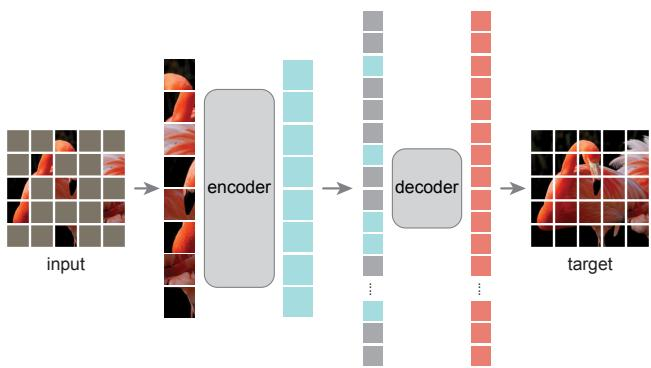  
图1. 我们的MAE架构。在预训练阶段，图像补丁的一个大随机子集（例如75%）被掩码掉。编码器仅应用于可见补丁的小子集。掩码标记在编码器之后引入，完整的编码补丁和掩码标记集合由一个小型解码器处理，该解码器以像素形式重建原始图像。预训练后，解码器被丢弃，编码器应用于未损坏的图像（完整补丁集）以进行识别任务。

(i) 直到最近，架构是不同的。在视觉领域，卷积网络[34]在过去十年中占据主导地位[33]。卷积通常作用于规则网格，并且将“指示符”（如掩码标记[14]或位置嵌入[57]）集成到卷积网络中并不直接。然而，这一架构差距已通过Vision Transformers（ViT）[16]的引入得到解决，不应再构成障碍。

(ii) 语言和视觉之间的信息密度不同。语言是人类生成的信号，具有高度语义性和信息密度。当训练模型预测每句中仅缺失的几个单词时，这一任务似乎能引发对语言的复杂理解。相反，图像是自然信号，具有严重的空间冗余——例如，缺失的补丁可以从相邻补丁中恢复，而无需对部分、物体和场景有高级理解。为了克服这一差异并鼓励学习有用的特征，我们展示了一个简单策略在计算机视觉中效果良好：掩码掉非常高比例的随机补丁。这一策略大大减少了冗余，并创建了一个具有挑战性的自监督任务，需要超越低级图像统计的整体理解。要定性了解我们的重建任务，请参见图2-4。

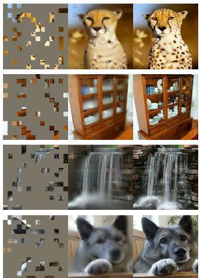

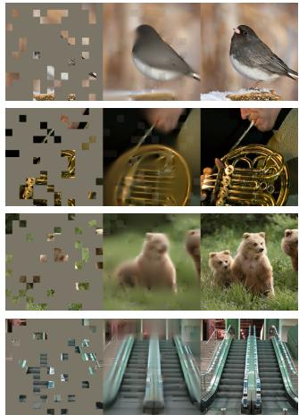

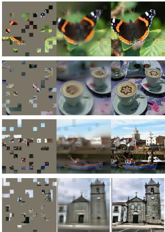

图2. ImageNet验证图像上的示例结果。对于每个三元组，我们展示掩码图像（左）、我们的MAE重建†（中）和真实图像（右）。掩码比例为80%，仅保留196个补丁中的39个。更多示例见附录。†由于在可见补丁上未计算损失，模型在可见补丁上的输出质量较差。可以简单地将输出与可见补丁叠加以提高视觉质量。我们有意不这样做，以便更全面地展示该方法的行为。  

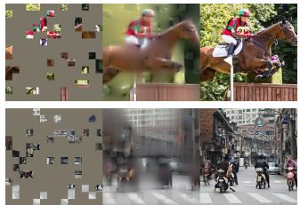

  
图3：在COCO验证集图像上的示例结果，使用了在ImageNet上训练的MAE（与图2相同的模型权重）。观察最右侧两个示例的重建结果，尽管与真实图像不同，但在语义上是合理的。

(iii) 自编码器的解码器将潜在表示映射回输入，在重建文本和图像时扮演不同角色。在视觉任务中，解码器重建像素，因此其输出语义层级低于常见识别任务。这与语言任务形成对比——语言解码器预测包含丰富语义信息的缺失单词。虽然BERT中的解码器可以很简单（一个MLP）[14]，但我们发现对于图像而言，解码器设计对学习到的潜在表示的语义层级起着关键作用。

基于上述分析，我们提出了一种简单、有效且可扩展的掩码自编码器（MAE）形式，用于视觉表示学习。我们的MAE从输入图像中随机掩码部分图像块，并在像素空间中重建缺失的图像块。该模型采用非对称编码器-解码器设计：编码器仅处理可见的图像块子集（不含掩码标记），而轻量级解码器则从潜在表示和掩码标记中重建输入（图1）。将掩码标记转移到非对称编码器-解码器中的小型解码器，可大幅降低计算量。在此设计下，极高的掩码比例（如75%）能实现双赢：既优化了精度，又使编码器仅需处理少量图像块（如25%）。这可将总预训练时间减少3倍或更多，同时降低内存消耗，使我们能轻松将MAE扩展到大型模型。

我们的MAE学习到的高容量模型具有良好的泛化能力。通过MAE预训练，我们可以在ImageNet-1K上训练像ViT-Large/-Huge [16]这类数据饥渴型模型，并获得更强的泛化性能。使用原始ViT-Huge模型在ImageNet-1K上微调后，我们达到了87.8%的准确率，超越了所有仅使用ImageNet-1K数据的前期成果。我们还在目标检测、实例分割和语义分割任务上评估了迁移学习效果。在这些任务中，我们的预训练方法优于有监督预训练方法，更重要的是，随着模型规模扩大，我们观察到显著的性能提升。这些观察结果与NLP领域自监督预训练的发现[14, 47, 48, 4]一致，我们希望这能推动本领域探索类似的发展路径。

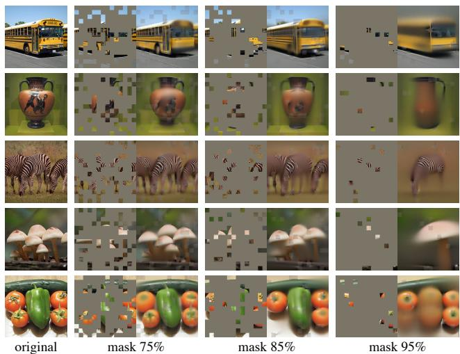  
图4：使用掩码率为75%预训练的MAE，在更高掩码率输入上重建的ImageNet验证集图像。预测结果与原始图像存在合理差异，表明该方法具有泛化能力。

## 2. 相关工作

掩码语言建模及其自回归变体（如BERT [14] 和 GPT [47, 48, 4]）是NLP领域非常成功的预训练方法。这些方法会保留输入序列的一部分，并训练模型预测缺失内容。研究表明这些方法具有出色的可扩展性 [4]，大量证据表明这些预训练表示能很好地泛化到各种下游任务。

自编码是学习表示的经典方法。它包含一个将输入映射到潜在表示的编码器，以及一个重建输入的解码器。例如，PCA和k-means都属于自编码器 [29]。去噪自编码器（DAE）[58] 是一类通过破坏输入信号并学习重建原始未破坏信号的自编码器。许多方法可被视为不同破坏形式下的广义DAE，例如掩码像素 [59, 46, 6] 或移除颜色通道 [70]。我们的MAE是一种去噪自编码形式，但在多个方面与经典DAE存在差异。

掩码图像编码方法通过掩码破坏的图像学习表示。开创性工作 [59] 将掩码作为DAE中的一种噪声类型。Context Encoder [46] 使用卷积网络修复大面积缺失区域。受NLP领域成功经验的启发，近期相关方法 [6, 16, 2] 基于Transformer [57]。iGPT [6] 处理像素序列并预测未知像素。ViT论文 [16] 研究了用于自监督学习的掩码块预测。最近，BEiT [2] 提出预测离散标记 [44, 50]。

自监督学习方法在计算机视觉领域引起了广泛关注，通常聚焦于不同的预训练前置任务 [15, 61, 42, 70, 45, 17]。近年来，对比学习 [3, 22] 变得流行，例如 [62, 43, 23, 7]，该方法对两个或多个视图之间的图像相似性与差异性（或仅相似性 [21, 8]）进行建模。对比学习及相关方法强烈依赖数据增强 [7, 21, 8]。自编码则追求概念上不同的方向，并展现出我们将要介绍的不同行为特性。

## 3. 方法

我们的掩码自编码器（MAE）是一种简单的自编码方法，通过部分观测重建原始信号。与所有自编码器类似，我们的方法包含一个编码器，将观测到的信号映射到潜在表示，以及一个解码器，从潜在表示重建原始信号。与经典自编码器不同，我们采用非对称设计，允许编码器仅处理部分观测信号（不含掩码标记），而轻量级解码器则从潜在表示和掩码标记重建完整信号。图1展示了这一思想，下文将详细介绍。

**掩码操作**。遵循ViT [16]，我们将图像划分为规则的非重叠块。随后采样一部分块，并掩码（即移除）其余块。我们的采样策略简单直接：无放回地随机采样块，遵循均匀分布。我们将其简称为“随机采样”。

高掩码比例（即移除块的比例）的随机采样能大幅消除冗余，从而创建一个无法通过可见邻近块的外推简单解决的任务（见图2-4）。均匀分布可防止潜在的中心偏差（即图像中心附近掩码块更多）。最后，高度稀疏的输入为设计高效编码器提供了机会，下文将介绍。

**MAE编码器**。我们的编码器采用ViT [16]，但仅应用于可见的、未掩码的块。与标准ViT类似，编码器通过线性投影嵌入块并添加位置嵌入，随后通过一系列Transformer块处理生成的集合。然而，我们的编码器仅处理完整集合中的一小部分（例如25%）。掩码块被移除，不使用掩码标记。这使我们能够以极少的计算和内存训练非常大的编码器。完整集合由轻量级解码器处理，下文将介绍。

**MAE解码器**。MAE解码器的输入是完整的标记集合，包括：(i) 编码后的可见块，以及 (ii) 掩码标记。见图1。每个掩码标记 [14] 是一个共享的可学习向量，表示需要预测的缺失块的位置。我们为完整集合中的所有标记添加位置嵌入；否则，掩码标记将无法获知其图像中的位置信息。解码器包含另一系列Transformer块。

MAE解码器仅在预训练期间用于执行图像重建任务（只有编码器用于生成图像表示以进行识别）。因此，解码器架构可以灵活设计，独立于编码器设计。我们实验了非常小的解码器，比编码器更窄更浅。例如，我们的默认解码器每个token的计算量不到编码器的10%。通过这种非对称设计，所有token仅由轻量级解码器处理，这显著减少了预训练时间。

重建目标。我们的MAE通过预测每个掩码块的像素值来重建输入。解码器输出的每个元素都是一个表示图像块的像素值向量。解码器的最后一层是一个线性投影，其输出通道数等于一个图像块中的像素值数量。解码器的输出被重塑以形成重建图像。我们的损失函数计算像素空间中重建图像与原始图像之间的均方误差（MSE）。我们仅对掩码块计算损失，类似于BERT [14]。¹

我们还研究了一种变体，其重建目标是每个掩码块的归一化像素值。具体来说，我们计算一个图像块中所有像素的均值和标准差，并用它们对该块进行归一化。在我们的实验中，使用归一化像素作为重建目标提高了表示质量。

简单实现。我们的MAE预训练可以高效实现，并且重要的是，不需要任何专门的稀疏操作。首先，我们为每个输入块生成一个token（通过线性投影并添加位置嵌入）。接下来，我们随机打乱token列表，并根据掩码比例移除列表的最后一部分。此过程为编码器生成一个小的token子集，相当于无放回地采样图像块。编码后，我们将一组掩码token附加到编码后的图像块列表后，并重新打乱这个完整列表（反转随机打乱操作），以使所有token与其目标对齐。解码器应用于这个完整列表（并添加位置嵌入）。如前所述，不需要稀疏操作。这种简单实现引入了可忽略的开销，因为打乱和重新打乱操作速度很快。

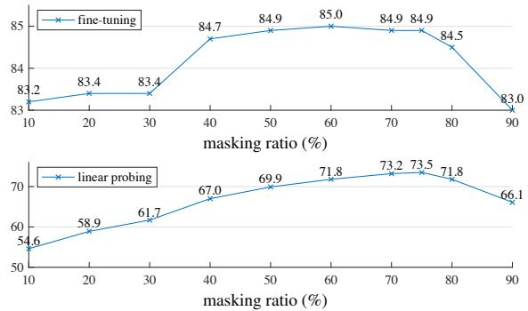  
图5. 掩码比例。高掩码比例（75%）对微调（上图）和线性探测（下图）均效果良好。本文所有图中的y轴均为ImageNet-1K验证准确率（%）。

## 4. ImageNet实验

我们在ImageNet-1K（IN1K）[13]训练集上进行自监督预训练，随后通过（i）端到端微调或（ii）线性探测进行监督训练以评估表征质量。报告单次224×224裁剪的top-1验证准确率。详见附录A.1。

基线：ViT-Large。我们采用ViT-Large（ViT-L/16）[16]作为消融实验的主干网络。ViT-L规模极大（比ResNet-50 [25]大一个数量级），容易过拟合。以下对比了从头训练的ViT-L与基于基线MAE微调的结果：

<table><tr><td>原始论文[16]从头训练</td><td>我们的实现从头训练</td><td>基线MAE</td></tr><tr><td>76.5</td><td>82.5</td><td>84.9</td></tr></table>

值得注意的是，从头训练有监督ViT-L并非易事，需要配合强正则化的训练策略（82.5%，见附录A.2）。即便如此，我们的MAE预训练仍带来了显著提升。此处微调仅需50个epoch（对比从头训练的200个epoch），表明微调准确率高度依赖预训练。

## 4.1 主要特性

我们采用表1的默认设置对MAE进行消融实验（见标题），观察到以下有趣特性。

**掩码比例。** 图5展示了掩码比例的影响。最优比例出奇地高：75%的掩码比例对线性探测和微调均表现良好。这与BERT [14]（典型掩码比例为15%）形成鲜明对比。我们的掩码比例也远高于计算机视觉相关研究[6, 16, 2]中常用的20%-50%。

模型通过推断缺失块生成不同但合理的输出（图4）。这种能力体现了对物体和场景整体形态的理解，而非简单的线条或纹理延伸。我们推测这种类推理行为与有效表征的学习密切相关。

图5还显示线性探测与微调结果呈现不同趋势。线性探测的准确率随掩码比例稳步提升直至最优值：准确率差距可达约20%（54.6% vs. 73.5%）。微调结果对掩码比例敏感度较低，40%-80%的宽范围掩码比例均能取得良好效果。图5中所有微调结果均优于从头训练（82.5%）。

<table><tr><td>块数</td><td>微调</td><td>线性探测</td></tr><tr><td>1</td><td>84.8</td><td>65.5</td></tr><tr><td>2</td><td>84.9</td><td>70.0</td></tr><tr><td>4</td><td>84.9</td><td>71.9</td></tr><tr><td>8</td><td>84.9</td><td>73.5</td></tr><tr><td>12</td><td>84.4</td><td>73.3</td></tr></table>

<table><tr><td>维度</td><td>微调</td><td>线性探测</td></tr><tr><td>128</td><td>84.9</td><td>69.1</td></tr><tr><td>256</td><td>84.8</td><td>71.3</td></tr><tr><td>512</td><td>84.9</td><td>73.5</td></tr><tr><td>768</td><td>84.4</td><td>73.1</td></tr><tr><td>1024</td><td>84.3</td><td>73.1</td></tr></table>

(a) 解码器深度。深层解码器可提升线性探测准确率。

<table><tr><td>case</td><td>ft</td><td>lin</td><td>FLOPs</td></tr><tr><td>编码器带[M]</td><td>84.2</td><td>59.6</td><td>3.3倍</td></tr><tr><td>编码器不带[M]</td><td>84.9</td><td>73.5</td><td>1倍</td></tr></table>

(c) 掩码标记。不带掩码标记的编码器更准确且速度更快（表2）。

(b) 解码器宽度。解码器可以比编码器更窄（1024维）。
<table><tr><td>case</td><td>ft</td><td>lin</td></tr><tr><td>像素（无归一化）</td><td>84.9</td><td>73.5</td></tr><tr><td>像素（有归一化）</td><td>85.4</td><td>73.9</td></tr><tr><td>主成分分析</td><td>84.6</td><td>72.3</td></tr><tr><td>dVAE标记</td><td>85.3</td><td>71.6</td></tr></table>

(d) 重建目标。像素作为重建目标效果显著。

<table><tr><td>case</td><td>ft</td><td>lin</td></tr><tr><td>无</td><td>84.0</td><td>65.7</td></tr><tr><td>裁剪，固定尺寸</td><td>84.7</td><td>73.1</td></tr><tr><td>裁剪，随机尺寸</td><td>84.9</td><td>73.5</td></tr><tr><td>裁剪+颜色抖动</td><td>84.3</td><td>71.9</td></tr></table>

(e) 数据增强。我们的MAE在最小或无增强条件下仍有效。

<table><tr><td>case</td><td>ratio</td><td>ft</td><td>lin</td></tr><tr><td>随机</td><td>75</td><td>84.9</td><td>73.5</td></tr><tr><td>块状</td><td>50</td><td>83.9</td><td>72.3</td></tr><tr><td>块状</td><td>75</td><td>82.8</td><td>63.9</td></tr><tr><td>网格</td><td>75</td><td>84.0</td><td>66.0</td></tr></table>

(f) 掩码采样。随机采样效果最佳。可视化结果见图6。  
表1. 基于ViT-L/16在ImageNet-1K上的MAE消融实验。报告微调（ft）和线性探测（lin）准确率（%）。未指定时，默认设置为：解码器深度8、宽度512，重建目标为未归一化像素，数据增强为随机尺寸裁剪，掩码比例75%，预训练时长800轮。默认设置以灰色标记。

解码器设计。我们的MAE解码器可灵活设计，如表1a和1b所示。

表1a展示了解码器深度（Transformer块数量）的变化。足够深的解码器对线性探测至关重要。这可通过像素重建任务与识别任务之间的差距解释：自编码器最后几层更专注于重建，但与识别任务的相关性较低。适当深度的解码器可承担重建专用功能，使潜在表示保持在更抽象层面。该设计在线性探测中可带来高达8%的提升（表1a中‘lin’列）。然而，若使用微调，编码器最后几层可通过调整适应识别任务，此时解码器深度对微调提升的影响较小（表1a中‘ft’列）。

有趣的是，我们的MAE使用单块解码器在微调时表现强劲（84.8%）。注意，单个Transformer块是传播可见令牌到掩码令牌所需的最小配置。如此小的解码器能进一步加速训练。

在表1b中，我们研究了解码器宽度（通道数）。默认使用512维，在微调和线性探测中表现良好。较窄的解码器在微调时同样有效。

总体而言，我们的默认MAE解码器非常轻量。它包含8个块和512维宽度（表1中灰色标注）。每个令牌的FLOPs仅为ViT-L（24块，1024维）的9%。因此，尽管解码器处理所有令牌，它仍只占整体计算量的一小部分。

<table><tr><td>编码器</td><td>解码器深度</td><td>微调准确率</td><td>小时</td><td>加速比</td></tr><tr><td>ViT-L,带[M]</td><td>8</td><td>84.2</td><td>42.4</td><td>=</td></tr><tr><td>ViT-L</td><td>8</td><td>84.9</td><td>15.4</td><td>2.8×</td></tr><tr><td>ViT-L</td><td>1</td><td>84.8</td><td>11.6</td><td>3.7×</td></tr><tr><td>ViT-H,带[M]</td><td>8</td><td>-</td><td>119.6†</td><td>-</td></tr><tr><td>ViT-H</td><td>8</td><td>85.8</td><td>34.5</td><td>3.5×</td></tr><tr><td>ViT-H</td><td>1</td><td>85.9</td><td>29.3</td><td>4.1×</td></tr></table>

表2. 我们的MAE训练（800轮）的挂钟时间，在128个TPU-v3核心上使用TensorFlow进行基准测试。加速比相对于编码器包含掩码令牌（灰色标注）的条目。解码器宽度为512，掩码比例为75%。†：该条目通过训练十轮估算。

掩码令牌。我们MAE的一个重要设计是在编码器中跳过掩码令牌[M]，并在轻量解码器中后续应用。表1c研究了这一设计。

如果编码器使用掩码令牌，其性能会下降：线性探测准确率下降14%。在这种情况下，预训练与部署之间存在差距：该编码器在预训练时输入中包含大量掩码令牌，而未被破坏的图像中并不存在这些令牌。这种差距可能降低部署时的准确率。通过从编码器中移除掩码令牌，我们限制编码器始终只看到真实图像块，从而提升准确率。

此外，通过在编码器中跳过掩码令牌，我们大幅减少了训练计算量。在表1c中，我们将整体训练FLOPs减少了3.3倍。这在我们实现中带来了2.8倍的挂钟时间加速（见表2）。对于更小的解码器（1块）、更大的编码器（ViT-H）或两者兼有，挂钟时间加速甚至更大（3.5–4.1倍）。注意，当掩码比例为75%时，加速比可超过4倍，部分原因是自注意力机制的复杂度是二次的。此外，内存占用也大幅减少，这有助于训练更大模型或通过大批量训练进一步加速。时间和内存效率使我们的MAE在训练超大规模模型时具有优势。

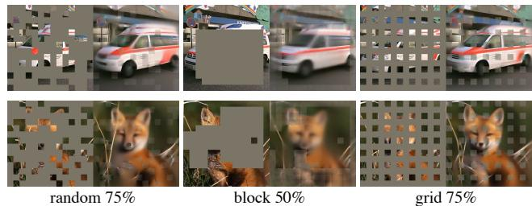  
图6. 掩码采样策略决定了预文本任务的难度，影响重建质量和表征（表1f）。此处每个输出均来自使用指定掩码策略训练的MAE。左图：随机采样（默认设置）。中图：块状采样[2]，移除大块随机区域。右图：网格采样，每四个块中保留一个。图像来自验证集。

**重建目标**。我们在表1d中比较了不同的重建目标。目前的结果基于未进行（逐块）归一化的像素。使用归一化像素可提升准确率。这种逐块归一化增强了局部对比度。另一种变体中，我们在块空间进行PCA，并使用最大的PCA系数（此处为96个）作为目标，但这样做降低了准确率。两项实验表明，高频分量在我们的方法中是有用的。

我们还比较了预测令牌的MAE变体，这是BEiT[2]使用的目标。具体而言，对于该变体，我们遵循[2]使用DALLE预训练的dVAE[50]作为分词器。此处MAE解码器通过交叉熵损失预测令牌索引。与未归一化像素相比，这种分词化将微调准确率提升了0.4%，但与归一化像素相比并无优势。它还降低了线性探测准确率。在第5节中，我们进一步表明分词化在迁移学习中并非必要。

基于像素的MAE比分词化简单得多。dVAE分词器需要额外的预训练阶段，可能依赖额外数据（2.5亿张图像[50]）。dVAE编码器是一个大型卷积网络（计算量占ViT-L的40%），并增加了显著开销。使用像素则不存在这些问题。

**数据增强**。表1e研究了数据增强对MAE预训练的影响。

我们的MAE在使用仅裁剪增强（固定尺寸或随机尺寸，均包含随机水平翻转）时表现良好。添加颜色抖动会降低结果，因此我们在其他实验中不使用它。

令人惊讶的是，即使不使用数据增强（仅中心裁剪，无翻转），我们的MAE也能表现良好。这一特性与对比学习及相关方法[62, 23, 7, 21]截然不同，后者严重依赖数据增强。有研究[21]指出，仅使用裁剪增强会使BYOL[21]和SimCLR[7]的准确率分别降低13%和28%。此外，没有证据表明对比学习能在无增强的情况下工作：同一图像的两个视图相同，容易满足平凡解。

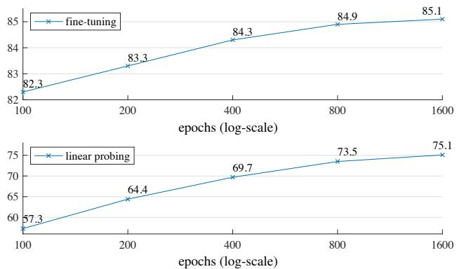  
图7. 训练计划。更长的训练计划带来显著提升。此处每个点代表一个完整的训练计划。模型为ViT-L，采用表1中的默认设置。

在MAE中，数据增强的作用主要由随机掩码（后续会消融研究）承担。每次迭代的掩码不同，因此无论是否进行数据增强，都会生成新的训练样本。掩码使前置任务变得困难，从而减少了对正则化训练所需的数据增强。

**掩码采样策略**。在表1f中，我们比较了不同的掩码采样策略，如图6所示。

块状掩码策略（如[2]中提出）倾向于移除大块区域（图6中间）。我们的MAE在50%的掩码比例下表现合理，但在75%的比例下性能下降。该任务比随机采样更困难，训练损失更高，重建结果也更模糊。

我们还研究了网格采样，即每隔四个块保留一个（图6右侧）。这是一个较简单的任务，训练损失更低，重建结果更清晰，但表示质量较低。

简单随机采样对我们的MAE效果最佳。它允许更高的掩码比例，从而带来更大的加速优势，同时保持良好的准确率。

**训练计划**。我们目前的消融研究基于800轮预训练。图7展示了训练计划长度的影响。随着训练时间延长，准确率稳步提升。事实上，即使在1600轮时，线性探测准确率仍未观察到饱和现象。这种行为与对比学习方法不同，例如MoCo v3 [9]在ViT-L上300轮时便达到饱和。注意，MAE编码器每轮仅看到25%的块，而对比学习中编码器每轮看到200%（双裁剪）甚至更多（多裁剪）的块。

<table><tr><td>方法</td><td>预训练数据</td><td>ViT-B</td><td>ViT-L</td><td>ViT-H</td><td>ViT-H448</td></tr><tr><td>从头训练（我们的实现）</td><td>-</td><td>82.3</td><td>82.6</td><td>83.1</td><td></td></tr><tr><td>DINO [5]</td><td>IN1K</td><td>82.8</td><td>-</td><td>1</td><td></td></tr><tr><td>MoCo v3 [9]</td><td>IN1K</td><td>83.2</td><td>84.1</td><td>1</td><td></td></tr><tr><td>BEiT[2]</td><td>IN1K+DALLE</td><td>83.2</td><td>85.2</td><td>1</td><td>-</td></tr><tr><td>MAE</td><td>IN1K</td><td>83.6</td><td>85.9</td><td>86.9</td><td>87.8</td></tr></table>

表3. 与ImageNet-1K上先前结果的比较。预训练数据为ImageNet-1K训练集（BEiT中的分词器除外，其在250M DALLE数据[50]上预训练）。所有自监督方法均通过端到端微调进行评估。ViT模型为B/16、L/16、H/14 [16]。每列最佳结果用下划线标出。所有结果基于图像尺寸224，ViT-H额外提供448尺寸的结果。此处我们的MAE重建归一化像素，并预训练了1600轮。

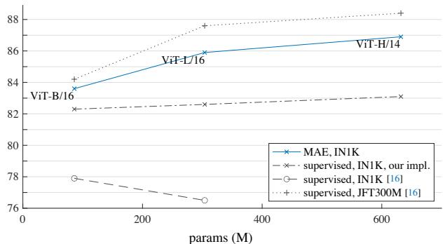  
图8. MAE预训练与监督预训练的对比，通过在ImageNet-1K（224尺寸）上进行微调评估。我们与原始ViT论文[16]中在IN1K或JFT300M上训练的结果进行比较。

## 4.2. 与先前结果的比较

与自监督方法的比较。在表3中，我们比较了自监督ViT模型的微调结果。对于ViT-B，所有方法表现接近。对于ViT-L，方法之间的差距更大，这表明更大模型面临的挑战是减少过拟合。

我们的MAE可以轻松扩展，并且在大模型上表现出稳定的提升。使用ViT-H（224尺寸）获得了86.9%的准确率。通过使用448尺寸进行微调，仅使用IN1K数据，我们达到了87.8%的准确率。此前仅使用IN1K数据的所有方法中，最佳准确率为87.1%（512尺寸）[67]，基于先进网络。我们在高度竞争的IN1K基准测试（无外部数据）中，以显著优势超越了当前最优水平。我们的结果基于标准ViT，预计先进网络将表现更佳。

与BEiT[2]相比，我们的MAE在更简单、更快速的同时，准确率更高。我们的方法重建像素，而BEiT预测token：BEiT报告称，使用ViT-B重建像素时性能下降了1.8%[2]。我们不需要dVAE预训练。此外，我们的MAE比BEiT快得多（每轮3.5倍），原因如表1c所示。

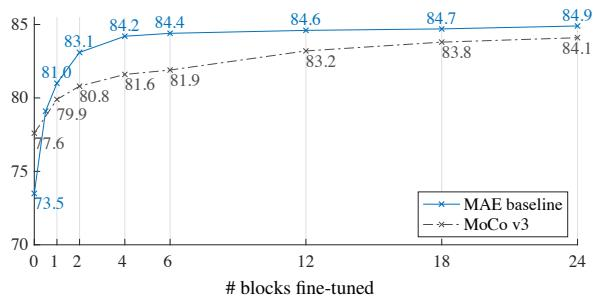  
图9. ViT-L在默认设置（表1）下，关于微调Transformer块数量的部分微调结果。调整0个块为线性探测；24个块为完全微调。我们的MAE表示线性可分性较差，但如果微调一个或多个块，则始终优于MoCo v3。

表3中的MAE模型预训练了1600轮以获得更好的准确率（图7）。即便如此，在相同硬件上训练时，我们的总预训练时间仍少于其他方法。例如，在128个TPU-v3核心上训练ViT-L，我们的MAE训练时间为31小时（1600轮），而MoCo v3为36小时（300轮）[9]。

与监督预训练的比较。在原始ViT论文[16]中，ViT-L在IN1K上训练时性能下降。我们实现的监督训练（见A.2）效果更好，但准确率趋于饱和。见图8。

我们的MAE预训练仅使用IN1K，但泛化能力更强：对于更高容量的模型，从头训练的增益更大。这遵循了与[16]中JFT-300M监督预训练类似的趋势。这一比较表明，我们的MAE有助于扩展模型规模。

## 4.3. 部分微调

表1显示，线性探测与微调结果之间基本不相关。线性探测在过去几年中是一种流行的方案，但它错过了追求强非线性特征的机会——而这正是深度学习的优势所在。作为折中方案，我们研究了一种部分微调策略：冻结其他层，仅微调最后几层。这一策略在早期工作中也有使用，例如[65, 70, 42]。

图9展示了结果。值得注意的是，仅微调一个Transformer块就能将准确率从73.5%显著提升至81.0%。此外，如果仅微调最后一个块的“一半”（即其MLP子块），我们可以获得79.1%的准确率，远优于线性探测。这种变体本质上相当于微调一个MLP头部。微调少量块（例如4个或6个）即可达到接近全微调的准确率。

在图9中，我们还与MoCo v3 [9]进行了对比，这是一种对比学习方法，且提供了ViT-L的结果。MoCo v3具有更高的线性探测准确率；然而，其所有部分微调结果均不如MAE。当微调4个块时，差距为2.6%。尽管MAE表示的线性可分性较弱，但其非线性特征更强，且在微调非线性头部时表现良好。

<table><tr><td colspan="2"></td><td colspan="2">Apbox</td><td colspan="2">Apmask</td></tr><tr><td>方法</td><td>预训练数据</td><td>ViT-B</td><td>ViT-L</td><td>ViT-B</td><td>ViT-L</td></tr><tr><td>有监督</td><td>IN1K含标签</td><td>47.9</td><td>49.3</td><td>42.9</td><td>43.9</td></tr><tr><td>MoCo v3</td><td>IN1K</td><td>47.9</td><td>49.3</td><td>42.7</td><td>44.0</td></tr><tr><td>BEiT</td><td>IN1K+DALLE</td><td>49.8</td><td>53.3</td><td>44.4</td><td>47.1</td></tr><tr><td>MAE</td><td>IN1K</td><td>50.3</td><td>53.3</td><td>44.9</td><td>47.2</td></tr></table>

表4. 基于ViT Mask R-CNN基线的COCO目标检测与分割结果。所有条目均基于我们的实现。自监督条目使用无标签的IN1K数据。掩码AP的变化趋势与边界框AP相似。

这些观察表明，线性可分性并非评估表示质量的唯一指标。已有研究（例如[8]）指出，线性探测与迁移学习性能（如目标检测）的相关性并不强。据我们所知，在自然语言处理中，线性评估并不常用于预训练基准测试。

## 5. 迁移学习实验

我们使用表3中的预训练模型评估下游任务的迁移学习性能。

目标检测与分割。我们在COCO [37]数据集上端到端微调Mask R-CNN [24]。ViT骨干网络经过适配以支持FPN [36]（详见A.3）。我们对表4中的所有条目均采用此方法。我们报告目标检测的边界框AP和实例分割的掩码AP。

与监督预训练相比，我们的MAE在所有配置下均表现更优（表4）。使用较小的ViT-B时，MAE比监督预训练高出2.4个点（APbox：50.3 vs. 47.9）。更显著的是，使用较大的ViT-L时，MAE预训练比监督预训练高出4.0个点（53.3 vs. 49.3）。

基于像素的MAE优于或等同于基于标记的BEiT，同时MAE更简单、更快速。MAE和BEiT均优于MoCo v3，而MoCo v3与监督预训练性能相当。

**语义分割**。我们在ADE20K [72]上使用UperNet [63]进行实验（见A.4）。表5显示，我们的预训练相比监督预训练显著提升了结果，例如ViT-L提升了3.7个点。基于像素的MAE也优于基于标记的BEiT。这些观察结果与COCO上的结果一致。

**分类任务**。表6研究了在iNaturalists [56]和Places [71]任务上的迁移学习（见A.5）。在iNat上，我们的方法展现出强大的扩展性：随着模型增大，准确率显著提升。我们的结果大幅超越了此前的最佳结果。在Places上，MAE优于此前通过数十亿图像预训练获得的最佳结果 [19, 40]。

**像素 vs. 标记**。表7比较了像素和标记作为MAE重建目标的效果。使用dVAE标记优于使用未归一化像素，但在所有测试案例中，它与使用归一化像素在统计上相似。这再次表明，标记化对于我们的MAE并非必要。

<table><tr><td>方法</td><td>预训练数据</td><td>ViT-B</td><td>ViT-L</td></tr><tr><td>监督</td><td>带标签的IN1K</td><td>47.4</td><td>49.9</td></tr><tr><td>MoCo v3</td><td>IN1K</td><td>47.3</td><td>49.1</td></tr><tr><td>BEiT</td><td>IN1K+DALLE</td><td>47.1</td><td>53.3</td></tr><tr><td>MAE</td><td>IN1K</td><td>48.1</td><td>53.6</td></tr></table>

表5. 使用Uper-Net的ADE20K语义分割（mIoU）。BEiT结果使用官方代码复现。其他条目基于我们的实现。自监督条目使用无标签的IN1K数据。

<table><tr><td>数据集</td><td>ViT-B</td><td>ViT-L</td><td>ViT-H</td><td>ViT-H448</td><td>此前最佳</td></tr><tr><td>iNat 2017</td><td>70.5</td><td>75.7</td><td>79.3</td><td>83.4</td><td>75.4 [55]</td></tr><tr><td>iNat 2018</td><td>75.4</td><td>80.1</td><td>83.0</td><td>86.8</td><td>81.2[54]</td></tr><tr><td>iNat 2019</td><td>80.5</td><td>83.4</td><td>85.7</td><td>88.3</td><td>84.1[54]</td></tr><tr><td>Places205</td><td>63.9</td><td>65.8</td><td>65.9</td><td>66.8</td><td>66.0[19]†</td></tr><tr><td>Places365</td><td>57.9</td><td>59.4</td><td>59.8</td><td>60.3</td><td>58.0[40]‡</td></tr></table>

表6. 在分类数据集上的迁移学习准确率，使用MAE在IN1K上预训练后微调。我们提供了与此前最佳结果的系统级比较。†：在10亿张图像上预训练。‡：在35亿张图像上预训练。

<table><tr><td></td><td colspan="3">IN1K</td><td colspan="2">COCO</td><td colspan="2">ADE20K</td></tr><tr><td>像素（无归一化）</td><td>ViT-B 83.3</td><td>ViT-L 85.1</td><td>ViT-H 86.2</td><td>ViT-B 49.5</td><td>ViT-L 52.8</td><td>ViT-B 48.0</td><td>ViT-L 51.8</td></tr><tr><td>像素（有归一化）</td><td>83.6</td><td>85.9</td><td>86.9</td><td>50.3</td><td>53.3</td><td>48.1</td><td>53.6</td></tr><tr><td>dVAE 令牌 △</td><td>83.6 0.0</td><td>85.7 -0.2</td><td>86.9 0.0</td><td>50.3 0.0</td><td>53.2 -0.1</td><td>48.1 0.0</td><td>53.4 -0.2</td></tr></table>

表 7. 像素与令牌作为 MAE 重建目标的对比。△ 表示使用 dVAE 令牌与使用归一化像素之间的差异。该差异在统计上不显著。

## 6. 讨论与结论

能够良好扩展的简单算法是深度学习的核心。在自然语言处理中，简单的自监督学习方法（例如 [47, 14, 48, 4]）使得从指数级扩展的模型中获益成为可能。在计算机视觉中，尽管自监督学习取得了进展，但实用的预训练范式仍以监督学习为主（例如 [33, 51, 25, 16]）。在本研究中，我们在 ImageNet 和迁移学习上观察到，一种自编码器——类似于 NLP 技术的简单自监督方法——提供了可扩展的益处。视觉领域的自监督学习可能正走上与 NLP 相似的发展轨迹。

另一方面，我们注意到图像和语言是不同性质的信号，必须谨慎处理这一差异。图像仅仅是记录下来的光线，没有像单词那样的语义分解。我们不是试图移除物体，而是移除最可能不构成语义片段的随机块。同样，我们的 MAE 重建像素，这些像素并非语义实体。尽管如此，我们观察到（例如图 4）我们的 MAE 推断出复杂、整体的重建结果，表明它已经学习了众多视觉概念，即语义。我们假设这种行为是通过 MAE 内部丰富的隐藏表示实现的。我们希望这一视角能激发未来的工作。

更广泛的影响。所提出的方法基于训练数据集的统计特性预测内容，因此会反映这些数据中的偏差，包括那些具有负面社会影响的偏差。该模型可能生成不存在的内容。在基于此工作生成图像时，这些问题需要进一步研究和考虑。

## 参考文献

[1] Jimmy Lei Ba, Jamie Ryan Kiros, and Geoffrey E Hinton. Layer normalization. arXiv:1607.06450, 2016.

[2] Hangbo Bao, Li Dong, and Furu Wei. BEiT: BERT pre-training of image transformers. arXiv:2106.08254, 2021. 访问于 2021 年 6 月。

[3] Suzanna Becker and Geoffrey E Hinton. Self-organizing neural network that discovers surfaces in random-dot stereograms. Nature, 1992.

[4] Tom Brown, Benjamin Mann, Nick Ryder, Melanie Subbiah, Jared D Kaplan, Prafulla Dhariwal, Arvind Neelakantan, Pranav Shyam, Girish Sastry, Amanda Askell, Sandhini Agarwal, Ariel Herbert-Voss, Gretchen Krueger, Tom Henighan, Rewon Child, Aditya Ramesh, Daniel Ziegler, Jeffrey Wu, Clemens Winter, Chris Hesse, Mark Chen, Eric Sigler, Mateusz Litwin, Scott Gray, Benjamin Chess, Jack Clark, Christopher Berner, Sam McCandlish, Alec Radford, Ilya Sutskever, and Dario Amodei. 语言模型是少样本学习器。发表于NeurIPS，2020年。

[5] Mathilde Caron, Hugo Touvron, Ishan Misra, Herve J ´ egou, Julien ´ Mairal, Piotr Bojanowski, and Armand Joulin. 自监督视觉Transformer中的涌现特性。发表于ICCV，2021年。

[6] Mark Chen, Alec Radford, Rewon Child, Jeffrey Wu, Heewoo Jun, David Luan, and Ilya Sutskever. 基于像素的生成式预训练。发表于ICML，2020年。

[7] Ting Chen, Simon Kornblith, Mohammad Norouzi, and Geoffrey Hinton. 视觉表征对比学习的简单框架。发表于ICML，2020年。

[8] Xinlei Chen and Kaiming He. 探索简单孪生表征学习。发表于CVPR，2021年。

[9] Xinlei Chen, Saining Xie, and Kaiming He. 自监督视觉Transformer训练实证研究。发表于ICCV，2021年。

[10] Kevin Clark, Minh-Thang Luong, Quoc V Le, and Christopher D Manning. ELECTRA：将文本编码器预训练为判别器而非生成器。发表于ICLR，2020年。

[11] Corinna Cortes and Vladimir Vapnik. 支持向量网络。机器学习，1995年。

[12] Ekin D Cubuk, Barret Zoph, Jonathon Shlens, and Quoc V Le. Randaugment：基于缩减搜索空间的实用自动化数据增强。发表于CVPR研讨会，2020年。

[13] Jia Deng, Wei Dong, Richard Socher, Li-Jia Li, Kai Li, and Li Fei-Fei. ImageNet：大规模分层图像数据库。发表于CVPR，2009年。

[14] Jacob Devlin, Ming-Wei Chang, Kenton Lee, and Kristina Toutanova. BERT：深度双向Transformer的语言理解预训练。发表于NAACL，2019年。

[15] Carl Doersch, Abhinav Gupta, and Alexei A Efros. 基于上下文预测的无监督视觉表征学习。发表于ICCV，2015年。

[16] Alexey Dosovitskiy, Lucas Beyer, Alexander Kolesnikov, Dirk Weissenborn, Xiaohua Zhai, Thomas Unterthiner, Mostafa Dehghani, Matthias Minderer, Georg Heigold, Sylvain Gelly, Jakob Uszkoreit, and Neil Houlsby. 一张图像等于16x16个词：用于大规模图像识别的Transformer。发表于ICLR，2021年。

[17] Spyros Gidaris, Praveer Singh, and Nikos Komodakis. 通过预测图像旋转的无监督表征学习。发表于ICLR，2018年。

[18] Xavier Glorot and Yoshua Bengio. 理解深度前馈神经网络训练的难度。发表于AISTATS，2010年。

[19] Priya Goyal, Mathilde Caron, Benjamin Lefaudeux, Min Xu, Pengchao Wang, Vivek Pai, Mannat Singh, Vitaliy Liptchinsky, Ishan Misra, Armand Joulin, and Piotr Bojanowski. 野外视觉特征的自监督预训练。arXiv:2103.01988，2021年。

[20] Priya Goyal, Piotr Dollar, Ross Girshick, Pieter Noordhuis, Lukasz Wesolowski, Aapo Kyrola, Andrew Tulloch, Yangqing Jia, 和 Kaiming He. 精确的大批量SGD：一小时内训练ImageNet. arXiv:1706.02677, 2017.

[21] Jean-Bastien Grill, Florian Strub, Florent Altche, Corentin Tallec, Pierre Richemond, Elena Buchatskaya, Carl Doersch, Bernardo Avila Pires, Zhaohan Guo, Mohammad Gheshlaghi Azar, Bilal Piot, Koray Kavukcuoglu, Remi Munos, 和 Michal Valko. 自举你的潜在特征——一种新的自监督学习方法. 在 NeurIPS, 2020.

[22] Raia Hadsell, Sumit Chopra, 和 Yann LeCun. 通过学习不变映射进行降维. 在 CVPR, 2006.

[23] Kaiming He, Haoqi Fan, Yuxin Wu, Saining Xie, 和 Ross Girshick. 用于无监督视觉表示学习的动量对比. 在 CVPR, 2020.

[24] Kaiming He, Georgia Gkioxari, Piotr Dollar, 和 Ross Girshick. Mask R-CNN. 在 ICCV, 2017.

[25] Kaiming He, Xiangyu Zhang, Shaoqing Ren, 和 Jian Sun. 用于图像识别的深度残差学习. 在 CVPR, 2016.

[26] Dan Hendrycks, Steven Basart, Norman Mu, Saurav Kadavath, Frank Wang, Evan Dorundo, Rahul Desai, Tyler Zhu, Samyak Parajuli, Mike Guo, 等. 鲁棒性的多面性：对分布外泛化的批判性分析. 在 ICCV, 2021.

[27] Dan Hendrycks 和 Thomas Dietterich. 对常见损坏和扰动的神经网络鲁棒性基准测试. 在 ICLR, 2019.

[28] Dan Hendrycks, Kevin Zhao, Steven Basart, Jacob Steinhardt, 和 Dawn Song. 自然对抗样本. 在 CVPR, 2021.

[29] Geoffrey E Hinton 和 Richard S Zemel. 自编码器、最小描述长度和亥姆霍兹自由能. 在 NeurIPS, 1994.

[30] Gao Huang, Yu Sun, Zhuang Liu, Daniel Sedra, 和 Kilian Q Weinberger. 具有随机深度的深度网络. 在 ECCV, 2016.

[31] Sergey Ioffe 和 Christian Szegedy. 批归一化：通过减少内部协变量偏移加速深度网络训练. 在 ICML, 2015.

[32] Insoo Kim, Seungju Han, Ji-won Baek, Seong-Jin Park, Jae-Joon Han, 和 Jinwoo Shin. 通过可逆解码器进行质量无关的图像识别. 在 CVPR, 2021.

[33] Alex Krizhevsky, Ilya Sutskever, 和 Geoff Hinton. 使用深度卷积神经网络的ImageNet分类. 在 NeurIPS, 2012.

[34] Yann LeCun, Bernhard Boser, John S Denker, Donnie Henderson, Richard E Howard, Wayne Hubbard, 和 Lawrence D Jackel. 反向传播在手写邮政编码识别中的应用. 神经计算, 1989.

[35] Yanghao Li, Saining Xie, Xinlei Chen, Piotr Dollar, Kaiming He, 和 Ross Girshick. 使用视觉变换器进行检测迁移学习的基准测试. 准备中, 2021.

[36] Tsung-Yi Lin, Piotr Dollar, Ross Girshick, Kaiming He, Bharath Hariharan, 和 Serge Belongie. 用于目标检测的特征金字塔网络. 在 CVPR, 2017.

[37] Tsung-Yi Lin, Michael Maire, Serge Belongie, James Hays, Pietro Perona, Deva Ramanan, Piotr Dollar 和 C Lawrence Zitnick。微软 COCO：上下文中的常见物体。载于 ECCV，2014 年。

[38] Ilya Loshchilov 和 Frank Hutter。SGDR：带热重启的随机梯度下降。载于 ICLR，2017 年。

[39] Ilya Loshchilov 和 Frank Hutter。解耦权重衰减正则化。载于 ICLR，2019 年。

[40] Dhruv Mahajan、Ross Girshick、Vignesh Ramanathan、Kaiming He、Manohar Paluri、Yixuan Li、Ashwin Bharambe 和 Laurens van der Maaten。探索弱监督预训练的极限。载于 ECCV，2018 年。

[41] Xiaofeng Mao、Gege Qi、Yuefeng Chen、Xiaodan Li、Ranjie Duan、Shaokai Ye、Yuan He 和 Hui Xue。迈向鲁棒的视觉变换器。arXiv:2105.07926，2021 年。

[42] Mehdi Noroozi 和 Paolo Favaro。通过解决拼图游戏进行视觉表征的无监督学习。载于 ECCV，2016 年。

[43] Aaron van den Oord、Yazhe Li 和 Oriol Vinyals。基于对比预测编码的表征学习。arXiv:1807.03748，2018 年。

[44] Aaron van den Oord、Oriol Vinyals 和 Koray Kavukcuoglu。神经离散表征学习。载于 NeurIPS，2017 年。

[45] Deepak Pathak、Ross Girshick、Piotr Dollar、Trevor Darrell 和 Bharath Hariharan。通过观察物体运动学习特征。载于 CVPR，2017 年。

[46] Deepak Pathak、Philipp Krahenbuhl、Jeff Donahue、Trevor Darrell 和 Alexei A Efros。上下文编码器：通过修复进行特征学习。载于 CVPR，2016 年。

[47] Alec Radford、Karthik Narasimhan、Tim Salimans 和 Ilya Sutskever。通过生成式预训练改进语言理解。2018 年。

[48] Alec Radford、Jeffrey Wu、Rewon Child、David Luan、Dario Amodei 和 Ilya Sutskever。语言模型是无监督的多任务学习者。2019 年。

[49] Colin Raffel、Noam Shazeer、Adam Roberts、Katherine Lee、Sharan Narang、Michael Matena、Yanqi Zhou、Wei Li 和 Peter J. Liu。探索基于统一文本到文本变换器的迁移学习极限。JMLR，2020 年。

[50] Aditya Ramesh、Mikhail Pavlov、Gabriel Goh、Scott Gray、Chelsea Voss、Alec Radford、Mark Chen 和 Ilya Sutskever。零样本文本到图像生成。载于 ICML，2021 年。

[51] Karen Simonyan 和 Andrew Zisserman。用于大规模图像识别的极深卷积网络。载于 ICLR，2015 年。

[52] Christian Szegedy、Vincent Vanhoucke、Sergey Ioffe、Jonathon Shlens 和 Zbigniew Wojna。重新思考计算机视觉的初始架构。载于 CVPR，2016 年。

[53] Hugo Touvron、Matthieu Cord、Matthijs Douze、Francisco Massa、Alexandre Sablayrolles 和 Herve Jegou。通过注意力训练数据高效的图像变换器及蒸馏。载于 ICML，2021 年。

[54] Hugo Touvron、Alexandre Sablayrolles、Matthijs Douze、Matthieu Cord 和 Herve Jegou。Grafit：利用粗粒度标签学习细粒度图像表征。载于 ICCV，2021 年。

[55] Hugo Touvron、Andrea Vedaldi、Matthijs Douze 和 Herve Jegou。修正训练-测试分辨率差异。arXiv:1906.06423，2019 年。

[56] Grant Van Horn, Oisin Mac Aodha, Yang Song, Yin Cui, Chen Sun, Alex Shepard, Hartwig Adam, Pietro Perona 和 Serge Belongie。iNaturalist 物种分类与检测数据集。载于 CVPR，2018 年。

[57] Ashish Vaswani, Noam Shazeer, Niki Parmar, Jakob Uszkoreit, Llion Jones, Aidan N Gomez, Lukasz Kaiser 和 Illia Polosukhin。注意力机制即一切。载于 NeurIPS，2017 年。

[58] Pascal Vincent, Hugo Larochelle, Yoshua Bengio 和 Pierre-Antoine Manzagol。利用去噪自编码器提取与组合鲁棒特征。载于 ICML，2008 年。

[59] Pascal Vincent, Hugo Larochelle, Isabelle Lajoie, Yoshua Bengio, Pierre-Antoine Manzagol 和 Leon Bottou。堆叠去噪自编码器：通过局部去噪准则在深度网络中学习有用表示。JMLR，2010 年。

[60] Haohan Wang, Songwei Ge, Zachary Lipton 和 Eric P Xing。通过惩罚局部预测能力学习鲁棒的全局表示。载于 NeurIPS，2019 年。

[61] Xiaolong Wang 和 Abhinav Gupta。利用视频无监督学习视觉表示。载于 ICCV，2015 年。

[62] Zhirong Wu, Yuanjun Xiong, Stella Yu 和 Dahua Lin。基于非参数实例判别的无监督特征学习。载于 CVPR，2018 年。

[63] Tete Xiao, Yingcheng Liu, Bolei Zhou, Yuning Jiang 和 Jian Sun。面向场景理解的统一感知解析。载于 ECCV，2018 年。

[64] Tete Xiao, Mannat Singh, Eric Mintun, Trevor Darrell, Piotr Dollar 和 Ross Girshick。早期卷积有助于 Transformer 更好地观察。载于 NeurIPS，2021 年。

[65] Jason Yosinski, Jeff Clune, Yoshua Bengio 和 Hod Lipson。深度神经网络中的特征可迁移性如何？载于 NeurIPS，2014 年。

[66] Yang You, Igor Gitman 和 Boris Ginsburg。卷积网络的大批量训练。arXiv:1708.03888，2017 年。

[67] Li Yuan, Qibin Hou, Zihang Jiang, Jiashi Feng 和 Shuicheng Yan。VOLO：用于视觉识别的视觉展望器。arXiv:2106.13112，2021 年。

[68] Sangdoo Yun, Dongyoon Han, Seong Joon Oh, Sanghyuk Chun, Junsuk Choe 和 Youngjoon Yoo。CutMix：通过可定位特征训练强分类器的正则化策略。载于 ICCV，2019 年。

[69] Hongyi Zhang, Moustapha Cisse, Yann N Dauphin 和 David Lopez-Paz。mixup：超越经验风险最小化。载于 ICLR，2018 年。

[70] Richard Zhang, Phillip Isola 和 Alexei A Efros。彩色图像着色。载于 ECCV，2016 年。

[71] Bolei Zhou, Agata Lapedriza, Jianxiong Xiao, Antonio Torralba 和 Aude Oliva。利用 Places 数据库学习用于场景识别的深度特征。载于 NeurIPS，2014 年。

[72] Bolei Zhou, Hang Zhao, Xavier Puig, Tete Xiao, Sanja Fidler, Adela Barriuso 和 Antonio Torralba。通过 ADE20K 数据集对场景进行语义理解。IJCV，2019 年。

## A. 实现细节

## A.1. ImageNet 实验

ViT架构。我们采用标准的ViT架构[16]，包含堆叠的Transformer模块[57]，每个模块由多头自注意力模块和MLP模块组成，两者均使用层归一化（LN）[1]。编码器末端同样应用LN。由于MAE编码器与解码器的宽度不同，我们在编码器后添加线性投影层以匹配维度。MAE在编码器和解码器输入中均添加位置嵌入[57]（正弦-余弦版本），且不使用相对位置或层缩放（后者在[2]的代码中有所应用）。

我们从编码器输出中提取特征用于微调和线性探测。由于ViT包含类别令牌[16]，为适配该设计，我们在MAE预训练中向编码器输入附加一个辅助虚拟令牌。该令牌将作为线性探测和微调中分类器训练的类别令牌。若不使用此令牌（采用平均池化），MAE仍能保持相近性能。

预训练。默认设置见表8。我们不使用颜色抖动、路径丢弃或梯度裁剪。采用Xavier均匀初始化[18]初始化所有Transformer模块（遵循ViT官方代码[16]）。使用线性学习率缩放规则[20]：学习率 = 基础学习率 × 批次大小 / 256。

端到端微调。微调遵循监督ViT训练的通用实践，默认设置见表9。采用逐层学习率衰减[10]（参照[2]）。

线性探测。线性分类器训练遵循[9]方法（见表10）。我们观察到线性探测与端到端微调需要截然不同的策略：正则化通常对线性探测有害。参照[9]，我们禁用多种常见正则化策略：不使用混合增强[69]、切割混合[68]、路径丢弃[30]或颜色抖动，并将权重衰减设为零。

训练经典线性分类器（如SVM[11]）时，通常会对分类器输入进行归一化。类似地，训练线性探测分类器时对预训练特征进行归一化也有益。参照[15]，我们添加一个无仿射变换（affine=False）的额外批归一化层[31]。该层应用于编码器生成的预训练特征，并置于线性分类器之前。需注意该层不会破坏线性性质，且可在训练后合并至线性分类器中——本质上是重参数化的线性分类器³。引入该层有助于校准不同消融实验中特征幅度的差异，使它们无需额外学习率搜索即可使用相同设置。

<table><tr><td>配置</td><td>值</td></tr><tr><td>优化器</td><td>AdamW[39]</td></tr><tr><td>基础学习率</td><td>1.5e-4</td></tr><tr><td>权重衰减</td><td>0.05</td></tr><tr><td>优化器动量批次大小</td><td> $\beta _ { 1 } , \beta _ { 2 } { = } 0 . 9 , 0 . 9 5 \left[ 6 \right]$ </td></tr><tr><td>学习率调度</td><td>4096</td></tr><tr><td></td><td>余弦衰减 [38]</td></tr><tr><td>预热轮数 [20]</td><td>40</td></tr><tr><td>数据增强</td><td>随机裁剪缩放</td></tr></table>

表 8. 预训练设置。
<table><tr><td>配置</td><td>值</td></tr><tr><td>优化器</td><td>AdamW</td></tr><tr><td>基础学习率</td><td>1e-3</td></tr><tr><td>权重衰减</td><td>0.05</td></tr><tr><td>优化器动量</td><td> $\beta _ { 1 } , \beta _ { 2 } { = } 0 . 9 , 0 . 9 9 9$ </td></tr><tr><td>层级学习率衰减 [10,2]</td><td>0.75</td></tr><tr><td>批次大小</td><td>1024</td></tr><tr><td>学习率调度</td><td>余弦衰减</td></tr><tr><td>预热轮数</td><td>5</td></tr><tr><td>训练轮数</td><td>100 (B),50 (L/H)</td></tr><tr><td>数据增强</td><td>RandAug (9,0.5)[12]</td></tr><tr><td>标签平滑 [52]</td><td>0.1</td></tr><tr><td>混合增强 [69]</td><td>0.8</td></tr><tr><td>裁剪混合 [68]</td><td>1.0</td></tr><tr><td>丢弃路径 [30]</td><td>0.1 (B/L) 0.2 (H)</td></tr></table>

表 9. 端到端微调设置。

<table><tr><td>配置</td><td>值</td></tr><tr><td>优化器</td><td>LARS[66]</td></tr><tr><td>基础学习率</td><td>0.1</td></tr><tr><td>权重衰减</td><td>0</td></tr><tr><td>优化器动量</td><td>0.9</td></tr><tr><td>批次大小</td><td>16384</td></tr><tr><td>学习率调度</td><td>余弦衰减</td></tr><tr><td>预热轮数</td><td>10</td></tr><tr><td>训练轮数</td><td>90</td></tr><tr><td>数据增强</td><td>随机裁剪缩放</td></tr></table>

表 10. 线性探测设置。我们使用 LARS 配合大批次以加速训练；使用 4096 批次时 SGD 效果类似。

部分微调。我们的 MAE 部分微调（§4.3）遵循表 9 的设置，但调整了微调轮数。我们观察到，微调更少的模块需要更长的调度。我们将微调轮数设置为 {50, 100, 200}，并为每个微调模块数量选择最优值。

## A.2. 从头监督训练 ViT-L/H

我们发现，在 ImageNet-1K 上从头监督训练 ViT-L/H 并非易事。训练过程不稳定。尽管已有针对较小模型的强基线及公开实现 [53]，但针对更大 ViT-L/H 的配方尚未探索。直接将先前配方应用于这些更大模型无效，训练中经常观察到 NaN 损失。

我们在表11中提供了我们的训练方案。我们采用权重衰减（wd）为0.3、大批量大小为4096以及较长的预热期，遵循原始ViT[16]的设置。我们使用$\beta _ { 2 } { = } 0 . 9 5$，参考[6]。我们采用表11中列出的正则化方法，并禁用其他方法，遵循[64]的做法。所有这些选择都是为了提升训练稳定性。我们的方案能够完成训练且不会出现NaN损失。

<table><tr><td>配置</td><td>数值</td></tr><tr><td>优化器</td><td>AdamW</td></tr><tr><td>基础学习率</td><td>1e-4</td></tr><tr><td>权重衰减</td><td>0.3</td></tr><tr><td>优化器动量</td><td>β₁, β₂ = 0.9, 0.95</td></tr><tr><td>批量大小</td><td>4096</td></tr><tr><td>学习率调度</td><td>余弦衰减</td></tr><tr><td>预热轮数</td><td>20</td></tr><tr><td>训练轮数</td><td>300 (B), 200 (L/H)</td></tr><tr><td>数据增强</td><td>RandAug (9, 0.5)[12]</td></tr><tr><td>标签平滑 [52]</td><td>0.1</td></tr><tr><td>mixup [69]</td><td>0.8</td></tr><tr><td>cutmix [68]</td><td>1.0</td></tr><tr><td>drop path [30]</td><td>0.1 (B), 0.2 (L/H)</td></tr><tr><td>指数移动平均 (EMA)</td><td>0.9999</td></tr></table>

表11. 从头开始有监督训练ViT。

ViT-L的准确率为82.6%（不使用EMA时为81.5%），ViT-H的准确率为83.1%（不使用EMA时为80.9%）。如果不使用EMA，ViT-L和ViT-H均表现出过拟合趋势。

作为副产品，我们的ViT-B方案达到了82.3%的准确率（不使用EMA时为82.1%），而[53]中的结果为81.8%。

## A.3. COCO数据集上的目标检测与分割

我们将原始ViT适配为Mask R-CNN[24]中的FPN骨干网络[36]。ViT由一系列Transformer块堆叠而成，所有块均生成单一尺度的特征图（例如步长为16）。我们将这一堆叠均匀划分为4个子集，并应用卷积对中间特征图进行上采样或下采样，以生成不同尺度（步长为4、8、16或32，与标准ResNet[25]相同）。FPN基于这些多尺度特征图构建。

为了在不同方法间进行公平比较，我们为表4中的每个条目（包括所有对比方法）搜索超参数。我们搜索的超参数包括学习率、权重衰减、drop path率和微调轮数。我们将发布代码及具体配置。有关完整模型和训练细节，以及更多实验，请参见[35]。

## A.4. ADE20K数据集上的语义分割

我们使用UperNet[63]，遵循[2]的语义分割代码。我们进行端到端微调，共100轮，批量大小为16。我们为表5中的每个条目（包括所有对比方法）搜索最优学习率。

[2]的语义分割代码使用了相对位置偏置[49]。我们的MAE预训练未使用该偏置。为了公平比较，我们仅在迁移学习时启用相对位置偏置，并将其初始化为零。我们注意到，我们的BEiT复现版本在预训练和微调中均使用了相对位置偏置，遵循其代码。

## A.5. 其他分类任务

我们遵循表9中针对iNaturalist和Places微调（表6）的设置。我们针对每个单独数据集调整学习率和微调轮数。

<table><tr><td>方法</td><td>模型</td><td>参数量</td><td>准确率</td></tr><tr><td>iGPT [6]</td><td>iGPT-L</td><td>1362 M</td><td>69.0</td></tr><tr><td>iGPT[6]</td><td>iGPT-XL</td><td>6801M</td><td>72.0</td></tr><tr><td>BEiT[2]</td><td>ViT-L</td><td>304M</td><td>52.1†</td></tr><tr><td>MAE</td><td>ViT-B</td><td>86M</td><td>68.0</td></tr><tr><td>MAE</td><td>ViT-L</td><td>304M</td><td>75.8</td></tr><tr><td>MAE</td><td>ViT-H</td><td>632M</td><td>76.6</td></tr></table>

表12. 掩码编码方法的线性探测结果。我们的微调结果见表3。†：我们的实现。

<table><tr><td>数据集</td><td>ViT-B</td><td>ViT-L</td><td>ViT-H</td><td>ViT-H448</td><td>先前最佳</td></tr><tr><td>IN-Corruption↓[27]</td><td>51.7</td><td>41.8</td><td>33.8</td><td>36.8</td><td>42.5[32]</td></tr><tr><td>IN-Adversarial [28]</td><td>35.9</td><td>57.1</td><td>68.2</td><td>76.7</td><td>35.8 [41]</td></tr><tr><td>IN-Rendition [26]</td><td>48.3</td><td>59.9</td><td>64.4</td><td>66.5</td><td>48.7[41]</td></tr><tr><td>IN-Sketch [60]</td><td>34.5</td><td>45.3</td><td>49.6</td><td>50.9</td><td>36.0[41]</td></tr><tr><td colspan="4">无监督训练基线：</td><td></td><td></td></tr><tr><td>IN-Corruption ↓</td><td>45.8</td><td>42.3</td><td>41.3</td><td></td><td></td></tr><tr><td>IN-Adversarial</td><td>27.2</td><td>29.6</td><td>33.1</td><td></td><td></td></tr><tr><td>IN-Rendition</td><td>49.4</td><td>50.9</td><td>50.3</td><td></td><td></td></tr><tr><td>IN-Sketch</td><td>35.6</td><td>37.5</td><td>38.0</td><td></td><td></td></tr></table>

表13. 在ImageNet变体上的鲁棒性评估（top-1准确率，除了IN-C [27]评估平均损坏误差）。我们在不同的ImageNet验证集上测试相同的MAE模型（表3），未进行任何专门的微调。我们提供了与先前最佳结果的系统级比较。

## B. 线性探测结果比较

在第4.3节中，我们展示了线性探测准确率和微调准确率在很大程度上不相关，并且它们对线性可分性的关注点不同。我们注意到，现有的掩码图像编码方法在线性探测方面通常竞争力较弱（例如，与对比学习相比）。为完整起见，我们在表12中与基于掩码的方法进行了线性探测准确率的比较。

我们的MAE（ViT-L）达到了75.8%的线性探测准确率。这显著优于之前的基于掩码的方法。另一方面，在此协议下，它仍落后于对比方法：例如，MoCo v3 [9] 在ViT-L上达到了77.6%的线性探测准确率（图9）。

## C. 在ImageNet上的鲁棒性评估

在表13中，我们评估了模型在不同ImageNet验证集变体上的鲁棒性。我们使用在原始ImageNet上微调后的相同模型（表3），仅在不同验证集上运行推理，未进行任何专门微调。表13显示我们的方法具有强大的扩展性：增大模型规模带来显著收益。提升图像分辨率对所有数据集（除IN-C外）均有帮助。我们的结果以较大优势超越了此前（专门系统）的最佳结果。

相比之下，监督训练表现差得多（表13底部；模型描述见A.2）。例如，在ViT-H上，我们的MAE预训练在IN-A上比监督方法高出35%（68.2% vs 33.1%）。

  
图10. ImageNet验证图像上的未筛选随机样本。每组三元组展示：掩码图像（左）、MAE重建结果（中）和真实图像（右）。掩码比例为75%。

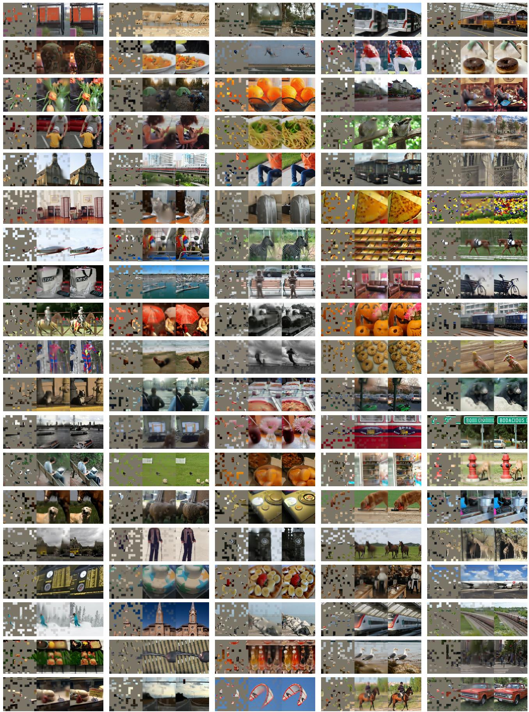  
图11. 使用ImageNet训练的MAE模型在COCO验证图像上的未筛选随机样本。每组三元组展示：掩码图像（左）、MAE重建结果（中）和真实图像（右）。掩码比例为75%。